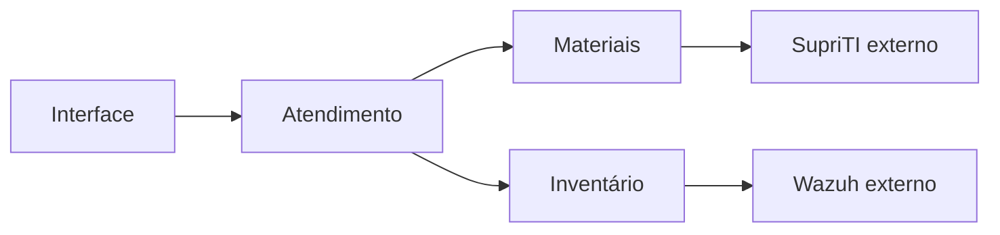

# Sistema de Chamados da Prefeitura

- **Autor:** Luis Felipe Vieira
- **Situação:** rascunho — problema, visão geral, objetivos e limites aprovados; plano técnico em construção.
- **Data:** 2026-11-10
- **Base:** [concepts_brief.md](./concepts_brief.md), aprovado como base do planejamento e atualizado com as decisões posteriores à revisão Goldfish.
- **Etapa atual:** plano técnico em construção, com decisões parciais aprovadas. O plano de implementação ainda não foi redigido.

## Ponto de retomada — 2026-11-12

**Atualização de retomada — 2026-11-25:** o autor confirmou que o trabalho continua apenas na documentação e pediu prosseguir com `egm-draft`. O escopo funcional de “Chamados por técnico” está aprovado e registrado ao final deste documento. O autor escolheu consulta periódica para atualizar o quadro. O ciclo de consulta foi aprovado. O intervalo escolhido é de 10 segundos após cada consulta. O autor escolheu suspender consultas em abas ocultas e atualizar ao retornar. O prazo máximo de cada consulta é de 20 segundos. As esperas após falhas consecutivas são de 10, 20, 40 e 60 segundos, mantendo 60 nas seguintes. Os critérios de aceite da atualização foram aprovados. O autor escolheu permitir mostrar ou ocultar colunas de técnicos ativos sem cartões. O padrão inicial escolhido é mostrar essas colunas. A preferência será salva na conta do técnico pelo serviço Atendimento. Se o salvamento da preferência não for confirmado, manter a escolha na tela com aviso. Se a leitura da preferência falhar, mostrar colunas vazias provisoriamente, com aviso e alternância liberada, sem salvar o padrão automaticamente. A recuperação da leitura será automática, com prazo de 20 segundos e esperas de 10, 20, 40 e 60 segundos, suspensa em aba oculta e encerrada após leitura válida. Em sessões diferentes, prevalece a última gravação aceita pelo servidor. Os critérios de apresentação e preferência foram aprovados. Continuar pelo contrato de gravação, depois pelos participantes desativados e pelo contrato de consulta. As pendências anteriores continuam abertas; esta retomada não aprova nem encerra as demais seções.

Continuar com a skill `egm-draft`, usando este documento e `concepts_brief.md`. O autor pediu salvar e sincronizar o trabalho para continuar em outro computador. Não há autorização de implementação nem aprovação do plano técnico completo. Problema, objetivos, aprovação documental, interface e publicação, banco e implantação, anexos e retenção, backup e limitação por IP possuem aprovações parciais registradas nas respectivas seções.

A discussão atual é o configurador visual de formulários. Decisões mais recentes: perguntas condicionais em linguagem simples orientam a triagem; o técnico define a categoria efetiva; somente dois tipos de formulário, uso externo e uso interno; um formulário interno pode atender vários grupos; a associação define quem pode usá-lo para abrir um chamado, sem restringir por si só a consulta posterior.

**Decisão de classificação inicial — 2026-11-12:** o autor escolheu categoria conforme as respostas. Os caminhos configurados no formulário determinam uma categoria sugerida; o técnico confirma ou altera a categoria efetiva na triagem. Não oferecer categoria fixa por formulário nem seleção entre os dois modos nesta etapa.

**Decisão sobre caminhos sem categoria — 2026-11-12:** o autor escolheu exigir categoria em todos os caminhos antes da publicação. O autor aprovou as regras de classificação em 2026-11-12 e autorizou continuar o detalhamento dos formulários. Essa aprovação é restrita à classificação; o bloco completo e as demais especificações permanecem abertos.

**Decisão sobre campos básicos — 2026-11-12:** o autor escolheu campos protegidos e ajustáveis: ordem, rótulos e textos de ajuda podem mudar, preservando presença, significado e obrigatoriedade definidos. O autor aprovou este trecho e autorizou continuar o detalhamento; o bloco completo permanece em construção.

O bloco de formulários ainda não passou pela aprovação de seção. A consolidação editorial e as especificações técnicas pendentes ainda precisam ser concluídas.

**Retomada das listas de cadastros:** o autor confirmou configuração somente por administradores. No campo de lista baseada em dados do sistema, o administrador escolhe a fonte entre os cadastros disponibilizados pelo sistema, como setores e computadores. As opções dessa fonte serão apresentadas ao usuário do formulário. O autor aprovou o detalhamento da escolha da fonte. O autor escolheu aceitar somente registros ativos em novos envios e exigir nova seleção se a opção for desativada durante o preenchimento, preservando os demais dados. O autor aprovou a regra de registros ativos e autorizou continuar. O autor escolheu permitir que o administrador configure seleção única ou múltipla por campo baseado em cadastro. O setor básico da abertura permanece singular. O autor aprovou a configuração de seleção única ou múltipla e autorizou continuar. O autor escolheu que o administrador defina as informações exibidas nas opções entre campos permitidos por fonte e tipo de formulário. O autor aprovou as regras de apresentação e autorizou continuar. O autor definiu tipos de cadastro criados pelo administrador no painel, disponíveis como fontes de listas, e consulta de ativos por setor. O autor escolheu um único setor de localização por ativo, sem vínculo de setores atendidos. O autor aprovou o vínculo único e autorizou continuar. O autor escolheu setor opcional no cadastro do ativo e acrescentou aviso informativo no chamado quando o setor do equipamento divergir do setor de abertura. O autor aprovou a localização opcional e o aviso informativo, autorizando continuar. O autor definiu comparação somente na abertura, sem reavaliação posterior, e botão “Já verificado” para ocultar o aviso. O autor aprovou a verificação única e a dispensa manual e solicitou sincronizar a documentação com o GitHub. Em 2026-11-13, o autor escolheu permitir que qualquer técnico com acesso ao chamado acione “Já verificado”, sem exigir participação no atendimento ou permissão específica por grupo. O autor aprovou o trecho e autorizou continuar o detalhamento. O autor aprovou mostrar apenas “Localização não informada” quando o ativo não tiver setor cadastrado e autorizou continuar o detalhamento. O autor aprovou verificar individualmente todos os equipamentos selecionados na abertura e autorizou continuar o detalhamento. O autor aprovou identificar ativos pelo tipo de cadastro, sem configurar a finalidade de cada campo, e autorizou continuar o detalhamento. O autor aprovou dispensar todos os avisos de divergência do chamado de uma vez e autorizou continuar o detalhamento. A lista concreta de campos permitidos e os limites de seleção continuam por detalhar.

## Visão geral

### Alteração de escopo aprovada durante o plano técnico

O autor decidiu priorizar a adoção pelos funcionários: permitir abertura por formulário sem login e manter a conversa, o acompanhamento e os pedidos de reabertura no WhatsApp/Chatwoot. A equipe técnica registra e atualiza o atendimento no sistema. Não implementar portal autenticado para o solicitante nem chat próprio nesta etapa.

Essa revisão altera parte da seção inicial anteriormente aprovada. Onde o texto anterior prevê notificações internas ou ações diretas do solicitante no portal, prevalece este novo fluxo pelo canal existente. As notificações dos técnicos e os controles internos continuam no escopo. Prazo e histórico de reabertura permanecem como referência; o registro e a avaliação pelo técnico de pedidos recebidos externamente ainda serão detalhados. Não há decisão de integrar automaticamente Chatwoot ou WhatsApp.

O autor confirmou os campos da abertura simplificada: nome, setor, telefone/WhatsApp, assunto, descrição e patrimônio opcional, além de anexo opcional de imagem, como foto do equipamento ou captura do erro. O contato permite à equipe continuar a conversa no canal existente, sem exigir conta do solicitante. Quantidade, formatos e tamanho máximo das imagens permanecem por definir. A relação dos campos essenciais com o configurador por categoria e as medidas para receber abertura não autenticada ainda precisam ser definidas. O formulário não deve permitir consulta anônima ao histórico nem apresentar dados informados como identidade comprovada. O configurador por categoria permanece previsto, sujeito à definição de uma abertura curta e de dados complementados pela equipe.

O sistema de Chamados organiza o atendimento interno de TI da Prefeitura. O solicitante informa seu problema por um formulário adequado à categoria. A equipe técnica faz a triagem, define a prioridade, assume o atendimento e registra intervenções, solução e materiais utilizados. O administrador configura formulários e permissões por grupos.

O atendimento mantém referências aos equipamentos e ao seu histórico técnico. O SupriTI permanece responsável pelo estoque oficial, pelas reservas e pelas movimentações de materiais. O Wazuh fornece inventários para comparação de hardware. Chamados deve relacionar essas informações sem confundir a conclusão do serviço com a confirmação de uma movimentação externa ou a evidência de uma mudança no equipamento.

O técnico fecha o chamado após conferir o resumo final. O fechamento não depende de confirmação do solicitante nem da disponibilidade do SupriTI. Pendências de integração permanecem visíveis em uma seção independente e continuam sendo acompanhadas por técnicos ativos. O solicitante pode pedir reabertura dentro de sete dias corridos; o pedido depende de aceite técnico e continua válido para avaliação depois do prazo se tiver sido apresentado a tempo.

## O problema

O planejamento busca reunir informações que precisam ser consultadas em conjunto durante uma manutenção: problema relatado, equipamento afetado, intervenções anteriores, responsáveis pelo atendimento e destino dos materiais. Quando o registro do atendimento e o controle de estoque têm ciclos diferentes, fechar o chamado não garante que a reserva, a baixa ou a liberação já tenha sido confirmada. Apresentar esses resultados como um único estado pode ocultar divergências ou provocar repetição de uma movimentação.

A equipe também precisa distinguir chamados novos dos já assumidos, ordenar o trabalho por prioridade e antiguidade e compartilhar atendimentos sem perder autoria. A participação de vários técnicos exige impedir que uma edição desatualizada sobrescreva alterações de materiais ou que alguém confirme um resumo diferente daquele que conferiu.

Formulários fixos não atendem à decisão de configurar dados diferentes por categoria. Ao mesmo tempo, mudar um formulário não pode alterar o significado das respostas de chamados anteriores. A configuração precisa preservar o registro histórico sem exigir rascunhos ou confirmações adicionais do solicitante.

Falhas externas e desativação de técnicos não podem tornar pendências invisíveis. Uma baixa recusada por falta de saldo exige regularização humana, mesmo que o atendimento já tenha terminado. A seção independente de pendências e a substituição do último técnico ativo devem manter esse trabalho identificável e atribuído.

Esses problemas e resultados pretendidos vêm do planejamento funcional. Ainda não foram medidos tempos de atendimento, volume de pico ou custos operacionais, nem foi comprovado que a cópia de SupriTI analisada corresponde à instalação em produção.

## Objetivos

Os critérios abaixo orientam o desenho e sua validação futura; não representam testes já executados.

1. **Permitir abertura adequada à categoria.** O administrador configura visualmente campos, ordem, tipos, obrigatoriedade e condições de exibição. Chamados existentes preservam a versão usada na abertura. Um erro de envio mantém os dados na página atual para correção, sem criar rascunho persistente.
2. **Organizar a fila sem ocultar chamados novos.** Manter a triagem no topo, independente dos filtros pessoais. Ao assumir, retirar o chamado da triagem e aplicar prioridade média caso o técnico não escolha outra. Ordenar os atendimentos por crítica, alta, média e baixa, com os mais antigos primeiro em cada nível. A prioridade é interna à equipe técnica.
3. **Preservar o trabalho compartilhado e sua autoria.** Permitir vários participantes, histórico de intervenções e permissões configuradas por grupos. Manter acompanhamento ativo na desativação do último técnico e notificar o substituto quando escolhido por outro administrador.
4. **Fechar com conferência do conteúdo efetivo.** Exigir nova conferência quando materiais, solução, diagnóstico ou equipamento mudarem durante a revisão. O fechamento é imediato e não depende do aceite do solicitante. Preservar o histórico nas reaberturas e não repetir consumos anteriores.
5. **Oferecer reabertura com decisão rastreável.** Permitir pedidos dentro dos sete dias corridos do fechamento mais recente, sujeitos a aceite ou recusa de qualquer técnico. Reabertura direta equivale a aceite quando há pedido pendente. Preservar decisões anteriores e aplicar a primeira ação válida nas disputas simultâneas. Reabertura técnica posterior a uma recusa é permitida dentro da janela vigente.
6. **Integrar materiais sem duplicar o controle oficial.** Reservar durante o atendimento e consumir somente os materiais atestados no fechamento, respeitando quantidade e condição. Tratar cancelamentos conforme o destino real das peças. A integração não deve duplicar efeitos ao repetir uma operação ou recuperar uma resposta perdida.
7. **Continuar o atendimento durante falhas externas.** Persistir intenções, separar indisponibilidade de recusa de negócio, preservar sucessos parciais e limitar a carga de recuperação. Mostrar pendências em seção independente, inclusive para chamados fechados ou cancelados, sem declará-las concluídas antes da confirmação externa.
8. **Relacionar histórico técnico e alterações de hardware.** Permitir consulta por equipamento e comparação diária com dados do Wazuh, com retenção limitada. Ausência de coleta não comprova ausência de alteração. A escolha da referência para dias sem coleta ainda depende de decisão.
9. **Comunicar pelo próprio sistema.** Usar notificações internas com indicação de leitura e retenção de 30 dias. Remover avisos de ações pendentes quando deixarem de ser aplicáveis, preservando o histórico do chamado.

## Limites e itens fora do escopo atual

- **Estoque paralelo:** Chamados guarda vínculos, intenções e resultados; o saldo oficial continua no SupriTI. O fluxo próprio da integração não substitui o ciclo das solicitações comuns desse sistema.
- **Aceite de conclusão pelo solicitante:** não haverá botão de confirmação, aceite de compliance ou fechamento automático após sete dias. O prazo serve à reabertura, não à confirmação de um serviço já fechado.
- **Rascunhos:** não haverá salvamento manual ou automático para retomada posterior. Preservar dados após um erro na página aberta não implica recuperação após fechar ou recarregar a página.
- **Comunicação externa:** e-mail, SMS, WhatsApp e implementação de um canal alternativo ficam fora desta etapa. Não acrescentar etapas de contestação à recusa de reabertura.
- **Login único:** as autenticações humanas dos sistemas permanecem separadas; integração com AD é futura.
- **Destino de componentes retirados dos equipamentos:** avaliação de reaproveitamento e eventual entrada no SupriTI são realizadas pelo técnico fora do fluxo de estoque de Chamados. Isso não exclui o registro técnico da intervenção nem a devolução de materiais separados do estoque para um atendimento cancelado.
- **Cópia integral do Wazuh:** não replicar todo o histórico bruto de inventários ou logs no novo sistema.
- **Privilégios fixos por nível técnico:** N1, N2 e N3 não substituem a configuração dinâmica de grupos e permissões.

O projeto inclui histórico de ativos e consulta à base de conhecimento, mas fluxos patrimoniais e publicação de artigos ainda não estão detalhados. Este documento não os declara prontos nem os exclui silenciosamente do projeto.

## Questões abertas para as próximas seções

- Definir arquitetura, tecnologias, armazenamento, hospedagem e mecanismos de credencial e fila com decisão explícita do autor.
- Especificar os contratos e a compatibilidade com a instalação real do SupriTI, inclusive recuperação após restauração ou retirada da integração com reservas ativas.
- Completar a matriz de permissões, os estados do atendimento e da integração, o fuso e o instante limite da janela de reabertura.
- Confirmar se o aceite técnico de pedidos de reabertura também se aplica a chamados cancelados por técnicos; as decisões atuais o definem para os fechados por resolução.
- Conciliar campos essenciais do chamado com o configurador por categoria; confirmar tipos de campo e regras de troca de categoria ou edição após abertura.
- Detalhar a seção de pendências, suas informações operacionais e os sinais de falta de progresso, sem depender da retenção das notificações.
- Fechar associação de equipamento e agente Wazuh, referência em dias sem coleta, componentes comparados e retenção mínima.
- Definir limites de anexos, retenção de dados, segurança, backup, implantação, reversão e metas mensuráveis. Não tratar a média mencionada de cinco chamados por dia como pico ou número de operações de integração.

## Plano técnico — em construção

### Organização em serviços separados

O autor escolheu serviços separados para permitir que mais pessoas desenvolvam o projeto de forma cooperativa. Os serviços devem ter responsabilidades e interfaces explícitas para que colaboradores possam trabalhar em partes diferentes sem depender continuamente de alterações internas de outros serviços.

A escolha permite implantações independentes, mas acrescenta comunicação entre serviços, compatibilidade de contratos, autenticação entre aplicações e investigação de falhas distribuídas. Separar serviços por si só não garante autonomia: limites mal definidos podem exigir mudanças coordenadas e dificultar o trabalho da equipe. A divisão precisa preservar as regras de consistência e recuperação já aprovadas.

O autor definiu um único repositório para o código dos serviços de Chamados. Cada serviço deve manter limites explícitos dentro desse repositório, permitindo colaboração e revisão conjunta de mudanças nos contratos. Compartilhar o repositório não implica compartilhar banco de dados, executar todos os serviços no mesmo processo ou exigir implantação conjunta.

As fronteiras dos serviços, seus responsáveis e a propriedade dos dados ainda não foram decididas. Não presumir um serviço para cada entidade ou tela, nem um banco compartilhado ou separado sem decisão do autor. O SupriTI continua sendo um sistema externo responsável pelo estoque oficial; a escolha não autoriza duplicar esse estoque em um novo serviço nem mover seu código para este repositório.

### Divisão inicial de responsabilidades

O autor escolheu três serviços para permitir frentes de desenvolvimento cooperativo e facilitar o isolamento de problemas em materiais e inventário:

| Serviço | Responsabilidade inicial | Limite |
| --- | --- | --- |
| Atendimento | Chamados, formulários por categoria e fluxo de atendimento, incluindo fechamento e reabertura. | Não controla o saldo oficial do SupriTI nem realiza comparação de inventários Wazuh. |
| Materiais | Integração com SupriTI: consulta, reservas, ajustes, liberações, consumos, devoluções e acompanhamento de resultados. | SupriTI mantém a propriedade do estoque oficial. A distribuição da persistência de intenções entre Atendimento e Materiais ainda precisa ser decidida. |
| Inventário | Equipamentos e integração com Wazuh para comparação de hardware e registro de alterações. | Não interpreta uma alteração detectada como autorização ou consumo de material; relacionamentos com intervenções exigem evidência. |

A interface ficará no mesmo repositório. O autor definiu que contas, login, grupos, permissões, sessões, notificações internas dos técnicos e base de conhecimento ficam dentro de Atendimento, sem criar serviços separados para essas funções.

### Base de conhecimento em Atendimento

Atendimento mantém os artigos da base de conhecimento e seus vínculos com as soluções dos chamados. Não criar um quarto serviço para esse recurso. A localização não define automaticamente autoria, revisão, publicação, visibilidade, versionamento ou criação de artigos a partir de soluções: essas regras continuam pendentes de detalhamento, respeitando as permissões por grupos e a proteção de informações dos chamados.

### Notificações centralizadas em Atendimento

Atendimento mantém as notificações internas dos técnicos e reúne no mesmo painel os avisos pertinentes dos três serviços. Materiais e Inventário encaminham os avisos pela API de Atendimento, sem consultar ou alterar diretamente suas tabelas de notificações. Aplicar as regras já aprovadas de destinatários, leitura, retenção de 30 dias e remoção de avisos que deixaram de ser aplicáveis. Não restabelecer notificações do solicitante retiradas pela simplificação do escopo.

A notificação não é a fonte oficial do resultado de uma operação nem substitui a seção independente de pendências. Uma falha no encaminhamento do aviso não deve apagar o resultado registrado no serviço responsável. Contrato, identificação para evitar avisos duplicados e recuperação de falhas de entrega ainda precisam ser definidos.

A separação facilita localizar e conter falhas, mas não garante isolamento sozinha. Falhas de Materiais não devem bloquear o fechamento técnico, conforme regra já aprovada. O desenho precisa definir como registrar a intenção com segurança quando esse serviço estiver indisponível, além de tempos de espera e recuperação sem duplicidade.

O autor confirmou que a indisponibilidade de Inventário não deve impedir a continuidade do atendimento nem o fechamento do chamado usando o vínculo de equipamento já registrado. Preservar esse vínculo e informar que a consulta ao histórico do equipamento e ao Wazuh está temporariamente indisponível; não apresentar ausência de resposta como ausência de histórico ou de alterações.

Durante essa falha, permitir também a abertura de chamado sem selecionar equipamento. O vínculo poderá ser realizado depois que Inventário voltar; não criar equipamento ou associação fictícia para contornar a indisponibilidade. A regra de contingência deve permitir enviar o formulário mesmo se ele normalmente exigir o seletor de equipamento.

Se o atendimento terminar antes da recuperação de Inventário, o técnico pode fechar o chamado ainda sem vínculo, registrando a indisponibilidade como justificativa e mantendo a associação pendente para regularização posterior. O fechamento técnico não elimina essa pendência. Registrar a associação posterior com autoria e data, preservando a justificativa e o histórico do fechamento, sem exigir reabertura apenas para completar o vínculo. Esta decisão não escolhe um mecanismo de cópia ou armazenamento dos dados do equipamento.

O autor confirmou que essa associação deve ser acompanhada na mesma seção independente de pendências já definida, identificada como “Vínculo de equipamento pendente”. Manter o aviso enquanto a associação não for regularizada, inclusive com o chamado fechado. Distinguir esse tipo das pendências de estoque; concluir o vínculo não resolve eventuais operações de materiais ainda pendentes no mesmo chamado. A recuperação de Inventário, por si só, não comprova a associação.

O autor escolheu banco compartilhado entre Atendimento, Materiais e Inventário. A propriedade das tabelas, as permissões de acesso entre serviços, os contratos e os mecanismos de comunicação continuam pendentes de decisão. O plano técnico completo ainda depende das decisões seguintes e de aprovação própria.

### Registro de materiais durante indisponibilidade

O autor confirmou que, se o serviço de Materiais estiver indisponível e o catálogo não puder ser consultado, o técnico pode registrar no chamado os materiais utilizados para sincronização posterior. A falha não impede esse registro nem o fechamento técnico. Preservar os dados informados e apresentar a pendência, sem declarar reserva ou consumo confirmado no SupriTI.

O autor confirmou que o registro provisório deve conter nome ou descrição do material, quantidade e condição (novo ou recondicionado). Após a recuperação do serviço, o técnico deve selecionar o produto correto no catálogo antes da execução da baixa. O retorno do serviço, por si só, não autoriza consumir um material ainda sem identificação oficial. Não fazer correspondência automática por nome nem criar produto oficial a partir do registro provisório. Preservar os dados informados e registrar a associação posterior com autoria e data, mantendo as validações de saldo, condição e proteção contra duplicidade já acordadas.

O autor confirmou que os materiais provisórios ainda sem produto oficial associado devem aparecer na seção independente de pendências, com o aviso “Identificação de material pendente”, inclusive se o chamado já estiver fechado. Remover esse aviso somente após a identificação; a associação do produto não equivale à confirmação da baixa, cujas pendências e resultados continuam sendo acompanhados separadamente.

O autor escolheu fila persistente para o encaminhamento e processamento posterior dessas operações, distinguindo pendência de identificação de operação pronta para baixa. Enquanto houver apenas descrição, quantidade e condição, preservar o registro aguardando ação humana, sem executar tentativas de consumo nem procurar adivinhar o produto pelo nome. A fila não substitui a identificação pelo técnico.

Depois de o técnico selecionar o produto oficial, a operação pode ser preparada para processamento automático, respeitando a intenção vigente do chamado e as validações de saldo, condição, autorização e proteção contra duplicidade. Identificar um material de chamado ainda em atendimento não antecipa o consumo: a baixa continua condicionada à revisão e ao fechamento, ou ao tratamento de cancelamento já aprovado. A seleção do produto não é confirmação de movimentação externa.

A tecnologia da fila, a propriedade do registro provisório e o mecanismo para persistir os dados e publicar a operação sem perda ainda precisam ser escolhidos. Respeitar a escrita exclusiva por serviço. A escolha não define que todos os processos do sistema serão assíncronos nem exige tentativas repetidas enquanto a identificação estiver pendente.

### Fila persistente no PostgreSQL

O autor escolheu usar somente PostgreSQL para persistência das filas, sem RabbitMQ ou outro intermediário de mensagens nesta etapa. As tarefas serão registros duráveis processados por executores dos serviços; não tratar a simples gravação de uma tabela como implementação completa de entrega e recuperação.

Cada serviço deve acessar apenas suas próprias tabelas, inclusive as de tarefas e de encaminhamento. Não usar uma tabela compartilhada que permita a um serviço consultar ou alterar a fila interna de outro. A comunicação entre serviços continua passando pelas interfaces responsáveis. O mecanismo de encaminhamento, confirmação de recebimento e recuperação diante de falha entre gravação e envio ainda precisa ser definido.

O desenho deve especificar reserva concorrente de tarefas, recuperação após interrupção do executor, intervalos e limites de tentativas, tratamento de recusas de negócio e resultados desconhecidos, identificação estável das operações e acompanhamento operacional. Uma tarefa sem produto identificado continua aguardando ação humana, sem tentativas de baixa. Biblioteca ou implementação da fila, transações e estratégia de processamento ainda não foram escolhidas.

#### Encaminhamento de Atendimento para Materiais

Na mesma transação do PostgreSQL que confirma o fechamento e registra a intenção de consumo, Atendimento grava uma tarefa de envio em sua própria fila para cada operação pronta. Se a transação falhar, o fechamento e as tarefas dessa tentativa são revertidos juntos. Uma intenção cujo produto ainda precisa ser identificado fica registrada como pendência humana e só gera tarefa quando estiver apta a processamento.

Após a confirmação da transação, um executor de Atendimento envia a tarefa pela API de Materiais. Uma nova tentativa de envio usa o mesmo identificador da operação. Materiais deve reconhecer um identificador já recebido, devolver a confirmação correspondente e evitar a criação de trabalho duplicado. A confirmação de recebimento encerra o envio e indica que Materiais registrou a operação de forma durável. O resultado da movimentação no SupriTI é acompanhado separadamente.

#### Ordem das operações por item

Atendimento encaminha as operações de cada item em sequência. Ao fechar um chamado, registra a intenção de consumo na mesma transação do fechamento. A tarefa de consumo fica bloqueada enquanto a reserva anterior do mesmo item tiver um resultado desconhecido. O fechamento técnico permanece registrado, e a seção de pendências mostra o item que aguarda conciliação. Outros itens podem seguir suas próprias sequências.

Atendimento só invalida localmente uma reserva superada quando pode garantir que nenhum executor iniciou seu envio. A invalidação e a autorização de envio precisam ser mutuamente exclusivas no PostgreSQL. Se o envio já puder ter ocorrido, preservar o identificador da reserva e obter seu desfecho por meio de Materiais. A confirmação de recebimento pela API permite acompanhar a reserva, mas o consumo só é encaminhado depois que seu desfecho estiver registrado. Esse resultado informa se o consumo deve usar uma reserva confirmada ou seguir o fluxo previsto para um item sem reserva.

Se uma resposta se perder e Materiais ainda não puder confirmar o resultado da reserva no SupriTI, manter o consumo pendente. Essa espera evita executar o consumo com uma premissa incorreta sobre a reserva, mas pode atrasar a movimentação mesmo após o fechamento. O contrato para consultar resultados e os intervalos de recuperação continuam em aberto.

#### Posse de tarefas com prazo

Cada executor assume uma tarefa elegível em uma transação curta no PostgreSQL. A transação registra o identificador exclusivo da tentativa, o prazo de posse e o início da tentativa antes de liberar o executor para chamar a API. Uma tarefa só é elegível quando sua vez na sequência do item chegar e quando estiver disponível para execução ou retomada. A chamada externa ocorre depois de confirmar a transação.

O executor pode renovar a posse enquanto a tentativa atual estiver vigente. Se o prazo vencer, outro executor pode assumir a tarefa com um novo identificador de tentativa. Renovação e registro do resultado exigem que o identificador corresponda à posse atual e que o prazo ainda esteja vigente. Uma resposta tardia de uma tentativa vencida fica sujeita à recuperação pelo executor atual.

O identificador da operação permanece igual nas retomadas. Uma chamada iniciada antes do vencimento pode chegar à API durante uma nova tentativa. A API receptora deve reconhecer o identificador da operação e preservar um único registro de recebimento. Se a chamada tiver resultado desconhecido no SupriTI, aplicar as regras de conciliação antes de liberar a operação seguinte do item.

#### Prazos iniciais de posse e recuperação

A posse dura inicialmente 120 segundos. Enquanto a tarefa estiver em execução, o executor tenta renovar a posse a cada 30 segundos. Uma renovação aceita estende a posse por 120 segundos a partir da renovação.

Após a primeira falha transitória, aguardar 30 segundos antes da nova tentativa. A cada falha transitória consecutiva, dobrar o intervalo até o teto de 15 minutos. Distribuir no tempo as tentativas de itens diferentes para reduzir picos quando várias tarefas falharem juntas. Esses valores são iniciais e devem ser avaliados com medições na VM e nas integrações.

Uma recusa de negócio fica visível para regularização. Quando o resultado de uma movimentação no SupriTI for desconhecido, a próxima ação é consultar o desfecho antes de repetir a movimentação.

#### Tempos limite das chamadas da fila de materiais

| Chamada | Prazo para conectar | Prazo total |
| --- | --- | --- |
| Atendimento → Materiais | 3 segundos | 10 segundos |
| Materiais → SupriTI | 5 segundos | 20 segundos |

O prazo total inclui o tempo de conexão. Materiais confirma o registro durável da operação na sua fila dentro da chamada de Atendimento. A chamada ao SupriTI ocorre separadamente, durante o processamento dessa operação. Se o prazo vencer depois de uma movimentação poder ter chegado ao SupriTI, registrar resultado desconhecido e consultar o desfecho antes de qualquer reenvio. Os prazos são valores iniciais a validar com medições.

#### Suspensão após falhas transitórias repetidas

Após dez falhas transitórias consecutivas da mesma tarefa, suspender as tentativas automáticas e manter a pendência visível para revisão, com a última falha registrada. Contar apenas chamadas da tarefa que falharam. Os intervalos entre tentativas e a pausa da dependência ficam fora da contagem. A recuperação da dependência pode liberar outras tarefas. Para retomar a tarefa suspensa, a equipe revisa a pendência e autoriza uma nova tentativa com o mesmo identificador da operação. Se o resultado de uma movimentação anterior ainda for desconhecido, retomar pela consulta do desfecho.

A suspensão pode manter o item pendente mesmo depois de a dependência voltar. As operações posteriores do mesmo item continuam sujeitas à ordem definida acima.

#### Pausa e retomada por dependência

Contar falhas transitórias consecutivas por dependência. Após três falhas, pausar novos envios para a dependência afetada por três minutos. Tarefas novas e tarefas reagendadas aguardam a retomada. Tarefas de outras dependências seguem seu processamento. Recusas de negócio ficam fora da contagem de falhas transitórias.

Depois da pausa, liberar uma chamada por vez a partir de tarefas elegíveis para testar a API no fluxo real. Se a tarefa tiver uma movimentação de resultado desconhecido, consultar o desfecho antes de repetir o envio. Após três respostas que confirmem a recuperação, permitir até duas chamadas simultâneas. Manter esse limite por três minutos sem nova falha transitória antes de voltar ao limite normal. Qualquer falha transitória durante a retomada reinicia a pausa de três minutos.

Em operação normal, permitir até quatro chamadas simultâneas por dependência, somadas entre os executores responsáveis. Cada item continua seguindo sua própria sequência. Todos os executores responsáveis pela mesma dependência precisam respeitar a pausa e os limites de chamadas simultâneas de cada fase. Os valores são iniciais e devem ser avaliados na VM e nas integrações.

A decisão evita operar um intermediário de mensagens separado, mas concentra também a persistência das tarefas no banco compartilhado. Não oferece disponibilidade independente do PostgreSQL nem proteção contra perda do armazenamento da VM sem recuperação apropriada.

### Acesso ao formulário pela internet

O autor confirmou que o formulário de abertura sem login deve ser acessível também fora da rede da Prefeitura, inclusive por celular conectado à internet. Essa decisão permite enviar solicitações externamente, mas não autoriza consulta anônima a chamados, anexos recebidos, contatos, cadastros de equipamentos ou histórico.

A exposição externa do formulário não define exposição pública dos três serviços, do PostgreSQL ou de suas filas. O autor também confirmou acesso ao painel dos técnicos pela internet, com login obrigatório e aplicação das permissões do usuário autenticado. Separar as funções públicas de abertura das consultas e ações restritas da equipe. O mecanismo de autenticação e sessão ainda precisa ser escolhido; acesso externo não autoriza consulta anônima ao painel.

Domínio, publicação HTTPS, entrada de rede, proteção contra envios abusivos e limites de upload ainda precisam ser definidos. Nenhuma configuração de servidor ou rede foi realizada nesta etapa de desenho.

### Contas da equipe técnica

O autor confirmou que as contas dos técnicos serão criadas pelo administrador, com login e senha próprios do sistema. Não prever autocadastro público de técnicos. A integração com AD permanece para uma etapa futura. O formulário público de abertura não exige nem cria uma conta técnica.

Manter as permissões dinâmicas por grupos e os controles de desativação e substituição já aprovados. A criação da conta não concede acesso irrestrito por si só. O administrador fornece uma senha temporária, que deve ser trocada obrigatoriamente no primeiro acesso antes da utilização das funções do painel. Se um técnico esquecer a senha, o administrador a redefine com outra senha temporária e o sistema exige nova troca no próximo acesso. Essa recuperação não depende de envio automático por e-mail ou de autocadastro. Autenticação adicional, duração e revogação de sessões e localização dessas funções entre os três serviços ainda precisam ser definidos.

### Comunicação por APIs

O autor confirmou a preferência por APIs para comunicação entre Atendimento, Materiais e Inventário. Consultas e solicitações de alteração passam pela API do serviço responsável, sem acesso direto às suas tabelas. A fila persistente no PostgreSQL continua sendo interna a cada serviço; o encaminhamento de trabalho entre serviços ocorre pelas APIs, com confirmação e recuperação ainda a especificar.

O autor definiu HTTP com mensagens JSON para as APIs entre os três serviços. Essa escolha não estabelece, por si só, um estilo REST completo nem torna todas as operações síncronas do ponto de vista do usuário. Preservar as contingências e o processamento posterior já aprovados. Autenticação entre serviços, proteção do transporte, versionamento, contratos, tempos de espera e tratamento de erros ainda precisam ser definidos. A escolha não presume que os contratos externos do SupriTI e do Wazuh já atendam ao padrão definido para os serviços internos.

### Banco compartilhado

Os três serviços de Chamados utilizarão um banco compartilhado. A escolha não inclui o banco do SupriTI, que permanece externo e responsável pelo estoque oficial, nem autoriza acesso direto ao banco do Wazuh.

O autor definiu PostgreSQL como banco compartilhado, alinhado à experiência da equipe. Essa escolha mantém a escrita exclusiva e as consultas entre serviços pelas interfaces responsáveis. Versão do PostgreSQL, organização das tabelas e schemas, credenciais por serviço, migrações, limites de conexão e configuração de persistência e recuperação ainda precisam ser definidos. O PostgreSQL será hospedado na mesma VM Debian dos serviços, dentro do orçamento total de recursos já informado.

O banco compartilhado facilita consultas e coordenação dos dados, mas constitui uma dependência comum: sua indisponibilidade pode afetar os três serviços. Alterações incompatíveis nas estruturas compartilhadas também podem exigir atualização coordenada. O objetivo aprovado de isolar falhas entre serviços continua válido para falhas específicas de cada serviço; não representa independência frente a falhas do banco.

O autor definiu escrita exclusiva por serviço: Atendimento, Materiais e Inventário alteram apenas as tabelas sob sua responsabilidade. Uma alteração em dados pertencentes a outro serviço deve passar pela interface desse serviço, preservando suas validações e regras. O autor também definiu que consultas a dados de outro serviço passam pela interface responsável, sem leitura direta de suas tabelas. O compartilhamento do banco não autoriza contornar essas fronteiras com consultas ou alterações diretas. A propriedade concreta das tabelas, as credenciais e a coordenação de migrações ainda precisam ser definidas.

Consequentemente, compartilhar o banco não torna os dados de Inventário acessíveis a Atendimento quando o serviço Inventário estiver indisponível. As contingências já aprovadas permanecem: preservar o vínculo registrado no chamado, permitir abertura e fechamento sem novo vínculo durante a falha e acompanhar a associação pendente para regularização.

O autor definiu que Atendimento deve guardar somente o identificador do equipamento vinculado, sem copiar patrimônio, descrição ou outro resumo do cadastro. Consultar os detalhes pela interface de Inventário. Durante sua indisponibilidade, preservar o identificador e informar que os detalhes não puderam ser consultados; não apagar o vínculo nem criar uma associação pendente apenas porque os detalhes de um vínculo existente estão inacessíveis. A pendência de vínculo aplica-se aos chamados que ainda precisam da associação. O formato do identificador ainda precisa ser definido.

Equipamentos que deixarem de ser usados devem ser desativados, preservando o cadastro e seu identificador para consulta pelos chamados antigos, sem exclusão que rompa esses vínculos. A desativação não apaga o histórico técnico nem implica uma movimentação de estoque ou um fluxo patrimonial de baixa já especificado. Equipamentos desativados não podem ser selecionados em novos chamados; a seleção volta a ser permitida se forem reativados. Preservar os vínculos antigos durante a desativação e a reativação, sem criar outro cadastro apenas para permitir o retorno ao uso.

O autor definiu que qualquer técnico pode desativar e reativar equipamentos, sem exigir uma concessão específica adicional para essas ações. Registrar a ação, a autoria e a data no histórico. Essa autorização não concede acesso direto às tabelas de Inventário nem altera as regras de consulta e preservação dos vínculos.

As setas representam relações funcionais, sem definir protocolo, sincronismo ou um ponto único obrigatório de acesso à interface.

### Linguagem dos serviços

O autor escolheu Rust para os três serviços de backend: Atendimento, Materiais e Inventário. As motivações são economizar recursos da VM e aprender a linguagem durante o projeto. A equipe de três pessoas possui experiência principalmente em JavaScript, Python e Java; o planejamento deve considerar o aprendizado e a revisão de código em Rust. A escolha não comprova economia de memória ou desempenho na carga real, que ainda precisam ser medidos.

Framework web, bibliotecas de acesso ao banco, cliente de fila e linguagem ou framework da interface ainda não foram escolhidos. Esta decisão não altera as responsabilidades dos serviços, o banco compartilhado, os limites de acesso aos dados ou os requisitos de recuperação.

### Ambiente de implantação

O autor definiu hospedagem em servidor próprio da Prefeitura, em uma VM Debian, com um container para cada serviço: Atendimento, Materiais e Inventário. Manter os serviços como processos separados, com configuração e execução próprias. A ferramenta de execução dos containers, a publicação da interface, a implantação do banco compartilhado e da fila persistente ainda precisam ser definidas.

Os containers permitem separar a execução dos serviços, mas todos dependem da mesma VM: falhas da VM, do armazenamento ou esgotamento de recursos podem afetar o conjunto. A configuração precisará prever limites de recursos, persistência, recuperação e monitoramento. Não presumir alta disponibilidade nem redundância de servidor a partir desta escolha.

O autor informou a capacidade inicial da VM: **4 GB de RAM, 4 vCPUs e 100 GB de armazenamento** e confirmou que o banco compartilhado e a fila persistente também serão hospedados nessa mesma VM. Tratar esses recursos como orçamento total, incluindo Debian, serviços, banco e fila, não como capacidade disponível para cada componente. A suficiência para a carga real ainda precisa ser validada. O volume de anexos, a retenção de logs e os requisitos de backup influenciam esse dimensionamento; não reservar silenciosamente o mesmo disco como única cópia de recuperação. A persistência da fila não garante disponibilidade durante falha da VM nem recuperação após perda do seu armazenamento. Metas de recuperação e distribuição dos recursos permanecem abertas.

### Validação e duração de sessões baseada no SupriTI

O autor pediu reproduzir o comportamento de sessão do SupriTI. A leitura estática de `apps/api/src/auth/auth.service.ts`, `session.guard.ts` e `auth.controller.ts` na cópia de SupriTI encontrou os padrões de 30 minutos de inatividade e limite absoluto de 8 horas desde o login, configuráveis por ambiente. Adotar esses padrões em Chamados; a configuração efetiva de produção do SupriTI não foi consultada.

A sessão é mantida no servidor, com hash do token persistido, e o navegador recebe o token em cookie HttpOnly, SameSite=Lax e Secure em produção. A cada requisição protegida, verificar existência, revogação, expiração por inatividade, limite absoluto e conta ativa. Requisições autenticadas renovam a janela de inatividade, sem ultrapassar o limite absoluto; no código examinado, a atualização persistida ocorre quando a última atividade registrada tem mais de um minuto. Atividade significa requisição autenticada observada pelo servidor, não movimento de mouse ou digitação. O cookie durar até o limite absoluto não impede a expiração anterior por inatividade.

Preservar a decisão de revogação imediata ao redefinir senha ou desativar conta. Atendimento é responsável por contas, grupos, permissões, login e sessões. Materiais e Inventário recorrem à API de Atendimento para validar acessos técnicos, sem ler suas tabelas nem compartilhar sessões com SupriTI. O contrato de validação e as credenciais entre serviços ainda precisam ser definidos. Esta inspeção não valida o comportamento em produção nem implementa autenticação.

### Revogação de sessões

O autor confirmou que redefinir a senha ou desativar uma conta deve encerrar imediatamente todas as sessões abertas do técnico. Requisições posteriores com essas sessões devem ser recusadas, inclusive se a página continuar aberta. A sessão antiga não volta a valer após a troca da senha temporária ou eventual reativação da conta; exigir novo login. Atendimento mantém a validação de identidade e sessão oferecida aos demais serviços por API. Não aceitar permissões declaradas pelo cliente como comprovação de autorização.

Revogar sessões não apaga autoria ou histórico nem cancela automaticamente operações de materiais já autorizadas. Preservar as regras de continuidade e de suspensão administrativa de operações específicas anteriormente aprovadas. A desativação também mantém a exigência de substituição do último participante ativo nos chamados vinculados.

## Framework HTTP: Axum

O autor escolheu Axum como framework HTTP dos serviços Atendimento, Materiais e Inventário. Usar o mesmo framework nos três serviços para manter uma base comum de desenvolvimento. Preservar os contratos HTTP/JSON e as responsabilidades já definidas; o acesso ao PostgreSQL foi definido posteriormente com SQLx e SQL direto. O mecanismo da fila, as sessões e a tecnologia da interface ainda precisam ser detalhados.

O desenho seguirá os mecanismos de rotas, extratores e integração com Tokio/Tower do Axum. Versões, bibliotecas complementares e padrões de erros e middleware ainda serão definidos. Não há medição que comprove um consumo específico de recursos da aplicação a partir dessa escolha.

## Acesso ao PostgreSQL: SQLx com SQL direto

O autor escolheu SQLx com consultas SQL escritas diretamente, sem ORM, para Atendimento, Materiais e Inventário. Preservar a propriedade das tabelas por serviço e o acesso aos dados de outros serviços somente pelas APIs responsáveis. SQL direto não autoriza consultas cruzando essas fronteiras.

A decisão permite explicitar consultas e atualizações condicionais, transações e operações concorrentes da fila PostgreSQL. Não representa garantia de desempenho ou consumo de memória. Usar parâmetros para os valores das consultas; versões, pools, migrações, estratégia de verificação das consultas e mecanismos de concorrência, tentativas e recuperação da fila ainda precisam ser definidos.

## Escopo futuro para discussão: alerta de inatividade

Registrar em Inventário a proposta de monitorar equipamentos sem atividade, usando a última atualização ou atividade disponível nos registros do Wazuh. Ao ultrapassar um prazo configurável pelo administrador, gerar alerta de possível sumiço do equipamento; 35 dias é a referência inicial proposta, ainda sujeita à discussão. A funcionalidade complementa a comparação de hardware e fica reservada para discussão futura, sem implementação nesta etapa.

Ainda definir a fonte e o significado de atividade no Wazuh, periodicidade, equipamentos elegíveis, tratamento de equipamentos desativados, registros ausentes e indisponibilidade da coleta, além de destinatários e ciclo dos alertas. Ausência de atualização não comprova desaparecimento. Este registro não pressupõe que a integração atual já ofereça o dado necessário nem exige replicar logs brutos.

## Aprovação opcional de uma ação no chamado — escopo funcional aprovado

O autor aprovou esta seção em 2026-11-12 e autorizou a continuidade do plano técnico. A aprovação abrange as regras funcionais registradas abaixo; não representa aprovação do plano técnico completo nem autorização de implementação.

Decisão do autor em 2026-11-12: incluir no escopo uma etapa opcional em que o técnico registra uma ação proposta, as informações disponíveis, os prós, os contras e os riscos conhecidos, e solicita análise de outro técnico designado. A pessoa designada aprova ou reprova, com registro da solicitação e da decisão no histórico. O uso por superiores não estabelece automaticamente novas permissões por cargo.

Bloquear apenas a ação submetida enquanto aguarda decisão ou após reprovação. Permitir outros trabalhos no chamado. A aprovação autoriza a continuidade da ação avaliada, sem executá-la automaticamente nem determinar diretamente o fechamento. A etapa é opcional no fluxo geral; solicitar a aprovação torna o impedimento aplicável à ação correspondente.

O registro deve permitir identificar quem solicitou, quem decidiu e qual conteúdo foi avaliado. Datas, preservação do conteúdo e tratamento de alterações posteriores ainda precisam ser detalhados. A finalidade é documentar riscos comunicados e autorização recebida; não prometer isenção administrativa. Aceite autenticado, geração de documento e eventual assinatura digital são mecanismos ainda não escolhidos.

O autor escolheu representar a ação como uma etapa escrita e documental, sem vínculo obrigatório com uma operação funcional do sistema. Exemplos: implantação de um sistema em um setor ou de um servidor Samba. O técnico apresenta a implementação e os riscos conhecidos; a pessoa designada registra se autoriza sua execução com conhecimento dos riscos descritos. A etapa permanece documentalmente impedida enquanto aguarda decisão ou após reprovação; o restante do chamado pode continuar. Não derivar dessa escolha bloqueios automáticos de estoque, cadastros ou execução externa.

O autor escolheu aprovação ou reprovação pela conta autenticada da pessoa designada, registrando identidade, decisão, data e hora vinculadas ao conteúdo avaliado. Aplicar a validação de sessão e conta ativa já definida, sem nova confirmação de senha e sem certificado digital. Apresentar o registro como aceite autenticado no sistema, sem declarar assinatura com certificado digital. Essa escolha resolve o mecanismo de aceite anteriormente aberto nesta seção.

O autor escolheu preservar cada versão da proposta. Alterações geram nova versão e exigem nova aprovação, sem transferir a autorização anterior ao texto alterado. Preservar conteúdo, autoria, datas e decisões das versões anteriores; cada decisão referencia a versão efetivamente avaliada. A versão alterada mantém a ação documentalmente impedida até nova aprovação.

O autor definiu exigir análise da versão atual: se houver alteração durante a leitura, recusar a tentativa de aprovação ou reprovação da versão substituída, apresentar o texto atual e exigir nova conferência. Validar a versão no servidor no processamento da decisão, impedindo que uma alteração concorrente seja ignorada. A tentativa desatualizada não registra aprovação nem reprovação de nenhuma versão; decisões anteriores já válidas permanecem preservadas.

O autor definiu comentário opcional nas decisões e acrescentou aprovação com ressalva e reprovação com sugestão. Oferecer quatro resultados: aprovação, aprovação com ressalva, reprovação e reprovação com sugestão. Registrar o resultado e o comentário, quando informado, na versão avaliada. A sugestão não modifica automaticamente o texto nem libera a ação reprovada. Incorporar a sugestão à proposta gera nova versão sujeita a nova aprovação. Ainda definir o efeito da aprovação com ressalva sobre a autorização e como representar ressalva ou sugestão sem texto; não exigir comentário por inferência.

O autor definiu que aprovação com ressalva autoriza a continuidade da ação na versão avaliada. A ressalva é uma observação documental, sem exigir comprovação de condições nem novo aceite. Alterações posteriores da proposta continuam exigindo nova aprovação. Manter comentário opcional; ainda definir a apresentação de uma ressalva ou sugestão sem texto. Esta decisão resolve o efeito da aprovação com ressalva anteriormente aberto nesta seção.

O autor esclareceu que aprovação e reprovação simples têm comentário opcional, enquanto aprovação com ressalva e reprovação com sugestão exigem comentário descrevendo o que deve mudar. Essa definição substitui a generalização anterior de comentário opcional em todas as decisões. Não aceitar resultados com ressalva ou sugestão sem texto preenchido; validar a obrigatoriedade no servidor. Preservar a liberação de continuidade pela aprovação com ressalva, sem novo aceite nem etapa adicional de comprovação das mudanças.

O autor definiu que qualquer outro técnico ativo pode ser designado como avaliador, sem permissão específica adicional de aprovação e sem exigência de cargo superior. Impedir autodesignação do solicitante. Somente a pessoa designada pode decidir essa solicitação, com sessão válida e conta ativa; os demais técnicos não podem substituí-la informalmente. Não exigir participação prévia no chamado para ser escolhido como avaliador.

O autor definiu que qualquer técnico com acesso ao chamado pode criar uma solicitação de aprovação, sem participação obrigatória no atendimento. Verificar o acesso já autorizado ao chamado e registrar a autoria da solicitação independentemente da lista de participantes. Criar essa solicitação não concede acesso a outros chamados.

O autor definiu que o técnico que criou a solicitação de aprovação ou um administrador pode trocar o avaliador antes da decisão. Não confundir esse solicitante com a pessoa que abriu o chamado público. Exigir que o substituto seja outro técnico ativo, sem autodesignação do autor. Registrar autoria, data e hora da troca e os avaliadores anterior e novo; o anterior perde a possibilidade de decidir após a substituição. Preservar versões e decisões históricas. Esta troca não permite substituir uma decisão já registrada.

O autor definiu que o autor da solicitação de aprovação ou um administrador pode cancelá-la enquanto estiver pendente. Manter a solicitação e suas versões no histórico, com autoria, data e hora do cancelamento, e impedir decisões posteriores. Cancelar não equivale a aprovar nem documenta autorização para executar a ação proposta. Ainda definir o efeito sobre a continuidade documental da etapa.

O autor definiu que o cancelamento da solicitação pendente retira a exigência de aprovação e permite a continuidade documental da etapa. Registrar quem retirou a exigência, a data e a hora, preservando proposta, versões e histórico. Exibir exigência retirada, sem aprovação do avaliador; não marcar a proposta como aprovada. O autor da solicitação ou um administrador pode efetuar essa retirada somente enquanto ela estiver pendente. Esta decisão resolve o efeito do cancelamento anteriormente aberto.

O autor definiu que não se pode fechar o chamado com solicitação de aprovação pendente. Resolver cada pendência por uma das quatro decisões ou pela retirada de exigência por pessoa autorizada. Verificar essa condição no processamento do fechamento, incluindo solicitações criadas durante a revisão final. Reprovação resolve a solicitação e não impede, por si só, fechar o chamado; continua sem autorizar a ação reprovada. Essa condição de fechamento detalha a relação anteriormente aberta entre o fluxo documental e a conclusão do atendimento.

Cancelar o chamado cancela automaticamente suas solicitações de aprovação ainda pendentes. Preservar propostas, versões e decisões anteriores, registrar o cancelamento automático com autoria e data do cancelamento do chamado e impedir decisões posteriores. Não confundir esse resultado com retirada individual de exigência para continuar: o cancelamento do chamado não autoriza a ação proposta. Não desfazer nem declarar desfeitas implementações externas apenas por esse registro. Preservar as regras já aprovadas para materiais e pendências de integração no cancelamento; o encerramento do fluxo documental não substitui liberação, consumo, devolução ou confirmação de efeitos externos.

O autor definiu avisar o avaliador por notificação interna quando a análise for solicitada e avisar o autor da solicitação quando houver decisão, em qualquer dos quatro resultados. Reutilizar as regras vigentes de destinatários, leitura, retenção e remoção de avisos de ações que deixarem de ser aplicáveis. Não tratar entrega ou leitura da notificação como leitura ou aprovação da proposta. Preservar o histórico independentemente das notificações e não acrescentar canais externos. Ainda detalhar avisos de troca de avaliador, nova versão e cancelamento.

O autor confirmou atualizar a pendência e notificar o avaliador responsável quando houver troca de avaliador ou nova versão da proposta. Remover avisos anteriores que perderam validade, preservando o histórico. Na troca, atribuir a análise ao novo avaliador; na nova versão, direcionar a análise ao texto atual. Avisos antigos não permitem decidir sem validar versão e designação atuais. Cancelamentos removem os avisos de ação pendente que deixaram de ser aplicáveis conforme regra geral existente; eventual aviso informativo específico de cancelamento permanece por definir.

O autor definiu que qualquer técnico com acesso ao chamado pode editar a proposta e criar nova versão. Exibir quem alterou e a data e hora da alteração, preservando o texto e a autoria de cada versão e suas decisões. Manter a autoria original da solicitação e as permissões já definidas para cancelar ou trocar o avaliador; a edição não transfere essas permissões. A nova versão exige nova aprovação e atualiza a pendência e o aviso ao avaliador. Ainda decidir como tratar a edição pelo próprio avaliador, sem presumir que ele possa aprovar o próprio texto.

O autor confirmou a exceção à edição geral: o avaliador designado não edita diretamente a proposta que está avaliando. Ele indica mudanças por aprovação com ressalva, com comentário obrigatório, autorizando a continuidade sem substituir o texto avaliado. Caso não autorize, pode usar reprovação com sugestão. Os demais técnicos com acesso continuam podendo gerar novas versões identificadas e sujeitas a nova aprovação. Validar no servidor a restrição ao avaliador atual; sua condição de administrador, se houver, não cria exceção implícita. Esta definição resolve a edição pelo próprio avaliador anteriormente aberta.

O autor escolheu apresentar solicitações e decisões somente no histórico do chamado, como uma linha do tempo, sem criar seção própria de aprovações. Identificar o momento da solicitação e da decisão, os envolvidos e a versão avaliada. Novas versões, trocas de avaliador, retirada de exigência e cancelamento decorrente do chamado também geram eventos com autoria, data e hora. Disponibilizar o texto de cada versão e o comentário da decisão no evento correspondente. Mostrar a situação atual junto à solicitação, distinguindo pendência, os quatro resultados, retirada de exigência e cancelamento pelo chamado, sem reescrever os fatos anteriores. Preservar as notificações internas já aprovadas.

O autor escolheu priorizar a decisão: impedir alterações da proposta enquanto o avaliador estiver analisando, exigindo liberação para editar. Preservar a edição pelos demais técnicos fora desse período e a validação da versão atual ao decidir. A entrega da notificação não inicia automaticamente a análise. Ainda definir como o avaliador inicia e libera o bloqueio e como recuperá-lo em caso de abandono, perda de sessão ou indisponibilidade. Não inferir dessa prioridade uma ordem para decisão concorrente com cancelamento ou troca de avaliador.

O autor definiu iniciar a análise e bloquear a edição quando o avaliador designado abrir a solicitação pendente, sem botão separado de início. Validar sessão e designação atual; abrir somente o chamado, receber notificação ou consultar como outro técnico não inicia o bloqueio. Registrar o início na linha do tempo com identidade, data e hora. Abrir a solicitação não constitui aprovação ou concordância com os riscos. Restringir o bloqueio à edição da proposta, permitindo os demais trabalhos no chamado.

O autor definiu liberar a edição ao sair da visualização da solicitação sem decidir. Encerrar o período de análise e registrá-lo na linha do tempo, mantendo a solicitação pendente e a exigência de aprovação: sair não equivale a cancelar ou aprovar. Uma abertura posterior pelo avaliador inicia nova análise da versão atual. Prever recuperação por prazo em caso de saída não comunicada pelo navegador ou perda de conexão; eventos de saída da página não bastam como único mecanismo. O prazo ainda depende de escolha do autor. Registrar uma decisão encerra o bloqueio de análise e aplica seu resultado, respeitando o versionamento.

O autor escolheu 1 minuto sem comunicação com a visualização do avaliador para expirar o bloqueio de análise após perda de conexão ou saída não comunicada. Não limitar a duração total da leitura a esse minuto nem alterar os prazos de autenticação. A expiração libera edição e mantém a solicitação pendente. Uma visualização com bloqueio expirado deve retomar a análise e conferir a versão atual antes de decidir. Ainda detalhar a renovação e as visualizações simultâneas.

O autor permitiu ambas as visualizações quando o avaliador abrir a mesma solicitação em múltiplas abas ou dispositivos. Manter o bloqueio enquanto alguma visualização estiver ativa e se comunicando; a saída ou expiração de uma não libera a edição se outra continuar ativa. Aplicar o prazo de 1 minuto sem comunicação a cada visualização. Liberar a edição quando nenhuma permanecer ativa. Aceitar somente a primeira decisão válida para a versão pendente e apresentar seu resultado nas demais visualizações, sem decisões duplicadas. Validar sessão, designação, versão e estado pendente no servidor. O mecanismo de renovação ainda será detalhado.

O autor confirmou permitir ao autor da solicitação ou administrador cancelar ou trocar o avaliador durante a análise, desde que a solicitação permaneça pendente. Encerrar as análises ativas e registrar a intervenção no histórico. O cancelamento retira a exigência; a troca mantém a pendência, notifica o novo avaliador e exige que ele abra a solicitação para iniciar nova análise. Invalidar as visualizações anteriores tanto para decidir quanto para renovar o bloqueio; uma designação posterior da mesma pessoa não revalida a visualização antiga. Não permitir que essas intervenções alterem uma decisão já registrada. Ainda definir a ordem entre ações simultâneas.

O autor definiu prevalecer a primeira ação válida registrada quando decisão e cancelamento ou troca de avaliador disputarem a mesma solicitação. Validar e registrar a transição de forma indivisível no serviço responsável, sem usar horário de clique do navegador. A operação seguinte confere o estado atual: uma decisão válida impede cancelar ou trocar; um cancelamento impede decidir; uma troca invalida a tentativa do avaliador anterior. Recusar a ação incompatível e apresentar o estado atualizado. Preservar o bloqueio de edição durante análise e a verificação de ausência de aprovações pendentes no processamento do fechamento.

O autor confirmou enviar notificação interna ao avaliador quando a solicitação for cancelada, removendo o aviso de análise pendente e preservando o evento na linha do tempo. Distinguir retirada individual de exigência de cancelamento automático pelo cancelamento do chamado, sem sugerir autorização de continuidade neste último. Aplicar as regras gerais de destinatários e retenção já aprovadas.

O autor escolheu renovar o bloqueio por interação na visualização do avaliador: clicar, digitar ou rolar. A página aberta, por si só, não renova o prazo. Expirar a participação da visualização após 1 minuto sem interação comunicada e aceita pelo servidor, inclusive se o avaliador estiver lendo sem interagir. Em múltiplas visualizações, manter o bloqueio enquanto alguma estiver ativa segundo essa regra. Não alterar os prazos próprios de autenticação nem restaurar sessões inválidas. Após expiração, exigir retomada da análise e conferência da versão atual antes de decidir. Sinais atrasados não revalidam análises invalidadas por troca, cancelamento ou decisão. Esta decisão resolve a renovação funcional e especifica o sentido de comunicação mencionado nos parágrafos anteriores; os detalhes técnicos serão definidos no plano de implementação.

As decisões funcionais desta seção foram aprovadas pelo autor. A consolidação técnica deve preservar essas regras. Uma ação realizada fora do sistema não pode ser impedida apenas por esse registro.

## Interface no navegador consumindo APIs

O autor aprovou em 2026-11-12 as definições de interface e publicação registradas nesta seção e nas subseções seguintes: React com TypeScript, arquivos servidos pelo proxy do projeto, encaminhamento das APIs por caminho, HTTPS no Traefik existente em outra VM, HTTP entre as VMs na VLAN de servidores e entrada do proxy restrita por firewall à VM do Traefik. A aprovação não resolve as escolhas técnicas explicitamente pendentes nem autoriza implementação.

O autor escolheu executar a interface no navegador, consumindo APIs para consultar dados e solicitar alterações. Manter seu código no mesmo repositório dos três serviços, conforme decisão anterior. Essa escolha não define framework, ferramenta de construção, publicação dos arquivos da interface ou roteamento das requisições entre serviços.

O navegador apresenta o formulário público, o painel técnico, o configurador de formulários e a linha do tempo, incluindo o fluxo documental de aprovação. Autenticação, permissões, validação de dados, controle de versões e transições concorrentes são aplicados pelos serviços responsáveis; esconder ou desabilitar um botão não substitui essa validação. Preservar as sessões em cookie protegido já definidas e não expor credenciais de integração ao navegador.

Prever estados de carregamento, indisponibilidade, falha de envio e dados desatualizados. Preservar a tentativa atual de preenchimento nos erros conforme as regras existentes, sem criar rascunho persistente. Uma resposta perdida não comprova falha da operação: contratos e recuperação deverão permitir conferir o resultado sem repetir efeitos. O framework e a linguagem da interface permanecem por escolher.

### Linguagem da interface: TypeScript

O autor escolheu TypeScript para a interface executada no navegador. Esta decisão resolve a linguagem anteriormente aberta, sem escolher framework ou ferramenta de construção. Usar tipos para representar dados e contratos consumidos pela interface; a tipagem não valida respostas HTTP em tempo de execução nem substitui validações do servidor. O alinhamento dos tipos aos contratos Rust, a validação das respostas e o tratamento de incompatibilidades ainda serão detalhados.

### Biblioteca da interface: React

O autor escolheu React para a interface em TypeScript porque já possui experiência com essa biblioteca. Manter a abordagem de execução no navegador consumindo APIs. Esta decisão resolve a escolha anteriormente aberta para a interface, sem definir ferramenta de construção, roteamento, biblioteca de componentes, formulários ou gerenciamento de dados remotos. A experiência informada reduz a necessidade de aprender outra biblioteca de interface enquanto a equipe aprende Rust no backend, mas não comprova prazo ou desempenho.

### Entrada das APIs por proxy

O autor escolheu um proxy que encaminha as requisições do navegador por caminho no mesmo endereço da interface: `/api/atendimento`, `/api/materiais` e `/api/inventario`, direcionados aos respectivos serviços. O navegador não precisa acessar portas ou endereços internos desses serviços. Essa entrada compartilhada não altera a propriedade dos dados nem permite consultas diretas às tabelas alheias.

O proxy encaminha o tráfego; os serviços continuam responsáveis por autenticação, autorização e validação das operações. Materiais e Inventário validam acessos técnicos pela API de Atendimento conforme decisão anterior. Preservar o cookie protegido de sessão; detalhar seu escopo, encaminhamento e proteção das operações autenticadas. Não tratar a passagem pelo proxy como autorização.

O proxy é uma dependência comum de acesso: sua falha pode impedir o uso da interface e das APIs pelo navegador mesmo com serviços internos funcionando. Ainda definir software do proxy, publicação dos arquivos React, HTTPS, configuração de caminhos, limites de requisição, tempos de espera e exposição de rede. Não presumir que as APIs internas e endpoints administrativos devam ficar publicamente acessíveis.

### Publicação da interface no próprio proxy

O autor escolheu servir os arquivos estáticos resultantes da construção da interface React no próprio proxy que encaminha as APIs. Não criar um container separado para servir a interface. Essa decisão não desloca regras de negócio para o proxy nem exige execução de um servidor Node.js em produção apenas para entregar esses arquivos.

Detalhar a publicação dos arquivos, o tratamento das rotas de navegação, a atualização de referências a recursos e a recuperação de uma versão anterior. Rotas de API devem continuar encaminhadas ao serviço responsável, sem receber a página React como resposta de erro. O software do proxy, sua forma de execução e a ferramenta de construção da interface permanecem abertos.

### HTTPS na infraestrutura existente: Traefik

O autor informou que a Prefeitura já utiliza Traefik e escolheu encerrar o HTTPS nessa infraestrutura existente. O Traefik recebe as conexões públicas e encaminha o tráfego ao proxy do projeto, que serve os arquivos React e distribui os caminhos das APIs aos serviços. Preservar os dois papéis definidos; não presumir que a escolha elimina o proxy do projeto ou exige um novo Traefik na VM.

Ainda confirmar domínio, localização e configuração efetiva do Traefik, responsabilidade pelos certificados, restrições de rede e proteção do trecho entre Traefik e proxy do projeto. O HTTPS externo não define se esse trecho interno será HTTP ou HTTPS. Configurar o reconhecimento do protocolo externo e aceitar cabeçalhos de encaminhamento apenas de proxies confiáveis, preservando cookies Secure e as validações de origem das operações autenticadas. Não aceitar cabeçalhos fornecidos livremente por clientes como comprovação de conexão segura ou identidade.

Essa decisão usa a infraestrutura informada pelo autor; sua configuração não foi inspecionada. Acessos internos não devem permitir contornar os controles definidos para a entrada pública. O software e a execução do proxy do projeto permanecem abertos.

### Transporte interno seguindo o SupriTI

Após verificar os arquivos locais `compose.traefik.yaml` e `compose.yaml` de SupriTI, o autor escolheu HTTPS externo encerrado no Traefik e HTTP na rede interna restrita até o proxy do projeto. Esta decisão substitui sua preferência inicial por HTTPS também nesse trecho. A inspeção foi estática e não comprovou a configuração de produção. Não exigir um segundo certificado para esse trecho HTTP.

O trecho interno não oferece criptografia nem autenticação TLS do destino. Quem conseguir observar ou manipular esse tráfego poderá acessar ou alterar dados e credenciais encaminhadas, incluindo tokens de sessão. Restringir o acesso de rede ao proxy, impedir exposição direta que contorne a entrada prevista e confiar em cabeçalhos de encaminhamento apenas dos proxies autorizados. Detalhar o isolamento considerando a localização real do Traefik e da VM; compartilhar uma rede Docker com aplicações alheias não prova isolamento suficiente. Esta escolha não define automaticamente o transporte de todas as integrações externas ou entre serviços.

### Localização do Traefik: outra VM

O autor informou que o Traefik existente está em outra VM. Portanto, o HTTP entre Traefik e proxy do projeto atravessa a rede entre VMs, não apenas uma rede local de containers. A escolha por HTTP interno permanece registrada, mas o isolamento desse caminho ainda não foi confirmado. Identificar rede ou VLAN, equipamentos intermediários, acesso de outras máquinas e regras de entrada da VM do projeto antes de concluir a configuração de publicação. Restringir a origem ao Traefik reduz a exposição direta, mas não criptografa o tráfego nem impede observação ou manipulação por quem controlar seu caminho. Não presumir que uma rede privada ofereça confidencialidade.

### Rede entre as VMs: VLAN exclusiva de servidores

O autor informou que as VMs do Traefik e do projeto se comunicam por uma VLAN exclusiva de servidores. Essa segmentação reduz a exposição aos computadores de usuários; não acrescenta criptografia ao HTTP e não comprova isolamento entre todos os servidores da VLAN. Permanecem os riscos de observação ou manipulação por um servidor comprometido com acesso ao caminho, pela infraestrutura de rede ou pelo ambiente de virtualização.

Manter a escolha por HTTPS externo e HTTP entre as VMs. Antes de finalizar a implantação, confirmar as regras que restringem a porta do proxy do projeto à origem do Traefik e impedem exposição direta das APIs e do banco a outras redes. A existência da VLAN não comprova que essas regras já estejam aplicadas. Não tratar o endereço de origem como substituto da autenticação dos serviços.

### Restrição de entrada ao proxy do projeto

O autor aprovou restringir por firewall a porta do proxy do projeto, permitindo conexões somente da VM do Traefik. Negar outras origens nessa porta, inclusive os demais servidores da VLAN. A regra é um requisito de implantação; não foi aplicada ou verificada nesta análise. Identificar o endereço de origem efetivamente observado e conferir o efeito das publicações de portas dos containers antes de considerar a restrição implementada.

Essa regra não define restrições de outras portas, como administração da VM, nem substitui autenticação ou criptografia. Preservar o encaminhamento pelo Traefik e a confiança apenas em proxies autorizados.

## Organização do PostgreSQL: um schema por serviço

O autor aprovou em 2026-11-12 as definições de banco e implantação desta seção e suas subseções: um schema e credenciais próprias por serviço, migrações na inicialização, atualização manual sem pipeline, construção das imagens na própria VM e execução com Docker Compose. A aprovação preserva as pendências técnicas explicitamente registradas e não autoriza implementação.

O autor escolheu um schema para cada serviço no banco PostgreSQL compartilhado: `atendimento`, `materiais` e `inventario`. Utilizar credenciais próprias e permissões restritas ao schema de responsabilidade de cada serviço, preservando a proibição de leitura e escrita diretas em tabelas alheias. Consultas e alterações entre serviços continuam passando pelas APIs responsáveis; compartilhar o banco ou conhecer o nome de uma tabela não concede acesso.

Detalhar permissões de conexão, uso e criação nos schemas, acesso a tabelas e sequências e permissões aplicadas a objetos futuros. As credenciais usadas em execução não devem receber acesso amplo por conveniência de instalação. O isolamento por schema não oferece disponibilidade independente: os serviços continuam dependentes da mesma instância e dos recursos da VM.

A separação entre credenciais de execução e de migração, a organização dos arquivos de migração e a coordenação de sua aplicação ainda precisam ser definidas. Esta escolha resolve a organização dos dados anteriormente aberta, sem definir tabelas ou contratos novos.

### Migrações na inicialização de cada serviço

O autor substituiu a etapa separada de migração por execução automática na inicialização de cada serviço, para simplificar a operação. Antes de atender requisições, o serviço aplica suas migrações pendentes somente em seu próprio schema. A inicialização precisa acessar uma credencial com permissão de alterar essas estruturas; o modelo de credenciais será detalhado sem presumir acesso a schemas alheios.

Se uma migração falhar, interromper a inicialização e informar o erro, sem atender com estrutura incompatível nem presumir reversão automática das alterações já aplicadas. Impedir execução simultânea do mesmo conjunto de migrações. Preservar compatibilidade com versões ainda em uso; voltar a imagem da aplicação não desfaz o banco.

Permanecem por definir a ferramenta e os arquivos de migração, o mecanismo de coordenação, as credenciais e a recuperação. Esta decisão não exige implantação simultânea dos três serviços.

### Atualização manual dos containers

O autor retirou o pipeline automatizado do desenho. Atualizar os containers manualmente, com as migrações executadas na inicialização dos serviços. Não exigir plataforma de automação, executor ou configuração de pipeline para implantar o projeto. Preservar a possibilidade de atualizar cada serviço separadamente.

Detalhar um procedimento curto para obter a versão, construir ou receber as imagens, atualizar os containers e verificar a inicialização. A forma de entrega das imagens e a ferramenta de execução dos containers permanecem abertas. Verificar falhas de migração e recuperação, sem presumir reversão automática do banco.

### Construção das imagens na própria VM

O autor escolheu obter o código e construir as imagens dos containers na própria VM Debian, durante a atualização manual. Essa decisão resolve a forma de obtenção das imagens anteriormente aberta; não exigir registro externo de imagens ou pipeline automatizado para esse fluxo. Preservar migrações na inicialização e atualização por serviço.

A construção compartilha os 4 GB de RAM, 4 vCPUs e 100 GB de armazenamento com os serviços, PostgreSQL e sistema operacional. Compilação Rust e construção da interface precisam ser verificadas nesse orçamento; não há medição que comprove sua suficiência. Detalhar limites de paralelismo, espaço de construção e cache, identificação da versão e procedimento em caso de falha, sem remover a versão em uso antes de uma construção bem-sucedida. A ferramenta de execução e construção dos containers permanece por escolher.

### Execução dos containers com Docker Compose

O autor escolheu Docker Compose para construir e executar os containers na VM Debian, seguindo o modelo operacional do SupriTI. Manter atualização manual a partir do código na própria VM e migrações na inicialização de cada serviço, sem pipeline automatizado. Preservar um container para cada backend e a entrega dos arquivos React pelo proxy do projeto.

Os arquivos Compose deverão descrever serviços, redes, volumes persistentes e configurações de execução. Não expor PostgreSQL ou portas dos backends por inferência da escolha da ferramenta. O acesso ao proxy continua restrito à VM do Traefik conforme regra de firewall aprovada. Detalhar limites de recursos e construção, verificações de saúde, reinício, armazenamento de anexos, segredos e identificação das versões no plano de implementação. Docker Compose não garante alta disponibilidade ou recuperação após perda do armazenamento.

## Armazenamento de anexos na VM

O autor aprovou em 2026-11-12 as definições de anexos e retenção desta seção e suas subseções: volume persistente local; limites separados de abertura e envios técnicos; formatos e visualização escolhidos; ausência de limite acumulado por chamado; retenção padrão de 90 dias com limpeza diária; preservação indeterminada controlada por técnicos com acesso; configuração do prazo restrita a administradores e aplicada a todos os encerrados; reinício da contagem após reabertura e novo encerramento. Permanecem abertas as especificações técnicas explicitamente indicadas. Esta aprovação autoriza continuar o desenho, sem implementação.

O autor escolheu armazenar os anexos em volume persistente na própria VM, integrado à implantação com Docker Compose. O volume deve sobreviver à substituição dos containers. O acesso aos arquivos continua sujeito às permissões do sistema; não publicar o volume como diretório estático público por inferência dessa escolha.

O autor informou que poderá ampliar o armazenamento da VM futuramente. Manter 100 GB como capacidade inicial total até haver ampliação confirmada, compartilhada por sistema operacional, PostgreSQL, anexos, logs, imagens e cache de construção. Não tratar a possibilidade de expansão como espaço já disponível ou substituto de limites de upload e acompanhamento do uso do disco.

Volume persistente não é backup e não protege contra perda da VM ou de seu armazenamento. Ainda definir destino externo de backup, consistência entre arquivos e registros do banco, recuperação, retenção e limites de anexos. A ampliação futura deverá preservar os arquivos existentes e ser verificada no ambiente de implantação.

### Limites de imagens na abertura pública

O autor escolheu limites separados para a abertura pública e para anexos posteriores. Na abertura pública, permitir até 3 imagens, com tamanho máximo de 5 MB por imagem, totalizando no máximo 15 MB de arquivos nessa abertura. O anexo continua opcional. Esses valores não são um limite total do chamado e não incluem texto, histórico ou arquivos posteriores.

Validar quantidade e tamanho no servidor, além das orientações na interface. O limite da requisição no proxy precisa comportar os arquivos permitidos e os demais campos e metadados do envio; não igualar automaticamente o limite HTTP ao total de arquivos. Formatos aceitos, validação do conteúdo, tratamento de imagens e controles de envios abusivos permanecem por definir. Os limites para envios posteriores e eventual limite acumulado de anexos por chamado ainda não foram escolhidos.

### Tipos de anexos posteriores e vídeo na abertura

O autor definiu inicialmente imagens, PDF, CSV e arquivos Excel como tipos permitidos para anexos posteriores dos técnicos. Ainda especificar os formatos concretos de imagem e Excel, a validação do conteúdo e os limites de quantidade, tamanho e armazenamento acumulado; não presumir aceitação de arquivos com macros apenas pela referência a Excel.

O autor ampliou a abertura pública para permitir vídeo opcional além das imagens. Preservar o limite de até 3 imagens de 5 MB cada; o total de 15 MB anteriormente registrado refere-se apenas às imagens e deixa de representar o total de arquivos da abertura quando houver vídeo. Quantidade, tamanho, duração, formatos de vídeo e possibilidade de combinação com imagens ainda precisam ser definidos. Compatibilizar os limites de requisição e armazenamento após essas decisões. Não presumir conversão automática, reprodução embutida ou permissão de vídeo nos anexos posteriores a partir dessa ampliação.

### Limite de vídeo na abertura pública

O autor escolheu até 1 vídeo de 30 MB na abertura pública, além das até 3 imagens de 5 MB cada. Todos os anexos continuam opcionais. A abertura pode conter simultaneamente esses arquivos, com no máximo 45 MB de conteúdo de anexos; esse total não representa limite acumulado do chamado. Esta decisão resolve a quantidade, o tamanho e a combinação de vídeo com imagens anteriormente abertos.

Validar quantidade e tamanho no servidor e compatibilizar o limite HTTP de entrada tanto no Traefik quanto no proxy do projeto com os arquivos, campos e metadados do envio. Formatos de vídeo, eventual limite de duração e tratamento do conteúdo continuam por definir. Não presumir compressão ou conversão automática.

### Limites dos anexos posteriores dos técnicos

O autor definiu até 5 arquivos de 10 MB cada por envio posterior dos técnicos, totalizando até 50 MB de arquivos por envio. Aplicar aos tipos já escolhidos: imagens, PDF, CSV e Excel. Esse limite é separado da abertura pública e não representa limite acumulado de anexos por chamado. Não incluir vídeos posteriores por inferência.

Validar quantidade e tamanho no servidor e dimensionar a requisição HTTP para comportar arquivos e metadados nos componentes de entrada. Permanecem por definir os formatos concretos aceitos, o tratamento de conteúdo e eventual limite acumulado por chamado.

### Sem limite acumulado de anexos por chamado

O autor escolheu não estabelecer limite acumulado de anexos por chamado. Manter os limites por envio: na abertura pública, até 3 imagens de 5 MB cada e 1 vídeo de 30 MB; nos envios posteriores dos técnicos, até 5 arquivos de 10 MB cada dos tipos autorizados. Esta decisão resolve a pendência sobre limite acumulado, sem alterar os tipos permitidos.

A ausência de limite por chamado não representa armazenamento ilimitado. Acompanhar o uso total do disco da VM, compartilhado com banco, logs, imagens e construções, e definir o comportamento quando não houver espaço para concluir um envio. Não registrar um anexo como disponível antes de sua persistência confirmada nem apagar anexos históricos automaticamente para liberar espaço por inferência dessa escolha. Controles de abuso da abertura pública e retenção permanecem por detalhar.

### Formatos de imagem permitidos

O autor escolheu JPEG, PNG e WebP para imagens, tanto na abertura pública quanto nos anexos posteriores dos técnicos. Preservar os respectivos limites de quantidade e tamanho. Não incluir outros formatos por inferência; detalhar a validação do conteúdo real do arquivo, sem confiar apenas na extensão ou no tipo declarado no envio. Esta escolha não determina conversão ou compressão automática.

### Formatos de Excel permitidos

O autor escolheu XLSX e XLS como formatos de planilha Excel permitidos nos anexos posteriores dos técnicos, incluindo o formato antigo XLS. Manter os limites de até 5 arquivos de 10 MB cada por envio. Não incluir XLSM por inferência. Aceitar XLS não comprova ausência de macros ou conteúdo ativo; a política de tratamento desse conteúdo ainda precisa ser definida. A aplicação não deve executar macros ou fórmulas dos arquivos como consequência do recebimento. Validar o formato real, sem confiar somente na extensão ou no tipo declarado.

### Formatos de vídeo permitidos

O autor escolheu MP4 e MOV para o vídeo opcional da abertura pública, mantendo até 1 arquivo de 30 MB além das imagens permitidas. Não incluir WebM nem vídeo nos envios posteriores dos técnicos por inferência. Validar o conteúdo real do arquivo, sem depender apenas da extensão ou do tipo declarado. MP4 e MOV identificam formatos de contêiner; não garantem reprodução no navegador para qualquer codec. Reprodução embutida, codecs aceitos e eventual conversão continuam por definir.

### Vídeo limitado por tamanho, sem duração máxima

O autor escolheu limitar o vídeo da abertura somente pelo tamanho: até 1 arquivo MP4 ou MOV de 30 MB, sem duração máxima. Essa decisão resolve a pendência de duração, sem ampliar formatos ou quantidade e sem exigir conversão automática. Preservar a validação do conteúdo e os limites dos demais anexos.

### Visualização e download dos anexos

O autor escolheu visualizar imagens e tentar reproduzir vídeos no navegador, mantendo download disponível para esses arquivos. Se o navegador não reproduzir o vídeo, informar a indisponibilidade da reprodução e permitir download; não rejeitar automaticamente um MP4 ou MOV válido somente por incompatibilidade do navegador. Não exigir conversão de codecs por inferência dessa escolha.

PDF, CSV, XLSX e XLS ficam disponíveis para download, sem visualizador embutido. Autorizar tanto visualização quanto download no servidor; não expor endereços públicos permanentes dos arquivos. A abertura pública permite enviar anexos, mas não concede consulta anônima aos anexos ou ao histórico do chamado. Detalhar cabeçalhos de resposta e entrega dos arquivos no plano técnico, preservando validação do conteúdo real e nomes de armazenamento seguros.

### Retenção de anexos e preservação histórica

O autor escolheu excluir anexos após um prazo configurável contado do encerramento do chamado, com opção de permanência por tempo indeterminado para arquivos considerados importantes pelo técnico como evidência histórica. Fechamento ou cancelamento não implica exclusão imediata. A marca de preservação deve permitir distinguir os arquivos mantidos por essa finalidade dos sujeitos à exclusão por prazo.

Preservar no histórico o registro da remoção, sem apresentar o arquivo excluído como disponível. Registrar autoria e data das alterações da marca de preservação. Permanência indeterminada impede a exclusão automática por prazo; não representa garantia contra perda do armazenamento. Ainda definir quem pode marcar e desmarcar, prazo inicial e configuração, efeito de reabertura na contagem, concorrência entre preservação e exclusão e tratamento das cópias de backup. Não presumir remoção imediata de arquivos já existentes nos backups.

### Permissão para preservar anexos

O autor definiu que qualquer técnico com acesso ao chamado pode marcar ou desmarcar a preservação por tempo indeterminado de um anexo. Não exigir participação no chamado ou permissão administrativa adicional. Verificar o acesso no servidor e registrar quem alterou a marca, a data e a hora, preservando o histórico anterior. A marca impede exclusão automática por prazo enquanto estiver ativa. Desmarcar não restaura arquivo já excluído; ainda definir quando excluir um arquivo desmarcado cujo prazo de retenção já venceu.

### Prazo padrão de retenção: 90 dias

O autor definiu 90 dias após o encerramento como prazo padrão para excluir anexos não marcados para preservação por tempo indeterminado. O prazo permanece configurável. Manter o registro dos arquivos removidos no histórico. Ainda definir quem configura o prazo, sua aplicação a chamados já encerrados e a contagem em caso de reabertura.

### Retenção após reabertura

O autor definiu reiniciar a contagem no próximo encerramento se o chamado for reaberto antes da exclusão. Enquanto o chamado estiver aberto, não excluir seus anexos automaticamente por prazo. No novo encerramento, contar novamente o prazo configurado, com padrão de 90 dias, para os anexos existentes não preservados. A reabertura não recupera arquivos já removidos e não altera as marcas de preservação indeterminada.

Verificar o estado atual do chamado e a marca de preservação no processamento da exclusão, para não aplicar uma contagem antiga após reabertura. O controle técnico dessa concorrência será detalhado no plano de implementação.

### Retirada da preservação após vencimento do prazo

O autor definiu que, ao desmarcar a preservação de um arquivo cujo prazo já venceu, ele fica elegível para exclusão na próxima execução da limpeza. Antes de confirmar a desmarcação, avisar explicitamente o técnico sobre esse efeito. Não iniciar novo prazo de retenção a partir da desmarcação.

Aplicar somente quando o chamado estiver encerrado e a contagem vigente estiver vencida. Se estiver aberto, prevalece a suspensão da exclusão por prazo até o próximo encerramento. Registrar a alteração da marca e, quando realizada, a remoção como eventos distintos no histórico. A limpeza deve conferir novamente as condições atuais antes de excluir, inclusive eventual nova marca de preservação ou reabertura.

### Configuração do prazo de retenção por administradores

O autor definiu que somente administradores podem alterar o prazo configurável de retenção de anexos, cujo padrão é 90 dias. Validar essa autorização no servidor. Essa restrição não altera a permissão já aprovada para qualquer técnico com acesso ao chamado marcar ou desmarcar a preservação de arquivos. Ainda definir o efeito de uma mudança do prazo sobre chamados já encerrados.

### Mudança de retenção aplicada a todos os chamados

O autor definiu aplicar o novo prazo de retenção a todos os chamados encerrados, inclusive os encerrados antes da alteração. Recalcular o vencimento a partir da data do último encerramento usando a configuração vigente; não preservar automaticamente o prazo que estava configurado na época do encerramento. Uma redução pode tornar anexos não preservados elegíveis para a próxima limpeza. Aumentar o prazo não recupera arquivos já excluídos.

Manter a exclusão suspensa nos chamados abertos e preservar os arquivos marcados por tempo indeterminado. Antes de salvar uma redução do prazo, informar ao administrador que ela também afeta chamados já encerrados e pode antecipar exclusões. Registrar autoria, data e valores anterior e novo da configuração no histórico administrativo. A limpeza deve utilizar as condições vigentes no processamento da exclusão.

### Limpeza diária dos anexos vencidos

O autor definiu executar a limpeza automática uma vez por dia. Considerar elegíveis somente anexos de chamados encerrados, com prazo vigente vencido e sem preservação indeterminada. Conferir novamente essas condições antes da remoção, respeitando reabertura, alterações de prazo e marcações concorrentes. Não declarar removido um arquivo cuja exclusão não foi confirmada; preservar no histórico o resultado da remoção.

Detalhar no plano técnico horário e fuso da execução, recuperação após indisponibilidade, exclusão coordenada entre arquivos e banco e tratamento de falhas sem duplicar eventos de remoção. A frequência diária não constitui garantia de exclusão no instante exato do vencimento nem implica limpeza das cópias de backup.

## Backup em serviço de armazenamento externo

O autor aprovou em 2026-11-12 as definições de backup desta seção, com precedência das delimitações posteriores: geração local diária às 02h em `America/Sao_Paulo`, cópia semanal aos domingos, retenção de 7 diários e 4 semanais, download somente por administradores e pausa temporária das alterações durante a geração. O sistema não controla o envio manual à nuvem. Permanecem abertas as especificações técnicas indicadas. A aprovação autoriza continuar o plano técnico, sem implementação.

O autor escolheu um serviço de armazenamento externo à VM como destino dos backups. A cópia deve permitir recuperar o PostgreSQL e os anexos de forma consistente, incluindo propostas, versões, decisões e marcas de preservação. Não tratar volumes locais ou cópias mantidas somente no disco da VM como atendimento a essa decisão.

Ainda identificar o serviço e definir acesso, credenciais, proteção do transporte e dos arquivos, periodicidade, retenção, tempo e perda de dados aceitáveis na recuperação e verificação de restauração. A exclusão de anexos na aplicação não implica remoção imediata dos backups; definir essa relação na política de retenção. A escolha não autoriza criar conta, contratar serviço ou transferir dados nesta etapa de desenho.

### Backup manual na conta de nuvem existente

O autor informou que a Prefeitura já possui uma conta de nuvem utilizada para guardar arquivos de backup e definiu que o envio pode ser manual nesta etapa. Usar essa conta como destino externo, sem exigir integração automática ou contratação de novo serviço. Essa definição resolve o modo inicial de envio, não a periodicidade ou retenção.

O procedimento deverá gerar uma cópia recuperável e consistente de banco e anexos e orientar o responsável a enviá-la à conta existente, conferindo a conclusão da transferência. Uma cópia gerada apenas na VM não conta como backup externo concluído. Não presumir sincronização automática nem proteção contra exclusão na conta de nuvem. Ainda definir frequência, responsável operacional, retenção, proteção dos arquivos e verificação de restauração; identificar o serviço ao detalhar suas instruções de envio, sem solicitar credenciais no documento.

### Geração e retenção de backups seguindo o SupriTI

O autor confirmou adotar o comportamento encontrado na leitura estática de `infrastructure/backup/run-backup.sh` e `entrypoint.sh` da cópia de SupriTI: gerar um backup completo automaticamente a cada dia e, aos domingos, copiar o backup concluído daquele dia para a categoria semanal. Manter os últimos 7 backups diários e os últimos 4 semanais, removendo os excedentes de cada categoria. Não juntar os diários nem apagar todos eles na virada da semana. O envio para a conta de nuvem existente permanece manual.

Cada backup completo deverá incluir banco e anexos de forma recuperável; a consistência durante alterações e limpeza de anexos ainda precisa de mecanismo definido. Uma falha na geração não deve contar como backup concluído nem justificar remoção de uma cópia válida para cumprir a contagem. Distinguir conclusão local de confirmação do envio externo. As contagens escolhidas descrevem a retenção local; a política das cópias enviadas à nuvem ainda será definida.

O código examinado do SupriTI verifica o domingo em UTC. Isso não estabelece automaticamente horário ou fuso para este projeto, que ainda precisam ser escolhidos. A inspeção não verificou a configuração de produção nem comprovou restauração. Detalhar também falhas, espaço temporário e verificação das cópias antes de concluir o plano técnico.

### Horário dos backups

O autor definiu gerar o backup diário às 02h no fuso `America/Sao_Paulo`. Usar esse mesmo fuso para identificar o domingo e criar a cópia semanal do backup concluído nesse dia, sem herdar a verificação em UTC encontrada no código examinado do SupriTI. Essa decisão resolve horário e fuso; não estabelece uma opção de alteração pelo painel administrativo.

### Escopo do sistema: gerar backups e disponibilizar download

O autor esclareceu que o sistema deve apenas gerar os backups localmente e disponibilizá-los para download. O envio à nuvem é uma atividade manual externa da equipe: não exigir integração, agenda de envio, confirmação de transferência ou gestão da retenção da nuvem dentro do sistema. A conta existente permanece como destino operacional informado, sem dependência funcional para a geração e o download.

Preservar geração diária às 02h em `America/Sao_Paulo`, cópia semanal de domingo e retenção local de 7 diários e 4 semanais. Exibir a conclusão como backup gerado localmente, sem afirmar que há uma cópia externa. O arquivo baixado deverá permitir recuperar banco e anexos; definir acesso ao download e mecanismo de consistência no plano técnico. Esta delimitação substitui expectativas anteriores de controle do envio externo pelo sistema.

### Download de backups restrito a administradores

O autor definiu que somente administradores podem baixar os backups. Validar sessão, conta ativa e autorização administrativa no servidor a cada solicitação de download. Não servir os arquivos por diretório público ou endereço que permita contornar essa verificação. Essa permissão não se estende aos técnicos apenas por terem acesso a chamados ou anexos. Registrar o download no histórico administrativo, sem expor o conteúdo do backup ou credenciais nos registros.

### Consistência do backup com pausa temporária de alterações

O autor escolheu pausar temporariamente as alterações durante a geração do backup, mantendo consultas disponíveis. A pausa deve abranger os três serviços e tarefas automáticas que escrevem no banco ou nos anexos, incluindo migrações, limpeza, processamento de filas e registros de análise e decisão. Não iniciar a cópia antes de concluir ou interromper de forma segura as gravações já em andamento. Não prometer que requisições de consulta que também atualizam sessão ou histórico sejam inteiramente livres de escrita: detalhar como manter sua segurança durante a pausa.

Informar o período de pausa à interface e impedir gravações no servidor, preservando o preenchimento atual quando aplicável. Após terminar ou falhar o backup, liberar alterações com recuperação segura em caso de reinício. A duração depende do volume de banco e anexos; não foi medida. Não declarar consistência apenas por desabilitar botões ou pausar novos uploads.

A pausa local não interrompe operações já enviadas a SupriTI ou atualizações do Wazuh. Preservar intenções e resultados recuperáveis e conferir efeitos externos ao retomar, sem duplicar movimentações. Detalhar coordenação da pausa, operações em andamento, expiração de análises e retorno dos trabalhadores antes de concluir o plano técnico. Esta decisão resolve a estratégia funcional de consistência, sem aprovar um mecanismo técnico específico.

## Proteção da abertura pública: limite por IP

O autor aprovou em 2026-11-12 as regras vigentes de limitação por IP: sem CAPTCHA, até 10 chamados criados e até 30 tentativas inválidas por IP, em contadores separados e janelas móveis de 10 minutos. As escolhas de CAPTCHA abaixo foram substituídas. A aprovação autoriza continuar o plano técnico, preservando pendências técnicas explicitamente registradas, sem implementação.

**Decisão vigente:** o autor retirou o CAPTCHA do escopo atual e manteve somente o limite por IP. As avaliações e escolhas de CAPTCHA abaixo são registros substituídos, sem obrigação de integração, configuração de chaves ou tratamento de indisponibilidade de provedor nesta etapa. Preservar a validação de origem por proxies confiáveis, o cuidado com IP compartilhado e a proteção dos uploads. Valores e janela do limite ainda precisam ser escolhidos.

O autor escolheu combinar limite de frequência por IP e CAPTCHA na abertura pública sem login. Validar ambos no servidor antes de aceitar a criação do chamado. A verificação de CAPTCHA no navegador não basta. Detalhar também em que momento limitar o recebimento de anexos para que o controle não ocorra somente após consumo de disco e processamento.

Usar o IP do cliente obtido da cadeia de proxies confiáveis já definida, sem aceitar cabeçalhos arbitrários como identidade de origem. Vários funcionários podem compartilhar o mesmo IP público de saída; os limites precisam considerar esse cenário para não impedir a abertura legítima da equipe. Não tratar CAPTCHA ou IP como comprovação da identidade informada no formulário.

Permanecem abertos o mecanismo ou provedor de CAPTCHA, frequência e janela por IP, persistência e recuperação dos contadores, comportamento quando o CAPTCHA estiver indisponível e tratamento acessível dos erros. Não presumir proteção absoluta contra abuso ou exigir conta do solicitante por inferência.

### CAPTCHA por serviço externo — decisão substituída

O autor escolheu serviço externo para o CAPTCHA da abertura pública. A interface obtém o resultado do desafio e o backend o valida com o provedor antes de aceitar a criação, mantendo a credencial secreta fora do navegador. A escolha não define provedor, plano ou autorização para contratação.

Ainda escolher o provedor e detalhar os dados envolvidos na verificação, configuração de domínio, acessibilidade, tempos de espera, prevenção de reutilização e comportamento em indisponibilidade. Essa dependência não elimina o limite por IP nem comprova a identidade informada pelo solicitante.

### Provedores de CAPTCHA avaliados — registro histórico fora do escopo atual

O autor informou não utilizar um provedor atualmente. Opções consultadas em fontes oficiais em 2026-11-12:

| Opção | Mecanismo e condições | Limites e falhas a considerar |
| --- | --- | --- |
| Cloudflare Turnstile | Verificação no navegador com token validado pelo backend. Possui plano gratuito e funciona sem transferir DNS ou tráfego do site para a Cloudflare. | Depende dos serviços e scripts da Cloudflare; bloqueios no navegador ou indisponibilidade podem impedir a validação. Não substitui limites por IP. |
| Google reCAPTCHA | Verificação integrada ao Google Cloud, com faixa gratuita publicada de até 10.000 avaliações mensais e cobrança conforme plano e uso. | Exige acompanhar configuração, cotas e cobrança; indisponibilidade ou bloqueio dos recursos Google afeta a verificação. |
| hCaptcha | Desafios no navegador e validação no backend, com mecanismos de acessibilidade documentados. | A experiência depende dos desafios e das opções do plano; verificar acessibilidade no formulário real e condições comerciais antes de escolher. |

Fontes: [Turnstile: planos](https://developers.cloudflare.com/turnstile/plans/), [integração](https://developers.cloudflare.com/turnstile/get-started/), [reCAPTCHA: cobrança](https://docs.cloud.google.com/recaptcha/docs/billing-information), [hCaptcha: planos](https://www.hcaptcha.com/plans) e [acessibilidade](https://www.hcaptcha.com/accessibility). Os três dependem de serviço externo. Nenhuma opção foi escolhida ou contratada; definir o comportamento em falha após a escolha.

### Cloudflare Turnstile — escolha substituída pela retirada do CAPTCHA

O autor escolheu Cloudflare Turnstile para a proteção da abertura pública, resolvendo a avaliação anterior de provedores. Integrar o desafio na interface React e validar seu token no backend de Atendimento antes de aceitar a criação do chamado. Manter o segredo somente no servidor e preservar a limitação de frequência por IP. Não exigir migração do DNS ou substituição do Traefik por inferência dessa escolha.

Detalhar configuração de domínio, validação do contexto e validade do token, prevenção de reutilização, testes de acessibilidade e falhas de comunicação. A escolha do provedor não define o comportamento da abertura quando a verificação estiver indisponível nem os valores dos limites por IP. Não houve criação de conta ou configuração de chaves nesta etapa.

### Limite de abertura: 10 chamados por IP a cada 10 minutos

O autor escolheu permitir até 10 chamados por IP a cada 10 minutos na abertura pública, sem CAPTCHA nesta etapa. Funcionários que compartilham o mesmo IP de saída compartilham esse limite. Identificar o cliente pela cadeia de proxies confiáveis e verificar o limite no servidor, sem depender da interface.

Quando o limite for atingido, recusar novas aberturas temporariamente, informar a restrição e preservar o preenchimento na página conforme as regras de erro já definidas. Não criar chamado para uma tentativa recusada. O mecanismo de janela e contagem, o tratamento de tentativas inválidas, a coordenação concorrente e a limitação do recebimento de uploads ainda serão detalhados; o limite de chamados criados não substitui proteção contra requisições inválidas repetidas ou uploads abusivos.

### Contagem por janela móvel

O autor escolheu janela móvel para o limite de abertura pública. A cada criação, considerar os chamados criados pelo mesmo IP nos 10 minutos anteriores, permitindo no máximo 10 nesse intervalo. Não zerar a contagem em blocos fixos de relógio. Coordenar verificação e criação para que requisições simultâneas não ultrapassem o limite. Quando houver recusa, informar quando a próxima vaga poderá estar disponível, sem revelar dados de chamados de outras pessoas que compartilham o IP.

Essa decisão resolve o tipo de janela. O controle separado de tentativas inválidas e recebimento de uploads permanece por definir, pois limitar criações concluídas não restringe sozinho requisições que falham antes da criação.

### Erros de validação não consomem a cota de chamados

O autor definiu contar somente chamados efetivamente criados no limite de 10 por IP em janela móvel de 10 minutos. Envios recusados por campos ou arquivos inválidos não consomem essa cota. Preservar o preenchimento da tentativa atual para correção conforme as regras existentes. Não registrar tentativa inválida como chamado nem reservar permanentemente uma vaga sem criação concluída.

Definir controle separado de frequência das tentativas e recebimento de uploads, aplicado antes de receber integralmente os arquivos quando possível. Esse controle poderá recusar temporariamente tentativas abusivas sem alterar a contagem dos chamados criados. Seu valor ainda precisa ser escolhido pelo autor.

### Limite separado de tentativas inválidas

O autor definiu até 30 tentativas inválidas por IP em janela móvel de 10 minutos, em contador separado dos chamados criados. Contar nesse limite envios recusados por validação dos campos ou arquivos. Chamados criados não consomem a cota de inválidos, e tentativas inválidas não consomem a cota de até 10 chamados criados no mesmo intervalo. A escolha não corresponde a limitar todas as tentativas a 30.

Ao atingir o limite de inválidos, restringir temporariamente novos envios do IP até que a janela permita nova tentativa, informando a espera e preservando o preenchimento atual na página. Não classificar indisponibilidade do sistema ou bloqueio pelo próprio limite como novo erro de validação. Detalhar no plano técnico o tratamento de envios interrompidos, controle durante recebimento dos arquivos e coordenação das requisições em andamento. O contador de inválidos, isoladamente, não limita bytes recebidos antes da validação.

## Configurador visual: triagem guiada e públicos do formulário

O autor esclareceu que o configurador visual existente deve atender à triagem guiada, sem criar um configurador separado. O administrador define perguntas em linguagem simples, opções e perguntas seguintes condicionadas às respostas. O solicitante pode indicar a natureza do problema por essas escolhas, sem precisar identificar uma categoria técnica. As respostas podem orientar uma categoria sugerida; o técnico define, confirma ou corrige a categoria efetiva na triagem.

Exemplo fornecido pelo autor: perguntar se o problema envolve internet ou computador; na opção internet, perguntar se afeta somente o computador da pessoa ou o setor inteiro. Essas respostas orientam a classificação, mas não comprovam diagnóstico de equipamento ou rede. Preservar as respostas e a versão do formulário usadas na abertura mesmo após reclassificação pelo técnico.

O autor substituiu a proposta de três destinos por dois tipos no mesmo configurador: **uso externo**, destinado ao solicitante, e **uso interno**, destinado aos grupos da equipe. Não oferecer modo híbrido ou formulário de uso mútuo nesta etapa. Formulários internos e seus dados não são expostos na abertura pública. A separação de tipo não cria dois configuradores independentes.

A associação dos formulários internos aos grupos e a classificação sugerida pelos caminhos foram definidas nas subseções seguintes. A troca de categoria mantém o formulário original, conforme a decisão registrada abaixo. Preservar as respostas e versões dos formulários externos e internos separadamente, os campos básicos já escolhidos para a abertura e as permissões aplicadas no servidor.

### Formulário interno compartilhado entre grupos

O autor definiu que um formulário de uso interno pode atender vários grupos. Associar os grupos autorizados à mesma configuração, sem exigir uma cópia do formulário para cada grupo. Preservar a versão usada em cada preenchimento; alterações na configuração não reescrevem respostas anteriores.

A associação define quem pode usar o formulário interno para abrir um chamado: técnicos integrantes dos grupos associados. Validar essa autorização no servidor durante a abertura. Não interpretar a associação como regra de atribuição do atendimento ou como restrição adicional de consulta às respostas. Após a criação, aplicar as permissões vigentes de acesso ao chamado; o vínculo do formulário não concede acesso a chamados antes inacessíveis. Essa definição resolve o significado da associação aos grupos, anteriormente aberto.

### Classificação inicial conforme as respostas

O autor aprovou estas regras em 2026-11-12 e autorizou continuar o detalhamento dos formulários, sem aprovar o bloco completo nem autorizar implementação.

O autor escolheu em 2026-11-12 que os caminhos de respostas definidos pelo administrador sugiram a categoria inicial. Não adotar categoria fixa por formulário nem um seletor entre os dois modos nesta etapa. O técnico confirma ou altera a categoria efetiva na triagem; a sugestão não comprova diagnóstico. Preservar respostas e versão originais mesmo após reclassificação.

O autor definiu que todo caminho de respostas que permita concluir o formulário deve ter uma categoria sugerida associada antes da publicação. Validar essa cobertura no servidor ao publicar: se algum caminho de conclusão estiver sem categoria, recusar a publicação e indicar o caminho que precisa de ajuste. Essa regra vale para formulários externos e internos e não transforma a sugestão em diagnóstico ou retira do técnico a decisão sobre a categoria efetiva. Não preencher lacunas com categoria padrão implícita. Alterações posteriores devem passar pela mesma validação antes de serem publicadas, preservando a versão e as respostas dos chamados anteriores.
### Troca de categoria sem troca de formulário

O autor aprovou este trecho em 2026-11-12 e autorizou continuar o detalhamento dos formulários. A aprovação não abrange o plano técnico completo nem autoriza implementação.

O autor escolheu manter o formulário original quando o técnico alterar a categoria do chamado. A reclassificação altera a categoria efetiva, preservando o formulário, sua versão e as respostas registradas. Não substituir o formulário nem acrescentar automaticamente campos ou exigir o preenchimento de um formulário da nova categoria.

Se faltarem informações, o técnico conversa diretamente com o solicitante por mensagens fora do sistema, pelo canal de comunicação já utilizado. Depois, pode documentar no chamado as informações que considerar necessárias ao atendimento. Não exigir uma nova resposta do solicitante dentro do sistema nem um formulário complementar para concluir a reclassificação. Essa decisão não cria integração automática ou envio de mensagens pelo sistema.

Preservar o histórico da mudança de categoria e a autoria dos registros técnicos. A forma de registrar essas informações deve seguir os recursos de documentação do atendimento, ainda sujeitos ao detalhamento do fluxo; não criar um novo mecanismo de conversa interna por consequência desta escolha.
### Campos básicos protegidos e ajustáveis na abertura pública

O autor aprovou este trecho em 2026-11-12 e autorizou continuar o detalhamento dos formulários, sem autorizar implementação.

O autor escolheu permitir ao administrador alterar a ordem, os rótulos e os textos de ajuda dos campos básicos pelo mesmo configurador visual. Preservar a presença e o significado de nome, setor, telefone/WhatsApp, assunto, descrição, patrimônio e imagem, assim como a obrigatoriedade definida para cada um; patrimônio e imagem permanecem opcionais. Não permitir remover, ocultar por condição ou transformar esses campos em outro tipo de informação para contornar sua proteção.

Identificar cada campo básico independentemente do rótulo exibido, para que a mudança de apresentação não altere o dado registrado ou as validações aplicadas. Validar as restrições no servidor ao publicar a configuração e ao receber o preenchimento. Mudanças valem para novas versões; preservar a apresentação e as respostas da versão usada em chamados anteriores. A configuração de perguntas adicionais continua no mesmo configurador, sujeita às regras próprias ainda por detalhar.
### Tipos de perguntas adicionais e listas de cadastros

O autor aprovou este trecho em 2026-11-12 e autorizou continuar o detalhamento das listas. O fluxo de escolha da fonte foi esclarecido posteriormente, conforme a subseção seguinte; não houve autorização de implementação.

O autor escolheu disponibilizar na primeira versão texto curto, texto longo, seleção única, seleção múltipla, sim/não, número, data, horário, telefone, e-mail e endereço de site. A imagem opcional já prevista na abertura permanece. Detalhar as validações de cada tipo e sua aplicação no servidor, sem interpretar a escolha como aprovação de limites ainda não discutidos.

O autor acrescentou listas de seleção alimentadas por cadastros do próprio sistema. Exemplo: o administrador cadastra setores e configura um campo para apresentar opções provenientes desse cadastro, evitando repetir manualmente os setores no formulário. A configuração identifica o cadastro usado como fonte; não implica permitir consultas SQL, conexão arbitrária a bancos externos ou acesso direto às tabelas de outro serviço.

O valor selecionado deve manter uma referência ao registro escolhido e preservar o significado da resposta no momento do envio, inclusive se o cadastro for renomeado ou desativado posteriormente. O mecanismo dessa preservação ainda será detalhado. Validar no servidor se a opção pertence à fonte configurada e está disponível para aquele formulário e usuário.

O autor esclareceu o fluxo e confirmou manter a configuração restrita aos administradores, conforme a subseção seguinte. Ainda definir o conjunto inicial de fontes suportadas além dos exemplos, os rótulos e dados apresentados em cada fonte, seleção única ou múltipla e tratamento das opções que deixam de estar disponíveis durante o preenchimento.
### Escolha da fonte de dados pelo administrador

O autor aprovou este trecho em 2026-11-12 e autorizou continuar o detalhamento das listas, sem autorizar implementação.

O autor confirmou que somente administradores configuram os formulários. Ao adicionar ou configurar um campo, o administrador pode escolher o tipo “Lista baseada em dados do sistema” e selecionar uma fonte entre os cadastros disponibilizados pelo sistema, como setores ou computadores. A fonte é um cadastro da aplicação, não um endereço ou uma conexão de banco fornecida pelo administrador.

As opções vêm do cadastro escolhido e ficam disponíveis ao usuário que preenche aquele formulário, inclusive ao solicitante no formulário externo. Não exigir uma lista manual duplicada para representar os registros existentes. Essa configuração não concede consulta às demais informações dos registros nem acesso geral às telas ou APIs dos cadastros. Detalhar quais informações identificam as opções de cada fonte antes de concluir o contrato técnico.

Para o setor informado na abertura, usar a seleção baseada no cadastro de setores e associar o chamado ao registro escolhido. O nome apresentado identifica uma opção existente; texto digitado livremente não cria um setor nem é aceito como referência a um setor inexistente. Validar no servidor a existência e a disponibilidade da opção para o formulário, sem depender apenas da seleção no navegador. Preservar as possibilidades de ajustar ordem, rótulo e texto de ajuda do campo básico, mantendo seu significado e sua proteção.

Ainda definir o tratamento de registros desativados ou alterados durante o preenchimento e a preservação do nome histórico após alterações do cadastro. A escolha de fonte não elimina as permissões aplicáveis aos formulários internos nem autoriza acesso direto às tabelas de outro serviço.
### Listas de cadastros: somente registros ativos em novos envios

O autor aprovou este trecho em 2026-11-12 e autorizou continuar o detalhamento das listas, sem autorizar implementação.

O autor escolheu apresentar e aceitar somente registros ativos nas listas baseadas em cadastros do sistema para novos envios. Registros desativados deixam de ser oferecidos como opções. A desativação não remove nem substitui vínculos em chamados já registrados; preservar seu significado histórico.

Validar no servidor a existência, a disponibilidade e a situação ativa da opção ao receber o envio. Se uma opção tiver sido desativada depois de apresentada ou selecionada, recusar o envio com indicação do campo afetado e pedir outra seleção. Preservar os demais dados preenchidos na página atual, conforme a regra existente de erros de envio, sem criar rascunho persistente nem substituir automaticamente o registro por outro.

Não criar o chamado com a opção desativada nem tratar a validação apenas no navegador como suficiente. O plano técnico deverá detalhar a coordenação entre a validação e o registro do chamado para tratar desativações concorrentes, respeitando as fronteiras dos serviços. Essa escolha não define exclusão física de cadastros nem autoriza remover referências históricas.
### Seleção única ou múltipla por campo de cadastro

O autor aprovou este trecho em 2026-11-12 e autorizou continuar o detalhamento, sem autorizar implementação.

O autor escolheu permitir ao administrador definir, em cada campo baseado em cadastro, se o preenchimento aceita um único registro ou vários registros. A fonte continua sendo o cadastro escolhido para aquele campo. Por exemplo, um campo adicional de computadores pode permitir selecionar vários equipamentos afetados. O campo básico de setor da abertura mantém seleção única, preservando seu significado já definido.

Validar o modo de seleção no servidor e preservar cada referência escolhida, com o significado histórico da resposta. Em seleção múltipla, validar existência, disponibilidade e situação ativa de todos os registros, sem aceitar duplicação do mesmo registro no campo. Se uma das opções não puder ser aceita, indicar o problema e preservar os demais dados para correção, conforme as regras de erro existentes; não descartar silenciosamente parte da seleção.

Selecionar vários computadores como resposta não define automaticamente qual será o equipamento principal do chamado, nem autoriza criar chamados separados ou operações de materiais por equipamento. Esses efeitos dependem do fluxo de equipamentos, ainda por detalhar. O limite de quantidade da seleção múltipla é configurável por campo, conforme a decisão abaixo. O tratamento de mudanças do modo de seleção entre versões permanece por detalhar; novas configurações não reescrevem respostas de chamados anteriores.
### Informações exibidas nas opções das listas

O autor aprovou este trecho em 2026-11-12 e autorizou continuar o detalhamento, sem autorizar implementação.

O autor escolheu permitir ao administrador definir quais informações identificam cada opção de uma lista baseada em cadastro, escolhendo entre os campos permitidos para aquela fonte e para o tipo de formulário, externo ou interno. A configuração da apresentação pertence ao campo do formulário. Por exemplo, a fonte de setores pode oferecer nome e sigla; a de computadores pode oferecer patrimônio e nome. Esses são exemplos para detalhamento, não uma aprovação da lista concreta de campos públicos.

O sistema deve fornecer o conjunto permitido para cada fonte e contexto; o administrador não pode selecionar arbitrariamente qualquer coluna do banco ou expor informação fora desse conjunto. Validar essa restrição no servidor ao publicar o formulário e ao fornecer suas opções. Entregar ao navegador apenas as informações autorizadas para apresentação e a referência necessária à seleção; ocultar campos apenas na interface não atende à restrição.

A escolha das informações exibidas não muda o vínculo: a resposta continua referenciando o registro selecionado, independentemente de nomes ou rótulos. Preservar o significado histórico conforme as regras das listas e das versões de formulário. Ainda definir o conjunto inicial de fontes e seus campos permitidos para uso externo e interno, a composição e ordem da apresentação, e como distinguir opções com informações iguais.
### Tipos de cadastro configuráveis e consulta de ativos por setor

O autor aprovou este trecho em 2026-11-12 e autorizou detalhar o vínculo dos ativos com setores, sem autorizar implementação.

O autor escolheu permitir ao administrador criar tipos de cadastro pelo painel, definir seus campos e cadastrar seus registros. Cada tipo criado deve ficar disponível como fonte no campo “Lista baseada em dados do sistema”, sem desenvolvimento específico para acrescentar cada novo tipo. Por exemplo: setores, computadores, monitores e, futuramente, switches, roteadores e pontos de acesso. Criar um tipo não fornece automaticamente integrações, descoberta de equipamentos ou comparação de hardware específica para esse tipo.

As opções de uma lista são os registros do tipo escolhido: setores cadastrados, hostnames de computadores ou monitores cadastrados, conforme a fonte. Preservar a escolha de informações exibidas entre campos permitidos e a configuração de seleção única ou múltipla. Ainda definir como o novo tipo estabelece sua identificação, campos e disponibilidade para formulários externos e internos; criar um tipo não autoriza divulgar todos os seus campos publicamente. Essa decisão amplia o configurador para incluir definição de cadastros; o modelo, suas validações e os limites ainda precisam de decisão antes da implementação.

O autor acrescentou a consulta de ativos de tecnologia por setor: ao abrir um setor, como Administração, apresentar os ativos vinculados a ele, abrangendo os tipos de equipamentos cadastrados, inclusive tipos acrescentados posteriormente. Essa consulta exige um vínculo explícito entre o ativo e o setor, independente dos campos escolhidos apenas para apresentação em formulários.

Não deduzir a localização atual de um ativo a partir do setor informado em seu último chamado: o setor do atendimento e o setor de localização do equipamento representam fatos distintos. Ainda definir se um ativo pode estar vinculado a um ou vários setores, como registrar transferências, quais tipos representam ativos e como distinguir equipamentos ativos de registros desativados nessa consulta. A inclusão da consulta não aprova movimentações patrimoniais, descoberta automática de rede ou integração adicional.
### Um único setor de localização por ativo

O autor aprovou este trecho em 2026-11-12 e autorizou continuar o detalhamento dos ativos, sem autorizar implementação.

O autor escolheu que cada ativo tenha um único setor de localização atual. A consulta do setor apresenta os ativos vinculados a ele por esse vínculo, incluindo os diferentes tipos de equipamentos cadastrados. Não permitir vários setores simultâneos no vínculo de localização nem criar uma relação adicional de setores atendidos nesta etapa.

Para equipamentos compartilhados, como switches, roteadores e pontos de acesso, esse setor representa a localização cadastrada, não todos os setores que utilizam o equipamento. A consulta de ativos do setor não representa um mapa de cobertura de rede ou de dependências dos serviços.

Preservar a separação entre localização do ativo e setor informado em um chamado: abrir um atendimento ou selecionar um equipamento no formulário não transfere automaticamente sua localização. Validar no servidor que o vínculo de localização contenha no máximo um setor. Ainda definir se o setor será obrigatório no cadastro, como tratar ativos ainda sem localização e como autorizar e registrar transferências entre setores. Não decidir essas regras implicitamente pela escolha de vínculo único.
### Localização opcional e aviso de divergência no chamado

O autor aprovou este trecho em 2026-11-12 e autorizou continuar o detalhamento, sem autorizar implementação.

O autor escolheu permitir cadastro de ativo sem setor de localização. Apresentar esses registros com indicação “Localização não informada” e permitir encontrá-los por filtro. Quando houver localização informada, manter o vínculo com um único setor existente. Não atribuir setor fictício ou deduzir a localização a partir do último chamado.

O autor acrescentou um aviso dentro do chamado quando o setor de localização cadastrado do equipamento for diferente do setor informado na abertura do chamado. O aviso informa o técnico sobre a divergência. Comparar os registros de setor, sem depender da grafia de seus nomes, e respeitar as permissões de acesso ao chamado e aos dados apresentados.

Esse aviso é somente informativo: não gera notificação, bloqueio, transferência automática, atualização do cadastro ou outra ação automática de tratamento da divergência. Não interpretar a diferença como prova de erro ou de movimentação indevida; o técnico pode avaliar o contexto do atendimento. Preservar o funcionamento do chamado e a distinção entre setor solicitante e localização do equipamento.

A comparação ocorre somente na abertura, conforme a decisão abaixo. Ainda definir como apresentar ausência de localização e como tratar vários equipamentos selecionados em respostas do formulário. O vínculo de equipamento do atendimento ainda precisa ser detalhado; não presumir que todo campo adicional de computadores se torne automaticamente o equipamento principal.
### Verificação única na abertura e dispensa manual do aviso

O autor aprovou este trecho em 2026-11-12 e pediu atualizar o repositório do GitHub. A aprovação abrange a documentação deste comportamento, sem autorizar implementação.

O autor definiu que a comparação entre o setor de abertura do chamado e a localização cadastrada do equipamento acontece somente na abertura. Se houver divergência, registrar o resultado e apresentar o aviso no chamado. Não realizar comparações posteriores, periódicas ou acionadas por consulta, correção de setor, transferência do equipamento ou alteração do chamado. O aviso pode permanecer mesmo depois de a localização ser corrigida.

Texto do aviso: “O sistema identificou uma incompatibilidade entre o setor informado na abertura do chamado e a localização cadastrada do equipamento [identificação do equipamento]. Recomenda-se uma verificação.” A identificação exibida deve respeitar as permissões do usuário que consulta o chamado. O aviso permanece no chamado; não criar notificação interna, mensagem externa ou fluxo adicional de comunicação com o solicitante.

Disponibilizar o botão “Já verificado” para ocultar o aviso no chamado. A ação dispensa o aviso sem executar nova comparação, exigir correção ou comprovar que os setores passaram a coincidir. Preservar o resultado original e registrar quem dispensou o aviso e quando, sem alterar localização, categoria ou situação do atendimento. Depois da dispensa, não recriar o aviso a partir de verificações posteriores.

A permissão para acionar “Já verificado” está descrita abaixo. O tratamento de equipamento sem localização está descrito abaixo. A verificação de vários equipamentos na abertura está descrita abaixo; a identificação dos equipamentos pelo tipo de cadastro está descrita abaixo. A dispensa conjunta dos avisos está descrita abaixo. Esses detalhes não autorizam reavaliação automática. O aviso documenta a divergência identificada na abertura, não a situação atual do equipamento.
### Permissão para dispensar o aviso de divergência

Em 2026-11-13, o autor escolheu permitir a dispensa por qualquer técnico com acesso ao chamado. O autor aprovou este trecho e autorizou continuar o detalhamento. A aprovação não abrange o plano técnico completo nem autoriza implementação.

Qualquer técnico autenticado e autorizado a acessar o chamado pode acionar “Já verificado”, mesmo sem participar do atendimento. Não exigir participação nem uma permissão específica por grupo para essa ação. Verificar no servidor o acesso ao chamado no momento da dispensa; conhecer o identificador do chamado ou visualizar anteriormente o botão não concede autorização.

A dispensa oculta o aviso no chamado e preserva o resultado original da comparação, registrando quem realizou a ação e quando. Não executa nova comparação nem altera a localização do ativo, o setor do chamado ou a situação do atendimento. Como qualquer técnico com acesso pode dispensar o aviso, o registro da ação não comprova uma inspeção física nem que os setores passaram a coincidir.
### Equipamento sem localização cadastrada na abertura

O autor aprovou mostrar apenas “Localização não informada” junto ao equipamento quando ele não tiver setor de localização cadastrado na abertura do chamado. A aprovação não abrange o plano técnico completo nem autoriza implementação.

A ausência de localização não permite concluir que existe divergência entre setores. Nesse caso, não criar aviso de divergência nem aviso específico dispensável por “Já verificado”. A indicação não bloqueia a abertura ou o atendimento, não atribui o setor do chamado ao ativo e não exige preenchimento da localização para prosseguir.

Manter a comparação restrita à abertura: informar ou alterar posteriormente a localização do ativo não inicia uma comparação nem cria um aviso retroativo nesse chamado. A indicação descreve a ausência de localização na abertura; não comprova a situação atual do cadastro.
### Verificação de todos os equipamentos selecionados na abertura

O autor aprovou comparar individualmente todos os equipamentos selecionados na abertura do chamado com o setor informado nessa abertura. A aprovação não abrange o plano técnico completo nem autoriza implementação.

Para cada equipamento com localização cadastrada, comparar seu setor com o setor do chamado. Se forem diferentes, registrar a divergência e apresentar o aviso identificando o equipamento correspondente. Se forem iguais, não criar aviso de divergência para aquele equipamento. Para equipamento sem localização, mostrar apenas “Localização não informada”, conforme a regra aprovada. Um chamado pode conter equipamentos em cada uma dessas situações.

Não limitar a comparação a um equipamento principal. Preservar a verificação somente na abertura, sem criar novas comparações por alterações posteriores do chamado ou do cadastro dos ativos. A verificação não transfere equipamentos, não altera seus cadastros e não cria chamados separados.

Identificar equipamentos pelo tipo de cadastro marcado como ativo, conforme a decisão abaixo. Não interpretar listas de tipos que não representam ativos como listas de equipamentos. O autor definiu posteriormente a dispensa de todos os avisos de uma vez, conforme a subseção seguinte.
### Dispensa conjunta dos avisos de divergência

O autor aprovou que o botão “Já verificado” dispense todos os avisos de divergência do chamado de uma vez. A aprovação não abrange o plano técnico completo nem autoriza implementação.

Apresentar uma única ação “Já verificado” para os avisos de divergência do chamado. Ao acioná-la, ocultar conjuntamente todos esses avisos, sem oferecer dispensa individual por equipamento. A regra vale também quando existir apenas um aviso. Qualquer técnico autenticado com acesso ao chamado pode realizar a ação, conforme a permissão já aprovada; validar esse acesso no servidor.

Preservar os resultados originais por equipamento e registrar quem realizou a dispensa conjunta e quando, mantendo identificáveis os avisos abrangidos pela ação. A dispensa não comprova conferência física de cada equipamento nem coincidência entre os setores e não altera os cadastros, o setor ou a situação do chamado. Não executar nova comparação nem recriar os avisos depois da dispensa.

A indicação “Localização não informada” não é um aviso de divergência e não é ocultada por essa ação.
### Identificação de ativos pelo tipo de cadastro

O autor aprovou que o administrador identifique, na configuração de cada tipo de cadastro, se ele representa ativos de tecnologia. A aprovação não abrange o plano técnico completo nem autoriza implementação.

Tipos como computadores e monitores podem ser marcados como ativos; tipos como setores não representam equipamentos apenas por serem fontes de listas. Os registros dos tipos marcados como ativos usam o vínculo de localização já definido: no máximo um setor atual, com localização opcional. Essa identificação também permite reunir os ativos dos diferentes tipos na consulta por setor.

Na abertura do chamado, considerar todos os registros selecionados em campos de listas cuja fonte seja um tipo marcado como ativo, tanto em seleção única quanto múltipla. Não exigir uma configuração adicional da finalidade de cada campo. Mesmo quando o equipamento tiver sido selecionado apenas como referência, ele entra na verificação de setor. Listas de tipos não marcados como ativos não entram nessa comparação.

Aplicar a comparação individual e as regras de localização ausente, verificação somente na abertura e dispensa conjunta já aprovadas. Identificar o tipo e a finalidade de ativo no servidor, sem confiar apenas na configuração enviada pelo navegador. Essa escolha não define equipamento principal nem cria integração ou descoberta automática para novos tipos.

A alteração da classificação segue a decisão abaixo. Não apagar histórico nem refazer comparações de chamados anteriores por consequência dessa alteração.
### Alteração de um tipo para representar ativos

O autor aprovou permitir marcar um tipo de cadastro existente como ativo, mas impedir que essa classificação seja retirada depois de seu uso como ativo. A aprovação não abrange o plano técnico completo nem autoriza implementação.

Ao marcar um tipo existente como ativo, seus registros passam a representar ativos de tecnologia. Os registros existentes começam sem localização cadastrada, com indicação “Localização não informada”; não deduzir localização de respostas, campos livres ou chamados anteriores. Permitir cadastrar posteriormente o vínculo opcional com um único setor pelas funções de cadastro autorizadas.

Usar a classificação de ativo nas novas aberturas e na consulta de ativos por setor. A mudança não executa comparações retroativas, não cria avisos em chamados anteriores e não altera suas respostas ou resultados já registrados.

Depois de utilizado como ativo, impedir no servidor a retirada dessa classificação do tipo. A restrição protege o significado dos vínculos e registros existentes, mas limita a correção de uma marcação equivocada. Não oferecer uma alteração de classificação que remova silenciosamente localizações ou histórico.

O primeiro uso como ativo e a possibilidade de desfazer a classificação antes dele seguem a decisão abaixo.
### Primeiro uso que bloqueia a retirada da classificação de ativo

O autor aprovou considerar primeiro uso como ativo a atribuição de localização a um de seus registros ou a seleção de um desses registros em uma nova abertura de chamado concluída enquanto o tipo estiver marcado como ativo. A aprovação não abrange o plano técnico completo nem autoriza implementação.

O primeiro desses eventos bloqueia a retirada da classificação para todo o tipo de cadastro. A simples existência de registros, a exibição em listas ou a seleção ainda não enviada no navegador não caracteriza esse uso. Uma tentativa de abertura recusada por validação também não o caracteriza. Referências em chamados anteriores à classificação como ativo não provocam bloqueio retroativo.

Antes de qualquer desses eventos, permitir ao administrador desmarcar o tipo como ativo. Depois do primeiro uso, manter o bloqueio mesmo que a localização seja removida posteriormente ou o chamado seja encerrado ou cancelado. Não apagar a evidência do primeiro uso para permitir a retirada da classificação.

Validar a restrição no servidor e coordenar a alteração de classificação com a atribuição de localização e o registro de novos chamados, para que operações simultâneas não retirem a classificação depois de um uso válido. Preservar as regras de verificação somente na abertura e de manutenção do histórico.
## Chamado específico de transferência de ativos

O autor aprovou os requisitos de um tipo específico de chamado para registrar a transferência oficial de ativos e autorizou continuar o detalhamento. A aprovação não abrange o fluxo técnico completo nem autoriza implementação.

O chamado deve identificar quais itens foram transferidos e registrar a origem e o destino de cada item. Uma transferência oficial deve ocorrer por esse fluxo, com vínculo entre o atendimento e os ativos envolvidos; uma simples edição da localização no cadastro não equivale ao registro oficial de transferência.

Permitir anexar fotos e arquivos PDF para documentar a transferência, incluindo a imagem do documento de transferência assinado. Preservar esses arquivos de forma permanente para auditoria: não submetê-los à reciclagem ou à limpeza automática por prazo aplicada aos anexos comuns. Essa preservação é uma regra própria dos anexos de transferência, não depende de um técnico marcar manualmente preservação indeterminada. O suporte a PDF neste fluxo não amplia automaticamente os formatos permitidos na abertura pública comum.

Manter a possibilidade de o técnico corrigir diretamente a localização cadastrada como retificação de localização. Distinguir essa correção de uma transferência oficial; não apresentar uma simples retificação como prova de movimentação documentada. A retificação exige permissão específica por grupo, conforme a decisão abaixo. A justificativa da retificação é opcional; registrar sempre as localizações anterior e nova, autor e data, conforme a decisão abaixo.

A atualização de localização ocorre na conclusão do chamado, conforme a decisão abaixo. O documento assinado é obrigatório para concluir o fluxo, conforme a decisão abaixo. A permissão para solicitar a conclusão e iniciar as atualizações está descrita abaixo. Cancelamentos, correções e falhas parciais seguem as decisões específicas registradas neste documento; os detalhes ainda abertos devem ser resolvidos antes de concluir o desenho. Definir também os limites e validações dos arquivos e a proteção contra exclusão manual ou substituição dos documentos preservados. Não presumir assinatura eletrônica, geração automática de documento ou aprovação adicional.

A verificação de divergência de setor continua restrita à abertura do chamado. A atualização de localização pela transferência ou pela retificação não provoca nova comparação nem recria avisos em chamados anteriores. O fluxo entre Atendimento e Inventário deverá respeitar a responsabilidade de cada serviço por seus dados.
### Atualização da localização na conclusão da transferência

O autor aprovou atualizar a localização dos ativos ao concluir o chamado de transferência, aplicando os destinos registrados para os itens envolvidos, e autorizou continuar o detalhamento. A aprovação não abrange o fluxo técnico completo nem autoriza implementação.

Abrir o chamado ou preencher sua relação de itens, origens e destinos não altera por si só a localização dos ativos. A conclusão do chamado é o momento que aciona a atualização para os destinos registrados. Não criar uma ação separada “Confirmar transferência” que antecipe essa atualização enquanto o chamado permanecer aberto.

Se a movimentação física ocorrer antes da conclusão documental, a localização cadastrada pode permanecer antiga até a conclusão do chamado. A edição direta continua disponível como retificação de localização, conforme o requisito aprovado, mas não substitui o fluxo oficial de transferência.

Preservar no registro da transferência os itens, as origens, os destinos e os documentos de auditoria. A atualização não refaz a comparação de divergência realizada na abertura nem recria avisos dispensados.

Ainda definir a coordenação da conclusão com Inventário e como apresentar falhas, resultados parciais ou localização alterada por outra operação enquanto o chamado estiver aberto. O chamado somente pode ser apresentado como concluído depois da confirmação das alterações em todos os ativos, conforme a decisão abaixo. A exigência do documento assinado está definida na subseção seguinte.
### Documento assinado obrigatório para concluir a transferência

O autor aprovou exigir um documento de transferência assinado para concluir o chamado de transferência e autorizou continuar o detalhamento. A aprovação não abrange o fluxo técnico completo nem autoriza implementação.

Permitir abrir e preparar o chamado antes de anexar o documento. Impedir sua conclusão enquanto não houver um anexo identificado como documento de transferência assinado, em imagem ou PDF. Uma foto de equipamento ou outro arquivo sem essa identificação não atende à exigência. Validar a presença e a disponibilidade do arquivo no servidor, sem considerar um envio incompleto como documento anexado.

Sem o documento exigido, não concluir o chamado nem acionar a atualização de localização vinculada à conclusão. Isso pode manter a localização cadastrada antiga enquanto o comprovante estiver pendente, conforme o momento de atualização já aprovado.

A presença do anexo e sua identificação não comprovam a assinatura nem a autenticidade do conteúdo. Esta decisão não cria validação automática de assinaturas, assinatura eletrônica ou uma etapa adicional de aprovação. A conferência do conteúdo cabe ao técnico, conforme o esclarecimento abaixo. A forma de identificar o documento na interface ainda precisa ser detalhada.

Preservar o documento e os demais anexos da transferência permanentemente para auditoria, sem limpeza automática por prazo. As regras para correção, substituição e proteção contra exclusão manual ainda precisam ser definidas; não interpretar a exigência de presença como autorização para apagar comprovantes anteriores.
### Correção de anexos sem remoção da evidência

O autor aprovou permitir marcar um anexo da transferência como inválido ou substituído, preservando o arquivo original e registrando quem fez a marcação e o motivo, e autorizou continuar o detalhamento. A aprovação não abrange o fluxo técnico completo nem autoriza implementação.

Para corrigir um envio, manter o arquivo anterior disponível para auditoria e permitir anexar o documento correto como outro arquivo. A substituição não sobrescreve o conteúdo original nem elimina seu vínculo com o chamado. Registrar a data e a hora da marcação e, em caso de substituição, identificar o arquivo que o substitui. Apresentar claramente a situação de cada anexo para distinguir documentos vigentes dos inválidos ou substituídos.

Um documento marcado como inválido ou substituído não atende à exigência de documento assinado para concluir a transferência. Conferir no servidor que exista um documento identificado como assinado, disponível e não marcado como inválido ou substituído no momento da conclusão. Essa verificação não comprova a assinatura ou a autenticidade do conteúdo.

Preservar permanentemente todos os arquivos da transferência, inclusive os inválidos ou substituídos, e o histórico das correções. Marcar um arquivo não o torna elegível para reciclagem ou limpeza automática. Não oferecer exclusão física ou sobrescrita como parte desse fluxo de correção.

A permissão para realizar essas marcações está descrita abaixo. As marcações não podem ser revertidas, conforme a decisão abaixo. A correção documental depois da conclusão exige reabertura, conforme a decisão abaixo. Uma correção documental posterior não deve ser interpretada implicitamente como nova transferência, reversão da movimentação ou autorização para alterar silenciosamente a localização dos ativos.
### Permissão para marcar anexos da transferência

O autor aprovou permitir que qualquer técnico com acesso ao chamado de transferência marque seus anexos como inválidos ou substituídos e autorizou continuar o detalhamento. A aprovação não abrange o fluxo técnico completo nem autoriza implementação.

Exigir autenticação e autorização de acesso ao chamado no momento da ação, com validação no servidor. Não exigir participação no atendimento nem uma permissão específica por grupo para essas marcações. O acesso anterior ao chamado ou o conhecimento do identificador do arquivo não substitui a autorização vigente.

Preservar o arquivo original e registrar autor, data, hora e motivo da marcação, identificando o arquivo substituto quando houver substituição, conforme as regras já aprovadas. A permissão não concede exclusão física, sobrescrita de arquivos ou remoção do histórico. Como qualquer técnico com acesso pode realizar a marcação, a ação não comprova que ele participou da transferência ou conferiu a assinatura.

Esta decisão trata de quem pode realizar a correção documental. A impossibilidade de reverter marcações está descrita abaixo. A correção documental depois da conclusão exige reabertura, conforme a decisão abaixo; não presumir que a permissão de acesso ao chamado resolva essas regras de estado.
### Marcações de anexos sem reversão

O autor aprovou não permitir reverter a marcação de um anexo da transferência como inválido ou substituído e autorizou continuar o detalhamento. A aprovação não abrange o fluxo técnico completo nem autoriza implementação.

Depois de registrada a marcação, não restaurar aquele anexo à condição de documento vigente. Aplicar a restrição no servidor, inclusive para o técnico que fez a marcação e para administradores; não criar uma exceção de reversão por perfil.

Se a marcação tiver sido feita por engano, permitir anexar novamente o documento como um novo arquivo e exigir uma explicação da correção, vinculando-a ao registro anterior. Preservar o arquivo anterior, sua marcação, autor, data e motivo. O novo envio mantém identidade própria no histórico, mesmo quando seu conteúdo for igual ao do arquivo anterior; não reutilizar o registro invalidado para contornar a irreversibilidade.

Para atender à exigência de documento assinado na conclusão, o novo anexo deve estar identificado para essa finalidade, disponível e sem marcação de inválido ou substituído. Não transferir automaticamente a situação documental do arquivo anterior para o novo envio. Todos os arquivos continuam preservados permanentemente para auditoria.

A regra de não reversão não define quando o novo envio pode ocorrer em um chamado já concluído. A correção documental depois da conclusão exige reabertura, conforme a decisão abaixo.
### Reabertura para corrigir documentos de transferência concluída

O autor aprovou exigir a reabertura do chamado para corrigir documentos depois da conclusão da transferência e autorizou continuar o detalhamento. A aprovação não abrange o fluxo técnico completo nem autoriza implementação.

Enquanto o chamado estiver concluído, impedir o envio de novos anexos e a marcação dos existentes como inválidos ou substituídos para correção documental. Exigir a reabertura antes dessas alterações e validar a situação do chamado no servidor, além da autenticação e do acesso do técnico.

Depois da reabertura, aplicar as regras documentais já aprovadas: preservar todos os arquivos, registrar autor, data e motivo das marcações, não reverter marcações anteriores e anexar novamente o documento quando necessário para corrigir um engano. A conclusão posterior continua exigindo documento identificado como assinado, disponível e não marcado como inválido ou substituído.

Distinguir a reabertura para correção documental da execução da transferência. Reabrir não desfaz a movimentação já registrada e a nova conclusão documental não deve repetir a transferência nem reaplicar destinos antigos sobre a localização atual dos ativos. Preservar a evidência da movimentação original e o histórico da reabertura e das correções.

A permissão para reabrir para essa finalidade está definida abaixo. A reabertura para correção documental não tem limite de prazo, conforme a decisão abaixo, e deve ser distinguida das demais finalidades de reabertura. Não aplicar implicitamente o prazo de solicitação de reabertura pelo solicitante a uma correção documental interna. Também permanece aberto o tratamento de chamados cuja transferência tenha falhado ou sido aplicada apenas parcialmente; não presumir movimentação concluída nesses casos.
### Permissão de reabertura para correção documental

O autor aprovou permitir que qualquer técnico com acesso ao chamado de transferência o reabra para corrigir documentos e autorizou continuar o detalhamento. A aprovação não abrange o fluxo técnico completo nem autoriza implementação.

Exigir autenticação e autorização de acesso ao chamado no momento da reabertura, com validação no servidor. Não exigir participação anterior na transferência nem uma permissão específica por grupo para essa finalidade. Registrar quem reabriu o chamado, quando e a finalidade de correção documental, preservando o histórico anterior.

A reabertura permite realizar as correções documentais conforme as regras aprovadas; não desfaz nem repete a movimentação original e não concede, por si só, autorização para executar outra transferência ou alterar seus itens, origens e destinos. A conclusão documental posterior não reaplica a localização dos ativos.

A reabertura para correção documental não tem limite de prazo, conforme a decisão abaixo. Essa regra específica não altera a regra de pedidos recebidos do solicitante pelo canal externo.
### Reabertura documental sem limite de prazo

O autor aprovou permitir a reabertura do chamado de transferência para correção documental sem limite de prazo após sua conclusão e autorizou continuar o detalhamento. A aprovação não abrange o fluxo técnico completo nem autoriza implementação.

Qualquer técnico autenticado com acesso vigente ao chamado pode reabri-lo para essa finalidade, inclusive quando o erro for identificado em auditoria muito depois da transferência. Não bloquear essa reabertura por tempo decorrido nem aplicar a ela o prazo de sete dias previsto para pedidos de reabertura do solicitante.

Preservar as regras específicas já aprovadas: registrar a reabertura, realizar correções com autoria e motivo, manter todos os arquivos e marcações anteriores e exigir documento assinado vigente para concluir novamente. A ausência de prazo permite corrigir a documentação histórica, mas não autoriza alterar silenciosamente a evidência da movimentação original.

A reabertura e a conclusão documental posterior não desfazem nem repetem a transferência e não reaplicam destinos sobre a localização atual dos ativos. Esta exceção de prazo se restringe à correção documental da transferência; não amplia por consequência os prazos de outras finalidades de reabertura.
### Conclusão pendente até confirmar todos os ativos

O autor aprovou aguardar a confirmação da atualização de localização de todos os ativos antes de concluir o chamado de transferência e autorizou continuar o detalhamento. A aprovação não abrange o fluxo técnico completo nem autoriza implementação.

Ao solicitar a conclusão com a documentação exigida, iniciar as atualizações de localização e manter o chamado em conclusão pendente enquanto existir qualquer item sem confirmação. Não apresentar o chamado como concluído apenas porque a solicitação foi enviada a Inventário ou porque parte dos ativos já foi atualizada.

Apresentar os resultados por item, distinguindo atualizações confirmadas, pendentes e falhas conhecidas. Uma resposta perdida ou uma indisponibilidade não comprova que a atualização falhou; conferir o resultado da operação antes de tentar executá-la novamente. Preservar os resultados já confirmados e recuperar somente o que ainda precisa de confirmação ou tratamento, sem repetir movimentações nem reaplicar destinos sobre alterações posteriores.

Concluir o chamado somente depois de confirmar todos os itens. Uma falha pode prolongar a conclusão pendente; não convertê-la automaticamente em conclusão com pendências. A espera não exige desfazer atualizações já confirmadas nem implica que todos os ativos sejam atualizados simultaneamente.

Ainda definir o tratamento de recusas definitivas, conflitos com localização alterada por outra operação, correções dos dados da transferência e cancelamento durante a conclusão pendente. Também detalhar como proteger itens e documentos contra alterações concorrentes nessa etapa. A decisão de aguardar confirmações não escolhe implicitamente essas regras.

A conclusão posterior de uma reabertura exclusivamente documental continua sem executar novamente a transferência original. O controle de confirmações deve distinguir essa correção da primeira execução das atualizações.
### Conflito entre a origem registrada e a localização atual

O autor aprovou bloquear o item e exigir revisão quando, antes de aplicar sua transferência, a localização atual do ativo não corresponder à origem registrada no chamado e autorizou continuar o detalhamento. A aprovação não abrange o fluxo técnico completo nem autoriza implementação.

Conferir essa condição no serviço responsável pelo ativo, coordenando a verificação com a atualização para não sobrescrever uma alteração concorrente. Se houver conflito, não transferir aquele item e apresentar a origem registrada e a localização atual ao técnico autorizado. Não substituir automaticamente a origem, tratar o destino já encontrado como prova de execução desta transferência ou sobrescrever a localização atual para forçar a conclusão.

Preservar a origem registrada e a evidência do conflito. Exigir revisão dos dados da transferência antes de permitir nova tentativa do item. A conferência da documentação cabe ao técnico; o sistema não verifica sua compatibilidade com os dados do item. O fluxo de correção deve manter o histórico; a escolha de bloquear não autoriza alterar silenciosamente origens ou documentos.

Enquanto o item não tiver sua atualização confirmada, manter o chamado sem conclusão, conforme a regra aprovada. Preservar as atualizações de outros itens que já tenham sido confirmadas. O bloqueio se restringe ao item em conflito. Os demais itens sem conflito continuam sendo processados, conforme a decisão abaixo.

A conferência de origem é uma condição para executar a transferência, distinta do aviso informativo de divergência entre o setor do chamado e a localização do equipamento. Ela não refaz aquele aviso nem altera a regra de comparação somente na abertura. Resultados incertos de tentativas anteriores devem ser conferidos pelo registro da operação antes de classificar o item como conflito ou tentar novamente.
### Continuidade dos itens sem conflito

O autor aprovou continuar o processamento dos itens sem conflito quando outro item da mesma transferência apresentar divergência entre a origem registrada e a localização atual e autorizou continuar o detalhamento. A aprovação não abrange o fluxo técnico completo nem autoriza implementação.

Bloquear somente os itens em conflito e continuar os demais ainda não processados que atendam às condições de execução. Conferir a origem de cada item no momento de sua atualização, respeitando as alterações concorrentes. Não interpretar a ausência de conflito em um item como validação dos demais nem permitir que o prosseguimento sobrescreva localizações incompatíveis.

Apresentar o resultado individual de cada item, preservando as atualizações já confirmadas. O chamado permanece em conclusão pendente até que todos os itens tenham sua atualização confirmada; o processamento parcial não equivale à conclusão da transferência inteira.

Depois da revisão de um item bloqueado, recuperar apenas o que ainda precisar de execução ou confirmação, sem repetir atualizações já confirmadas. Conferir operações de resultado incerto antes de nova tentativa. Não desfazer automaticamente os itens concluídos em razão do conflito de outro item.

Esta regra trata da continuidade diante de conflitos de origem. Não define implicitamente o procedimento de revisão, o cancelamento de uma transferência parcialmente aplicada ou a continuidade durante uma indisponibilidade geral do serviço de Inventário.
### Revisão de item bloqueado no mesmo chamado

O autor aprovou permitir revisar o item bloqueado por conflito de origem no próprio chamado de transferência e autorizou continuar o detalhamento. A aprovação não abrange o fluxo técnico completo nem autoriza implementação.

Registrar os dados corrigidos e o motivo da revisão, preservando os valores anteriores, a autoria, a data e a hora da alteração e a evidência do conflito. Não substituir silenciosamente a origem pela localização atual nem eliminar o registro da tentativa anterior.

Se a revisão alterar a origem ou o destino, manter o histórico dos dados corrigidos. O técnico avalia internamente se o documento precisa de correção; o sistema não exige automaticamente novo comprovante em razão dessa alteração nem vincula o arquivo à versão dos dados. Quando houver correção documental, preservar os arquivos anteriores e aplicar as regras de anexos inválidos ou substituídos.

Na nova tentativa, conferir novamente a localização atual em relação à origem revisada, no serviço responsável pelo ativo e de forma coordenada com a atualização. Se houver novo conflito, manter o item bloqueado para revisão. Corrigir os dados não equivale a confirmar a movimentação nem autoriza ignorar essa conferência.

Preservar os resultados dos demais itens, inclusive as atualizações já confirmadas. A revisão se aplica ao item bloqueado e não permite editar uma movimentação já confirmada para reaplicá-la. Manter o chamado em conclusão pendente até confirmar todos os itens, conforme a regra aprovada.

A permissão para revisar os dados do item está descrita abaixo. Conforme o esclarecimento posterior do autor, os comprovantes são anexos do chamado, sem vínculo obrigatório com itens ou versões de origem e destino.
### Permissão para revisar dados de item bloqueado

O autor aprovou permitir que qualquer técnico com acesso ao chamado de transferência revise a origem e o destino de um item bloqueado por conflito e autorizou continuar o detalhamento. A aprovação não abrange o fluxo técnico completo nem autoriza implementação.

Exigir autenticação e autorização vigente de acesso ao chamado no momento da revisão, com validação no servidor. Não exigir participação no atendimento nem uma permissão específica por grupo para essa revisão. Validar também que o item esteja bloqueado e sujeito à revisão, sem estender essa permissão à edição de movimentações já confirmadas.

Registrar os valores anteriores e corrigidos, o motivo, o autor, a data e a hora da revisão. A conferência do documento e a necessidade de corrigi-lo ficam com o técnico, sem exigência automática de novo comprovante por alteração dos dados. Manter a exigência de anexo identificado como documento assinado vigente no chamado e a conferência da localização atual para executar a transferência.

A revisão não confirma a transferência, não altera diretamente a localização do ativo e não concede por si só permissão para retificação de localização ou outras operações. Preservar os resultados dos demais itens e o histórico dos documentos. Não exigir vínculo dos comprovantes com itens ou versões dos dados; os arquivos pertencem ao chamado.
### Documento como confirmação interna, sem interpretação do conteúdo

O autor esclareceu que o documento serve à confirmação interna e confirmou eliminar o vínculo obrigatório entre comprovantes, itens e versões de origem e destino. O autor aprovou esta redação e autorizou continuar o detalhamento. A aprovação não abrange o fluxo técnico completo nem autoriza implementação. Essa decisão substitui a exigência anterior de novo comprovante automático por alteração de origem ou destino.

Manter o documento assinado como anexo do chamado. O sistema não precisa ler, extrair, comparar ou validar o conteúdo do arquivo, sua assinatura ou quais itens ele abrange. A conferência interna e a avaliação de eventual necessidade de corrigir a documentação cabem ao técnico, sem criar uma etapa adicional de aprovação.

Para concluir, exigir um anexo disponível e identificado como documento assinado, sem marcação de inválido ou substituído, conforme as regras já aprovadas. Essa é uma verificação da situação do anexo, não do conteúdo. Alterar os dados de um item não invalida automaticamente o documento nem exige automaticamente outro arquivo.

Preservar permanentemente os documentos e seu histórico para auditoria. Quando o técnico corrigir a documentação, manter as regras de marcação irreversível, preservação dos originais e reabertura para correção depois da conclusão. As validações dos dados estruturados da transferência, inclusive o conflito de origem e a confirmação das atualizações de localização, continuam aplicáveis independentemente do conteúdo dos anexos.
### Cancelamento bloqueado após a primeira transferência confirmada

O autor aprovou impedir o cancelamento do chamado de transferência depois da primeira atualização de localização confirmada de um de seus itens e autorizou continuar o detalhamento. A aprovação não abrange o fluxo técnico completo nem autoriza implementação.

Depois dessa confirmação, manter o chamado em conclusão pendente enquanto houver itens sem confirmação e exigir o tratamento dos itens restantes pelas regras de recuperação e revisão aprovadas. Não oferecer cancelamento com resultado parcial nem apresentar as movimentações confirmadas como desfeitas. A restrição vale também se a localização do ativo mudar posteriormente por outra operação; preservar a evidência da transferência já executada.

Validar o bloqueio no servidor com base nos resultados das operações, não apenas na situação exibida na interface. A ausência de confirmação recebida não comprova ausência de movimentação: antes de aceitar qualquer cancelamento, conferir operações com resultado incerto e coordenar o cancelamento com operações em andamento, para não cancelar enquanto uma atualização é aplicada sem conhecimento do chamado.

O cancelamento antes da primeira confirmação também fica restrito ao período anterior ao início das atualizações, conforme a decisão abaixo. Não oferecer interrupção de operações já iniciadas por meio de cancelamento. Itens que se tornem impossíveis de transferir mantêm o chamado pendente sem limite de prazo, conforme a decisão abaixo. Não removê-los silenciosamente da relação para forçar a conclusão e não encerrar automaticamente o chamado com pendências.

O cancelamento não serve para desfazer uma transferência já confirmada. O procedimento para uma movimentação de retorno ou correção de transferência executada ainda precisa de detalhamento, sem presumir reversão automática de localização.
### Cancelamento somente antes do início das atualizações

O autor aprovou permitir o cancelamento do chamado de transferência somente antes de iniciar as atualizações de localização dos ativos e autorizou continuar o detalhamento. A aprovação não abrange o fluxo técnico completo nem autoriza implementação.

Depois de iniciado o processamento das atualizações, impedir o cancelamento mesmo que ainda não exista movimentação confirmada. Exigir o tratamento de falhas, conflitos e resultados incertos até resolver o processamento, conforme as regras aprovadas. Não oferecer cancelamento apenas porque uma tentativa não recebeu resposta ou foi recusada.

Antes do início das atualizações, o cancelamento não executa movimentações de localização. Preservar o chamado, seus itens, dados e histórico e todos os anexos de transferência permanentemente para auditoria, inclusive quando não houve movimentação.

Validar no servidor o limite de cancelamento e coordenar a transição para processamento com o pedido de cancelamento. Se o cancelamento for aceito antes do início, impedir que as atualizações desse chamado sejam iniciadas depois. Se o processamento tiver iniciado primeiro, recusar o cancelamento e informar a condição atual, sem depender apenas da disponibilidade do botão na interface.

A permissão para cancelar está descrita abaixo. Exigir justificativa e registrar autor e data do cancelamento, conforme a decisão abaixo. Detalhar no contrato técnico o marco persistente de início do processamento, inclusive em relação à preparação e ao envio das operações a Inventário, para que não exista uma janela em que o chamado possa ser cancelado enquanto uma movimentação sua já está autorizada a executar.
### Permissão para cancelar a transferência

O autor aprovou permitir que qualquer técnico com acesso ao chamado de transferência o cancele antes do início das atualizações de localização e autorizou continuar o detalhamento. A aprovação não abrange o fluxo técnico completo nem autoriza implementação.

Exigir autenticação e autorização vigente de acesso ao chamado no momento do cancelamento, com validação no servidor. Não exigir participação no atendimento nem uma permissão específica por grupo. Verificar também que o processamento das atualizações ainda não começou; a autorização de acesso não permite contornar esse limite.

Registrar quem cancelou e quando, preservando os itens, os dados, o histórico e todos os anexos para auditoria. A ação não altera a localização dos ativos. Coordenar o cancelamento com o início do processamento, conforme a regra aprovada, para impedir que atualizações sejam iniciadas depois de um cancelamento aceito.

O motivo do cancelamento é obrigatório, conforme a decisão abaixo. Esta permissão não autoriza desfazer uma transferência executada, cancelar depois do início das atualizações ou apagar o chamado e seus documentos.
### Justificativa obrigatória no cancelamento

O autor aprovou exigir justificativa para cancelar o chamado de transferência e autorizou continuar o detalhamento. A aprovação não abrange o fluxo técnico completo nem autoriza implementação.

Solicitar o motivo ao técnico e impedir o cancelamento quando a justificativa estiver vazia ou contiver somente espaços. Validar essa exigência no servidor, além das condições de acesso e de cancelamento antes do início das atualizações. Se a validação falhar, manter o chamado sem cancelamento e permitir corrigir o preenchimento.

Registrar a justificativa no histórico com o autor, a data e a hora da ação. Preservar os dados e os documentos da transferência para auditoria. A justificativa não permite cancelar depois do início das atualizações, desfazer movimentações ou apagar registros.
### Permissão para solicitar a conclusão da transferência

O autor aprovou permitir que qualquer técnico com acesso ao chamado solicite a conclusão da transferência, iniciando as atualizações de localização dos ativos, e autorizou continuar o detalhamento. A aprovação não abrange o fluxo técnico completo nem autoriza implementação.

Exigir autenticação e autorização vigente de acesso ao chamado no momento da solicitação, com validação no servidor. Não exigir participação no atendimento nem uma permissão específica por grupo para essa ação. O acesso ao chamado não permite ignorar suas condições de execução ou iniciar atualizações em um chamado cancelado.

Antes de iniciar as atualizações, aplicar a exigência de anexo disponível e identificado como documento assinado, sem marcação de inválido ou substituído. O conteúdo permanece sujeito à conferência interna do técnico, sem leitura ou validação automática pelo sistema.

Registrar quem solicitou a conclusão, a data e a hora. Aplicar as regras já aprovadas de bloqueio de cancelamento após o início, conferência da origem por item, continuidade dos itens sem conflito e conclusão pendente até confirmar todos os ativos. A permissão de solicitar a conclusão não equivale à confirmação de sucesso das movimentações.

Em uma reabertura exclusivamente documental, a conclusão posterior continua sem executar novamente a transferência nem reaplicar destinos anteriores sobre a localização atual dos ativos. Esta escolha não concede por si só permissão para retificar diretamente a localização no cadastro.
### Permissão específica por grupo para retificar localização

O autor aprovou controlar a retificação direta de localização por uma permissão específica atribuída a grupos e autorizou continuar o detalhamento. A aprovação não abrange o fluxo técnico completo nem autoriza implementação.

Exigir autenticação, acesso autorizado ao ativo e a permissão específica de retificação no momento da alteração, com validação no servidor responsável pelo cadastro. A permissão comum de editar o ativo não basta para alterar sua localização como retificação. Não permitir contornar essa restrição enviando o setor de localização pela edição geral do cadastro.

A atribuição dessa permissão segue a gestão de grupos do sistema. Não concedê-la implicitamente a todos os técnicos por terem acesso a chamados, poderem concluir transferências ou editarem outros dados de ativos. Esta decisão não define quais grupos receberão a permissão inicialmente.

A retificação corrige a localização cadastrada e permanece distinta da transferência oficial, que usa o chamado específico e sua documentação. Ela não refaz a comparação de setor nos chamados anteriores. Se ocorrer enquanto uma transferência estiver pendente, a execução dessa transferência continua sujeita à conferência da origem e ao bloqueio por conflito já aprovados.

A justificativa opcional e os dados obrigatórios de histórico da retificação estão definidos abaixo. O tratamento de localização alterada durante a retificação está descrito abaixo. A escolha da permissão não cria automaticamente obrigação de chamado ou documento assinado para corrigir a localização.
### Justificativa opcional e histórico obrigatório da retificação

O autor aprovou tornar opcional a justificativa da retificação direta de localização, mantendo obrigatório o registro das localizações anterior e nova, do autor e da data da alteração, e autorizou continuar o detalhamento. A aprovação não abrange o fluxo técnico completo nem autoriza implementação.

Permitir ao técnico autorizado informar um motivo, sem impedir a correção quando esse campo estiver vazio. Quando informado, preservar o motivo junto ao evento de retificação. Não inventar uma justificativa padrão nem apresentar ausência de motivo como prova de que a alteração foi uma transferência oficial.

Registrar sempre a localização anterior, a nova localização, quem realizou a alteração e quando, identificando o evento como retificação. Representar explicitamente a ausência de localização quando ela fizer parte dos valores registrados, preservando a regra de localização opcional. Esse histórico é obrigatório mesmo sem justificativa.

Exigir no servidor o acesso ao ativo e a permissão específica de retificação atribuída por grupo. Preservar a distinção entre correção de cadastro e transferência oficial pelo chamado específico. A retificação não refaz avisos de divergência de chamados anteriores. O tratamento de alterações concorrentes está descrito abaixo.
### Recusa de retificação baseada em localização desatualizada

O autor aprovou recusar a tentativa de salvar uma retificação quando a localização do ativo tiver mudado desde a abertura da tela e autorizou continuar o detalhamento. A aprovação não abrange o fluxo técnico completo nem autoriza implementação.

Ao salvar, conferir no servidor responsável pelo ativo se houve alteração de localização desde a leitura usada pelo técnico. Coordenar essa conferência com a gravação para que uma alteração concorrente não seja sobrescrita entre a verificação e a atualização. Detectar também alterações intermediárias, mesmo que a localização tenha voltado ao setor inicialmente apresentado; o mecanismo técnico de controle será detalhado no contrato de atualização.

Se houver mudança, recusar a retificação, apresentar a localização atual ao técnico autorizado e exigir revisão antes de um novo envio. Não aplicar automaticamente o destino pretendido nem oferecer uma confirmação que force a sobrescrita na mesma tentativa. A recusa não altera a localização e não registra a retificação como realizada.

Um novo envio após revisão continua sujeito à verificação de concorrência, ao acesso vigente ao ativo e à permissão específica por grupo. Quando a retificação for efetivamente aplicada, registrar a localização imediatamente anterior à gravação, a nova localização, o autor, a data e a justificativa quando informada.

A regra vale diante de alterações provocadas por outra retificação ou por uma transferência. Não refaz os avisos informativos dos chamados e não permite contornar o bloqueio de conflito de origem na execução de transferências.
### Transferência com origem sem localização cadastrada

O autor aprovou permitir a transferência de um ativo sem localização cadastrada, registrando a origem como “Localização não informada” e exigindo informar o setor de destino, e autorizou continuar o detalhamento. A aprovação não abrange o fluxo técnico completo nem autoriza implementação.

Não exigir retificação prévia nem atribuir um setor fictício para viabilizar o chamado. Registrar explicitamente a ausência de localização na origem do item, distinguindo-a de um setor cadastrado. Essa origem representa a ausência de informação no cadastro, não a identificação do local físico de saída.

Exigir um setor de destino existente e validar sua disponibilidade para a operação no serviço responsável. A localização do ativo passa ao destino somente pela execução vinculada à conclusão, sujeita à confirmação por item e às demais regras da transferência. A simples preparação do chamado não preenche a localização do ativo.

Ao executar, conferir que a localização atual continua sem informação. Se outro processo tiver atribuído um setor, tratar como conflito com a origem registrada, bloquear o item e exigir revisão no mesmo chamado. Não substituir automaticamente a origem ausente pelo novo setor nem ignorar a alteração por ter sido uma transferência iniciada sem localização.

Preservar a origem sem localização no histórico da movimentação confirmada, junto ao destino e à identificação do ativo. Manter a exigência de anexo identificado como documento assinado e sua preservação para auditoria, sem interpretar o conteúdo do documento ou vinculá-lo obrigatoriamente ao item.
### Bloqueio da edição comum dos itens após o início do processamento

O autor aprovou bloquear a edição comum de todos os itens da transferência depois do início do processamento das atualizações de localização, mantendo somente a revisão específica dos itens bloqueados por conflito, e autorizou continuar o detalhamento. A aprovação não abrange o fluxo técnico completo nem autoriza implementação.

Depois do início, não permitir acrescentar ou remover itens, trocar o ativo de um item ou alterar suas origens e destinos pela edição comum, inclusive quando um item ainda não tiver sido enviado a Inventário. Preservar a relação de itens usada para iniciar a execução e seus dados no histórico.

Aplicar a restrição no servidor e coordenar as gravações com o início do processamento. Uma tela aberta anteriormente não autoriza salvar alterações depois dessa transição. Se o processamento tiver iniciado antes da gravação, recusar a edição comum e informar a condição atual ao técnico autorizado.

Para um item efetivamente bloqueado por conflito, manter o fluxo específico de revisão no mesmo chamado, com motivo, autoria e preservação dos valores anteriores. Essa exceção não permite remover o item, trocar o ativo ou alterar movimentações já confirmadas. Antes de nova execução, continuar exigindo a conferência da origem revisada e o tratamento de resultados incertos.

A revisão de um item bloqueado não reabre a edição comum dos demais e não desfaz resultados confirmados. A reabertura exclusivamente documental também não libera alterações nos itens da movimentação original.

Esta decisão trata dos dados estruturados dos itens. As alterações nos anexos durante a conclusão pendente ficam bloqueadas, conforme a decisão abaixo.
### Anexos bloqueados durante a conclusão pendente

O autor aprovou bloquear alterações nos anexos enquanto o chamado de transferência estiver em conclusão pendente e autorizou continuar o detalhamento. A aprovação não abrange o fluxo técnico completo nem autoriza implementação.

Desde o início do processamento das atualizações de localização até a conclusão do chamado, impedir novos anexos, marcações de inválido ou substituído e alterações na identificação de documentos assinados. Preservar a consulta aos arquivos e ao histórico conforme as permissões vigentes. O bloqueio não permite exclusão, sobrescrita ou limpeza dos documentos.

Validar a restrição no servidor e coordenar a transição para processamento com as alterações documentais, para que uma tela aberta ou um envio iniciado anteriormente não modifique os anexos depois do bloqueio. Antes de iniciar o processamento, continuar exigindo documento identificado como assinado, disponível e não marcado como inválido ou substituído.

Se for necessário corrigir um documento durante a espera, adiar a correção até concluir a transferência e reabrir o chamado para a finalidade documental. A regra vale também quando houver itens bloqueados por conflito: a revisão dos dados desses itens não libera a edição dos anexos. Conforme o esclarecimento aprovado, alterar origem ou destino não exige automaticamente novo documento pelo sistema; a conferência do conteúdo permanece interna.

Depois da conclusão, aplicar a reabertura documental já definida, sem limite de prazo e sem repetir a transferência. Preservar permanentemente os arquivos originais e as correções posteriores para auditoria. O bloqueio durante a conclusão pendente pode adiar a correção de documentos enquanto persistirem falhas na transferência; não criar uma liberação implícita por tempo de espera.
### Permanência pendente quando um item não puder ser transferido

O autor aprovou manter as regras atuais mesmo quando um item se tornar definitivamente impossível de transferir depois de outros itens terem sido movimentados e autorizou continuar o detalhamento. A aprovação não abrange o fluxo técnico completo nem autoriza implementação.

Manter o chamado em conclusão pendente até confirmar a transferência de todos os itens, sem prazo máximo de espera. Não criar exceção de encerramento parcial, marcar um item não realizado como sucesso, removê-lo da relação ou liberar cancelamento para encerrar o chamado. Preservar as movimentações já confirmadas e seus resultados individuais.

A situação pode permanecer pendente indefinidamente se não houver solução para o item. Manter visíveis o impedimento e os resultados por item, sem apresentar a transferência integral como concluída e sem repetir atualizações confirmadas. Esta decisão não cria novas tentativas automáticas ilimitadas nem define sua frequência; o mecanismo de recuperação ainda deve ser detalhado.

Durante essa permanência, continuam bloqueadas a edição comum dos itens e as alterações dos anexos. A revisão específica de itens bloqueados por conflito permanece permitida conforme as regras aprovadas. Não criar liberação documental por tempo decorrido nem reabertura documental de um chamado que ainda não foi concluído.

O autor foi informado de que essa escolha pode impedir a conclusão do chamado e adiar indefinidamente a correção de seus anexos. Manter essa consequência explícita no desenho, sem substituí-la por um encerramento parcial não autorizado.
### Limites dos anexos de transferência

O autor aprovou aplicar aos anexos da transferência os mesmos limites de quantidade e tamanho dos envios técnicos: até 5 arquivos de 10 MB cada por envio, totalizando até 50 MB de arquivos por envio, sem limite acumulado por chamado, e autorizou continuar o detalhamento. A aprovação não abrange o fluxo técnico completo nem autoriza implementação.

Permitir novos envios enquanto a situação do chamado admitir alterações documentais. Manter o bloqueio durante a conclusão pendente e a exigência de reabertura para corrigir documentos depois da conclusão. Os limites por envio não autorizam modificar anexos em uma etapa bloqueada.

Aplicar esses limites às fotos e PDFs previstos no fluxo de transferência. Para fotos, usar os formatos de imagem já aprovados, JPEG, PNG e WebP. A escolha de limites iguais não acrescenta CSV, Excel ou vídeo aos tipos previstos para a transferência.

Validar quantidade e tamanho no servidor e compatibilizar os limites de entrada com os arquivos e metadados. Um arquivo acima de 10 MB deve ser recusado para correção do envio, sem conversão ou divisão automática presumida. Não apresentar como disponível um arquivo cujo recebimento e persistência não tenham sido confirmados.

Preservar permanentemente todos os anexos recebidos da transferência, inclusive os posteriormente marcados como inválidos ou substituídos. A ausência de limite acumulado por chamado não representa capacidade ilimitada do armazenamento; não remover documentos de auditoria automaticamente para liberar espaço.
### Abertura de transferência somente pelo formulário interno

O autor aprovou permitir a abertura de chamados de transferência somente pela equipe, por formulário interno, e autorizou continuar o detalhamento. A aprovação não abrange o fluxo técnico completo nem autoriza implementação.

O técnico autenticado registra os itens, suas origens e destinos no painel interno. Aplicar os grupos autorizados a usar o formulário, conforme as regras de formulários internos já aprovadas. A associação dos grupos controla a abertura por aquele formulário e não restringe por si só a consulta posterior ao chamado.

Não disponibilizar o formulário de transferência na abertura pública sem login. Pedidos de transferência recebidos pelo canal externo podem ser registrados pela equipe no formulário interno; esse registro não implica integração automática com WhatsApp ou Chatwoot.

A escolha de uso interno não cria um terceiro tipo de público no configurador. A transferência é um fluxo específico dentro do uso interno, mantendo as regras de acesso ao chamado, documentação, execução e auditoria já aprovadas. A permissão de consultar um chamado existente ou solicitar sua conclusão não concede implicitamente autorização para abrir outro por um formulário não disponibilizado ao grupo do técnico.
### Formulário próprio de transferência fornecido pelo sistema

O autor aprovou um formulário próprio de transferência fornecido pelo sistema, em vez de permitir configurar essa finalidade em vários formulários internos, e autorizou continuar o detalhamento. A aprovação não abrange o fluxo técnico completo nem autoriza implementação.

Concentrar a abertura de transferências nesse formulário interno. Permitir ao administrador ajustar sua apresentação e os grupos autorizados a usá-lo, preservando os campos e as regras obrigatórias da transferência. Não permitir remover ou descaracterizar a identificação dos itens, origens e destinos, nem contornar as exigências documentais e de execução pela configuração visual.

Identificar o fluxo de transferência de forma independente do nome exibido do formulário e da categoria atribuída na triagem. Renomear o formulário ou reclassificar a categoria do chamado não transforma uma transferência em atendimento comum nem desativa suas regras. Selecionar ativos em outro formulário não o converte automaticamente em transferência oficial.

Manter o formulário dentro do tipo de uso interno, sem criar outro tipo de público nem disponibilizá-lo na abertura pública. A relação de grupos autorizados segue as regras de abertura por formulário interno já aprovadas. A escolha não permite criar cópias independentes com a finalidade de transferência nesta etapa.

Preservar a versão utilizada e os dados registrados em cada chamado quando houver ajustes de apresentação. Detalhar a configuração concreta dos campos protegidos e sua compatibilidade com as demais regras do configurador antes de concluir o contrato técnico.
### Limite de seleção múltipla configurável por campo

O autor aprovou permitir ao administrador definir, em cada campo de lista baseada em cadastro com seleção múltipla, a quantidade máxima de registros selecionados e autorizou continuar o detalhamento. A aprovação não abrange o plano técnico completo nem autoriza implementação.

O limite pertence à configuração do campo na versão publicada do formulário, não ao cadastro usado como fonte. Campos diferentes podem usar a mesma fonte com limites diferentes. Manter a seleção única do campo básico de setor, sem transformá-lo em seleção múltipla por essa configuração.

Validar no servidor a configuração ao publicar e a quantidade selecionada ao receber o preenchimento. Se a seleção ultrapassar o limite do campo, recusar o envio com indicação do campo afetado e preservar os demais dados na página para correção, conforme as regras de envio já aprovadas. Não descartar silenciosamente registros selecionados nem truncar a resposta para fazê-la caber no limite.

Manter as demais validações de existência, disponibilidade, situação ativa e ausência de registros duplicados. O limite não dispensa a verificação de cada opção nem concede acesso a dados além dos permitidos para a fonte e o contexto do formulário.

Alterações do limite valem para novas versões publicadas e não reescrevem respostas anteriores. É permitido publicar o campo sem máximo explícito, conforme a decisão abaixo. Ainda definir o valor inicial de um novo campo e os limites técnicos permitidos na configuração. Esta decisão não define automaticamente o limite da relação de itens do formulário próprio de transferência.
### Máximo opcional nos campos de seleção múltipla

O autor aprovou permitir publicar campos de listas baseadas em cadastro com seleção múltipla sem definir uma quantidade máxima de registros e autorizou continuar o detalhamento. A aprovação não abrange o plano técnico completo nem autoriza implementação.

O administrador pode informar um máximo por campo ou deixá-lo sem definição. A ausência desse valor não impede a publicação e significa que não há máximo funcional configurado para aquele campo. Não interpretar a ausência como zero nem atribuir um máximo funcional implícito.

Quando houver máximo configurado, validar a quantidade no servidor conforme a regra aprovada. Quando não houver, continuar validando individualmente os registros selecionados, sua disponibilidade, situação ativa, permissões e ausência de duplicações. Não descartar opções silenciosamente.

Os limites técnicos de tamanho de requisição e de processamento continuam aplicáveis, mesmo sem máximo funcional. Eles deverão ser definidos no contrato técnico e tratados com erro explícito quando excedidos, sem criar o chamado com apenas parte da seleção. A possibilidade de deixar o máximo indefinido não representa capacidade ilimitada.

Preservar essa configuração na versão do formulário usada no chamado. Mudanças posteriores não alteram respostas históricas. A decisão não define por si só se um campo recém-criado começa sem máximo ou com algum valor inicial; esse comportamento ainda precisa ser definido.
### Limpeza de respostas quando um campo condicional é ocultado

O autor aprovou limpar os valores de campos condicionais quando uma mudança de resposta fizer com que deixem de ser exibidos durante o preenchimento e autorizou continuar o detalhamento. A aprovação não abrange o plano técnico completo nem autoriza implementação.

Ao mudar uma resposta que altera o caminho do formulário, limpar os valores dos campos que passam a ficar ocultos, inclusive os campos dependentes afetados pela mesma mudança. Se o usuário voltar ao caminho anterior e os campos reaparecerem, exigir novo preenchimento conforme suas regras; não restaurar os valores apagados nem mantê-los como respostas de um caminho abandonado.

Campos ocultos pelo caminho atual não são obrigatórios, não integram as respostas registradas e não participam da classificação sugerida. Recalcular o caminho aplicável a partir das respostas atuais, sem usar valores apagados para manter condições ou categorias de um caminho anterior.

Validar o caminho e os campos aplicáveis no servidor com base na versão do formulário utilizada. Valores de campos não aplicáveis enviados pelo navegador não podem ser registrados como respostas nem influenciar a classificação. A validação no servidor não depende de o navegador ter executado a limpeza visual.

A limpeza ocorre durante o preenchimento e não altera respostas de chamados já registrados. Não cria rascunho persistente nem se aplica aos campos básicos protegidos, que não podem ser ocultados por condição. Preservar os demais valores de campos ainda aplicáveis quando houver erro de envio, conforme as regras já aprovadas.
### Envio pela versão aberta antes de nova publicação

O autor aprovou aceitar o envio pela versão do formulário que o usuário abriu, mesmo que uma nova versão seja publicada durante o preenchimento, e autorizou continuar o detalhamento. A aprovação não abrange o plano técnico completo nem autoriza implementação.

Identificar a versão utilizada e validar o preenchimento no servidor pelas regras daquela versão, incluindo campos, obrigatoriedade, condições, limites configurados e caminhos de classificação sugerida. Registrar o chamado com essa versão e suas respostas, sem migrar silenciosamente o preenchimento para a versão mais recente nem exigir atualização apenas porque houve nova publicação.

Uma nova publicação não reescreve as versões anteriores. Preservar a configuração necessária à validação e à apresentação histórica das respostas. Não confiar em uma definição de formulário enviada pelo navegador como substituto da versão mantida pelo servidor.

Manter as verificações atuais de autenticação, acesso ao formulário e disponibilidade das opções de cadastro. Em particular, a versão anterior não autoriza selecionar um registro que foi desativado durante o preenchimento nem usar um formulário interno depois da perda do acesso. Aplicar as regras de erro já aprovadas, preservando os demais dados na página quando possível para correção, sem criar rascunho persistente.

Esta decisão trata da substituição por uma nova versão publicada. A desativação impede também o envio de preenchimentos já iniciados, conforme a decisão abaixo. Um preenchimento iniciado tem validade de 30 minutos desde a abertura da versão, conforme a decisão abaixo.
### Desativação impede envios de preenchimentos já iniciados

O autor aprovou recusar também os envios de preenchimentos já iniciados quando o administrador desativar o formulário e autorizou continuar o detalhamento. A aprovação não abrange o plano técnico completo nem autoriza implementação.

Impedir novas aberturas e, ao receber um envio, verificar no servidor se o formulário continua ativo. Se estiver desativado, informar que não está mais disponível e não criar o chamado, ainda que a versão utilizada tenha sido aberta antes da desativação. Não conceder exceção por horário de início ou por manter a página aberta.

Coordenar a verificação da situação do formulário com o registro do chamado para tratar desativação e envio concorrentes. Uma recusa não deve ser apresentada como abertura concluída nem produzir um chamado parcial. Não criar rascunho persistente ou migrar as respostas automaticamente para outro formulário como consequência dessa recusa.

Preservar os chamados registrados anteriormente, suas versões, respostas e histórico. Desativar o formulário não cancela esses chamados nem apaga suas informações. Esta regra é distinta da publicação de uma nova versão: enquanto o formulário permanecer ativo, a versão aberta continua aceita conforme a decisão anterior.
### Validade de 30 minutos para o preenchimento iniciado

O autor aprovou limitar a validade de um preenchimento a 30 minutos desde a abertura da versão do formulário e autorizou continuar o detalhamento. A aprovação não abrange o plano técnico completo nem autoriza implementação.

Contar o prazo a partir da abertura daquela versão para preenchimento. A atividade na página não reinicia nem prolonga esse prazo. Ao vencer, recusar o envio, informar a expiração e exigir atualizar o formulário antes de enviar novamente. Não criar o chamado com um preenchimento expirado.

Dentro dos 30 minutos, aceitar a versão aberta mesmo que outra seja publicada, conforme a decisão anterior. A desativação do formulário impede o envio imediatamente, sem aguardar o fim do prazo. Continuar verificando acesso, sessão quando aplicável e disponibilidade dos registros selecionados.

Validar a abertura e o vencimento no servidor, sem confiar somente no horário ou em um contador informado pelo navegador. Detalhar no contrato técnico como comprovar a abertura da versão e coordenar a validade com a recepção do envio. Esse controle não cria rascunho persistente das respostas.

A validade do preenchimento é independente da sessão do técnico: uma sessão válida não prolonga o formulário, e um formulário dentro do prazo não permite enviar por sessão expirada ou acesso revogado. Atualizar o formulário inicia um novo preenchimento pela versão então disponível, com reaproveitamento dos campos compatíveis na página e revisão pelo usuário, conforme a decisão abaixo.
### Reaproveitamento de campos compatíveis após expiração

O autor aprovou reaproveitar os valores de campos compatíveis na página ao atualizar um formulário cujo prazo de preenchimento venceu e autorizou continuar o detalhamento. A aprovação não abrange o plano técnico completo nem autoriza implementação.

Carregar a versão atualmente disponível e iniciar um novo prazo de 30 minutos. Reaproveitar os valores ainda presentes na página somente em campos compatíveis da nova versão e solicitar ao usuário que revise o preenchimento antes de enviá-lo. Não enviar automaticamente nem criar o chamado com base na versão expirada.

Identificar os campos por sua identidade na configuração, sem associá-los apenas pelo rótulo exibido. Não copiar valores para um campo diferente que reutilize o mesmo nome. Exigir a mesma identificação, tipo de pergunta, fonte de cadastro e modo de seleção para reaproveitar o valor, conforme a decisão abaixo.

Aplicar as condições e validações da versão atual aos valores reaproveitados. Limpar os valores de campos que fiquem ocultos, conforme a regra aprovada, e exigir correção dos que não atendam às regras atuais. Opções de cadastro desativadas não se tornam válidas por terem sido selecionadas anteriormente. Não descartar silenciosamente parte de uma seleção para acomodá-la a um limite menor.

O reaproveitamento depende dos dados ainda disponíveis na página: não criar rascunho persistente no servidor ou armazenamento durável de respostas no navegador por essa decisão. Não prometer recuperação depois de fechar ou perder a página. Arquivos podem exigir nova seleção; nunca apresentá-los como anexados sem confirmação de recebimento e persistência.

Se o formulário estiver desativado ou o usuário tiver perdido o acesso, não permitir novo preenchimento ou envio por consequência do reaproveitamento. No envio, validar novamente a versão, seu prazo, as respostas e as permissões no servidor.
### Compatibilidade estrutural sem conversão de respostas

O autor aprovou exigir a mesma estrutura do campo para reaproveitar valores ao atualizar um formulário expirado e autorizou continuar o detalhamento. A aprovação não abrange o plano técnico completo nem autoriza implementação.

Reaproveitar um valor somente quando o campo mantiver a mesma identificação, o mesmo tipo de pergunta e, quando aplicável, a mesma fonte de cadastro e o mesmo modo de seleção. Mudanças de rótulo, ordem ou texto de ajuda não impedem o reaproveitamento. Não associar campos apenas por nomes semelhantes.

Quando houver mudança estrutural, não converter automaticamente a resposta: apresentar o campo para novo preenchimento. Isso inclui mudanças entre texto curto e longo, entre seleção única e múltipla ou entre fontes de cadastro, mesmo quando o valor anterior pareça conversível. Não reaproveitar respostas de campos removidos ou recriados com outra identificação.

A compatibilidade estrutural não dispensa as validações da versão atual. Alterações de obrigatoriedade, limites ou condições podem exigir correção de um valor reaproveitado. Limpar respostas de campos ocultos, validar as opções atualmente disponíveis e não truncar seleções silenciosamente para atender a um limite menor.

Informar ao usuário quais campos precisam ser preenchidos novamente e exigir revisão antes do envio. Manter o reaproveitamento restrito aos valores disponíveis na página, sem rascunho persistente e sem alterar respostas de chamados anteriores.
### Condições de exibição combinadas por todas ou qualquer uma

O autor aprovou permitir várias condições de exibição por pergunta, combinadas por “todas as condições” ou “qualquer uma das condições”, e solicitou sincronizar a documentação com o GitHub. A aprovação não abrange o plano técnico completo nem autoriza implementação.

O administrador define as condições com base nas respostas de outras perguntas e escolhe um único modo de combinação para a regra daquela pergunta. Em “todas”, a pergunta aparece somente quando todas as condições forem atendidas. Em “qualquer uma”, aparece quando pelo menos uma condição for atendida. Não oferecer grupos aninhados nem misturar os dois modos dentro da mesma regra nesta etapa.

Por exemplo, mostrar “As pessoas afetadas estão no mesmo setor?” somente quando o problema informado for acesso a um sistema e o alcance informado for várias pessoas. Uma pergunta diferente pode usar “qualquer uma” para aparecer em mais de uma situação. Os exemplos ilustram a capacidade do configurador, sem instituir perguntas obrigatórias em todos os formulários.

Aplicar a mesma interpretação no navegador e no servidor, usando a versão do formulário correspondente. Quando a regra deixar de ser atendida, limpar a resposta da pergunta e das dependências que se tornarem ocultas, conforme a decisão anterior. Respostas ocultas não podem manter condições verdadeiras, influenciar a classificação ou ser registradas como respostas aplicáveis.

Preservar a proteção dos campos básicos, que não podem ser ocultados por condição, e a validação de categoria sugerida em todos os caminhos que permitam concluir o formulário. A escolha de múltiplas condições não dispensa essa cobertura antes da publicação.

Antes de concluir o contrato técnico, detalhar os operadores disponíveis por tipo de pergunta, o tratamento de respostas ainda não preenchidas e a validação de dependências inválidas ou circulares. Esta escolha não autoriza scripts, expressões arbitrárias ou consultas ao banco na configuração das regras.
### Perguntas condicionais somente a partir de opções fixas

O autor definiu que o encadeamento de perguntas se aplica somente a perguntas com opções de resposta fixas. Texto livre, números, datas, horários e contatos digitados não determinam a exibição de perguntas seguintes. A proposta anterior de comparar valores digitados não foi adotada. O autor aprovou esta subseção e autorizou continuar o detalhamento. Não há aprovação do plano técnico completo nem autorização de implementação.

O administrador pode oferecer a opção “Prefiro descrever o problema”, em vez de “Outros”. Ao selecioná-la, disponibilizar um campo para o usuário descrever o problema. Essa descrição não pode originar novas perguntas condicionais, seja pelo conteúdo digitado, seja pela presença ou ausência de texto. Não interpretar palavras da descrição para continuar a árvore de perguntas ou inferir diagnóstico.

O campo de descrição é a entrada de texto associada à opção escolhida, não o início de outro encadeamento. Essa escolha não elimina os campos básicos protegidos nem as demais perguntas independentes aplicáveis ao formulário. Preservar as regras já aprovadas de limpeza de respostas quando um caminho deixa de ser aplicável e de validação no servidor pela versão utilizada.

A combinação de condições por “todas” ou “qualquer uma” permanece conforme aprovada. Distinguir encadeamento de perguntas de grupos aninhados de condições: permitir perguntas seguintes conforme opções fixas não autoriza misturar modos em grupos aninhados de regras.

A descrição livre não substitui a exigência já aprovada de uma categoria sugerida em cada caminho de conclusão. O caminho “Prefiro descrever o problema” também precisa dessa associação antes da publicação, sem extrair categoria do texto; o técnico confirma ou altera a categoria efetiva na triagem.

Ainda definir os operadores concretos sobre opções fixas, o tratamento de respostas vazias e a validação de dependências. Também permanecem abertos: se listas alimentadas por cadastros podem controlar perguntas seguintes; a obrigatoriedade e os limites da descrição associada; e o comportamento de seleção múltipla caso “Prefiro descrever o problema” seja escolhida junto de outras opções. Não presumir essas decisões a partir desta definição.

### Operadores positivos e negativos sobre opções fixas

O autor escolheu a opção B: permitir condições positivas e negativas sobre perguntas com opções fixas. O autor aprovou esta subseção e autorizou continuar o detalhamento. Não há aprovação do plano técnico completo nem autorização de implementação.

Em seleção única, disponibilizar “é” e “não é” uma opção. Em seleção múltipla, disponibilizar “inclui” e “não inclui” uma opção por condição. Para sim/não, permitir condições sobre as respostas explícitas “sim” e “não”. Combinar as condições por “todas” ou “qualquer uma”, conforme a regra já aprovada, sem grupos aninhados de condições.

Por exemplo, uma pergunta pode aparecer quando a resposta é “Internet” ou quando a resposta não é “Impressora”. A condição negativa abrange outras opções da versão utilizada: se uma nova opção for acrescentada em uma versão posterior, ela também poderá satisfazer “não é Impressora”. O administrador precisa conferir esse efeito na configuração da nova versão. Chamados anteriores preservam sua versão e suas respostas.

Comparar a identificação da opção, não o rótulo exibido. Validar no servidor se a opção pertence à pergunta na versão utilizada e aplicar a mesma interpretação das condições no navegador e no servidor. Os operadores não autorizam condições sobre texto livre, números, datas, horários ou contatos digitados.

Preservar a exceção aprovada para “Prefiro descrever o problema”: disponibilizar sua descrição associada, sem abrir novas perguntas nesse caminho, inclusive por consequência de uma condição negativa que corresponda a essa escolha. O conteúdo da descrição não participa de condições. Seu uso conjunto com outras opções em seleção múltipla ainda precisa ser definido.

Não interpretar esta escolha como decisão sobre perguntas ainda sem resposta. O tratamento da ausência de resposta, inclusive em “não é” e “não inclui”, permanece aberto e deve ser definido antes de concluir a avaliação das condições. A possibilidade de usar listas alimentadas por cadastros como origem de condições também permanece aberta.

### Condições sobre perguntas ainda sem resposta

O autor escolheu a opção A: exigir uma resposta para satisfazer qualquer comparação com opções. O autor aprovou esta subseção e autorizou continuar o detalhamento. Não há aprovação do plano técnico completo nem autorização de implementação.

Enquanto a pergunta de origem estiver sem resposta, nenhuma comparação com suas opções é atendida, incluindo “não é” e “não inclui”. Por exemplo, “mostrar se o problema não é Impressora” só passa a valer quando houver uma resposta diferente de Impressora. Em seleção múltipla sem itens selecionados, “não inclui Impressora” também não é atendida. Uma pergunta opcional deixada vazia não abre um caminho negativo por ausência de seleção.

Distinguir ausência de resposta da escolha explícita “não” em uma pergunta sim/não. A escolha “não” é uma resposta válida e pode satisfazer a condição correspondente. Não converter ausência de resposta em “não”.

Aplicar essa regra a cada condição individual antes de combinar os resultados. Em “todas”, todas as condições precisam ser atendidas. Em “qualquer uma”, uma condição atendida pode mostrar a pergunta mesmo se outra condição tiver origem ainda sem resposta. Não exigir que todas as perguntas de origem estejam respondidas para avaliar uma combinação por “qualquer uma”.

Respostas de perguntas ocultas são limpas conforme a regra já aprovada e não podem sustentar condições, inclusive negativas. Se uma pergunta reaparecer sem resposta, suas comparações continuam não atendidas até novo preenchimento. Não restaurar valores antigos para avaliar a regra.

Aplicar a mesma interpretação no navegador e no servidor, pela versão utilizada. Validar a cobertura de categoria sugerida nos caminhos que permitam concluir o formulário, inclusive quando perguntas opcionais ficarem sem resposta. Esta escolha não cria operadores de presença ou ausência, não altera a obrigatoriedade dos campos e preserva a exceção de “Prefiro descrever o problema”.

### Dependências somente de perguntas anteriores

O autor escolheu a opção A: cada pergunta pode depender somente de perguntas posicionadas antes dela no formulário. O autor aprovou esta subseção e autorizou continuar o detalhamento. Não há aprovação do plano técnico completo nem autorização de implementação.

No configurador, disponibilizar como origem de condição somente perguntas anteriores elegíveis, respeitando a restrição a opções fixas já definida. Por exemplo, posicionar “Qual é o problema?” antes de “Outras pessoas também estão com esse problema?” quando a segunda depender da resposta da primeira. Uma pergunta não pode depender dela mesma nem de uma pergunta posterior.

Validar as referências e a ordem no servidor antes da publicação de cada versão. Reordenar, remover ou alterar uma pergunta ou suas opções pode invalidar condições existentes. Se houver referência inexistente, opção que não pertença à pergunta de origem ou origem que não esteja antes da pergunta dependente, recusar a publicação e indicar a condição que precisa de ajuste. Não remover, inverter ou substituir condições silenciosamente para permitir a publicação.

A ordem estrita das dependências impede ciclos: uma cadeia de dependências não pode voltar à pergunta inicial se cada origem estiver antes de sua dependente. Aplicar essa restrição a todas as condições, tanto na combinação por “todas” quanto por “qualquer uma”, sem depender apenas das limitações visuais do configurador.

Validar o preenchimento conforme a ordem, as condições e as referências da versão utilizada. Alterações em uma nova versão não reescrevem as condições nem as respostas de chamados anteriores. Preservar os campos básicos protegidos, a limpeza de respostas ocultas, o tratamento aprovado de perguntas sem resposta, a exceção de “Prefiro descrever o problema” e a cobertura de categoria sugerida em todos os caminhos de conclusão.

### Listas baseadas em cadastros como origem de condições

O autor escolheu a opção B: permitir que listas alimentadas por cadastros também controlem a exibição de perguntas seguintes. Essa decisão esclarece o alcance de “opções fixas”: além das opções definidas no formulário, são elegíveis seleções de registros existentes em uma fonte de cadastro configurada. Não inclui texto digitado livremente. O autor aprovou esta subseção e autorizou continuar o detalhamento. Não há aprovação do plano técnico completo nem autorização de implementação.

Em listas de seleção única, permitir “é” e “não é” um registro específico. Em listas de seleção múltipla, permitir “inclui” e “não inclui” um registro específico. Comparar a identificação do registro na fonte configurada, não seu nome ou rótulo. Por exemplo, selecionar determinado setor pode fazer aparecer uma pergunta específica. Renomear o registro não muda sua identificação na condição.

Não permitir condições sobre outras propriedades do registro, consultas arbitrárias ou acesso adicional aos dados do cadastro. Preservar as restrições de fonte, disponibilidade, situação ativa e exposição de informações já aprovadas. A origem da condição precisa ser uma pergunta anterior; ausência de resposta não satisfaz nenhuma comparação, inclusive negativa.

A inclusão de registros novos pode fazer com que novas escolhas satisfaçam condições negativas existentes. A desativação de um registro impede sua seleção em novos envios e pode tornar um caminho positivo inacessível. A escolha desta funcionalidade não resolve como revisar ou sinalizar condições afetadas por mudanças de cadastro, nem autoriza alterar regras publicadas silenciosamente. Definir esse tratamento antes de concluir o contrato técnico.

Preservar a cobertura de categoria sugerida em todos os caminhos de conclusão e a versão utilizada por cada chamado. Esta decisão não autoriza adicionar a opção “Prefiro descrever o problema” às listas de cadastros como se fosse um registro: seu uso nesse contexto, caso necessário, exige definição própria. A exceção já aprovada para essa opção nas perguntas com escolhas continua válida.

### Desativação permitida com aviso sobre condições afetadas

O autor escolheu a opção A: permitir desativar um registro usado em condições de formulários e avisar o administrador sobre as condições afetadas. O autor aprovou esta subseção e autorizou continuar o detalhamento. Não há aprovação do plano técnico completo nem autorização de implementação.

O vínculo com condições publicadas não bloqueia, por si só, a desativação do registro. Apresentar ao administrador os formulários ativos e as condições de suas versões atuais que referenciam o registro desativado. Esse aviso não exige ajuste prévio do formulário nem cria uma aprovação adicional para desativar. O mecanismo de apresentação e de identificação das referências entre serviços será detalhado no contrato técnico; esta decisão não define um novo canal de notificação.

Após a desativação, o registro deixa de ser oferecido e não é aceito em novos envios, inclusive se tiver sido selecionado antes de ser desativado, conforme a regra já aprovada. Preservar as condições sem removê-las, substituí-las ou invertê-las automaticamente. O formulário continua disponível; não desativá-lo automaticamente por essa referência.

Um caminho que exija selecionar o registro desativado deixa de poder ser escolhido. Por exemplo, se uma pergunta aparece somente ao selecionar determinado setor, a desativação desse setor impede novas seleções que abram essa pergunta. Isso não implica ocultar uma pergunta que também possa aparecer por outra condição válida combinada por “qualquer uma”. Os demais caminhos continuam sujeitos às regras da versão utilizada, incluindo resposta obrigatória, condições e categoria sugerida.

Manter o significado dos operadores negativos: a desativação não altera “não é” ou “não inclui”. Outras seleções válidas continuam sendo comparadas à identificação referenciada, e ausência de resposta continua sem satisfazer qualquer comparação. Não usar respostas antigas de campos ocultos ou seleções desativadas para sustentar condições.

Preservar as versões, respostas, referências e histórico dos chamados anteriores. O aviso não garante que a revisão administrativa será realizada; podem permanecer condições sem opção selecionável até que o administrador ajuste e publique nova versão. Definir no contrato técnico o tratamento de concorrência e da identificação das referências, respeitando a propriedade dos cadastros entre serviços.

### Opção de descrição exclusiva em perguntas de seleção múltipla

O autor escolheu a opção A: “Prefiro descrever o problema” é exclusiva mesmo quando a pergunta permite seleção múltipla. O autor aprovou esta subseção e autorizou continuar o detalhamento. Não há aprovação do plano técnico completo nem autorização de implementação.

Permitir selecionar várias opções comuns ou selecionar “Prefiro descrever o problema”, nunca as duas situações na mesma resposta. Ao selecionar a opção de descrição, desmarcar as opções comuns e disponibilizar o campo de descrição associado. Ao selecionar uma opção comum, desmarcar a opção de descrição. Não restaurar automaticamente escolhas anteriores ao alternar entre esses modos.

Recalcular as condições a partir da seleção atual. Limpar os valores de perguntas que deixem de ser aplicáveis, conforme a regra já aprovada. Se a opção de descrição for desmarcada e seu campo ficar oculto, limpar também o texto associado. Preservar os valores dos demais campos que continuarem aplicáveis.

A opção de descrição abre somente sua entrada de texto, sem iniciar novas perguntas nesse caminho. Manter os campos básicos protegidos e as perguntas independentes aplicáveis ao formulário. A descrição digitada não participa das condições nem determina a categoria sugerida; configurar a categoria desse caminho antes da publicação, conforme a regra já aprovada.

Validar a exclusividade no servidor pela versão utilizada. Se o envio combinar a opção de descrição com opções comuns, recusar com indicação da pergunta afetada e preservar os demais dados na página para correção. Não escolher silenciosamente quais opções manter nem criar o chamado com resposta parcial. Manter as validações de opções existentes, ausência de duplicações e limite configurado de seleção múltipla. A descrição é um valor associado à opção, não outra opção selecionada.

A descrição associada é obrigatória quando a opção é selecionada, conforme a decisão seguinte; seus limites de tamanho permanecem por definir. Esta escolha não adiciona automaticamente a opção de descrição a listas baseadas em cadastros nem a todas as perguntas do formulário.

### Descrição associada obrigatória quando a opção for selecionada

O autor escolheu a opção A: selecionar “Prefiro descrever o problema” exige preencher a descrição associada. O autor aprovou esta subseção e autorizou continuar o detalhamento. Não há aprovação do plano técnico completo nem autorização de implementação.

Exigir texto no campo associado sempre que essa opção estiver selecionada, inclusive quando a pergunta de origem for opcional. A pessoa pode deixar uma pergunta opcional sem resposta, mas, se escolher descrever, precisa fornecer o texto correspondente. Não disponibilizar configuração para tornar esse texto opcional.

Validar a exigência no navegador e no servidor, pela versão utilizada. Texto vazio ou composto somente por espaços não satisfaz a obrigatoriedade. Se faltar a descrição, recusar o envio com indicação do campo afetado e preservar os demais dados aplicáveis na página para correção, sem criar chamado parcial nem rascunho persistente. Os limites de tamanho do texto ainda precisam ser definidos.

Manter o campo básico protegido de descrição e sua obrigatoriedade já definida. O texto associado à opção não o remove nem o substitui, e não deve ser copiado automaticamente entre os dois campos por esta decisão. Isso pode exigir que o usuário repita informações já registradas na descrição geral; a escolha de exigir a explicação associada foi mantida pelo autor.

A descrição associada só é aplicável enquanto “Prefiro descrever o problema” estiver selecionada. Se essa opção for desmarcada ou a pergunta de origem ficar oculta, limpar o texto conforme a regra aprovada e deixar de exigir seu preenchimento. Se a opção voltar a ser selecionada, exigir novo preenchimento, sem restaurar o texto apagado.

Preservar a exclusividade da opção em seleção múltipla e a ausência de novas perguntas derivadas da descrição. Não usar o texto para avaliar condições nem inferir a categoria sugerida; a categoria do caminho precisa estar configurada antes da publicação.

### Tamanho máximo da descrição associada configurável por pergunta

O autor escolheu a opção B: permitir ao administrador configurar, em cada pergunta, o tamanho máximo da descrição associada a “Prefiro descrever o problema”. O autor aprovou esta subseção e autorizou continuar o detalhamento. Não há aprovação do plano técnico completo nem autorização de implementação.

O máximo pertence à configuração da descrição associada naquela pergunta, não a um limite único compartilhado por todos os formulários. Perguntas diferentes podem ter máximos diferentes. Preservar a configuração na versão publicada e validar o preenchimento conforme a versão utilizada, sem aplicar retroativamente alterações a respostas de chamados anteriores.

Quando houver máximo configurado, informar o limite ao usuário e validar o tamanho no navegador e no servidor. Se o texto ultrapassar o máximo, recusar o envio com indicação do campo afetado e preservar os demais dados aplicáveis na página para correção. Não truncar o texto silenciosamente nem criar o chamado com apenas parte da descrição.

A configuração de tamanho não permite tornar a descrição opcional: selecionar “Prefiro descrever o problema” continua exigindo texto que não seja vazio nem composto somente por espaços. Manter a limpeza do texto quando deixar de ser aplicável e a proibição de usar seu conteúdo para abrir perguntas seguintes ou inferir categoria.

Antes de concluir o contrato técnico, definir o valor inicial para novas perguntas, o intervalo permitido de configuração, a unidade de contagem e se é permitido publicar sem máximo funcional explícito. A escolha de configuração por pergunta não resolve essas questões nem representa capacidade ilimitada. Limites técnicos de requisição e processamento também precisam ser definidos. Não alterar os limites da descrição básica ou dos demais campos de texto como consequência desta decisão.

### Máximo opcional para a descrição associada

O autor escolheu a opção B: permitir publicar perguntas com “Prefiro descrever o problema” sem informar um máximo funcional para a descrição associada. O autor aprovou esta subseção e autorizou continuar o detalhamento. Não há aprovação do plano técnico completo nem autorização de implementação.

O administrador pode configurar um máximo por pergunta ou deixar o valor em branco. A ausência não impede a publicação e significa que não há máximo funcional configurado para aquele campo. Não interpretar como zero nem atribuir um máximo funcional implícito. Preservar essa configuração na versão utilizada.

Quando houver máximo configurado, informar e validar o limite conforme a regra aprovada. Quando não houver, continuam aplicáveis os limites técnicos de tamanho da requisição e de processamento. Não apresentar a ausência de máximo funcional como capacidade ilimitada. Definir esses limites técnicos e sua comunicação ao usuário no contrato técnico, considerando os demais campos e anexos enviados.

Ao exceder um limite aplicável, produzir erro explícito, sem truncar a descrição nem criar chamado parcial. Preservar os dados na página para correção quando possível, conforme as regras de envio já aprovadas. Os limites da requisição não podem ser confundidos com um limite de caracteres próprio do campo.

A descrição continua obrigatória quando a opção correspondente for selecionada: ausência de máximo não permite texto vazio ou composto somente por espaços. Preservar a exclusividade da opção, a limpeza do texto quando deixar de ser aplicável e a proibição de derivar novas perguntas ou categoria a partir do conteúdo digitado.

Esta decisão não determina se uma pergunta recém-criada começa sem máximo ou com um valor inicial preenchido. O comportamento inicial, o intervalo permitido para máximos explícitos e a unidade de contagem continuam pendentes. Não alterar respostas históricas nem os limites dos demais campos por esta escolha.

### Máximo da descrição associada inicialmente em branco

O autor escolheu a opção A: ao acrescentar “Prefiro descrever o problema” a uma nova pergunta, iniciar o máximo da descrição associada em branco. O autor aprovou esta subseção e autorizou continuar o detalhamento. Não há aprovação do plano técnico completo nem autorização de implementação.

Não preencher um máximo funcional automaticamente. O administrador pode informar um máximo por pergunta ou manter o campo em branco e publicar, conforme a decisão já aprovada. Apresentar o campo de configuração de modo a distinguir ausência de máximo funcional de um valor numérico, sem interpretar o vazio como zero.

O estado inicial vale para novas configurações, sem apagar máximos explicitamente definidos em perguntas existentes ou alterar versões publicadas. Preservar o máximo escolhido, inclusive sua ausência, na versão utilizada pelo preenchimento e pelo chamado.

A ausência de máximo funcional não representa capacidade ilimitada: manter os limites técnicos aplicáveis, ainda por detalhar. Preservar a obrigatoriedade da descrição ao selecionar a opção, a validação no servidor e a recusa explícita de conteúdo que exceda um limite aplicável, sem corte silencioso.

O intervalo permitido para máximos explícitos e a unidade de contagem continuam pendentes. Esta escolha não altera os valores iniciais ou limites de outros campos do configurador.

### Máximos explícitos entre 1 e 10.000 caracteres

O autor escolheu a opção A: quando o administrador informar um máximo para a descrição associada a “Prefiro descrever o problema”, aceitar somente números inteiros de 1 a 10.000, inclusive. O autor aprovou esta subseção e autorizou continuar o detalhamento. Não há aprovação do plano técnico completo nem autorização de implementação.

O intervalo define os valores permitidos na configuração do máximo, não um tamanho mínimo obrigatório da resposta. Por exemplo, configurar 500 permite uma descrição não vazia com até 500 caracteres; não exige escrever 500. Preservar a obrigatoriedade já aprovada e a recusa de texto composto somente por espaços.

Validar a configuração no servidor antes da publicação. Zero, números negativos, frações, valores não numéricos e valores acima de 10.000 impedem a publicação, com indicação da pergunta e da configuração a corrigir. Não arredondar, reduzir ou substituir valores silenciosamente. Preservar o máximo válido na versão publicada e aplicar a regra daquela versão no preenchimento.

Manter a possibilidade de deixar o máximo em branco e o estado inicial em branco para novas perguntas. A ausência significa que não há máximo funcional configurado para aquele campo: não aplicar 10.000 automaticamente. Por isso, 10.000 não é um teto universal de conteúdo aceito pelo sistema nem uma definição do limite técnico da requisição.

Quando houver máximo configurado, informar o limite e recusar descrições que o ultrapassem, sem truncamento nem criação parcial do chamado. Os limites técnicos de campos e requisições ainda precisam ser compatibilizados com os demais dados e anexos antes de concluir o contrato técnico. O intervalo escolhido é uma decisão de produto, sem teste de capacidade realizado nesta etapa. A unidade de contagem de caracteres permanece pendente.

### Contagem por caracteres percebidos pelo usuário

O autor escolheu a primeira opção (A): contar caracteres percebidos pelo usuário, usando agrupamentos definidos pelas regras Unicode de segmentação de grafemas. O autor aprovou esta subseção e autorizou continuar o detalhamento. Não há aprovação do plano técnico completo nem autorização de implementação.

Aplicar essa unidade ao máximo configurado para a descrição associada a “Prefiro descrever o problema”. Por exemplo, “👍🏽” conta como uma unidade, e uma letra acompanhada de acento combinante também conta como uma unidade. Não usar bytes, pontos de código isolados ou o comprimento nativo de uma string JavaScript como substitutos dessa contagem.

Usar a mesma interpretação no contador do navegador e na validação do servidor. Antes de concluir o contrato técnico, definir implementações e versões compatíveis das regras de segmentação e uma representação consistente das quebras de linha. Contar espaços e quebras de linha; texto composto somente por espaços continua sem satisfazer a obrigatoriedade já aprovada. A unidade não autoriza remover ou alterar conteúdo silenciosamente para acomodar o limite.

Preservar a regra de contagem correspondente à versão utilizada pelo preenchimento. Quando houver máximo configurado, recusar texto que ultrapasse esse máximo, indicar o campo afetado e preservar os dados aplicáveis na página para correção, sem truncamento nem chamado parcial. Quando o máximo estiver em branco, não aplicar um máximo funcional implícito.

Um agrupamento visível pode conter vários elementos e ocupar muitos bytes. A contagem por grafemas não substitui os limites técnicos de tamanho e processamento, ainda por definir, nem representa capacidade ilimitada. Validar futuramente exemplos com acentos combinantes e emojis compostos para verificar que navegador e servidor exibem e aplicam a mesma contagem. Esta decisão não altera automaticamente a unidade de outros campos do configurador.

### Prioridade explícita entre regras de categoria sugerida

O autor escolheu a opção B: o administrador define uma ordem de prioridade entre as regras de categoria sugerida. Quando várias regras forem aplicáveis ao mesmo preenchimento, usar a de maior prioridade. O autor aprovou esta subseção e autorizou continuar o detalhamento. Não há aprovação do plano técnico completo nem autorização de implementação.

Permitir que combinações válidas de respostas atendam a regras que sugiram categorias diferentes. Por exemplo, se selecionar “Internet” e “Impressora” ativar duas regras de categoria, a prioridade configurada determina qual delas fornece a sugestão inicial. Não usar a ordem visual das perguntas nem a ordem em que o usuário marcou as opções como prioridade implícita.

Exigir uma ordem sem empates entre as regras de categoria da versão publicada. Validar no servidor antes da publicação; uma prioridade ausente ou ambígua precisa ser corrigida na configuração, sem escolher arbitrariamente uma categoria. A forma de edição e representação dessa ordem será detalhada no contrato técnico. A ordem das regras de categoria é distinta da ordem das perguntas e não altera suas condições de exibição.

Avaliar as regras com base nas respostas aplicáveis e nas condições da versão utilizada, respeitando a limpeza de campos ocultos, o tratamento de perguntas sem resposta e a restrição às origens de condição aprovadas. A descrição livre não participa da escolha. Selecionar a regra aplicável de maior prioridade não descarta respostas nem impede a exibição de perguntas pertencentes a outros caminhos válidos.

Preservar a exigência de cobertura: todo caminho que permita concluir precisa ter ao menos uma regra de categoria aplicável, inclusive o caminho “Prefiro descrever o problema”. A prioridade resolve conflitos entre regras aplicáveis; não preenche caminhos sem categoria e não cria uma categoria padrão implícita. Validar essa cobertura antes da publicação de cada versão.

Preservar as regras, sua ordem e a categoria sugerida conforme a versão utilizada, sem recalcular chamados anteriores pela configuração mais recente. O técnico continua confirmando ou alterando a categoria efetiva na triagem, sem trocar o formulário original. Esta escolha não cria chamados separados por categoria nem altera a participação técnica.

### Máximo de itens inicialmente em branco nas listas de cadastros

O autor escolheu a opção A: novas listas baseadas em cadastros com seleção múltipla começam com “Máximo de itens” em branco. O autor aprovou esta subseção e autorizou continuar o detalhamento. Não há aprovação do plano técnico completo nem autorização de implementação.

Não preencher um máximo funcional automaticamente. O administrador pode informar um máximo por campo ou manter o valor em branco e publicar, conforme a decisão já aprovada. A ausência significa que não há máximo funcional configurado para a quantidade de registros daquele campo; não interpretar como zero nem como capacidade ilimitada.

Aplicar esse estado inicial a novos campos, sem apagar máximos definidos em campos existentes nem alterar versões publicadas. Preservar a configuração, inclusive a ausência de máximo, na versão utilizada pelo preenchimento e pelo chamado. Campos diferentes podem usar a mesma fonte de cadastro com máximos diferentes.

Quando houver máximo configurado, validar a quantidade no servidor e recusar seleções acima do limite com indicação do campo afetado, preservando os demais dados na página para correção. Não truncar seleções nem criar o chamado com somente parte dos registros. Com ou sem máximo funcional, validar cada registro quanto à existência, fonte, disponibilidade, situação ativa, acesso e ausência de duplicações.

Manter os limites técnicos de requisição e processamento, ainda por detalhar. Esta decisão não transforma o setor básico em seleção múltipla, não define o limite dos itens do formulário próprio de transferência e não aplica às quantidades de registros o intervalo de caracteres da descrição associada. O intervalo permitido para máximos explícitos de itens permanece pendente.

### Máximos explícitos de itens entre 1 e 100

O autor escolheu a opção A: quando o administrador preencher “Máximo de itens” de uma lista baseada em cadastro com seleção múltipla, aceitar somente números inteiros de 1 a 100, inclusive. O autor aprovou esta subseção e autorizou continuar o detalhamento. Não há aprovação do plano técnico completo nem autorização de implementação.

O valor limita a quantidade de registros distintos selecionados naquele campo; não exige selecionar essa quantidade nem limita o número de opções disponíveis no cadastro. Por exemplo, um máximo de 5 permite selecionar até cinco registros válidos. A obrigatoriedade de responder à pergunta continua sendo uma configuração separada.

Validar a configuração no servidor antes da publicação. Zero, negativos, frações, valores não numéricos e valores acima de 100 impedem a publicação, com indicação da configuração a corrigir. Não arredondar, reduzir ou substituir valores silenciosamente. Preservar o máximo válido na versão publicada e validar o envio pela versão utilizada.

Manter a possibilidade de publicar com o máximo em branco e o estado inicial em branco para novos campos. Nesse caso, não há máximo funcional configurado: não aplicar 100 automaticamente. Assim, 100 não é um teto universal de seleção nem uma definição do limite técnico da requisição.

Se a quantidade enviada exceder o máximo configurado, recusar o envio com indicação do campo afetado e preservar os demais dados aplicáveis na página para correção, sem truncar a seleção ou criar chamado parcial. Continuar validando cada registro e a ausência de duplicações, independentemente do máximo.

O intervalo é uma decisão de produto, sem teste de capacidade realizado nesta etapa. Compatibilizar limites técnicos com quantidade de campos, registros, metadados e anexos no contrato técnico. Esta escolha não altera a seleção única do setor básico nem define o limite dos itens do formulário próprio de transferência.

### Identificação do computador pelo patrimônio na abertura do solicitante

O autor autorizou substituir a seleção pública de computador por lista pela informação do patrimônio digitado pelo solicitante. A proposta de apresentar hostname em uma lista pública de computadores foi retirada deste fluxo. O autor aprovou esta subseção e autorizou continuar o detalhamento. Não há aprovação do plano técnico completo nem autorização de implementação.

Na abertura do solicitante, oferecer o campo para digitar o patrimônio do computador, preservando seu caráter opcional já definido. Não exigir que o solicitante procure ou selecione seu computador em uma lista do inventário. A mudança não altera as listas de computadores dos formulários internos, que permanecem disponíveis conforme suas configurações e permissões.

Quando o patrimônio for informado, o sistema procura o computador cadastrado correspondente. Encontrando uma correspondência única válida, associar o chamado ao computador identificado. Preservar o patrimônio informado na abertura e a referência ao computador associado, sem depender de uma lista pública ou de uma seleção por hostname. Consultar o cadastro pelo serviço responsável, respeitando sua propriedade exclusiva; detalhar o contrato dessa busca antes da implementação.

Se não encontrar um computador com o patrimônio informado, permitir registrar o chamado e apresentar ao técnico um aviso para alinhar com o solicitante se houve erro na informação ou falta de cadastro. Preservar o patrimônio informado para essa verificação. Não criar um computador automaticamente nem associar a outro por semelhança. O aviso não comprova erro do solicitante ou ausência real do equipamento. Sua dispensa e a forma de corrigir posteriormente o vínculo ainda precisam ser definidas.

A busca não cria uma consulta pública ao inventário e não autoriza apresentar ao solicitante hostname, localização, histórico ou outros dados do registro encontrado. A associação identificada pelo sistema tampouco comprova a identidade do solicitante ou que ele utiliza aquele computador. Preservar as restrições de acesso público já aprovadas.

Esta definição substitui as referências anteriores à seleção pública de computador por lista para identificar a máquina do solicitante. Não elimina listas públicas de outras fontes, como setores, nem altera os formulários internos. Manter a comparação informativa de setor na abertura quando houver computador associado, conforme as regras já aprovadas, sem confundir seu aviso de divergência com o aviso de patrimônio não localizado.

Antes de concluir o contrato técnico, definir a comparação e normalização do patrimônio, a unicidade desse identificador, o tratamento de registros desativados, correspondências ambíguas e indisponibilidade da busca. Não tratar falha de consulta como resultado de computador não encontrado. Também definir o momento da busca, a apresentação concreta do aviso e a correção do vínculo pelo técnico. Não decidir esses casos por associação arbitrária, cadastro automático ou omissão silenciosa de falha.

### Patrimônio único entre computadores

O autor escolheu a opção A: impedir patrimônio repetido entre computadores, inclusive entre registros ativos e desativados. O autor aprovou esta subseção e autorizou continuar o detalhamento. Não há aprovação do plano técnico completo nem autorização de implementação.

Quando informado, o patrimônio precisa identificar um único registro no cadastro de computadores. Recusar criação ou alteração que repita um patrimônio existente, independentemente da situação ativa do registro. A desativação de um computador não libera seu patrimônio para atribuição a outro computador. Esta regra não define um procedimento de reutilização de plaquetas.

Permitir vários computadores sem patrimônio informado não caracteriza duplicação: a unicidade se aplica ao identificador preenchido. Esta decisão não torna o patrimônio obrigatório no cadastro nem altera seu caráter opcional na abertura do solicitante. Não usar um valor fictício compartilhado para representar a ausência de patrimônio.

Aplicar a mesma regra de comparação no cadastro e na busca usada na abertura. A normalização do identificador ainda precisa ser definida. Garantir a unicidade também diante de cadastros ou alterações concorrentes, no serviço proprietário dos computadores; detalhar sua implementação no contrato técnico.

Regularizar eventuais patrimônios duplicados em dados existentes antes de habilitar a associação automática sobre esses dados. Não selecionar arbitrariamente um dos computadores, excluir registros ou fundir seus históricos como solução implícita. Se uma inconsistência produzir múltiplas correspondências apesar da regra, não associar automaticamente; definir o tratamento explícito dessa falha no contrato técnico.

Preservar o patrimônio informado e a referência ao computador associado no chamado, conforme o fluxo aprovado. Encontrar um registro desativado não autoriza associá-lo automaticamente: esse comportamento permanece por definir. A unicidade aprovada se limita ao cadastro de computadores e não se estende automaticamente a outros tipos de ativos.

### Computador desativado: abertura sem associação automática

O autor escolheu a opção A: se o patrimônio informado corresponder a um computador desativado, registrar o chamado sem associação automática e avisar o técnico. O autor aprovou esta subseção e autorizou continuar o detalhamento. Não há aprovação do plano técnico completo nem autorização de implementação.

Permitir a abertura com o patrimônio informado. Não vincular automaticamente o chamado ao computador desativado, não reativar o registro e não criar outro computador. Preservar o identificador informado e o resultado da verificação na abertura para análise técnica, sem tratar esse resultado como computador não encontrado.

Apresentar à equipe um aviso específico de que o patrimônio corresponde a um computador desativado, orientando verificar a situação com o solicitante. Não dar ao solicitante acesso aos dados internos do registro por causa dessa correspondência. A identificação apresentada ao técnico deve respeitar suas permissões de consulta.

A unicidade do patrimônio permanece válida entre computadores ativos e desativados. A abertura sem vínculo não libera o identificador para outro registro e não altera o histórico do computador encontrado. Como não há computador associado automaticamente nesse caso, não produzir por esse fluxo um aviso de divergência de setor baseado em vínculo inexistente.

A correção posterior da situação e do vínculo, suas permissões e a dispensa do aviso ainda precisam ser definidas. Não presumir que corrigir o cadastro associe chamados anteriores automaticamente ou elimine seus avisos. Indisponibilidade da consulta continua sendo um resultado distinto, ainda por detalhar.

### Patrimônios numéricos comparados sem zeros à esquerda

O autor escolheu a opção B: para patrimônios compostos somente por dígitos, ignorar zeros à esquerda na comparação. O autor aprovou esta subseção e autorizou continuar o detalhamento. Não há aprovação do plano técnico completo nem autorização de implementação.

Considerar “00123” e “123” o mesmo patrimônio na busca do computador e na verificação de unicidade do cadastro. Aplicar a mesma regra em criação e alteração de computadores, inclusive para registros desativados. Não permitir que computadores diferentes recebam identificadores que se tornem iguais após essa comparação.

Preservar o patrimônio originalmente informado pelo solicitante, independentemente da representação usada para comparar. A equivalência não autoriza reescrever silenciosamente os dados históricos nem alterar a apresentação do patrimônio no cadastro. Definir a representação de comparação no serviço proprietário, sem depender apenas de tratamento no navegador.

Antes de habilitar a regra sobre dados existentes, identificar e regularizar eventuais colisões, como computadores distintos cadastrados com “00123” e “123”. Não fundir registros, excluir histórico ou escolher arbitrariamente uma correspondência. Garantir a unicidade também em alterações concorrentes, conforme o contrato técnico a detalhar.

A regra aprovada se limita a identificadores numéricos. Ela não autoriza remover letras, separadores ou espaços internos, nem converter texto alfanumérico em número. O tratamento desses formatos, de espaços nas extremidades e de identificadores compostos somente por zeros permanece por definir. Não transformar ausência de patrimônio em zero.

Manter a distinção entre computador ativo encontrado, computador desativado encontrado, patrimônio não localizado e falha na consulta. A equivalência de zeros não modifica o fluxo aprovado para cada situação nem permite busca aproximada por outros critérios.

### Patrimônio composto somente por dígitos

O autor escolheu a opção A: quando preenchido, o patrimônio do computador aceita somente dígitos de 0 a 9. O autor aprovou esta subseção e autorizou continuar o detalhamento. Não há aprovação do plano técnico completo nem autorização de implementação.

Aplicar o formato à entrada do solicitante e ao cadastro de computadores. Letras, hífens e outros separadores não são aceitos como parte do identificador. Não remover esses caracteres silenciosamente para tentar encontrar uma correspondência. O tratamento de espaços nas extremidades permanece por definir; espaços internos não integram o formato numérico aprovado.

Manter a comparação sem zeros à esquerda: “00123” e “123” correspondem ao mesmo patrimônio para busca e unicidade, inclusive entre computadores ativos e desativados. Preservar o valor originalmente informado no registro da abertura, conforme a regra já aprovada. Tratar o identificador como sequência de dígitos, sem pressupor uma conversão para tipo numérico de tamanho limitado.

Validar o formato no navegador e no servidor. Se o valor informado tiver formato inválido, indicar o campo para correção e preservar os demais dados aplicáveis na página, sem criar um chamado parcial nem executar uma associação com identificador alterado. Distinguir erro de formato de patrimônio válido sem computador encontrado; neste segundo caso, permanece a abertura com aviso ao técnico já aprovada.

A ausência de patrimônio continua permitida e não deve ser convertida em zero. O tratamento de valores compostos somente por zeros, o comprimento máximo e os espaços nas extremidades permanecem pendentes. Verificar os formatos existentes e regularizar eventuais incompatibilidades antes de aplicar a regra ao cadastro, sem excluir ou reescrever histórico automaticamente.

### Patrimônio composto somente por zeros não é válido

O autor escolheu a opção A: recusar patrimônios compostos somente por zeros. O autor aprovou esta subseção e autorizou continuar o detalhamento. Não há aprovação do plano técnico completo nem autorização de implementação.

Quando preenchido, o patrimônio deve conter somente dígitos de 0 a 9 e pelo menos um dígito de 1 a 9. Valores como “0”, “00” e “0000” são inválidos. Essa regra não impede zeros à esquerda de um valor válido: “00123” continua equivalente a “123” para busca e unicidade.

Aplicar a validação no navegador e no servidor, tanto na abertura do solicitante quanto na criação ou alteração do cadastro de computadores. Informar que o patrimônio não pode ser composto somente por zeros. Na abertura, permitir corrigir o campo ou deixá-lo vazio, conforme seu caráter opcional, preservando os demais dados aplicáveis na página. Não converter o valor inválido em ausência silenciosamente.

Não executar associação automática com um patrimônio inválido nem tratá-lo como uma busca concluída sem computador encontrado. A abertura com aviso de patrimônio não localizado continua reservada ao identificador válido que não tenha correspondência no cadastro.

Verificar e regularizar eventuais valores compostos somente por zeros nos dados existentes antes de aplicar a restrição ao cadastro. Não usar zero como marcador de patrimônio desconhecido, não excluir computadores ou histórico automaticamente e não atribuir identificadores fictícios por esta decisão. Comprimento máximo e tratamento dos espaços nas extremidades continuam pendentes.

### Desconsiderar espaços nas extremidades do patrimônio

O autor escolheu a opção A: desconsiderar espaços antes e depois do patrimônio na validação e na comparação. O autor aprovou esta subseção e autorizou continuar o detalhamento. Não há aprovação do plano técnico completo nem autorização de implementação.

Retirar os espaços das extremidades da representação usada para validar, buscar e verificar a unicidade do patrimônio. Depois, aplicar o formato somente de dígitos, a exigência de pelo menos um dígito diferente de zero e a comparação sem zeros à esquerda. Por exemplo, “ 00123 ” corresponde ao mesmo identificador que “123”.

Não remover espaços entre dígitos, letras ou separadores: “00 123” continua inválido, assim como identificadores com hífens ou letras. Uma entrada composta somente por espaços representa ausência de patrimônio, permitida pelo caráter opcional do campo; não convertê-la em zero nem executar busca por identificador vazio.

Aplicar a mesma regra ao cadastro de computadores e à abertura do solicitante, no navegador e no servidor, mantendo a validação autoritativa no serviço proprietário. Detalhar no contrato técnico o conjunto de caracteres de espaço desconsiderados para evitar diferenças entre as implementações.

Preservar o valor originalmente informado na abertura, conforme a decisão já aprovada, distinguindo-o da representação utilizada para comparação. A regra não autoriza reescrever dados históricos automaticamente. O comprimento máximo do identificador permanece pendente, assim como os demais contratos de busca e de correção posterior do vínculo.

### Patrimônio com até 20 dígitos

O autor escolheu a opção A: limitar o patrimônio preenchido a 20 dígitos. O autor aprovou esta subseção e autorizou continuar o detalhamento. Não há aprovação do plano técnico completo nem autorização de implementação.

Aplicar o limite na abertura do solicitante e no cadastro de computadores. Desconsiderar espaços nas extremidades e contar todos os dígitos restantes, inclusive zeros à esquerda, antes de remover zeros para comparação. Um identificador com mais de vinte dígitos é inválido mesmo que a remoção dos zeros à esquerda produza uma representação menor.

Manter as regras aprovadas: somente dígitos de 0 a 9, pelo menos um dígito diferente de zero e equivalência de zeros à esquerda para busca e unicidade. Patrimônio vazio continua permitido. O limite não estabelece uma quantidade mínima de vinte dígitos nem exige completar valores menores com zeros.

Validar no navegador e no servidor. Se o comprimento exceder o limite, indicar o campo para correção e preservar os demais dados aplicáveis na página. Não cortar dígitos, transformar a entrada em ausência ou buscar por apenas parte do identificador. Formato ou comprimento inválido não equivale a patrimônio válido sem computador encontrado.

Tratar o patrimônio como texto de dígitos, sem depender da capacidade de um inteiro de tamanho limitado. Preservar o valor originalmente informado na abertura conforme a regra aprovada, distinguindo-o da representação usada para comparação. Verificar eventuais identificadores existentes com mais de vinte dígitos antes de aplicar a restrição ao cadastro, sem reescrever ou excluir registros históricos automaticamente.

O limite foi escolhido pelo autor, sem levantamento dos comprimentos existentes nesta etapa. Permanecem pendentes o momento e o contrato da busca, o tratamento de sua indisponibilidade, a correção posterior do vínculo e a dispensa dos avisos ao técnico.

### Busca do computador durante o envio da abertura

O autor escolheu a opção A: buscar o computador pelo patrimônio durante o processamento do envio do formulário. O autor aprovou esta subseção e autorizou continuar o detalhamento. Não há aprovação do plano técnico completo nem autorização de implementação.

Depois de validar o patrimônio informado, consultar o cadastro pelo serviço responsável antes de concluir o registro inicial do chamado. Patrimônio vazio não gera consulta. A busca não exige que o solicitante selecione um computador e não expõe os dados internos encontrados.

Quando a consulta for concluída com correspondência única de computador ativo, registrar o chamado com essa associação. Quando não houver correspondência, registrar o chamado sem vínculo e com o aviso de patrimônio não localizado. Quando a correspondência for um computador desativado, registrar sem associação automática e com o aviso específico já aprovado. Preservar o patrimônio informado e o resultado da verificação.

Para computador associado, realizar a comparação informativa de setor na abertura conforme a regra já aprovada, sem criar verificações posteriores automáticas por esta decisão. Nos casos sem associação, não produzir aviso de divergência de setor baseado em vínculo inexistente. Distinguir esse aviso dos resultados da busca por patrimônio.

A consulta acrescenta tempo ao processamento do envio. Definir seu prazo e o tratamento de erro ou indisponibilidade antes de concluir o contrato técnico. A escolha de buscar durante o envio não decide se uma falha deve impedir o registro ou permitir abertura com pendência explícita; não presumir nenhuma dessas alternativas e não tratar erro como computador não encontrado.

Confirmar a abertura ao solicitante somente após o registro efetivo, sem divulgar dados internos do computador. Detalhar a coordenação entre consulta, mudanças concorrentes no cadastro e registro do chamado, assim como a prevenção de duplicidade em novas tentativas do mesmo envio. Não apresentar sucesso de abertura se o registro falhar.

### Falha na consulta: abertura com identificação pendente e definição manual

O autor escolheu a opção B e definiu que, se a consulta falhar, o técnico pode definir a máquina manualmente. O autor aprovou esta subseção e solicitou salvar e enviar a documentação ao GitHub para encerrar a sessão. Não há aprovação do plano técnico completo nem autorização de implementação.

Tentar buscar o computador durante o envio, conforme a regra aprovada. Se a consulta de um patrimônio válido falhar ou exceder o prazo, permitir registrar o chamado sem computador associado e com identificação pendente. Preservar o patrimônio originalmente informado e o resultado de falha. Confirmar a abertura somente após o registro efetivo do chamado.

Apresentar à equipe indicação de que não foi possível concluir a consulta, distinta dos avisos de patrimônio não localizado e computador desativado. Não afirmar que o computador está ausente do cadastro. O solicitante não recebe acesso aos dados internos como consequência desse tratamento.

Disponibilizar ao técnico a definição manual do computador no chamado, usando um registro existente do cadastro interno. Essa definição deve associar explicitamente o chamado ao computador escolhido, sem exigir um novo envio do solicitante ou criar uma máquina automaticamente. Preservar o patrimônio originalmente informado mesmo quando o computador definido pelo técnico tiver outro patrimônio.

Registrar a autoria e o instante da definição manual, preservando o resultado da tentativa inicial para rastreabilidade. Validar no servidor o acesso ao chamado e ao registro escolhido. A permissão concreta para alterar o vínculo, a exigência de participação no chamado, a aceitação de computadores desativados e eventual justificativa para divergência de patrimônio ainda precisam ser definidas.

A definição manual é o caminho de recuperação explicitamente autorizado para esta falha. Esta escolha não aprova tentativas automáticas posteriores nem permite sobrescrever uma definição manual por um resultado tardio da consulta inicial. Detalhar a coordenação entre consulta, registro e edição concorrente no contrato técnico.

Não realizar comparação posterior de setor automaticamente por consequência da associação manual. Preservar a regra aprovada de comparação somente na abertura; qualquer ampliação precisa de decisão própria. A apresentação da identificação pendente após a definição manual e a dispensa do aviso ainda precisam ser definidas, sem apagar o histórico da falha.

Definir também o prazo da consulta e a prevenção de chamados duplicados em novas tentativas do mesmo envio. Não confundir falha de consulta com falha ao gravar o chamado: se o registro não for concluído, não apresentar abertura bem-sucedida.

## Continuidade após esta sessão — 2026-11-13

O autor aprovou as subseções discutidas nesta sessão e solicitou enviar a documentação ao GitHub e encerrar. O plano técnico completo ainda não foi aprovado; não há autorização de implementação. Retomar com `egm-draft`, preservando as decisões abaixo e as aprovações anteriores.

### Decisões aprovadas nesta sessão

- Perguntas seguintes dependem de opções fixas ou de registros selecionados em listas baseadas em cadastros, nunca de texto livre ou valores digitados. Permitir operadores positivos e negativos; uma pergunta sem resposta não satisfaz comparação alguma. Condições só podem referenciar perguntas anteriores. Preservar as combinações por “todas” ou “qualquer uma”.
- Permitir desativar registros usados em condições, avisando o administrador sobre as condições afetadas e sem alterar regras ou desativar formulários automaticamente.
- “Prefiro descrever o problema” é exclusiva em seleção múltipla e exige uma descrição associada, sem novas perguntas derivadas dela. O máximo de caracteres é configurável por pergunta, opcional e inicialmente em branco. Quando preenchido, aceitar de 1 a 10.000. Contar caracteres percebidos pelo usuário, por grafemas Unicode.
- Regras de categoria sugerida têm prioridade explícita definida pelo administrador, sem empates. A regra aplicável de maior prioridade prevalece; todos os caminhos de conclusão continuam precisando de categoria. O técnico confirma ou altera a categoria efetiva.
- Novas listas de cadastros com seleção múltipla começam com máximo de itens em branco. Quando preenchido, aceitar inteiros de 1 a 100. Ausência de máximo não aplica esses tetos automaticamente nem representa capacidade ilimitada.
- Na abertura do solicitante, substituir a lista de computadores pelo patrimônio digitado, ainda opcional. Buscar durante o envio. Associar somente a correspondência única de computador ativo. Se não encontrado ou se desativado, abrir sem associação e apresentar o aviso específico ao técnico. As listas internas permanecem disponíveis conforme configuração e permissões.
- Patrimônio preenchido aceita até 20 dígitos de 0 a 9 e precisa conter ao menos um dígito diferente de zero. Desconsiderar espaços nas extremidades e zeros à esquerda para comparação; espaços internos são inválidos. Contar todos os dígitos, inclusive zeros à esquerda, para o limite de comprimento. Exigir unicidade entre computadores ativos e desativados, preservando o valor informado na abertura.
- Se a consulta falhar, registrar o chamado com identificação pendente, distinguindo a falha de patrimônio não localizado. O técnico pode associar manualmente um computador cadastrado. Preservar a tentativa inicial, o patrimônio informado, a autoria e o instante da definição manual. Não aprovar recuperação automática nem comparação posterior de setor implicitamente.

### Próximo ponto de retomada

Detalhar as permissões da associação manual do computador após falha da busca: quem pode fazê-la, necessidade de participação no chamado, registros elegíveis e tratamento do aviso depois da associação. Também definir correção de patrimônio e vínculo nos casos de computador não localizado ou desativado, sem reabrir decisões já aprovadas.

Permanecem os contratos técnicos explicitamente registrados, incluindo prazo de consulta, concorrência, prevenção de duplicidade, comunicação entre serviços, limites de requisições, regras compatíveis de contagem e configuração concreta dos campos dos cadastros. Algumas subseções anteriores registram pendências históricas respondidas nas subseções posteriores; prevalecem as decisões posteriores aprovadas.

O desenho de transferências e os demais blocos técnicos anteriores mantêm suas próprias pendências. Alternativas, plano detalhado de implementação e reconciliação final com o brief continuam pendentes. As decisões posteriores ao brief deverão ser reconciliadas na finalização, sem tratar sua ausência no brief como descarte. O documento continua sendo um rascunho em construção, não um desenho finalizado.

## Continuidade do detalhamento — 2026-11-14

### Permissão para associação manual após falha da consulta

O autor escolheu a opção A: qualquer técnico com acesso ao chamado pode associar manualmente um computador após falha da consulta por patrimônio. Não exigir participação no atendimento nem permissão específica por grupo para essa ação. O autor aprovou esta subseção e autorizou continuar o detalhamento; o plano técnico completo permanece em construção, sem autorização de implementação.

Validar no servidor que o técnico está autenticado, com conta ativa e acesso ao chamado e ao computador escolhido. A dispensa de participação e de permissão específica não amplia o acesso a chamados ou registros internos que ele não possa consultar. A associação usa um computador já cadastrado, sem criar um registro automaticamente.

Preservar o patrimônio originalmente informado e o resultado da consulta inicial. Registrar a autoria e o instante da associação manual, conforme a regra já aprovada. Um resultado tardio da consulta inicial não pode sobrescrever essa escolha.

Essa permissão permite que um técnico que não participa do atendimento altere o vínculo; o registro de autoria permite identificar quem realizou a ação, mas não impede uma seleção equivocada. O tratamento de alterações concorrentes e de correções posteriores do vínculo continua pendente.

A elegibilidade de computadores desativados, eventual justificativa para patrimônio divergente e o tratamento do aviso após a associação ainda precisam de decisão. Esta escolha se limita à recuperação após falha da consulta; não estende automaticamente a mesma regra aos casos de patrimônio não localizado ou computador desativado.

A elegibilidade dos computadores é detalhada na subseção seguinte. Permanecem pendentes a justificativa para patrimônio divergente e o tratamento do aviso após a associação.

### Associação manual após falha da consulta: somente computadores ativos

O autor escolheu a opção A: permitir somente computadores ativos na associação manual após falha da consulta por patrimônio. O autor aprovou esta subseção e autorizou continuar o detalhamento; o plano técnico completo permanece em construção, sem autorização de implementação.

Apresentar para seleção apenas computadores ativos aos quais o técnico tenha acesso. Validar novamente no servidor a situação do computador ao efetivar a associação. Se ele tiver sido desativado durante a seleção, recusar a associação e informar ao técnico que deve escolher outro registro ativo, preservando o vínculo e os demais dados existentes do chamado.

Se o equipamento pretendido estiver desativado, sua associação depende de reativação prévia no cadastro pelo fluxo e pelas permissões próprios desse cadastro. A permissão de associar computadores ao chamado não concede permissão de reativação, e a tentativa de associação não reativa o computador automaticamente.

Preservar o patrimônio informado na abertura, o resultado da falha inicial e o registro de autoria e instante da associação. A restrição a ativos vale para novas associações nesse fluxo; não autoriza remover vínculos históricos quando um computador for desativado posteriormente.

Essa regra pode exigir regularizar o cadastro antes de identificar o computador no chamado. Enquanto não houver associação válida, manter a identificação pendente. A apresentação do aviso depois de uma associação bem-sucedida e eventual justificativa para patrimônio divergente continuam por definir. A decisão não define o fluxo de correção dos casos de patrimônio não localizado ou computador desativado na consulta inicial.

### Associação manual com patrimônio divergente: sem justificativa obrigatória

O autor escolheu a opção A: não exigir justificativa quando o técnico associar manualmente, após falha da consulta, um computador cujo patrimônio seja diferente daquele informado na abertura. O autor aprovou esta subseção e autorizou continuar o detalhamento; o plano técnico completo permanece em construção, sem autorização de implementação.

Permitir a associação sem preenchimento de motivo, mantendo as regras aprovadas de acesso ao chamado e ao computador e de seleção somente de computadores ativos. A divergência de patrimônio não impede, por si só, essa associação.

Preservar o patrimônio originalmente informado na abertura, o computador escolhido, a autoria e o instante da associação, além do resultado da consulta inicial. Não substituir o valor informado pelo solicitante pelo patrimônio do computador selecionado. A comparação de patrimônios segue a normalização já aprovada: desconsiderar espaços nas extremidades e zeros à esquerda, de modo que “00123” e “123” sejam equivalentes.

O histórico permite identificar quem definiu o vínculo e quando, mas não exige registrar por que o patrimônio era diferente. A escolha reduz o preenchimento necessário para corrigir a identificação e mantém essa limitação de explicação. Não altera o cadastro do computador nem define o tratamento do aviso após a associação, que continua pendente.

### Associação manual concluída: encerramento automático do aviso de identificação pendente

O autor escolheu a opção A: encerrar automaticamente o aviso de identificação pendente quando a associação manual do computador, após falha da consulta por patrimônio, for concluída com sucesso. O autor aprovou esta subseção e autorizou continuar o detalhamento; o plano técnico completo permanece em construção, sem autorização de implementação.

Após efetivar o vínculo com um computador ativo e validar os acessos conforme as regras aprovadas, deixar de apresentar a identificação como pendente e encerrar seu aviso, sem exigir a ação “Já verificado”. A seleção de um computador na tela, antes de salvar, não encerra o aviso. Se a associação for recusada ou não for gravada, manter a identificação pendente e o aviso.

Preservar no histórico o resultado da falha inicial, o patrimônio originalmente informado, o computador associado, a autoria e o instante da associação. Encerrar o aviso não apaga essa evidência nem transforma a tentativa inicial em consulta bem-sucedida. A associação manual passa a explicar como a identificação foi resolvida.

O encerramento é consequência da associação efetiva e não exige reconhecimento separado do aviso pelo técnico. A regra se limita ao aviso de identificação pendente decorrente de falha da consulta; não dispensa avisos de divergência de setor nem decide o tratamento dos casos de patrimônio não localizado ou computador desativado na consulta inicial. Não realizar nova comparação de setor por consequência da associação manual.

### Patrimônio não localizado: associação manual de computador ativo

O autor escolheu a opção A: quando a consulta inicial for concluída sem encontrar o patrimônio informado, permitir ao técnico selecionar manualmente um computador ativo, seguindo as mesmas regras aprovadas para associação após falha da consulta. O autor aprovou esta subseção e autorizou continuar o detalhamento; o plano técnico completo permanece em construção, sem autorização de implementação.

Qualquer técnico autenticado, com conta ativa e acesso ao chamado e ao computador escolhido, pode realizar a associação, sem exigir participação no atendimento ou permissão específica por grupo. Apresentar somente computadores ativos e validar novamente no servidor os acessos e a situação do registro ao efetivar o vínculo. Se a associação não for gravada, preservar o estado anterior e o aviso de patrimônio não localizado.

Permitir escolher um computador cujo patrimônio seja diferente do informado pelo solicitante, sem justificativa obrigatória. Não exigir um patrimônio corrigido ou uma nova consulta pelo identificador como condição para a seleção manual. Preservar o patrimônio originalmente informado e o resultado inicial de patrimônio não localizado; registrar o computador escolhido, a autoria e o instante da associação. Não criar um computador nem alterar seu cadastro automaticamente.

Após gravar a associação com sucesso, encerrar automaticamente o aviso de patrimônio não localizado, sem exigir “Já verificado”. Preservar a evidência da consulta inicial no histórico, sem apresentá-la como uma correspondência encontrada posteriormente. Não realizar nova comparação de setor por consequência da associação manual.

Esse caminho permite resolver um erro de digitação por seleção do cadastro correto, mas o histórico não exige explicar a diferença entre os patrimônios. Se o computador ainda não estiver cadastrado ou estiver desativado, será necessário regularizar o cadastro pelo fluxo e pelas permissões próprios antes de selecioná-lo. Esta decisão não define o tratamento do caso em que a consulta inicial encontra um computador desativado, nem as regras de substituição de um vínculo já existente.

### Computador desativado encontrado: associação manual de computador ativo

O autor escolheu a opção A: quando o patrimônio informado corresponder a um computador desativado na consulta inicial, permitir selecionar manualmente qualquer computador ativo ao qual o técnico tenha acesso, seguindo as mesmas regras aprovadas para falha da consulta e patrimônio não localizado. O autor aprovou esta subseção e autorizou continuar o detalhamento; o plano técnico completo permanece em construção, sem autorização de implementação.

Qualquer técnico autenticado, com conta ativa e acesso ao chamado e ao computador escolhido, pode realizar a associação, sem exigir participação no atendimento ou permissão específica por grupo. Apresentar somente computadores ativos e validar novamente no servidor os acessos e a situação do registro ao efetivar o vínculo. A correspondência inicial com um registro desativado não restringe a escolha a esse registro.

Permitir selecionar um computador com patrimônio diferente do informado na abertura, sem justificativa obrigatória. Preservar o patrimônio originalmente informado e o resultado inicial de correspondência com computador desativado; registrar o computador associado, a autoria e o instante da associação. A escolha não altera o cadastro nem reativa o computador encontrado. Se o técnico pretender associar esse mesmo computador, ele deverá estar ativo antes da associação, após reativação pelo fluxo e pelas permissões próprios do cadastro.

Encerrar automaticamente o aviso de computador desativado encontrado somente após gravar a associação com sucesso, sem exigir “Já verificado”. Se a associação for recusada ou não for gravada, preservar o estado anterior e o aviso. Manter a evidência da consulta inicial no histórico; encerrar o aviso não altera o resultado daquela consulta nem comprova que o cadastro desativado foi regularizado.

Não realizar nova comparação de setor por consequência da associação manual. A seleção de outro registro pode corrigir um patrimônio informado por engano, mas o histórico não exige explicar a diferença. Esta decisão trata da identificação inicial sem vínculo; as regras de correção ou substituição de um vínculo já existente permanecem pendentes.

### Permissão para substituir o computador associado ao chamado

O autor escolheu a opção A: qualquer técnico com acesso ao chamado pode substituir o computador já associado quando o vínculo estiver errado, sem exigir participação no atendimento ou permissão específica por grupo. O autor aprovou esta subseção e autorizou continuar o detalhamento; o plano técnico completo permanece em construção, sem autorização de implementação.

Validar no servidor que o técnico está autenticado, com conta ativa e acesso ao chamado e ao novo computador escolhido. A permissão para corrigir o vínculo não amplia o acesso a registros internos nem concede permissão para alterar o cadastro do computador.

Registrar no histórico o vínculo anterior, o novo vínculo, a autoria e o instante da troca. Preservar também o patrimônio originalmente informado na abertura e o resultado da consulta inicial. A correção não pode apagar a evidência de associações anteriores.

Essa permissão permite correções por técnicos que não participam do atendimento, mas também permite que eles alterem uma identificação definida por outro técnico. O histórico identifica a troca; não impede uma escolha equivocada. O tratamento de alterações concorrentes continua pendente.

Esta decisão define quem pode substituir o vínculo. A elegibilidade do computador substituto, eventual justificativa, a possibilidade de remover o vínculo sem substituição e o tratamento de registros técnicos já ligados ao computador anterior ainda precisam ser definidos. Não transferir automaticamente intervenções, materiais ou histórico técnico entre computadores por consequência desta decisão.

### Substituição do vínculo: somente computadores ativos

O autor escolheu a opção A: na substituição de um vínculo incorreto, permitir selecionar somente computadores ativos. O autor aprovou esta subseção e autorizou continuar o detalhamento; o plano técnico completo permanece em construção, sem autorização de implementação.

Apresentar para seleção somente computadores ativos aos quais o técnico tenha acesso. Validar novamente no servidor o acesso ao chamado, o acesso ao computador escolhido e sua situação ativa ao efetivar a troca. Se o novo computador tiver sido desativado durante a seleção, recusar a substituição e preservar o vínculo atual e os demais dados do chamado.

Se o computador correto estiver desativado, exigir sua reativação prévia pelo fluxo e pelas permissões próprios do cadastro antes de permitir selecioná-lo como substituto. A permissão de substituir o vínculo não concede permissão de reativação, e a troca não reativa registros automaticamente.

A restrição se aplica ao novo computador escolhido. Ela não remove um vínculo existente por desativação posterior do computador nem exige reativar o computador atualmente associado para substituí-lo por um registro ativo. Preservar o vínculo anterior, o novo, a autoria e o instante da troca no histórico, conforme a regra aprovada.

Essa regra pode impedir a correção imediata de um atendimento antigo cujo computador correto esteja desativado, até regularização do cadastro. Eventual justificativa para a troca, remoção do vínculo sem substituição, concorrência e tratamento dos registros técnicos ligados ao computador anterior continuam pendentes.

### Substituição do vínculo: sem justificativa obrigatória

O autor escolheu a opção A: não exigir justificativa para substituir um computador já associado ao chamado. O autor aprovou esta subseção e autorizou continuar o detalhamento; o plano técnico completo permanece em construção, sem autorização de implementação.

Permitir a troca sem preenchimento de motivo, respeitando as permissões já aprovadas: qualquer técnico autenticado, com conta ativa e acesso ao chamado e ao computador substituto, pode realizar a alteração, sem exigir participação no atendimento ou permissão específica por grupo. O novo computador deve estar ativo, com validação no servidor ao efetivar a troca.

Registrar no histórico os vínculos anterior e novo, a autoria e o instante da substituição. Preservar o patrimônio originalmente informado na abertura, o resultado da consulta inicial e as associações anteriores. A ausência de justificativa obrigatória não autoriza apagar ou reescrever esses registros.

A troca pode ser realizada sem explicar seu motivo, inclusive quando o patrimônio do novo computador for diferente do informado na abertura. Isso reduz o preenchimento necessário para corrigir um vínculo, mas o histórico de autoria e data, por si só, não explica por que a identificação foi alterada.

Esta decisão não resolve a remoção do vínculo sem substituição, as alterações concorrentes nem o tratamento de intervenções, materiais e demais registros técnicos ligados ao computador anterior. Não transferir esses registros automaticamente por consequência desta escolha.

### Remoção de vínculo incorreto sem substituição

O autor escolheu a opção A: permitir remover um vínculo incorreto sem selecionar outro computador. Após a remoção efetiva, o chamado fica sem computador associado. O autor aprovou esta subseção e autorizou continuar o detalhamento; o plano técnico completo permanece em construção, sem autorização de implementação.

Não exigir que o computador correto seja conhecido ou esteja disponível para seleção como condição para retirar uma associação indevida. Preservar o vínculo anterior no histórico; a remoção não apaga o computador do cadastro nem elimina a evidência de que ele esteve associado ao chamado. Preservar também o patrimônio originalmente informado na abertura e o resultado da consulta inicial.

Essa possibilidade permite retirar uma identificação sabidamente incorreta, mas pode deixar o chamado sem identificação do equipamento. A permissão concreta para remover o vínculo, eventual justificativa e a apresentação desse estado ainda precisam ser definidas; não presumir que a ausência de vínculo seja uma nova falha de consulta nem reabrir automaticamente avisos anteriores por esta decisão.

O tratamento de alterações concorrentes e de intervenções, materiais e demais registros técnicos ligados ao computador anterior permanece pendente. Esta escolha não autoriza excluir, desvincular ou transferir esses registros automaticamente.

### Permissão para remover o vínculo sem substituição

O autor escolheu a opção A: qualquer técnico com acesso ao chamado pode remover o vínculo com o computador sem selecionar um substituto. Não exigir participação no atendimento nem permissão específica por grupo para essa ação. O autor aprovou esta subseção e autorizou continuar o detalhamento; o plano técnico completo permanece em construção, sem autorização de implementação.

Validar no servidor que o técnico está autenticado, com conta ativa e acesso ao chamado ao efetivar a remoção. Essa permissão não concede acesso adicional ao cadastro do computador nem permite alterá-lo ou excluí-lo.

Após gravar a remoção, deixar o chamado sem computador associado e registrar no histórico o vínculo anterior, a autoria e o instante da remoção. Preservar o patrimônio originalmente informado, o resultado da consulta inicial e o histórico das associações anteriores. Se a remoção não for gravada, manter o vínculo existente.

A regra permite retirar uma identificação incorreta mesmo por um técnico que não participa do atendimento, mas também permite que ele deixe o chamado sem computador definido. A exigência ou dispensa de justificativa, a apresentação desse estado e o tratamento de alterações concorrentes permanecem pendentes, assim como o destino dos registros técnicos ligados ao computador anterior. Não excluir ou transferir esses registros automaticamente por consequência desta permissão.

### Remoção do vínculo: sem justificativa obrigatória

O autor escolheu a opção A: não exigir justificativa para remover o vínculo com o computador sem selecionar um substituto. O autor aprovou esta subseção e autorizou continuar o detalhamento; o plano técnico completo permanece em construção, sem autorização de implementação.

Permitir a remoção sem preenchimento de motivo por qualquer técnico autenticado, com conta ativa e acesso ao chamado, sem exigir participação no atendimento ou permissão específica por grupo. Validar essas condições no servidor ao efetivar a ação, conforme a permissão já aprovada.

Após gravar a remoção, manter o chamado sem computador associado e registrar o vínculo removido, a autoria e o instante da ação no histórico. Preservar o patrimônio originalmente informado na abertura, o resultado da consulta inicial e as associações anteriores. Se a remoção não for gravada, manter o vínculo existente.

A dispensa de justificativa reduz o preenchimento necessário para retirar uma identificação incorreta, mas o histórico não exige explicar por que o chamado ficou sem computador. Essa decisão não define a apresentação desse estado nem reabre automaticamente avisos anteriores. O tratamento de concorrência e dos registros técnicos ligados ao computador anterior continua pendente, sem autorizar sua exclusão ou transferência automática.

### Apresentação após remoção do vínculo: sem computador associado

O autor escolheu a opção A: após remover o vínculo sem selecionar um substituto, mostrar apenas “Sem computador associado”, sem criar um novo aviso de identificação pendente. O autor aprovou esta subseção e autorizou continuar o detalhamento; o plano técnico completo permanece em construção, sem autorização de implementação.

Apresentar esse estado somente após gravar a remoção com sucesso. Se a operação não for gravada, preservar o vínculo existente. A ausência de computador associado não constitui, por si só, uma nova pendência, pois o chamado pode não envolver um computador.

Não reabrir os avisos antigos de falha da consulta, patrimônio não localizado ou computador desativado como consequência da remoção. Preservar os resultados originais no histórico, junto ao patrimônio informado na abertura, ao vínculo removido, à autoria e ao instante da ação. A indicação do estado atual não substitui nem apaga esses registros.

Essa apresentação informa que o chamado está sem computador associado, mas não destaca como pendente uma identificação que ainda possa estar incompleta. Não altera outros avisos do chamado por consequência desta decisão. O tratamento de alterações concorrentes e dos registros técnicos ligados ao computador anterior continua pendente.

### Uso de materiais registrado no chamado, sem distribuição por computador

O autor definiu que o uso de um material deve estar ligado ao chamado, para registrar quando o item foi utilizado. O sistema não precisa controlar diretamente em qual computador cada peça foi usada. O autor aprovou esta subseção e autorizou continuar o detalhamento; o plano técnico completo permanece em construção, sem autorização de implementação.

Quando um atendimento envolver mais de um computador, o técnico pode descrever em texto quais peças foram utilizadas em quais equipamentos. Essa descrição não constitui uma distribuição estruturada de materiais por computador e não exige que o sistema interprete o texto para criar vínculos individuais.

Corrigir ou remover o vínculo do chamado com um computador não transfere o uso de materiais entre equipamentos: o registro de uso permanece ligado ao chamado. Não exigir regularização de associações entre material e computador para permitir essa correção, pois esse controle individual não faz parte da regra definida pelo autor. Preservar os registros de uso e as regras já aprovadas de estoque, movimentação e integração com SupriTI.

O sistema não poderá deduzir automaticamente dessa descrição quais peças foram aplicadas em cada computador. A definição se limita aos materiais; não decide se intervenções terão vínculo próprio com equipamento. A menção a atendimentos com mais de um computador também não define, por si só, a quantidade de vínculos estruturados de computadores por chamado, que deverá ser esclarecida separadamente.

### Vários computadores vinculados ao mesmo chamado

O autor escolheu a opção A: permitir vincular vários computadores ao mesmo chamado. A equipe técnica pode adicionar os equipamentos envolvidos, permitindo localizar o atendimento pelo histórico de cada computador vinculado. O autor aprovou esta subseção e autorizou continuar o detalhamento; o plano técnico completo permanece em construção, sem autorização de implementação.

Manter um único chamado para o atendimento, com seus computadores relacionados. A presença de vários vínculos não cria chamados separados nem distribui automaticamente intervenções ou materiais entre equipamentos. O uso de materiais continua registrado no chamado; o técnico pode descrever quais peças foram utilizadas em quais computadores, sem controle estruturado dessa distribuição.

A abertura pública permanece com o campo opcional de patrimônio já aprovado. Quando houver correspondência válida, a associação inicial integra os computadores do chamado. Esta escolha não acrescenta seleção pública de vários computadores nem altera as regras da consulta inicial. A equipe pode acrescentar os demais computadores pelo painel técnico.

Aplicar às inclusões pela equipe as regras já aprovadas de associação manual: técnico autenticado e ativo, com acesso ao chamado e ao computador, sem exigir participação ou permissão específica por grupo; selecionar somente computadores ativos e validar no servidor ao efetivar o vínculo. Não exigir justificativa por patrimônio diferente do informado na abertura. Preservar o valor original e o resultado da consulta inicial.

Interpretar a substituição e a remoção já aprovadas como operações sobre um vínculo individual, preservando os demais computadores associados. Registrar inclusões, substituições e remoções com autoria e instante; nas substituições e remoções, preservar também o vínculo anterior no histórico. Mostrar “Sem computador associado” quando não restar nenhum vínculo, sem criar pendência por essa ausência nem reabrir avisos antigos. Manter as regras de encerramento dos avisos de identificação após associação manual bem-sucedida.

A consulta ao histórico de cada computador deve permitir localizar o chamado enquanto ele estiver vinculado, respeitando os acessos. O tratamento da apresentação histórica depois da remoção ou substituição de um vínculo, a relação das intervenções com os equipamentos, os limites de quantidade e as alterações concorrentes ainda precisam ser detalhados. A preservação da auditoria das alterações permanece obrigatória.

### Intervenções registradas no chamado, sem distribuição por computador

O autor escolheu a opção A: as intervenções, que registram o trabalho realizado, ficam ligadas apenas ao chamado. Os detalhes do trabalho em cada computador podem ser descritos em texto, sem seleção de equipamentos em cada intervenção. O autor aprovou esta subseção e autorizou continuar o detalhamento; o plano técnico completo permanece em construção, sem autorização de implementação.

Em atendimentos com vários computadores vinculados, não exigir nem manter distribuição estruturada das intervenções entre equipamentos. O sistema não interpreta a descrição para deduzir quais atividades foram realizadas em cada computador. O histórico de um computador permite localizar os chamados a ele vinculados, mas não comprova que todas as intervenções do atendimento foram realizadas naquele equipamento.

Adicionar, substituir ou remover computadores do chamado não move nem exclui intervenções: elas permanecem no chamado, com sua autoria e seus registros históricos conforme as regras de atendimento. Não bloquear a correção de vínculos para exigir regularização de associações entre intervenção e computador, pois essas associações individuais não fazem parte do modelo escolhido.

Essa regra segue o registro de materiais já aprovado e reduz o preenchimento por equipamento. Como consequência, uma consulta estruturada não distingue o trabalho executado em cada computador; essa informação depende do texto registrado pela equipe. Permanecem pendentes a apresentação do histórico dos computadores após remoção ou substituição de vínculos, os limites de quantidade de computadores e o tratamento de alterações concorrentes.

### Histórico do computador após remoção ou substituição do vínculo

O autor escolheu a opção A: depois de remover ou substituir o vínculo de um computador, retirar o chamado da lista de atendimentos desse equipamento e preservar a alteração somente na auditoria do chamado. O autor aprovou esta subseção e autorizou continuar o detalhamento; o plano técnico completo permanece em construção, sem autorização de implementação.

A lista de atendimentos de cada computador considera os vínculos atuais dos chamados. Após gravar a remoção ou substituição, não apresentar o chamado nessa lista do computador anterior com marcação de vínculo removido. Preservar os demais computadores vinculados ao chamado; em uma substituição, o chamado passa a ser localizável pela lista do novo computador.

Manter no histórico do chamado o computador anteriormente vinculado, o novo quando houver substituição, a autoria e o instante da alteração. Não excluir essa auditoria, o patrimônio originalmente informado ou o resultado da consulta inicial. Intervenções e uso de materiais permanecem no chamado, conforme as regras aprovadas.

Essa apresentação evita tratar uma associação corrigida como evidência de atendimento do computador anterior. Como consequência, quem consultar apenas a lista de atendimentos desse equipamento não encontrará o chamado pelo vínculo removido; a consulta à alteração exige acessar o histórico do chamado, respeitando as permissões existentes. Se a alteração não for gravada, preservar o vínculo e sua apresentação anteriores.

### Alterações concorrentes: exigir lista atualizada de computadores

O autor escolheu a opção A: se a lista de computadores vinculados mudar depois de ser carregada pelo técnico, recusar uma nova alteração baseada naquela lista antiga e exigir atualização antes de tentar novamente. O autor aprovou esta subseção e autorizou continuar o detalhamento; o plano técnico completo permanece em construção, sem autorização de implementação.

Controlar no servidor uma revisão da lista de vínculos de cada chamado. A solicitação de inclusão, substituição ou remoção informa a revisão que o técnico consultou. Ao gravar, verificar essa revisão e efetivar a alteração e o avanço da revisão de forma atômica. Não permitir que duas alterações baseadas na mesma revisão sejam ambas aceitas.

Se dois técnicos enviarem alterações sobre a mesma revisão, a primeira alteração válida efetivada prevalece. Recusar a segunda sem alterar vínculos, encerrar avisos ou registrar a operação como realizada. Informar que a lista mudou e apresentar sua versão atual para revisão antes de um novo envio. Não reaplicar automaticamente a intenção anterior, mesmo que ela envolva outro computador.

Depois da atualização, revalidar os acessos e a situação ativa dos computadores selecionados conforme as regras aprovadas. A verificação de revisão não substitui essas validações. Alterações em materiais ou intervenções, por si só, não modificam a revisão da lista de computadores; seus controles de concorrência seguem os contratos próprios.

Essa regra evita combinar silenciosamente decisões baseadas em listas diferentes, mas exige nova revisão mesmo quando as alterações poderiam coexistir. O contrato técnico ainda deve detalhar a representação da revisão e as respostas da API, distinguindo conflito de revisão de falha ao gravar e de repetição do mesmo envio.

### Quantidade de computadores por chamado: limite definido pelo administrador

O autor escolheu a opção B: o administrador define a quantidade máxima de computadores vinculados por chamado, e o sistema bloqueia inclusões que excedam esse máximo. O autor aprovou esta subseção e autorizou continuar o detalhamento; o plano técnico completo permanece em construção, sem autorização de implementação.

Validar o limite no servidor ao efetivar inclusões, considerando a quantidade resultante de vínculos do chamado. Respeitar também o controle de revisão da lista já aprovado, para que alterações concorrentes não ultrapassem o máximo. Quando uma inclusão exceder o limite, informar o motivo e preservar os vínculos existentes, sem gravar parcialmente a operação.

Uma substituição que mantenha a quantidade de computadores não aumenta o total, e uma remoção o reduz. A configuração limita a quantidade de computadores vinculados, sem criar uma distribuição de materiais ou intervenções por equipamento. Os limites de seleção de campos dos formulários continuam sendo configurações distintas.

O teto permite controlar o tamanho dos chamados, mas pode exigir ajuste administrativo para atendimentos maiores. Permanecem por definir o alcance da configuração, seu valor inicial, o intervalo permitido, a possibilidade de deixá-la em branco e o tratamento de chamados existentes quando o máximo for reduzido. Não presumir valores nem remover vínculos existentes automaticamente.

### Limite de computadores: configuração única para todo o sistema

O autor escolheu a opção A: manter um único limite máximo de computadores por chamado, configurado pelo administrador e aplicável a todo o sistema. O autor aprovou esta subseção e autorizou continuar o detalhamento; o plano técnico completo permanece em construção, sem autorização de implementação.

Não definir máximos diferentes por formulário de abertura ou categoria efetiva. A mudança de categoria do chamado não altera o limite aplicável. Os limites de seleção de campos dos formulários permanecem configurações distintas e não substituem esse máximo de vínculos.

Aplicar a configuração comum na validação de inclusões de computadores, conforme a regra já aprovada. O administrador pode ajustar o máximo para atender à operação, mas o mesmo valor será usado em chamados de tamanhos e categorias diferentes.

Permanecem pendentes o valor inicial, o intervalo permitido, a possibilidade de deixar a configuração em branco e o tratamento dos chamados existentes quando o máximo for reduzido. Esta decisão não remove vínculos existentes nem define implicitamente esses comportamentos.

### Limite de computadores inicialmente em branco

O autor escolheu a opção A: a configuração global do máximo de computadores por chamado começa em branco. Enquanto não houver valor preenchido, não aplicar teto funcional à quantidade de computadores vinculados. O autor aprovou esta subseção e autorizou continuar o detalhamento; o plano técnico completo permanece em construção, sem autorização de implementação.

Permitir o uso das associações sem exigir que o administrador preencha previamente essa configuração. Não interpretar a ausência de valor como zero, não adotar um máximo implícito e não bloquear vínculos apenas porque a configuração está em branco. Quando o administrador definir um máximo válido, aplicar a validação de quantidade já aprovada.

A ausência de teto funcional não representa capacidade ilimitada: permanecem os limites técnicos de requisição, armazenamento e processamento, ainda por detalhar. Essa condição inicial facilita começar a operação, mas permite listas extensas até que um máximo seja configurado.

Permanecem pendentes o intervalo de valores explícitos aceitos, a possibilidade de voltar a deixar a configuração em branco depois de preenchida e o tratamento de chamados existentes acima de um máximo posteriormente definido ou reduzido. Não remover vínculos existentes automaticamente.

### Permitir retirar o limite de computadores configurado

O autor escolheu a opção A: o administrador pode apagar um máximo anteriormente preenchido e voltar a deixar a configuração global em branco. Nesse estado, não aplicar teto funcional de computadores por chamado. O autor aprovou esta subseção e autorizou continuar o detalhamento; o plano técnico completo permanece em construção, sem autorização de implementação.

Após salvar a configuração em branco, deixar de bloquear inclusões por esse teto, preservando os vínculos existentes. Não interpretar a ausência de valor como zero nem substituir o valor apagado por um máximo implícito. Manter as demais validações aprovadas de acesso, situação ativa dos computadores e revisão da lista de vínculos.

Retirar o teto não elimina os limites técnicos de requisição, armazenamento e processamento. Essa possibilidade permite ajustar a operação sem manter um máximo obrigatório, mas também permite novamente listas extensas. Permanecem pendentes o intervalo aceito para máximos explícitos e o tratamento de chamados acima de um máximo posteriormente definido ou reduzido.

### Novo limite inferior à quantidade já vinculada

O autor escolheu a opção A: permitir salvar um máximo global menor que a quantidade de computadores já vinculados em alguns chamados, preservando todos os vínculos existentes. O autor aprovou esta subseção e autorizou continuar o detalhamento; o plano técnico completo permanece em construção, sem autorização de implementação.

Nos chamados acima do máximo, bloquear novas inclusões, mas permitir remover computadores e substituir um vínculo sem aumentar a quantidade, respeitando as permissões e validações já aprovadas. Não exigir regularizar esses chamados para salvar a configuração nem remover vínculos automaticamente.

Aplicar a mesma regra quando um máximo for preenchido após um período com a configuração em branco ou quando um máximo existente for reduzido. Para inclusões, a quantidade resultante deve respeitar o máximo vigente. Se o chamado atingir exatamente o teto, não permitir acrescentar outro computador; se ficar abaixo dele, permitir inclusões até o máximo.

Preservar o controle de revisão da lista para alterações concorrentes. Uma substituição que mantenha o total não deve ser tratada como aumento por causa de etapas internas de execução. O contrato técnico deve garantir a validação da quantidade resultante e detalhar a coordenação com mudanças simultâneas da configuração global.

Essa regra aplica o teto às novas inclusões sem apagar associações existentes, mas permite que chamados permaneçam acima do máximo por tempo indeterminado. A condição não impede, por si só, o atendimento ou outras alterações do chamado. O intervalo permitido para máximos explícitos continua pendente.

### Valores permitidos para o máximo de computadores

O autor escolheu a opção A: quando preenchida, a configuração global do máximo de computadores por chamado aceita somente números inteiros de 1 a 100, inclusive. O autor aprovou esta subseção e autorizou continuar o detalhamento; o plano técnico completo permanece em construção, sem autorização de implementação.

Validar o intervalo no navegador e no servidor. Recusar zero, valores negativos, fracionários, não numéricos e inteiros acima de 100, informando o erro e preservando a configuração vigente. Não arredondar, limitar silenciosamente ou converter um valor inválido em ausência de teto.

Manter a configuração inicialmente em branco e permitir ao administrador apagá-la posteriormente, conforme as decisões aprovadas. Em branco significa ausência de teto funcional, sem aplicar implicitamente o máximo de 100. Esse número limita os valores explícitos configuráveis; não representa um teto automático para a operação sem configuração.

Ao salvar um máximo válido, preservar vínculos existentes mesmo que ultrapassem o valor escolhido e bloquear novas inclusões que excedam esse máximo. Permitir remoções e substituições sem aumento da quantidade, conforme a regra aprovada. O intervalo escolhido não representa medição de capacidade nem elimina os limites técnicos de processamento, ainda por detalhar.

### Consulta por patrimônio: prazo máximo de cinco segundos

O autor escolheu a opção B: a consulta por patrimônio durante o envio da abertura tem prazo máximo de cinco segundos. O autor aprovou esta subseção e autorizou continuar o detalhamento; o plano técnico completo permanece em construção, sem autorização de implementação.

Após validar o patrimônio, limitar a espera do processamento da abertura pela consulta ao cadastro a cinco segundos. Esse prazo se refere à consulta, não ao tempo total de envio do formulário ou de gravação do chamado. Patrimônio vazio não gera consulta, conforme a regra aprovada.

Se a consulta exceder o prazo, seguir o fluxo aprovado de falha: permitir gravar o chamado sem computador associado, com identificação pendente, preservando o patrimônio informado e o resultado de prazo excedido. Não tratar a expiração como patrimônio não localizado. Confirmar a abertura somente depois da gravação efetiva do chamado.

Um resultado recebido após o prazo não deve associar automaticamente o computador nem sobrescrever uma associação manual. A recuperação permanece pela seleção manual já aprovada, sem tentativas automáticas posteriores. Uma falha definitiva conhecida antes dos cinco segundos pode seguir imediatamente o fluxo de falha; não exigir aguardar o restante do prazo.

O prazo foi escolhido pelo autor sem medições de desempenho nesta etapa. Ele limita a espera pela consulta, mas pode produzir identificações pendentes quando o cadastro responder mais lentamente. O contrato técnico deverá especificar a aplicação desse prazo na comunicação entre serviços, respeitando o máximo escolhido e distinguindo falha da consulta de falha na gravação do chamado.

### Repetição da abertura: identificador único por envio

O autor escolheu a opção A: identificar cada envio de abertura por um identificador único, reutilizado pelo navegador nas tentativas de concluir o mesmo envio. O autor aprovou esta subseção e solicitou enviar a documentação ao GitHub; o plano técnico completo permanece em construção, sem autorização de implementação.

O servidor deve impedir que requisições concorrentes ou repetidas com o mesmo identificador criem mais de um chamado. Coordenar a gravação do chamado e o registro do resultado do envio de modo que uma perda de resposta não permita duplicar a abertura. Se o chamado já tiver sido criado, reconhecer a repetição e devolver a confirmação correspondente, sem criar outro chamado nem repetir os efeitos da abertura.

Uma repetição deve conservar os dados do envio original. Não aceitar silenciosamente o mesmo identificador como uma nova abertura com conteúdo diferente. O contrato técnico deve definir a resposta para essa divergência e como o navegador distingue uma nova abertura ou correção de uma tentativa de recuperar a confirmação do envio anterior.

O identificador não concede acesso ao histórico, aos anexos ou aos dados internos do chamado. A confirmação pública e sua recuperação devem respeitar as restrições de acesso já aprovadas. Detalhar no contrato técnico o formato e a geração do identificador, o conteúdo permitido da confirmação, a retenção dos registros de envio e o tratamento de operações ainda em processamento ou interrompidas.

Não deduplicar chamados pela semelhança de seus dados como consequência desta escolha. Aberturas intencionais distintas podem conter relatos iguais e usar identificadores diferentes. Uma página reaberta com novo identificador não é reconhecida automaticamente como repetição; a regra protege as novas tentativas que reutilizem o identificador do mesmo envio. Essa definição não cria rascunho persistente do formulário.

## Ponto de retomada após envio ao GitHub — 2026-11-14

O autor aprovou as subseções de 2026-11-14 e solicitou enviar a documentação ao GitHub. Retomar com `egm-draft` a partir das decisões registradas nesta seção de continuidade. As decisões posteriores prevalecem sobre pendências históricas do mesmo assunto. O plano técnico completo permanece em construção, sem autorização de implementação.

As associações de computadores agora permitem vários equipamentos por chamado; intervenções e materiais pertencem apenas ao chamado, com detalhes por equipamento descritos em texto. As permissões, correções de vínculos, avisos, histórico, concorrência e configuração global de quantidade foram detalhados e aprovados nas subseções anteriores. O prazo de consulta por patrimônio é de cinco segundos. Repetições de abertura usam o mesmo identificador único de envio.

Próximo ponto: detalhar o contrato de repetição da abertura, começando pelo prazo de retenção do identificador e do resultado, seguido pelo tratamento de envio ainda em processamento, conteúdo divergente e recuperação da confirmação pública sem expor dados internos. Permanecem por detalhar a coordenação da consulta e da gravação com mudanças concorrentes no cadastro, mudanças simultâneas do limite global e os demais contratos técnicos em aberto.

Os blocos anteriores de formulários, transferências e demais componentes mantêm suas pendências próprias. Alternativas, plano detalhado de implementação e reconciliação final com o brief continuam pendentes. Este documento ainda não é um desenho finalizado.

## Continuidade do detalhamento — 2026-11-15

### Repetição da abertura: retenção de 24 horas

O autor escolheu a opção A: permitir recuperar a confirmação de abertura pelo mesmo identificador de envio durante 24 horas. Depois do prazo, recusar o identificador expirado. O autor aprovou esta subseção e autorizou continuar o detalhamento; o plano técnico completo permanece em construção, sem autorização de implementação.

Durante a janela de recuperação, preservar o vínculo entre o identificador e o resultado da abertura. Se o chamado já tiver sido criado, uma repetição deve devolver a confirmação correspondente sem criar outro chamado nem repetir os efeitos da abertura, conforme a regra aprovada. Essa confirmação não concede acesso ao histórico, aos anexos ou aos dados internos.

Após a expiração, não recuperar a confirmação por esse identificador nem aceitar sua reutilização como uma nova abertura. Preservar um registro mínimo do identificador expirado para impedir que sua reapresentação crie outro chamado. O encerramento da janela de recuperação não apaga o chamado nem seu histórico e não autoriza guardar indefinidamente uma cópia dos dados completos do formulário no registro de envio.

O prazo curto reduz a retenção do resultado para recuperação, mas impede essa recuperação após um dia. Se o solicitante não souber se a abertura ocorreu, encaminhar a verificação pelo canal de atendimento existente; não orientar automaticamente um novo envio, pois outro identificador pode criar um chamado distinto para o mesmo relato.

Ainda definir o instante que inicia a contagem das 24 horas, a representação e a retenção do registro mínimo de identificadores expirados e o tratamento dos envios ainda em processamento ou interrompidos. A escolha do prazo não resolve esses contratos nem permite descartar a proteção contra duplicação. Após a aprovação desta subseção, continuar pelo início da contagem do prazo.

### Retenção do envio: contagem a partir do primeiro recebimento

O autor escolheu a opção A: contar as 24 horas a partir do primeiro recebimento do envio pelo servidor. Repetições com o mesmo identificador não reiniciam nem prolongam esse prazo. O autor aprovou esta subseção e autorizou continuar o detalhamento; o plano técnico completo permanece em construção, sem autorização de implementação.

Registrar no servidor o instante do primeiro recebimento e preservar esse marco nas novas tentativas do mesmo envio. Usar esse instante, e não o relógio do navegador, para determinar a expiração. Requisições concorrentes com o mesmo identificador devem compartilhar um único marco de recebimento; não permitir que uma repetição o substitua.

A gravação posterior do chamado não inicia outra janela de 24 horas. O tempo de processamento consome parte da janela disponível para recuperar a confirmação; se a abertura demorar, o solicitante terá menos tempo após a conclusão para recuperá-la. Ao completar 24 horas desde o primeiro recebimento, aplicar a recusa do identificador expirado já aprovada, preservando a proteção contra duplicação.

A expiração da janela de recuperação não comprova que o envio falhou nem cancela, por si só, uma operação em andamento. Não criar outro chamado com o mesmo identificador nem apagar evidências necessárias para determinar o resultado. Ainda definir o tratamento de processamento interrompido, a coordenação com a expiração e a resposta pública enquanto o resultado não estiver disponível.

Esta decisão resolve a pendência anterior sobre o início da contagem. Permanecem abertas a representação e a retenção do registro mínimo de identificadores expirados e as demais partes do contrato de repetição. Após a aprovação desta subseção, continuar pelo tratamento de uma repetição recebida enquanto o envio original ainda está em processamento.

### Repetição durante o processamento: resposta imediata

O autor escolheu a opção A: quando uma repetição do mesmo envio chegar enquanto a abertura original ainda estiver em processamento, responder imediatamente com a indicação de “em processamento”, sem aguardar sua conclusão para responder à repetição. O navegador consulta novamente usando o mesmo identificador. O autor aprovou esta subseção e autorizou continuar o detalhamento; o plano técnico completo permanece em construção, sem autorização de implementação.

A repetição não inicia outra abertura, não executa novamente os efeitos do envio e não renova as 24 horas contadas do primeiro recebimento pelo servidor. Aplicar esta resposta a repetições reconhecidas como o mesmo envio; o tratamento de conteúdo divergente permanece por definir e não deve ser confundido com uma repetição válida.

Enquanto não houver resultado confirmado, a interface deve informar que a abertura está em processamento, sem apresentar o chamado como criado ou o envio como fracassado. Nas consultas seguintes, devolver a confirmação se a criação já tiver sido concluída, respeitando a janela de recuperação e as restrições de acesso aprovadas. Se o identificador tiver expirado, aplicar a recusa já definida; não interpretar a expiração como falha da abertura.

A resposta imediata evita manter a requisição repetida aguardando o processamento original, mas exige novas consultas para obter o resultado. Consultas frequentes podem sobrecarregar o serviço; ainda definir intervalo, limites e condições de parada das consultas pelo navegador, inclusive diante de falhas de comunicação. Nenhuma dessas falhas autoriza trocar automaticamente o identificador e enviar uma nova abertura.

Esta decisão trata da resposta enquanto há processamento reconhecido, sem definir como detectar ou recuperar uma execução interrompida. Permanecem abertos esse tratamento, o contrato das consultas e as respostas para conteúdo divergente. Após a aprovação desta subseção, continuar pela frequência das consultas automáticas do navegador.

### Consultas durante o processamento: intervalos crescentes

O autor escolheu a opção B: consultar o resultado da abertura após 2 segundos, depois de mais 5 segundos e, nas consultas seguintes, a cada 10 segundos enquanto o envio permanecer em processamento. O autor aprovou esta subseção e autorizou continuar o detalhamento; o plano técnico completo permanece em construção, sem autorização de implementação.

Depois da primeira resposta de “em processamento”, o navegador aguarda 2 segundos para consultar novamente. Se a resposta continuar indicando processamento, aguarda 5 segundos para a próxima consulta. Persistindo esse estado, usa intervalos de 10 segundos nas consultas seguintes. Contar cada intervalo após o recebimento da resposta anterior, sem sobrepor consultas do mesmo envio.

Usar o mesmo identificador em todas as consultas, sem iniciar outra abertura, repetir seus efeitos ou renovar a janela de recuperação de 24 horas. Ao receber a confirmação de criação, apresentar o resultado e encerrar as consultas automáticas. Se o servidor informar expiração, aplicar a recusa já aprovada, sem concluir que a abertura falhou nem gerar automaticamente outro identificador.

Os intervalos crescentes reduzem a frequência das consultas durante esperas prolongadas, mas podem acrescentar até 10 segundos, além do tempo de comunicação, à apresentação de uma conclusão ocorrida entre consultas. A frequência escolhida não representa medição de capacidade nem define limites de requisições no servidor.

Permanecem por definir o tempo ou a quantidade máxima de consultas automáticas, a apresentação e as ações disponíveis depois dessa parada e o comportamento diante de falhas de comunicação. Esta escolha não define como detectar ou recuperar processamento interrompido. Após a aprovação desta subseção, continuar pelo limite das consultas automáticas do navegador.

### Consultas automáticas: limite de cinco minutos

O autor escolheu a opção B: parar as consultas automáticas após cinco minutos de acompanhamento. O autor aprovou esta subseção e autorizou continuar o detalhamento; o plano técnico completo permanece em construção, sem autorização de implementação.

Durante esse acompanhamento, manter os intervalos crescentes de 2, 5 e depois 10 segundos já aprovados, sempre com o mesmo identificador e sem sobrepor consultas. Encerrar antes do limite se houver confirmação de criação ou resposta de expiração, conforme as regras existentes. Ao atingir o limite, deixar de iniciar novas consultas automáticas.

Parar as consultas não cancela o processamento no servidor, não comprova falha e não autoriza criar outro identificador ou enviar outra abertura automaticamente. Preservar a distinção entre confirmação ainda não obtida e abertura recusada. O limite de cinco minutos não altera a janela de recuperação de 24 horas contada do primeiro recebimento pelo servidor.

O limite permite acompanhar processamentos mais demorados que a opção de dois minutos, mas mantém requisições por mais tempo e ainda pode terminar antes da conclusão. Não representa um prazo máximo de processamento do chamado nem uma garantia de resposta nesse período.

Permanecem por definir o marco inicial dos cinco minutos, o tratamento de uma consulta em andamento no instante da parada, a apresentação e as ações disponíveis depois dela e o comportamento diante de falhas de comunicação. Não presumir reinício automático do acompanhamento ao recarregar a página. Após a aprovação desta subseção, continuar pelo marco inicial da contagem dos cinco minutos.

### Contagem das consultas: primeira resposta de processamento

O autor escolheu a opção B: contar os cinco minutos de acompanhamento automático a partir do recebimento, pelo navegador, da primeira resposta de “em processamento” para aquele envio. O autor aprovou esta subseção e autorizou continuar o detalhamento; o plano técnico completo permanece em construção, sem autorização de implementação.

O tempo entre o envio inicial e essa primeira resposta não consome os cinco minutos. Ao receber a indicação, iniciar a contagem e a sequência de consultas após 2 segundos, depois 5 segundos e, nas seguintes, a cada 10 segundos, conforme a regra aprovada. Respostas posteriores de “em processamento” não reiniciam nem prolongam a contagem.

Ao completar cinco minutos desde esse marco, deixar de iniciar novas consultas automáticas, mesmo que ainda não exista confirmação. Se a criação for confirmada ou o identificador expirar antes, encerrar as consultas conforme as regras existentes. A parada não cancela a abertura nem comprova falha.

Esse marco oferece cinco minutos de acompanhamento depois da primeira resposta de processamento, mas não limita a espera pela resposta inicial. O prazo de recuperação de 24 horas continua contado pelo servidor desde o primeiro recebimento do envio; a contagem no navegador não renova esse prazo nem substitui a verificação de expiração no servidor.

Permanecem por definir o tratamento de uma consulta em andamento ao terminar os cinco minutos, as ações disponíveis após a parada, as falhas de comunicação e o comportamento ao recarregar ou reabrir a página. Esta escolha não autoriza reiniciar automaticamente o acompanhamento nessas situações. Após a aprovação desta subseção, continuar pelo tratamento da consulta em andamento no instante da parada.

### Fim dos cinco minutos: cancelar a consulta no navegador

O autor escolheu a opção B: se houver consulta em andamento ao completar os cinco minutos de acompanhamento, cancelar essa consulta no navegador e encerrar a espera automática. O autor aprovou esta subseção e autorizou continuar o detalhamento; o plano técnico completo permanece em construção, sem autorização de implementação.

Ao atingir o limite contado da primeira resposta de “em processamento”, cancelar a requisição de consulta em andamento, se houver, e impedir novas consultas automáticas desse acompanhamento. Não aguardar a resposta para encerrar a espera na tela. Se a confirmação já tiver sido recebida e apresentada antes da parada, preservar esse resultado confirmado.

O cancelamento se limita à consulta pelo navegador. Não cancelar a abertura no servidor, desfazer a criação do chamado ou interpretar a interrupção como recusa ou falha do envio. Uma resposta tardia da consulta cancelada não deve reativar o acompanhamento encerrado. A coordenação entre o cancelamento e uma resposta recebida no mesmo instante deverá respeitar a distinção entre resultado já confirmado e consulta ainda pendente.

Uma confirmação em trânsito pode deixar de ser exibida nessa rodada de acompanhamento. Preservar o mesmo identificador e a janela de recuperação de 24 horas já aprovados, sem gerar nova abertura automaticamente. A escolha permite encerrar a espera ao atingir o limite, mas pode exigir uma consulta posterior para conhecer um resultado já disponível no servidor.

Permanecem por definir a mensagem e as ações disponíveis após a parada, inclusive a forma de consultar novamente, além das falhas de comunicação e do comportamento ao recarregar ou reabrir a página. Não presumir nova rodada automática de cinco minutos. Após a aprovação desta subseção, continuar pelas ações disponíveis depois da parada.

### Após a parada: orientar contato pelo canal existente

O autor escolheu a opção C: após encerrar os cinco minutos sem obter confirmação, orientar o solicitante a verificar a abertura com a equipe pelo canal de atendimento existente. O autor aprovou esta subseção e autorizou continuar o detalhamento; o plano técnico completo permanece em construção, sem autorização de implementação.

Informar na tela que a confirmação ainda não foi obtida e que o encerramento da espera não significa falha nem cancelamento da abertura. Encerrar as consultas nessa tela, sem oferecer botão de consulta manual ou de nova rodada automática de acompanhamento. Orientar a verificação com a equipe pelo canal já utilizado, sem recomendar outro envio do mesmo relato como solução para a incerteza.

Essa orientação não envia mensagem automaticamente, não cria integração com WhatsApp ou Chatwoot e não concede acesso público ao chamado, ao histórico ou aos anexos. Preservar a abertura em processamento ou já gravada e o identificador original, sem reiniciar os prazos existentes. O contrato de recuperação da confirmação durante 24 horas permanece válido; a escolha restringe as ações oferecidas nessa tela após a parada, sem revogar esse contrato.

O encaminhamento encerra as requisições dessa tela, mas transfere à equipe a verificação de aberturas que podem já estar concluídas. Não apresentar o identificador de envio como número de chamado confirmado. A forma de localizar o envio pela equipe, as informações que o solicitante deve fornecer e a apresentação concreta do contato ainda precisam ser detalhadas.

Permanecem também por definir o comportamento diante de falhas de comunicação e ao recarregar ou reabrir a página. Não usar essas situações para reiniciar implicitamente o acompanhamento encerrado. Após a aprovação desta subseção, continuar pelas informações necessárias à verificação da abertura pela equipe.

### Verificação pela equipe: código de referência e busca pelos dados

O autor escolheu a opção C: permitir que a equipe localize a abertura por um código de referência do envio ou, na ausência dele, por nome, telefone e horário aproximado informados pelo solicitante. O autor aprovou esta subseção e autorizou continuar o detalhamento; o plano técnico completo permanece em construção, sem autorização de implementação.

Na orientação exibida após a parada do acompanhamento, apresentar um código de referência próprio do envio para o solicitante informar à equipe pelo canal existente. Distinguir esse código do número do chamado: sua apresentação não confirma que um chamado foi criado. O código não concede acesso público ao chamado, às respostas, ao histórico ou aos anexos e não deve ser tratado como prova de identidade.

Disponibilizar consulta interna pelo código para verificar o resultado conhecido do envio e sua associação ao chamado, quando houver. Caso o solicitante não tenha o código, permitir à equipe buscar pelos dados já informados — nome, telefone e horário aproximado — sem exigir nova abertura. Não gerar outro envio nem repetir efeitos como consequência dessas consultas.

A busca pelos dados pode retornar mais de um resultado e não comprova, por si só, que um registro corresponde ao relato procurado. Não interpretar ausência de resultado como prova de que a abertura falhou, especialmente quando o processamento ainda não tiver terminado. Respeitar as permissões de consulta interna; os papéis e o alcance concreto dessa busca ainda precisam ser definidos.

As duas formas de consulta permitem verificar o envio mesmo se o código for perdido, mas exigem consulta interna adicional e tratamento de resultados ambíguos. Permanecem por definir a geração e o formato do código, sua relação com o identificador de repetição, o momento em que fica disponível, sua retenção e as informações consultáveis após a janela pública de 24 horas. A escolha não autoriza retenção indefinida de cópias dos dados completos do formulário.

Após a aprovação desta subseção, continuar pelas permissões da consulta interna de verificação. O comportamento diante de falhas de comunicação e ao recarregar ou reabrir a página permanece pendente, assim como a apresentação concreta do contato.

### Consulta interna de envios: permissão por grupo

O autor escolheu a opção B: permitir a consulta interna de verificação somente a técnicos com permissão concedida por grupo pelo administrador. O autor aprovou esta subseção e autorizou continuar o detalhamento; o plano técnico completo permanece em construção, sem autorização de implementação.

Exigir autenticação, conta ativa e a permissão de consulta interna de envios para pesquisar tanto pelo código de referência quanto por nome, telefone e horário aproximado. Validar essa autorização no servidor a cada consulta. Ser técnico, participar de um atendimento ou conhecer o código de referência não concede essa permissão por si só.

A permissão permite verificar o resultado conhecido do envio pelos meios já aprovados, sem criar outra abertura ou repetir seus efeitos. Não concede acesso adicional ao chamado associado: sua abertura, respostas, histórico e anexos continuam sujeitos às permissões próprias do chamado. O código de referência permanece sem valor de prova de identidade e não cria acesso público.

A configuração por grupo permite ao administrador definir quem realiza a verificação, mas a ausência de alguém autorizado disponível pode atrasar o atendimento ao solicitante. Não ampliar automaticamente o acesso de outros técnicos para contornar essa ausência.

Esta escolha define quem pode utilizar a consulta, sem decidir quais informações do envio ou do vínculo ao chamado podem aparecer em cada resultado. Permanecem por detalhar o conteúdo mínimo dos resultados, o tratamento de chamados inacessíveis ao técnico e as consultas de envios ainda sem chamado. Após a aprovação desta subseção, continuar pelo conteúdo exibido na consulta interna.

### Resultado da consulta interna: dados de identificação

O autor escolheu a opção B: apresentar código de referência, horário e estado do envio, nome, telefone e setor nos resultados da consulta interna. O autor aprovou esta subseção e autorizou continuar o detalhamento; o plano técnico completo permanece em construção, sem autorização de implementação.

Aplicar esse conteúdo às consultas pelo código e às buscas por nome, telefone e horário aproximado. Exigir a permissão por grupo já definida e validar o acesso no servidor. Os dados de identificação auxiliam a equipe a distinguir resultados, mas são informações declaradas na abertura e não comprovam a identidade de quem solicita a verificação.

Não incluir assunto, descrição, demais respostas do formulário, histórico ou anexos nesse resultado de verificação. O acesso a esses conteúdos depende das permissões próprias do chamado. Não oferecer atalho para um chamado ao qual o técnico não tenha acesso. A permissão de verificar envios não amplia esse acesso.

A apresentação do estado deve refletir o resultado conhecido, sem transformar ausência de confirmação em falha ou cancelamento. Resultados semelhantes podem permanecer ambíguos mesmo com nome, telefone e setor; não escolher automaticamente um deles como correspondente ao relato. A consulta não cria nova abertura, não repete efeitos nem reinicia os prazos de recuperação.

Esta opção expõe contato e setor aos técnicos autorizados a verificar envios, inclusive quando ainda não houver chamado associado. Não autoriza retenção indefinida desses dados nem disponibilização pública. A disponibilidade de cada informação durante o processamento e após a janela pública de 24 horas ainda depende do contrato de persistência e retenção.

Após a aprovação desta subseção, continuar pela geração do código de referência e sua relação com o identificador de repetição. Permanecem pendentes o formato e o momento de disponibilização do código, a retenção, a apresentação concreta do contato e os comportamentos diante de falhas de comunicação e ao recarregar ou reabrir a página.

### Código de referência: o próprio identificador de envio

O autor escolheu a opção A: usar o próprio identificador de envio como código de referência informado à equipe. O autor aprovou esta subseção e autorizou continuar o detalhamento; o plano técnico completo permanece em construção, sem autorização de implementação.

Gerar o identificador no navegador antes de enviar a abertura e reutilizá-lo nas tentativas do mesmo envio, conforme a proteção contra duplicação já aprovada. A referência apresentada ao solicitante deve corresponder a esse identificador, sem criar outro código ou uma tabela de correspondência entre códigos distintos.

O navegador dispõe da referência mesmo se a resposta do servidor não chegar. Isso não comprova que o servidor tenha recebido o envio nem que um chamado tenha sido criado. A consulta interna pelo identificador deve refletir somente o resultado conhecido; a ausência de registro não comprova falha da abertura. Não apresentar a referência como número de chamado confirmado ou prova de identidade.

Conhecer o identificador não concede acesso público ao chamado, às respostas, ao histórico ou aos anexos. A consulta interna permanece sujeita à autenticação, à conta ativa e à permissão por grupo. O uso como referência não amplia o conteúdo permitido na recuperação pública da confirmação, cujo contrato ainda precisa ser detalhado.

Essa escolha elimina a dependência de receber um código novo do servidor, mas pode exigir copiar ou ditar uma referência longa. Não encurtar o identificador de modo a perder sua unicidade nem substituir seu valor nas novas tentativas. O formato, a geração com baixa probabilidade de colisão e o tratamento de conflitos ainda precisam ser especificados.

Após a aprovação desta subseção, continuar pelo formato do identificador. Permanecem pendentes o momento e a forma de exibição da referência, sua preservação ao recarregar ou reabrir a página, a retenção e os demais contratos de recuperação e falha de comunicação.

### Formato do identificador: letras e números em grupos

O autor escolheu a opção B: usar um identificador com 26 caracteres aleatórios de letras e números, apresentado em grupos e com alfabeto que evite caracteres visualmente ambíguos. O autor aprovou esta subseção e autorizou continuar o detalhamento; o plano técnico completo permanece em construção, sem autorização de implementação.

Gerar os 26 caracteres no navegador com aleatoriedade criptográfica antes do envio. Os separadores de apresentação não contam entre os 26 caracteres aleatórios. Usar o mesmo identificador como referência para a equipe e como identificação das tentativas do mesmo envio, sem substituí-lo a cada consulta ou repetição.

A apresentação em grupos auxilia a leitura e a comunicação pelo canal existente, mas a referência continua longa e sujeita a erros de transcrição. Não tratar um código parecido como equivalente nem selecionar automaticamente outro envio por aproximação. A busca alternativa por nome, telefone e horário aproximado permanece disponível aos técnicos autorizados, conforme as regras aprovadas.

Verificar a unicidade no servidor, inclusive diante de recebimentos concorrentes. Uma colisão não pode sobrescrever outro envio, associar relatos diferentes ou devolver a confirmação de um envio alheio. A aleatoriedade reduz a probabilidade de colisão, mas não substitui essa proteção. O tratamento concreto de conflitos e de conteúdo divergente ainda precisa ser definido.

O formato não concede acesso ao chamado nem comprova identidade ou recebimento pelo servidor. Preservar os controles de consulta, a janela de recuperação e a proteção contra reutilização de identificadores expirados já aprovados.

Após a aprovação desta subseção, continuar pela definição do alfabeto e do agrupamento, incluindo as regras de normalização da entrada. Permanecem pendentes o tratamento de conflitos, a exibição e preservação da referência, a retenção e os demais contratos de recuperação e falha de comunicação.

### Alfabeto, agrupamento e normalização da referência

O autor escolheu a opção A: converter letras minúsculas em maiúsculas e ignorar espaços e hífens ao consultar a referência. O formato apresentado usa letras maiúsculas e números, excluindo I, L, O, 0 e 1, com os 26 caracteres distribuídos em grupos de 5–5–5–5–6. O autor aprovou esta subseção e autorizou continuar o detalhamento; o plano técnico completo permanece em construção, sem autorização de implementação.

Usar como alfabeto os caracteres ASCII ABCDEFGHJKMNPQRSTUVWXYZ23456789. Gerar somente caracteres desse conjunto, com aleatoriedade criptográfica conforme a decisão anterior. Exibir a referência com hífens entre os cinco grupos; os hífens são apresentação e não fazem parte dos 26 caracteres que identificam o envio.

Na entrada da consulta interna, converter letras ASCII minúsculas em maiúsculas e remover espaços comuns e hífens. Depois dessa normalização, exigir exatamente 26 caracteres pertencentes ao alfabeto permitido. Recusar caracteres diferentes, inclusive outros separadores ou letras visualmente semelhantes de outros alfabetos, sem corrigi-los por aproximação. Informar erro de formato sem iniciar uma busca por um identificador diferente.

Tratar representações que diferem somente por essas regras de apresentação como a mesma referência. Aplicar uma representação canônica sem separadores na comparação e na verificação de unicidade no servidor. A normalização não cria outro envio, não altera a associação existente nem reinicia qualquer prazo. As repetições e consultas devem identificar o mesmo valor canônico.

Aceitar diferenças de apresentação facilita a digitação e a cópia, mas não resolve troca, falta ou excesso de letras e números. Não converter caracteres excluídos em outros permitidos nem procurar automaticamente códigos parecidos. Preservar a busca alternativa pelos dados e as permissões já aprovadas.

Após a aprovação desta subseção, continuar pelo tratamento de um identificador já registrado quando o conteúdo recebido divergir do envio original. Permanecem pendentes os detalhes de geração, o contrato de recuperação pública, a retenção, a exibição e preservação da referência e o comportamento diante de falhas de comunicação.

### Conteúdo divergente: preservar alterações e orientar contato

O autor escolheu a opção A: quando o servidor recusar uma tentativa com conteúdo diferente usando um identificador já registrado, preservar as alterações na página e orientar a verificação com a equipe pelo canal existente, usando a referência original. O autor aprovou esta subseção e autorizou continuar o detalhamento; o plano técnico completo permanece em construção, sem autorização de implementação.

Não substituir os dados do envio original, criar outro chamado ou repetir efeitos da abertura. Informar que a tentativa com dados diferentes foi recusada e que as alterações não foram aplicadas ao envio original. Essa recusa não comprova falha, cancelamento ou conclusão do processamento original.

Preservar os dados alterados na página aberta para consulta pelo solicitante. Essa preservação não cria rascunho persistente nem garante recuperação depois de recarregar ou fechar a página. Não gerar outro identificador ou reenviar automaticamente as alterações. A orientação de contato não deve recomendar outra abertura do mesmo relato como solução para a incerteza.

Interromper o acompanhamento automático desse envio nessa tela e impedir que respostas tardias reativem esse acompanhamento. Essa parada não cancela a abertura no servidor nem reinicia os prazos já definidos. Preservar um resultado de criação que já tenha sido confirmado e apresentado, sem atribuir a ele as alterações recusadas.

Apresentar a referência original para a equipe verificar o resultado conhecido. O código não representa número de chamado confirmado nem prova de identidade. A consulta interna continua sujeita à permissão por grupo e ao conteúdo de resultado já aprovados. Não enviar mensagens automaticamente nem criar integração com o canal externo.

Essa escolha mantém o texto alterado disponível na página, mas transfere à equipe a verificação e o esclarecimento sobre informações que não foram aplicadas. O contrato de recuperação pública durante 24 horas permanece válido; a parada restringe as ações dessa tela, sem revogar esse contrato.

Após a aprovação desta subseção, continuar pela definição de quais dados são comparados para reconhecer conteúdo divergente, incluindo respostas do formulário e anexos. Permanecem pendentes o tratamento de falhas de validação antes da criação, a geração e preservação da referência, a retenção e os demais contratos de recuperação e falha de comunicação.

### Comparação do envio: valores exatos

O autor escolheu a opção A: comparar os valores exatos do formulário e de sua versão, de todos os campos e respostas e dos anexos para reconhecer uma repetição do mesmo envio. O autor aprovou esta subseção e autorizou continuar o detalhamento; o plano técnico completo permanece em construção, sem autorização de implementação.

Usar o conteúdo original registrado para o identificador como referência da comparação. Uma tentativa com o mesmo identificador e conteúdo divergente deve seguir a recusa e a orientação de contato já aprovadas, sem substituir o envio original, criar outro chamado ou repetir efeitos.

Não normalizar os valores das respostas para considerá-los equivalentes. Alterações em espaços dos textos, na formatação do telefone ou na ordem dos itens de uma seleção múltipla contam como divergência. Alterações no formulário, na versão informada ou nos valores de qualquer campo também contam como divergência. A normalização de apresentação do identificador continua válida e não se estende às respostas.

A comparação abrange os valores do envio, não a representação bruta da requisição de transporte. Mudanças na ordem das propriedades de um objeto de transporte ou em delimitadores técnicos de upload não constituem, por si só, alteração de uma resposta. Não acrescentar dados consultados posteriormente no cadastro ou resultados do processamento como se tivessem sido informados pelo solicitante; esses dados podem mudar sem que o conteúdo reenviado tenha mudado.

Incluir os anexos na verificação, sem considerar dois arquivos equivalentes apenas por nome ou aparência. O contrato técnico ainda deve definir os atributos comparados e como reconhecer o mesmo anexo em uma nova tentativa, respeitando a comparação exata escolhida e sem repetir seus efeitos. Não declarar identidade dos arquivos com base somente em nome e tamanho.

Essa regra evita equivalências implícitas entre respostas diferentes, mas pode recusar uma tentativa em que o solicitante apenas ajustou a apresentação de um valor. O navegador deve preservar o conteúdo original ao repetir o mesmo envio; se houver alterações, aplicar a recusa já definida. Esta escolha não resolve quando uma tentativa rejeitada por validação passa a vincular conteúdo ao identificador.

Após a aprovação desta subseção, continuar pela comparação dos anexos, incluindo conteúdo e metadados. Permanecem pendentes a vinculação do identificador antes ou depois da validação, o tratamento de processamento interrompido, a recuperação pública, a retenção e os demais contratos em aberto.

### Comparação dos anexos: conteúdo e ordem

O autor escolheu a opção B: exigir os mesmos bytes e a mesma ordem dos anexos, ignorando diferenças no nome do arquivo e preservando no chamado o nome recebido originalmente. O autor aprovou esta subseção e autorizou continuar o detalhamento; o plano técnico completo permanece em construção, sem autorização de implementação.

Para reconhecer uma repetição do mesmo envio, comparar a quantidade e a sequência dos anexos e o conteúdo de cada arquivo na posição correspondente. Adicionar, remover, reordenar ou alterar os bytes de um anexo caracteriza conteúdo divergente e segue a recusa já aprovada. Arquivos visualmente iguais, mas com bytes diferentes, não são equivalentes para essa comparação.

Renomear um arquivo sem alterar seus bytes ou sua posição não caracteriza divergência. A repetição não atualiza o nome original, substitui o anexo armazenado nem cria outra cópia vinculada ao chamado como efeito da repetição. Essa é uma exceção explícita à comparação exata dos valores: o nome reenviado do anexo não participa da identidade do conteúdo.

Não reconhecer identidade apenas por nome, tamanho ou tipo declarado pelo navegador. A comparação deve corresponder ao conteúdo original recebido, antes de eventuais transformações de armazenamento ou apresentação. Esta decisão não autoriza aceitar arquivos inválidos nem altera as regras de validação de anexos; detalhes de verificação e de recuperação após uploads interrompidos continuam por especificar.

A regra permite reenviar o mesmo arquivo com outro nome, mas recusa versões regravadas ou reprocessadas quando os bytes mudarem, mesmo que a imagem pareça igual. Não substituir arquivos por aproximação visual nem aplicar automaticamente as alterações recusadas ao envio original.

Após a aprovação desta subseção, continuar pelo momento em que o conteúdo passa a ficar vinculado ao identificador diante de erros de validação. Permanecem pendentes o tratamento de uploads e processamento interrompidos, a recuperação pública, a retenção e os demais contratos em aberto.

### Vínculo do conteúdo: após passar pela validação

O autor escolheu a opção A: vincular o conteúdo ao identificador somente depois que o envio passar pela validação. Erros de validação permitem corrigir os dados e reenviar com o mesmo identificador. O autor aprovou esta subseção e autorizou continuar o detalhamento; o plano técnico completo permanece em construção, sem autorização de implementação.

Distinguir o registro do primeiro recebimento da aceitação do conteúdo. Registrar o marco inicial das 24 horas conforme a decisão anterior, sem exigir que um conteúdo recusado por validação se torne o conteúdo imutável do envio. Corrigir e reenviar não reinicia nem prolonga esse prazo e não permite reutilizar um identificador expirado.

Quando houver recusa definitiva por validação e ainda não existir conteúdo aceito para aquele identificador, informar os campos afetados e preservar os demais dados na página. Permitir a correção com o mesmo identificador, sem criar chamado ou executar efeitos de uma abertura aceita. A existência dessa tentativa não deve ser apresentada como confirmação de criação.

Depois que um conteúdo válido for aceito para processamento, preservá-lo como referência das repetições. Tentativas seguintes devem respeitar a comparação exata dos campos e a regra específica dos anexos já aprovadas. Conteúdo divergente segue a recusa e a orientação de contato, sem alterar o envio aceito, mesmo que ainda não exista confirmação de criação do chamado.

Coordenar no servidor a aceitação do conteúdo e o início do processamento para impedir que duas correções concorrentes aceitem conteúdos diferentes sob o mesmo identificador. Não permitir que uma resposta de validação de uma tentativa anterior desfaça uma aceitação já efetivada ou autorize sobrescrever o conteúdo aceito. A regra concreta de disputa entre tentativas válidas concorrentes ainda precisa ser definida.

Ausência de resposta, interrupção da comunicação e falha técnica não equivalem a uma recusa definitiva de validação. Não liberar alterações do conteúdo aceito nem gerar outro identificador automaticamente nessas situações. Continuam aplicáveis as regras de acompanhamento e recuperação do mesmo envio.

Essa escolha facilita corrigir o formulário sem trocar a referência, mas exige distinguir tentativas inválidas de conteúdo aceito e coordenar seu processamento. Após a aprovação desta subseção, continuar pela disputa entre tentativas válidas concorrentes com conteúdos diferentes. Permanecem pendentes uploads e processamento interrompidos, recuperação pública, retenção e demais contratos em aberto.

### Tentativas concorrentes: primeira aceitação gravada no banco

O autor escolheu a opção A: quando tentativas válidas concorrerem pelo mesmo identificador, prevalece a primeira cuja aceitação seja gravada atomicamente no banco. O autor aprovou esta subseção e autorizou continuar o detalhamento; o plano técnico completo permanece em construção, sem autorização de implementação.

Depois da validação, coordenar no banco a verificação do identificador e a gravação do conteúdo aceito. Permitir que somente uma tentativa fixe esse conteúdo. Não usar a ordem de chegada das requisições nem o horário informado pelo navegador como critério de preferência. Uma tentativa recebida depois pode prevalecer se concluir a aceitação antes das demais.

Se outra tentativa encontrar conteúdo já aceito, compará-la com esse conteúdo pelas regras aprovadas. Se for equivalente, tratá-la como repetição do mesmo envio e devolver o estado ou a confirmação aplicável. Se for divergente, recusá-la e aplicar a preservação das alterações e a orientação de contato já definidas. Não sobrescrever a primeira aceitação ou executar novamente seus efeitos.

Uma tentativa que falhe na validação não fixa conteúdo nem impede, por si só, a aceitação de outra tentativa válida. Uma aceitação que não tenha sido efetivamente gravada não deve ser apresentada como vencedora. A coordenação deve preservar a proteção contra duplicação também diante de falha técnica, perda de resposta ou reinício; os mecanismos de recuperação do processamento continuam por detalhar.

A disputa não altera o marco do primeiro recebimento nem renova as 24 horas. Antes de aceitar conteúdo, aplicar a regra de expiração já aprovada; não aceitar como novo um identificador expirado. Conteúdo anteriormente aceito permanece protegido contra substituição, independentemente da ordem em que as respostas cheguem ao navegador.

Essa escolha evita aguardar a validação de todas as tentativas na ordem de chegada, mas permite que um conteúdo enviado depois prevaleça. O resultado depende da aceitação efetivamente persistida, e não de uma preferência presumida pelo primeiro clique do solicitante.

Após a aprovação desta subseção, continuar pelo tratamento de uma execução interrompida depois de o conteúdo ter sido aceito. Permanecem pendentes o contrato de recuperação desse processamento, uploads interrompidos, recuperação pública, retenção e demais contratos em aberto.

### Processamento interrompido: recuperação automática com encaminhamento à equipe

O autor escolheu a opção C: tentar recuperar automaticamente um envio aceito cujo processamento tenha sido interrompido, até um limite; depois, manter uma pendência visível para intervenção autorizada da equipe. O autor aprovou esta subseção e autorizou continuar o detalhamento; o plano técnico completo permanece em construção, sem autorização de implementação.

Retomar o mesmo envio com seu identificador e conteúdo aceito, sem criar outra abertura. Antes de repetir qualquer etapa, verificar o resultado persistido e se o chamado já foi criado. Se a criação já tiver ocorrido, recuperar sua associação e o resultado correspondente, sem criar outro chamado ou repetir efeitos já concluídos.

Coordenar as retomadas com a execução anterior e com outras tentativas de recuperação. Não permitir que uma execução considerada interrompida e outra retomada produzam efeitos duplicados caso a primeira volte a responder. O critério de interrupção, o controle de execução e os mecanismos concretos dessa coordenação ainda precisam ser especificados.

Limitar as tentativas automáticas. Ao atingir o limite sem conclusão confirmada, encerrar novas tentativas automáticas e apresentar a pendência à equipe autorizada. Não marcar o envio como concluído ou definitivamente fracassado apenas porque esse limite foi atingido. A pendência deve preservar o resultado conhecido e permitir verificar se o chamado já existe antes de qualquer ação manual.

A escolha não define quais técnicos podem intervir nem quais ações manuais podem executar. A permissão por grupo já aprovada para consultar envios não concede, por si só, permissão para retomar ou alterar seu processamento. Detalhar separadamente essas permissões, as ações disponíveis e seu registro de autoria.

A recuperação no servidor não reinicia o acompanhamento encerrado no navegador nem renova as 24 horas de recuperação pública. A expiração dessa janela não cancela, por si só, uma operação em andamento. Preservar as evidências necessárias para determinar o resultado e a proteção contra duplicação, conforme as decisões anteriores.

Essa estratégia reduz a dependência de intervenção em falhas transitórias, mas exige controlar tentativas e garantir que as pendências recebam atendimento quando a recuperação automática não resolver. Ainda definir quantidade, intervalos e condições de parada das tentativas, localização da pendência, permissões e ações manuais.

Após a aprovação desta subseção, continuar pelo limite de tentativas automáticas de recuperação. Permanecem pendentes a detecção de interrupção, a coordenação de execuções, uploads interrompidos, recuperação pública, retenção e demais contratos em aberto.

### Recuperação automática: três tentativas além da execução inicial

O autor escolheu permitir três tentativas automáticas de recuperação, além da execução inicial do envio. O autor aprovou esta subseção e autorizou continuar o detalhamento; o plano técnico completo permanece em construção, sem autorização de implementação.

Aplicar esse limite à recuperação de um processamento aceito e interrompido. A execução inicial não consome uma das três tentativas de recuperação. Consultas do navegador, buscas internas pelo envio e repetições que apenas devolvam o estado conhecido também não consomem tentativas de recuperação.

Manter o controle das tentativas no servidor, associado ao mesmo envio, sem reiniciar a contagem após reinício do serviço ou repetição de uma requisição. Coordenar esse controle com o início efetivo das retomadas para impedir que execuções concorrentes ultrapassem o limite. O marco concreto de consumo de uma tentativa e o tratamento de falha durante sua inicialização ainda precisam ser especificados.

Encerrar a recuperação automática antes de esgotar o limite se o resultado da criação tiver sido confirmado. Se as três tentativas forem esgotadas sem conclusão confirmada, não iniciar uma quarta tentativa automática; manter a pendência visível para intervenção autorizada. O esgotamento não comprova que o chamado deixou de ser criado nem autoriza outra abertura.

Preservar o identificador, o conteúdo aceito e a verificação dos efeitos já concluídos em todas as retomadas. O limite não renova os prazos de recuperação pública nem reinicia o acompanhamento encerrado no navegador. Não interpretar essa escolha como autorização para reiniciar a contagem por ação manual; as ações manuais continuam por definir.

Três tentativas limitam o trabalho automático antes do encaminhamento à equipe, mas podem se esgotar durante uma indisponibilidade temporária. Sem os intervalos e o critério de interrupção, essa quantidade não determina o tempo total até a intervenção.

Após a aprovação desta subseção, continuar pelos intervalos entre as tentativas automáticas. Permanecem pendentes a detecção de interrupção, o marco de consumo de uma tentativa, a coordenação de execuções, as permissões e ações manuais, a retenção e os demais contratos em aberto.

### Intervalos de recuperação: 10 segundos, 30 segundos e 1 minuto

O autor escolheu a opção A: aguardar 10 segundos antes da primeira tentativa automática de recuperação, 30 segundos antes da segunda e 1 minuto antes da terceira. O autor aprovou esta subseção e autorizou continuar o detalhamento; o plano técnico completo permanece em construção, sem autorização de implementação.

Contar a primeira espera a partir do reconhecimento da interrupção da execução inicial pelo servidor. Contar cada espera seguinte a partir do término da tentativa anterior sem conclusão confirmada ou do reconhecimento de sua interrupção. Não contar todos os intervalos desde o envio inicial nem iniciar uma retomada somente porque passou determinado tempo enquanto outra execução ainda estiver reconhecida como ativa.

Antes de cada retomada, verificar o resultado persistido e a necessidade de recuperação. Se a criação já estiver confirmada, encerrar a recuperação sem repetir efeitos. Aplicar o limite de três tentativas além da execução inicial e preservar o identificador e o conteúdo aceito.

Esses intervalos determinam a espera entre oportunidades de recuperação, não o tempo máximo de execução de cada tentativa. O tempo até esgotar as três tentativas inclui também o processamento e o reconhecimento de interrupções; não prometer conclusão ou encaminhamento à equipe em 100 segundos.

Preservar no servidor a etapa de recuperação e o instante previsto para a próxima tentativa, sem reiniciar a contagem ou as esperas a cada reinício do serviço. O comportamento concreto ao encontrar um agendamento vencido depois de uma indisponibilidade ainda precisa ser especificado. Não executar tentativas concorrentes ou acumular retomadas simultâneas para compensar o tempo em que o serviço esteve indisponível.

A sequência permite novas tentativas em intervalos curtos e crescentes, mas pode esgotar o limite antes de terminar uma indisponibilidade temporária. Após a terceira tentativa sem conclusão confirmada, manter a pendência para intervenção autorizada, conforme a decisão anterior. As esperas não alteram a janela pública de recuperação nem reiniciam o acompanhamento do navegador.

Após a aprovação desta subseção, continuar pelo critério de reconhecimento de uma execução interrompida. Permanecem pendentes o controle de execução, o marco de consumo das tentativas, o tratamento de agendamentos vencidos, as permissões e ações manuais, a retenção e os demais contratos em aberto.

### Reconhecimento de interrupção: prazo renovável por atividade

O autor escolheu a opção B: cada execução mantém uma autorização com prazo renovável por sinais periódicos de atividade. Sem renovação dentro do prazo, a execução pode ser reconhecida como interrompida e encaminhada ao fluxo de recuperação. O autor aprovou esta subseção e autorizou continuar o detalhamento; o plano técnico completo permanece em construção, sem autorização de implementação.

Manter no servidor, de forma persistente, a identificação da execução autorizada e a validade de sua autorização para processar o envio. A renovação deve comprovar que essa execução ainda possui a autorização vigente. Não permitir que uma execução antiga renove ou recupere sua autorização depois de perdê-la, nem que uma renovação tardia substitua uma execução sucessora.

Coordenar atomicamente a renovação e o reconhecimento da expiração para que somente uma decisão prevaleça em uma disputa. Usar o controle de tempo do servidor; o relógio do navegador e suas consultas não renovam a autorização de processamento. Ao reconhecer a interrupção, aplicar a espera correspondente antes da retomada, respeitando o limite de tentativas já aprovado.

Condicionar as gravações de resultado e os efeitos à autorização da execução vigente. Uma execução que perder a autorização deve ser impedida de gravar resultados, criar outro chamado ou repetir efeitos, mesmo se voltar a responder. A expiração não comprova que nenhum efeito anterior ocorreu; verificar o estado persistido antes de retomar e preservar a proteção contra duplicação.

A autorização renovável não altera o identificador público do envio, o conteúdo aceito ou a contagem das 24 horas. Renovar sinais de atividade não consome uma tentativa de recuperação e não reinicia o acompanhamento do navegador. Uma retomada constitui outra execução do mesmo envio, sujeita aos controles de tentativas que ainda serão detalhados.

O sinal de atividade permite distinguir uma execução que mantém sua autorização de outra que deixou de renová-la, mas não comprova avanço útil nem conclusão do trabalho. Uma execução travada que continue renovando pode permanecer ativa; a política para ausência de progresso ou duração excessiva ainda precisa ser definida. A frequência dos sinais e o prazo de validade também permanecem abertos.

Após a aprovação desta subseção, continuar pela frequência de renovação e pelo prazo de validade da autorização. Permanecem pendentes a política de duração sem progresso, o mecanismo concreto de proteção contra execuções antigas, o marco de consumo das tentativas, os agendamentos vencidos, as permissões e ações manuais e os demais contratos em aberto.

### Autorização de processamento: renovação a cada 5 segundos e validade de 20 segundos

O autor escolheu a opção A: renovar a autorização de processamento a cada 5 segundos, com validade de 20 segundos contados da última renovação aceita pelo servidor. O autor aprovou esta subseção e autorizou continuar o detalhamento; o plano técnico completo permanece em construção, sem autorização de implementação.

Ao conceder a autorização inicial a uma execução, estabelecer sua validade de 20 segundos no servidor. Enquanto estiver autorizada, a execução deve solicitar renovação a cada 5 segundos. Cada renovação aceita estabelece uma nova validade de 20 segundos, sem mudar o identificador do envio, o conteúdo aceito ou a contagem das tentativas de recuperação.

Somente uma renovação aceita e persistida pelo servidor estende a validade. O envio do sinal, uma resposta perdida ou o relógio local da execução não comprovam a extensão. Aplicar a coordenação atômica já definida entre renovação e expiração, sem permitir que uma execução recupere autorização vencida por renovação tardia.

Ao vencer a autorização sem renovação válida, a execução deixa de ter direito a gravar resultados ou executar efeitos protegidos. O servidor pode reconhecer a interrupção e agendar a recuperação conforme as esperas de 10 segundos, 30 segundos e 1 minuto e o limite de três tentativas já aprovados. A verificação concreta de expiração pode ocorrer depois do vencimento; não apresentar 20 segundos como garantia do tempo total de detecção ou recuperação.

A frequência de 5 segundos permite reconhecer a ausência de renovação em uma janela curta, mas gera gravações frequentes e pode provocar perda de autorização durante pausas transitórias. A validade de 20 segundos não garante que a execução tenha avançado nem determina duração máxima do processamento. Os valores foram escolhidos sem medições de carga nesta etapa.

Preservar os controles contra gravações tardias e verificar resultados persistidos antes de retomar. A expiração não comprova que o chamado não existe, não cancela efeitos já confirmados e não reinicia o acompanhamento do navegador nem a janela pública de recuperação.

Após a aprovação desta subseção, continuar pela política para execuções que continuam renovando a autorização sem concluir o processamento. Permanecem pendentes o mecanismo concreto de proteção contra execuções antigas, o marco de consumo das tentativas, os agendamentos vencidos, as permissões e ações manuais e os demais contratos em aberto.

### Execução sem conclusão: duração máxima por execução

O autor escolheu a opção A: impor uma duração máxima por execução, retirar sua autorização ao atingir esse limite e seguir o fluxo de recuperação automática limitado já aprovado. O autor aprovou esta subseção e autorizou continuar o detalhamento; o plano técnico completo permanece em construção, sem autorização de implementação.

Aplicar o limite mesmo quando a execução continuar enviando sinais de atividade. A renovação a cada 5 segundos e a validade de 20 segundos continuam detectando ausência de atividade, mas não podem prolongar a execução além de sua duração máxima. Não exigir comprovação de falta de progresso para aplicar esse limite.

Ao atingir a duração máxima, retirar a autorização da execução e impedir novas gravações ou efeitos por ela. Coordenar essa retirada com a conclusão e as renovações concorrentes: preservar resultados efetivamente gravados sob autorização válida e não permitir que uma resposta tardia recupere a autorização ou sobrescreva uma execução sucessora. Verificar o resultado persistido antes de decidir pela retomada.

Se o envio continuar sem conclusão confirmada, aplicar a espera correspondente e o limite de três tentativas automáticas além da execução inicial. A duração máxima vale para cada execução; as esperas entre recuperações não constituem execução de processamento. Não reiniciar a duração máxima por renovação de atividade, consulta do navegador ou repetição do envio.

Ao esgotar as tentativas sem confirmação, manter a pendência para intervenção autorizada. A interrupção por duração máxima não comprova que o chamado deixou de ser criado, não autoriza nova abertura e não desfaz efeitos já confirmados. Preservar o identificador e o conteúdo aceito em todas as retomadas.

O limite impede que sinais de atividade mantenham uma execução indefinidamente, mas pode interromper um processamento lento que ainda esteja avançando. Repetir o mesmo trabalho pode atingir o limite novamente, motivo pelo qual a recuperação permanece limitada e sujeita à verificação de efeitos anteriores.

Após a aprovação desta subseção, continuar pelo valor da duração máxima e seu marco inicial. Permanecem pendentes o mecanismo concreto de proteção contra execuções antigas, o marco de consumo das tentativas, os agendamentos vencidos, as permissões e ações manuais e os demais contratos em aberto.

## Ponto de retomada após solicitação de sincronização — 2026-11-15

O autor solicitou atualizar o GitHub e deixar pendente a escolha da duração máxima de cada execução. Retomar com `egm-draft` neste ponto, sem presumir escolha ou aprovação do prazo. As subseções anteriores desta continuidade foram aprovadas; o plano técnico completo permanece em construção e não há autorização de implementação.

A questão deixada pendente foi retomada em 2026-11-16: o autor escolheu a opção A, duração máxima de 30 segundos por execução, contada da concessão da autorização pelo servidor, e aprovou a redação da subseção abaixo. Retomar pelo mecanismo de proteção contra gravações e efeitos de execuções antigas. O plano técnico completo permanece em construção.

As decisões aprovadas incluem três recuperações automáticas além da execução inicial, com esperas de 10 segundos, 30 segundos e 1 minuto; autorização renovada a cada 5 segundos, com validade de 20 segundos; e duração máxima por execução mesmo com renovação de atividade, seguida pelo fluxo limitado de recuperação. Preservar as demais decisões e pendências registradas nas subseções anteriores.

### Duração máxima: 30 segundos desde a concessão da autorização

O autor escolheu a opção A em 2026-11-16: limitar cada execução a 30 segundos contados da concessão de sua autorização pelo servidor. O autor aprovou esta subseção e autorizou continuar o detalhamento; o plano técnico completo permanece em construção, sem autorização de implementação.

Registrar no servidor o instante da concessão e o limite correspondente. Aplicar o prazo separadamente à execução inicial e a cada retomada autorizada do mesmo envio. As esperas de 10 segundos, 30 segundos e 1 minuto entre recuperações ficam fora dessa contagem. O tempo anterior à concessão da autorização também não consome os 30 segundos da execução.

As renovações a cada 5 segundos mantêm a regra de validade de 20 segundos, mas nenhuma renovação pode estender a autorização além do limite de 30 segundos da execução. A autorização termina pelo primeiro limite atingido: expiração por falta de renovação ou duração máxima. Consultas do navegador, repetição do envio e sinais de atividade não reiniciam a contagem.

Ao atingir o limite, impedir novas gravações e efeitos pela execução, mesmo que a detecção ou o encerramento do processo ocorram depois. Coordenar a conclusão com a perda da autorização para preservar resultados confirmados sob autorização válida. Antes de agendar uma retomada, consultar o estado persistido: o prazo vencido não comprova ausência de chamado, não desfaz efeitos confirmados e não permite duplicá-los. O mecanismo concreto dessa proteção permanece por detalhar.

Se ainda não houver conclusão confirmada, seguir o fluxo aprovado de até três recuperações além da execução inicial, com suas esperas. Cada recuperação recebe seu próprio prazo de 30 segundos. Preservar o identificador, o conteúdo aceito, a janela pública de 24 horas e as regras de acompanhamento do navegador.

O prazo pode interromper trabalho lento que ainda esteja avançando; executar novamente o mesmo trabalho pode atingir o limite outra vez. O valor foi escolhido sem medições de carga e não representa garantia de conclusão do envio em 30 segundos nem de recuperação imediata ao vencer o prazo.

Após a aprovação desta subseção, continuar pelo mecanismo de proteção contra gravações e efeitos de execuções antigas. Permanecem pendentes o marco de consumo das tentativas, o tratamento de agendamentos vencidos, as permissões e ações manuais, a retenção e os demais contratos em aberto.

### Proteção contra execuções antigas: número crescente por execução

O autor escolheu a opção A em 2026-11-16: atribuir um número crescente a cada execução do mesmo envio e exigir o número vigente nas gravações protegidas. O autor aprovou esta subseção e autorizou continuar o detalhamento; o plano técnico completo permanece em construção, sem autorização de implementação.

Persistir no servidor o número da execução vigente. Ao conceder autorização para uma retomada, avançar esse número de forma atômica com o registro da nova autorização. Não reutilizar números de execuções anteriores, inclusive após reinício do serviço. O número identifica a execução interna; não substitui o identificador público do envio nem altera o conteúdo aceito.

Cada execução deve apresentar seu número ao renovar a autorização ou gravar resultados. O banco somente aceita a operação se esse número ainda for o vigente e a autorização continuar válida, respeitando tanto a validade de 20 segundos quanto o limite de 30 segundos desde a concessão. Mesmo sem sucessora, uma execução com prazo vencido não pode continuar gravando. Uma renovação tardia não recupera a autorização antiga.

A conferência e a alteração protegida devem compor uma operação atômica ou uma transação coordenada no PostgreSQL, sem intervalo desprotegido entre consultar a autorização e gravar. Aplicar essa proteção à criação do chamado e aos registros de resultado, conclusão, falha e recuperação do envio. Uma atualização de execução antiga não pode sobrescrever o estado da sucessora, consumir suas tentativas ou substituir seu agendamento. Detalhar consultas e limites transacionais no plano de implementação.

Se uma execução antiga voltar a responder depois de uma retomada autorizada, rejeitar suas novas gravações mesmo que ela ainda mantenha dados locais que indiquem autorização. Preservar resultados já confirmados sob autorização válida e consultar o estado persistido antes de repetir trabalho. O número crescente complementa a proteção contra criação duplicada pelo identificador do envio; não a substitui.

Essa escolha depende de todas as operações protegidas aplicarem a conferência. Uma gravação que a omita deixa uma brecha. O número no banco também não impede, sozinho, escrita de arquivos ou chamadas externas por um processo antigo. Os mecanismos para esses efeitos permanecem pendentes: não declarar que a conferência no banco os cancela, desfaz ou impede automaticamente.

Após a aprovação desta subseção, continuar pela proteção dos efeitos fora do banco durante a abertura, incluindo arquivos de anexos. Permanecem pendentes o marco de consumo das tentativas, o tratamento de agendamentos vencidos, as permissões e ações manuais, a retenção e os demais contratos em aberto.

### Anexos da abertura: arquivos separados por execução

O autor escolheu a opção A em 2026-11-16: cada execução grava os anexos em caminhos exclusivos, sem sobrescrever arquivos de outras execuções. Somente a execução autorizada pode vincular seus arquivos ao chamado no banco. O autor aprovou esta subseção e autorizou continuar o detalhamento; o plano técnico completo permanece em construção, sem autorização de implementação.

Separar os caminhos pelo envio e pela execução, com identificação de armazenamento controlada pelo servidor. Não usar o nome fornecido pelo navegador para permitir acesso a caminhos arbitrários. Cada execução deve escrever somente em seu próprio espaço, sem alterar ou remover arquivos pertencentes a outra execução ou anexos já vinculados a um chamado. Essa separação não altera os limites, os formatos ou a comparação do conteúdo dos anexos já aprovados.

Confirmar a persistência dos arquivos antes de registrá-los como disponíveis. Para vincular os arquivos ao chamado, exigir no banco o número vigente da execução e sua autorização ainda válida, incluindo o limite de 30 segundos. Coordenar essa conferência com a gravação do vínculo conforme a proteção atômica já escolhida. Não apresentar um arquivo como anexo disponível apenas porque existe no disco.

Se uma execução perder a autorização e posteriormente terminar uma escrita, seus arquivos permanecem sem vínculo; ela não pode publicá-los, substituir anexos confirmados ou sobrescrever arquivos de uma retomada. A proteção impede que o resultado tardio se torne um anexo válido por ação dessa execução, mas não garante a interrupção física imediata da escrita nem evita seu consumo de disco.

Uma retomada deve consultar os resultados persistidos antes de repetir trabalho. Preservar os anexos já confirmados e a proteção contra criação duplicada do chamado. A separação por execução não decide se uma retomada poderá aproveitar arquivos completos deixados por uma execução anterior nem como os arquivos aceitos ficarão disponíveis para recuperação após reinício; esses mecanismos permanecem por detalhar.

Prever limpeza coordenada dos arquivos sem vínculo, distinguindo arquivos ainda em escrita, conteúdo necessário à recuperação e anexos confirmados. Não remover arquivos somente porque a autorização venceu nem confundir essa limpeza com a retenção de anexos de chamados encerrados. O prazo, a elegibilidade, a coordenação com retomadas e o tratamento de escritas tardias permanecem pendentes. As cópias por execução podem ampliar o consumo temporário de disco.

Após a aprovação desta subseção, continuar pela possibilidade de reaproveitar arquivos completos de uma execução anterior durante a recuperação. Permanecem pendentes a disponibilidade durável do conteúdo aceito, a limpeza de arquivos sem vínculo, eventuais efeitos externos na abertura, o marco de consumo das tentativas, os agendamentos vencidos, as permissões e ações manuais e os demais contratos em aberto.

### Recuperação de anexos: reaproveitamento de arquivos completos

O autor escolheu a opção A em 2026-11-16: permitir que uma retomada reaproveite arquivos completos deixados por uma execução anterior, após verificar sua integridade e correspondência com o envio aceito e garantir que não possam mais ser alterados. Copiar esses arquivos para o espaço exclusivo da nova execução antes de vinculá-los ao chamado. O autor aprovou esta subseção e autorizou continuar o detalhamento; o plano técnico completo permanece em construção, sem autorização de implementação.

Não considerar um arquivo completo apenas porque existe no disco, possui o tamanho esperado ou pertence a uma execução cujo prazo venceu. Exigir evidência de conclusão da escrita e conferir o conteúdo contra o anexo correspondente do envio aceito, preservando sua posição na comparação já definida. Nome, extensão e tipo declarado não comprovam identidade ou integridade. Preservar as validações de formato e tamanho já aprovadas.

Antes da cópia, garantir que a origem não possa mais ser modificada por uma escrita tardia da execução anterior. O vencimento da autorização no banco, sozinho, não oferece essa garantia. O mecanismo concreto para concluir e proteger a origem permanece por definir; não permitir reaproveitamento enquanto essa proteção não puder ser assegurada.

Coordenar o reaproveitamento com a limpeza para impedir remoção da origem durante a conferência e a cópia. A nova execução escreve somente em seu próprio espaço, sem modificar o arquivo anterior. Confirmar a conclusão e a integridade da cópia antes de disponibilizá-la como anexo. Um arquivo parcialmente copiado não pode ser vinculado como disponível.

O vínculo da cópia ao chamado continua condicionado ao número vigente e ao prazo válido da nova execução, com conferência atômica no banco. Se ela perder a autorização durante a cópia, não pode publicar o resultado tardio. Consultar os resultados persistidos antes de repetir trabalho, preservando anexos confirmados e a proteção contra criação duplicada do chamado.

O reaproveitamento é permitido, não presumido. Arquivos incompletos, divergentes ou cuja proteção contra alteração não esteja comprovada não são elegíveis. A disponibilidade durável do conteúdo original e o tratamento de sua ausência continuam pendentes; esta escolha não autoriza solicitar nova abertura, descartar o envio aceito ou declarar falha definitiva apenas porque não foi encontrado um arquivo reaproveitável.

Essa opção pode evitar repetir etapas de preparação, mas ainda exige leitura, conferência e cópia e pode ampliar o uso temporário de disco. Não representa garantia de conclusão dentro dos 30 segundos nem elimina a necessidade de recuperar uploads ou processamento interrompidos.

Após a aprovação desta subseção, continuar pelo mecanismo que impede alterações em um arquivo completo antes de seu reaproveitamento. Permanecem pendentes a disponibilidade durável do conteúdo aceito, a coordenação da limpeza, eventuais efeitos externos na abertura, o marco de consumo das tentativas, os agendamentos vencidos, as permissões e ações manuais e os demais contratos em aberto.

### Origem estável para reaproveitamento: componente interno de arquivos protegidos

O autor escolheu a opção A em 2026-11-16: um componente interno recebe o arquivo completo e guarda uma versão que as execuções não têm permissão para alterar. O autor aprovou esta subseção e autorizou continuar o detalhamento; o plano técnico completo permanece em construção, sem autorização de implementação.

O componente integra a responsabilidade de Atendimento; esta escolha não cria um quarto serviço de negócio nem altera as fronteiras já definidas entre Atendimento, Materiais e Inventário. Manter os espaços de escrita separados por execução. A proteção da versão concluída complementa essa separação, sem conceder às execuções acesso de escrita à área protegida.

Receber o conteúdo por um meio que não permita à execução conservar acesso de escrita à versão protegida. Não presumir que renomear o arquivo de origem ou mudar sua permissão revogue um acesso de escrita já aberto. O isolamento de permissões, o meio de entrega e a organização concreta do componente ainda precisam ser especificados. Uma função chamada no mesmo processo, com as mesmas permissões de escrita, não basta para oferecer a separação escolhida.

O componente deve concluir o recebimento, conferir o arquivo contra o conteúdo aceito e confirmar sua persistência antes de registrá-lo como protegido e completo. Durante o recebimento, o conteúdo não é elegível para reaproveitamento. A versão protegida não pode ser modificada pelas execuções, inclusive pela que a forneceu. Divergências ou interrupções não podem produzir um registro falso de conclusão.

A nova execução pode obter uma cópia dessa versão para seu próprio espaço, respeitando as conferências de integridade e a coordenação com a limpeza já exigidas. Guardar uma versão protegida não publica o anexo nem concede acesso anônimo: a disponibilidade no chamado continua dependendo do vínculo confirmado no banco pela execução vigente, dentro do prazo. Uma entrega tardia da execução anterior não pode, por si só, criar esse vínculo ou alterar resultados confirmados.

Coordenar exclusões com recebimentos e cópias em andamento e preservar versões ainda necessárias à recuperação. A versão protegida não implica retenção permanente; prazos, elegibilidade de limpeza, referências e recuperação após falha do componente permanecem por definir. Não confundir a limpeza de arquivos sem vínculo com a retenção de anexos históricos.

A proteção depende de isolamento efetivo: se as execuções mantiverem acesso de escrita à versão protegida, a garantia deixa de existir. O componente também pode interromper a preparação ou o reaproveitamento de anexos enquanto estiver indisponível. Esta decisão não define fila adicional, protocolo, credenciais ou estratégia de reinício, nem garante recuperação de conteúdo que nunca terminou de ser recebido.

Após a aprovação desta subseção, continuar pela forma de isolamento e comunicação do componente interno. Permanecem pendentes a disponibilidade durável do conteúdo aceito, a recuperação do componente e de recebimentos interrompidos, a limpeza, eventuais efeitos externos na abertura, o marco de consumo das tentativas, os agendamentos vencidos, as permissões e ações manuais e os demais contratos em aberto.

### Isolamento do componente de arquivos: processo com usuário próprio e socket local

O autor escolheu a opção B em 2026-11-16: executar o componente de arquivos protegidos como processo separado, com usuário próprio e permissões de sistema operacional que reservem a ele a escrita na área protegida. Atendimento se comunica com esse processo por um socket local restrito. O autor aprovou esta subseção e autorizou continuar o detalhamento; o plano técnico completo permanece em construção, sem autorização de implementação.

Manter o componente sob responsabilidade de Atendimento, sem criar um quarto serviço de negócio. Esta escolha substitui a alternativa de um container exclusivo com API de rede para esse componente; não retira o Docker Compose já escolhido para a implantação do projeto. A localização concreta do processo em relação aos containers e sua supervisão permanecem por definir.

Separar a identidade do processo de arquivos da identidade usada pelas execuções de processamento. Somente o componente pode escrever na área das versões protegidas. As execuções mantêm seus espaços exclusivos e não podem obter acesso de escrita à área protegida por permissões de grupo, volumes, diretórios ancestrais ou privilégios que contornem a separação. Não executar o processamento com privilégios que permitam assumir a identidade do componente ou alterar suas proteções.

Restringir o socket local aos processos autorizados a solicitar operações de arquivos. A permissão para conectar não autoriza caminhos arbitrários, alteração de versões concluídas ou consulta pública de anexos. O componente deve controlar os caminhos de armazenamento e aplicar os contratos de recebimento, conferência, cópia e limpeza que ainda serão detalhados. Não expor uma porta de rede pública por consequência desta decisão.

Preservar a separação entre guardar uma versão protegida e publicar um anexo no chamado. O processo de arquivos não concede autorização de execução nem substitui a conferência atômica do número e dos prazos no banco. Uma resposta pelo socket, isoladamente, não confirma a criação do chamado ou o vínculo de um anexo.

Prever indisponibilidade, interrupção da comunicação e reinício do componente sem declarar concluído um recebimento incompleto. Não interpretar perda de resposta como ausência de arquivo persistido nem repetir efeitos sem conferir resultados. O protocolo local, a identificação das operações, a recuperação e a coordenação com a limpeza permanecem pendentes.

A escolha exige configurar e verificar usuários, permissões de diretórios e socket e supervisão do processo. Se Atendimento e o componente usarem privilégios capazes de contornar essas permissões, a proteção escolhida deixa de existir. O processo separado também acrescenta uma dependência operacional para preparar e reaproveitar anexos.

Após a aprovação desta subseção, continuar pela localização e supervisão do processo em relação à implantação com Docker Compose. Permanecem pendentes o protocolo do socket, a disponibilidade durável do conteúdo aceito, a recuperação de recebimentos interrompidos, a limpeza, eventuais efeitos externos na abertura, o marco de consumo das tentativas, os agendamentos vencidos, as permissões e ações manuais e os demais contratos em aberto.

### Localização e supervisão: dois processos no container de Atendimento

O autor escolheu a opção A em 2026-11-16: executar Atendimento e o componente de arquivos protegidos dentro do mesmo container, iniciados por um supervisor com usuários distintos e comunicação pelo socket local restrito. O autor aprovou esta subseção e autorizou continuar o detalhamento; o plano técnico completo permanece em construção, sem autorização de implementação.

Manter a implantação desse conjunto no Docker Compose já escolhido, sem instalar o componente diretamente na VM por meio do systemd nem criar um container exclusivo para ele. O componente continua sendo um processo interno sob responsabilidade de Atendimento, sem alterar as fronteiras dos três serviços de negócio.

O supervisor deve iniciar cada processo com a identidade e as permissões correspondentes. Atendimento e suas execuções não podem obter os privilégios necessários para assumir a identidade do componente, alterar as permissões da área protegida ou controlar o supervisor de modo a contornar o isolamento. A configuração concreta de usuários, grupos, capacidades e eventual privilégio de inicialização permanece por especificar; não presumir que usuários distintos, sozinhos, garantam a separação.

Disponibilizar o socket somente aos processos autorizados e reservar ao componente a escrita na área protegida. Preservar os espaços exclusivos por execução e as regras de conferência e cópia. Compartilhar o container não autoriza Atendimento a escrever diretamente nos arquivos protegidos nem substitui o controle de autorização das gravações no banco.

O supervisor deve acompanhar ambos os processos e tratar sua saída, sem manter indefinidamente uma aparência de funcionamento normal quando uma dependência necessária estiver indisponível. A política concreta diante da falha de um processo — reinício individual ou encerramento do conjunto para recuperação pelo Docker Compose — permanece por decidir. Também detalhar inicialização, prontidão, sinais de encerramento e limites de espera.

Prever que falha ou reinício do container pode interromper os dois processos. Preservar arquivos e estados necessários à recuperação em armazenamento persistente, sem considerar memória do supervisor ou o socket como registro durável de uma operação. A perda de comunicação não comprova ausência de arquivo gravado nem autoriza criar outro chamado. Os contratos de recuperação e identificação de operações continuam pendentes.

A escolha mantém a implantação no Compose, mas exige supervisionar dois processos e validar o isolamento dentro do mesmo container. Um supervisor ou configuração que conceda a Atendimento meios de alterar a área protegida elimina a garantia escolhida. Não pressupor isolamento equivalente ao de containers separados.

Após a aprovação desta subseção, continuar pela política de falha e reinício dos processos supervisionados. Permanecem pendentes a configuração do supervisor e das permissões, o protocolo do socket, a disponibilidade durável do conteúdo aceito, a recuperação de recebimentos interrompidos, a limpeza, eventuais efeitos externos na abertura, o marco de consumo das tentativas, os agendamentos vencidos, as permissões e ações manuais e os demais contratos em aberto.

### Falha de processo supervisionado: reinício individual

O autor escolheu a opção B em 2026-11-16: quando Atendimento ou o componente de arquivos encerrar inesperadamente, o supervisor tenta reiniciar somente o processo que falhou, mantendo o outro ativo. O autor aprovou esta subseção e autorizou continuar o detalhamento; o plano técnico completo permanece em construção, sem autorização de implementação.

Não encerrar automaticamente o processo sobrevivente apenas porque seu par terminou. O reinício individual deve preservar as identidades, permissões e restrições do socket já escolhidas. A escolha não garante disponibilidade do container se o supervisor ou o próprio container falhar; a recuperação desse conjunto continua dependente da configuração de implantação que será detalhada.

Enquanto o componente de arquivos estiver indisponível, Atendimento somente pode continuar operações cujas dependências estejam disponíveis. Não aceitar como concluídos recebimentos, proteção, cópias ou vínculos que dependam de confirmação ainda ausente. Consultas sem essa dependência podem continuar; consultas ou downloads que precisem do componente não devem ser apresentados como funcionais por mera disponibilidade do processo de Atendimento. A relação concreta de operações permitidas, recusadas ou aguardando recuperação permanece por especificar.

Se Atendimento estiver indisponível e o componente de arquivos continuar ativo, este não assume funções de criação do chamado ou de autorização de execuções. Preservar o isolamento e os resultados duráveis de operações já recebidas. O comportamento dos recebimentos em andamento e da reconexão após a volta de Atendimento ainda precisa ser definido.

Uma desconexão ou saída de processo não comprova que a última operação deixou de produzir efeito. Após o reinício, conferir resultados persistidos e coordenar a recuperação, sem duplicar arquivos publicados, vínculos ou chamados. O protocolo deve permitir tratar respostas perdidas; sua identificação de operações e seu contrato de consulta permanecem pendentes.

O supervisor deve reconhecer a saída e acompanhar a recuperação do processo afetado. Processo iniciado não equivale a processo pronto: a retomada das operações dependentes exige disponibilidade efetiva. Intervalos, limites de reinício, critérios de prontidão e comportamento após falhas repetidas permanecem por decidir. Não presumir tentativas ilimitadas nem reinício imediato contínuo.

O reinício de um processo não concede nova autorização às execuções antigas, não renova os prazos de 20 ou 30 segundos e não reinicia a contagem das recuperações do envio. Distinguir as tentativas do supervisor de reiniciar um processo das três tentativas automáticas de recuperar um envio já aprovadas.

A escolha pode preservar operações independentes durante uma falha, mas exige controlar a disponibilidade por dependência e restabelecer a comunicação. Se o processo sobrevivente continuar aceitando trabalho dependente sem esse controle, poderá deixar operações incompletas ou apresentar disponibilidade que não existe.

Após a aprovação desta subseção, continuar pela política de intervalos e limite de reinícios individuais do supervisor. Permanecem pendentes os critérios de prontidão, as operações durante indisponibilidade, a configuração de permissões, o protocolo do socket, a disponibilidade durável do conteúdo aceito, a recuperação de recebimentos interrompidos, a limpeza, eventuais efeitos externos na abertura, o marco de consumo das tentativas, os agendamentos vencidos, as permissões e ações manuais e os demais contratos em aberto.

### Reinícios individuais: três tentativas com esperas de 5, 15 e 30 segundos

O autor escolheu a opção A em 2026-11-16: limitar a recuperação individual pelo supervisor a três tentativas de reinício, com esperas de 5, 15 e 30 segundos. Após três reinícios sem recuperação estável, manter o processo parado para intervenção da equipe. O autor aprovou esta subseção e autorizou continuar o detalhamento; o plano técnico completo permanece em construção, sem autorização de implementação.

Aplicar o controle separadamente a Atendimento e ao componente de arquivos protegidos. Após reconhecer a saída inesperada de um processo, aguardar 5 segundos antes da primeira tentativa. Se essa tentativa falhar ou o processo voltar a encerrar antes de alcançar o critério de estabilidade, aguardar 15 segundos antes da segunda e, nas mesmas condições, 30 segundos antes da terceira. Contar cada espera a partir do reconhecimento da falha anterior; não executar reinícios concorrentes do mesmo processo.

Após falha da terceira tentativa sem recuperação estável, não iniciar automaticamente uma quarta tentativa individual. Manter o processo afetado parado, com a falha identificável para intervenção da equipe, preservando o processo sobrevivente e as restrições das operações dependentes já escolhidas. Não reiniciar o container inteiro como substituição automática desse limite.

Iniciar um processo não comprova prontidão nem estabilidade. O critério e o período de funcionamento estável que encerram a sequência de falhas e permitem reiniciar a contagem permanecem por definir. Também especificar falha de inicialização, processo que permanece vivo sem ficar pronto e momento exato de consumo de uma tentativa. Não reiniciar a contagem apenas porque o processo chegou a iniciar.

Os limites são do supervisor e não alteram as três recuperações automáticas de um envio, suas esperas de 10 segundos, 30 segundos e 1 minuto ou os prazos de autorização. Reiniciar Atendimento ou o componente não concede autorização a uma execução antiga nem confirma ausência de efeitos anteriores.

O estado e as ações de intervenção, a sinalização operacional e o comportamento após reinício do supervisor ou do container permanecem pendentes. Não presumir que esses reinícios zerem o bloqueio por esgotamento, nem que exista nesta decisão um novo painel, canal de notificação ou permissão administrativa.

A escolha limita ciclos automáticos de falha, mas pode deixar um processo parado mesmo que a causa desapareça depois. O retorno nesse caso depende da intervenção ainda por detalhar. As esperas escolhidas não constituem garantia do tempo total de recuperação, pois inicialização, prontidão e detecção também consomem tempo.

Após a aprovação desta subseção, continuar pelo critério e período de recuperação estável para reiniciar a contagem. Permanecem pendentes prontidão e inicializações travadas, persistência do controle do supervisor, intervenção após esgotamento, operações durante indisponibilidade, configuração de permissões, protocolo do socket, disponibilidade durável do conteúdo aceito, recuperação de recebimentos interrompidos, limpeza, eventuais efeitos externos na abertura e demais contratos em aberto.

### Recuperação estável: cinco minutos contínuos de prontidão

O autor escolheu a opção B em 2026-11-16: exigir cinco minutos contínuos em que o processo permaneça pronto e sem interrupções antes de zerar sua contagem de reinícios individuais. O autor aprovou esta subseção e autorizou continuar o detalhamento; o plano técnico completo permanece em construção, sem autorização de implementação.

Aplicar o período separadamente a Atendimento e ao componente de arquivos protegidos. Iniciar a contagem quando a prontidão do processo for confirmada, não no simples início do processo. Durante os cinco minutos, manter a contagem de tentativas já consumidas; não conceder uma nova sequência de três reinícios apenas porque o processo voltou a executar ou respondeu uma vez.

Ao completar cinco minutos contínuos de prontidão, encerrar a sequência de falhas e zerar a contagem de reinícios desse processo. Uma saída inesperada posterior inicia nova sequência com espera de 5 segundos, seguida, quando necessário, das esperas de 15 e 30 segundos. O período foi escolhido sem medições operacionais nesta etapa e não comprova ausência de falhas futuras.

Se o processo encerrar ou perder a prontidão antes de completar os cinco minutos, interromper o período estável. Uma nova contagem de cinco minutos começa somente quando a prontidão for novamente confirmada, sem somar períodos anteriores. Perder prontidão, por si só, não define nesta decisão encerramento forçado ou consumo de nova tentativa; o tratamento de um processo vivo que não esteja pronto continua pendente.

Definir os critérios e a frequência de verificação de prontidão e o controle de tempo pelo supervisor. Não usar ausência de tráfego como prova de estabilidade nem exigir abertura de chamados reais para demonstrá-la. Distinguir a prontidão do processo da disponibilidade de operações dependentes do outro processo, cuja relação ainda precisa ser especificada.

Após falha da terceira tentativa sem alcançar estabilidade, manter o processo parado para intervenção conforme aprovado. O período de cinco minutos não autoriza nova tentativa automática depois do esgotamento nem reinicia contadores de recuperação de envios, prazos de execução ou acompanhamento do navegador.

Cinco minutos de observação permitem recuperar a margem de tentativas depois de funcionamento contínuo, mas falhas recorrentes separadas por períodos maiores ainda podem iniciar novas sequências indefinidamente. Durante uma recuperação instável, falhas transitórias antes desse marco continuam consumindo o limite existente.

Após a aprovação desta subseção, continuar pelos critérios de prontidão de cada processo e sua relação com a disponibilidade das dependências. Permanecem pendentes frequência de verificação, inicializações travadas e processos vivos sem prontidão, persistência do controle do supervisor, intervenção após esgotamento, operações durante indisponibilidade, configuração de permissões, protocolo do socket, disponibilidade durável do conteúdo aceito, recuperação de recebimentos interrompidos, limpeza e demais contratos em aberto.

### Prontidão e estabilidade: contagem independente por processo

O autor escolheu a opção A em 2026-11-16: avaliar separadamente a prontidão de Atendimento e a do componente de arquivos para contar os cinco minutos de estabilidade de cada processo. Atendimento pode completar seu período estável quando suas funções próprias estiverem prontas, mesmo que o componente de arquivos esteja indisponível. O autor aprovou esta subseção e autorizou continuar o detalhamento; o plano técnico completo permanece em construção, sem autorização de implementação.

Não atribuir automaticamente a indisponibilidade de um processo ao outro. A perda de prontidão do componente de arquivos interrompe o período estável desse componente, mas não interrompe, por si só, o período de Atendimento. Aplicar a mesma separação quando Atendimento estiver indisponível: isso não comprova falha do processo de arquivos. Os critérios concretos para verificar as funções próprias de cada processo permanecem por definir.

A contagem independente não significa disponibilidade integral do sistema. Avaliar separadamente se uma operação depende do componente de arquivos e se essa dependência está disponível. Atendimento não pode aceitar como concluída uma operação de arquivo sem a confirmação exigida, mesmo quando seu próprio processo já tiver completado cinco minutos de estabilidade. Preservar consultas independentes e as restrições já aprovadas para operações dependentes.

Distinguir nos sinais operacionais a prontidão individual, a disponibilidade da comunicação pelo socket e a disponibilidade das operações que exigem os dois processos. Uma falha de comunicação pode impedir essas operações mesmo que ambos os processos estejam executando. A escolha não define interface de monitoramento, canal de aviso ou novo painel; sua apresentação operacional continua pendente.

O supervisor usa a prontidão individual para a contagem de estabilidade e não reinicia um processo saudável somente porque o outro está indisponível. O tratamento de um processo vivo que perca sua própria prontidão ainda será definido. Não usar o sucesso de uma consulta independente para comprovar que recebimento, proteção, cópia ou entrega de arquivos estejam funcionando.

A separação evita consumir a margem de recuperação de um processo por falha exclusiva de outro, mas exige representar a disponibilidade das operações dependentes sem reduzi-la a um único indicador de processo pronto. Sem essa distinção, a contagem pode sugerir recuperação completa enquanto parte das funções continua indisponível.

Após a aprovação desta subseção, continuar pelos critérios concretos de prontidão das funções próprias de cada processo. Permanecem pendentes frequência e limites das verificações, tratamento de processos vivos sem prontidão, persistência do controle do supervisor, intervenção após esgotamento, operações durante indisponibilidade, configuração de permissões, protocolo do socket, disponibilidade durável do conteúdo aceito, recuperação de recebimentos interrompidos, limpeza e demais contratos em aberto.

### Verificação de prontidão: pequenas operações em áreas reservadas

O autor escolheu a opção B em 2026-11-16: verificar a prontidão com pequenas operações de teste, além da resposta do processo. Atendimento grava e remove um registro reservado em seu banco; o componente de arquivos grava, lê e remove um arquivo de teste em área reservada. O autor aprovou esta subseção e autorizou continuar o detalhamento; o plano técnico completo permanece em construção, sem autorização de implementação.

Executar as verificações separadamente por processo, preservando a contagem independente dos cinco minutos de estabilidade. A verificação de Atendimento exige resposta do processo e confirmação das operações reservadas em seu próprio schema PostgreSQL. Não acessar diretamente schemas de Materiais ou Inventário nem depender do componente de arquivos para declarar a prontidão própria de Atendimento.

O componente de arquivos deve responder e confirmar escrita, leitura do conteúdo esperado e remoção de um pequeno arquivo reservado de verificação. Usar o armazenamento cuja disponibilidade se pretende verificar, com as permissões da identidade efetiva do componente; uma verificação bem-sucedida em diretório temporário alheio não comprova acesso à área necessária. Não conceder às execuções de Atendimento acesso direto de escrita à área protegida para realizar essa verificação.

Separar os dados de verificação dos registros de negócio e dos arquivos de chamados. Não criar chamados, consumir cotas de abertura pública, alterar contadores de recuperação de envios ou produzir anexos visíveis como consequência dessas operações. Identificar cada teste para que verificações concorrentes ou limpeza de resíduos não confundam seus resultados. O formato, a estrutura de armazenamento e a coordenação concreta serão especificados posteriormente.

Somente considerar a verificação bem-sucedida quando todas as etapas exigidas confirmarem seu resultado. Falha, resposta incerta ou ausência de confirmação da remoção não comprovam sucesso completo. Prever resíduos após interrupções e sua limpeza restrita à área de verificação, sem atingir dados de negócio. Detalhar transações e confirmações no banco, persistência dos arquivos e recuperação dos testes interrompidos.

Essas pequenas operações exercitam capacidades de escrita que uma consulta isolada não comprova. Ainda assim, seu sucesso não garante espaço para anexos grandes, capacidade sob carga, funcionamento de todo o fluxo de abertura ou disponibilidade da comunicação entre os dois processos. Preservar a distinção entre prontidão individual e disponibilidade das operações dependentes.

Frequência, tempo máximo de resposta, tratamento de falhas consecutivas e relação com a pausa de alterações durante backup permanecem pendentes. Não permitir que a verificação contorne a pausa já aprovada nem interpretar automaticamente uma pausa planejada como motivo de reinício; o tratamento concreto dessa situação ainda será definido.

Após a aprovação desta subseção, continuar pela frequência e pelo tempo máximo de resposta das verificações. Permanecem pendentes critérios de perda de prontidão, tratamento durante backup, processos vivos sem prontidão, persistência do controle do supervisor, intervenção após esgotamento, operações durante indisponibilidade, configuração de permissões, protocolo do socket, disponibilidade durável do conteúdo aceito, recuperação de recebimentos interrompidos, limpeza e demais contratos em aberto.

### Frequência da prontidão: intervalo de 5 segundos e prazo de 2 segundos

O autor escolheu a opção A em 2026-11-16: executar as verificações de prontidão de cada processo com intervalo de 5 segundos após o término da verificação anterior e prazo total de 2 segundos por verificação. O autor aprovou esta subseção e autorizou continuar o detalhamento; o plano técnico completo permanece em construção, sem autorização de implementação.

Aplicar o agendamento separadamente a Atendimento e ao componente de arquivos. Não iniciar uma segunda verificação do mesmo processo enquanto a anterior estiver em andamento. Contar os 5 segundos a partir da conclusão da verificação anterior ou do reconhecimento de seu prazo esgotado, sem acumular verificações para compensar atrasos. O momento da primeira verificação após inicialização permanece por especificar.

Os 2 segundos abrangem a verificação inteira, incluindo resposta do processo e todas as operações reservadas exigidas, não 2 segundos para cada etapa. Uma verificação somente tem sucesso se todas as etapas, inclusive a remoção, tiverem confirmação dentro desse prazo. Falha ou resultado incerto não equivalem a sucesso. Uma resposta tardia não deve reclassificar como bem-sucedida a verificação cujo prazo já terminou.

O esgotamento do prazo encerra a espera e a avaliação daquela verificação, mas não comprova que operações já enviadas tenham sido canceladas no banco ou no armazenamento. Impedir sobreposição de trabalho de teste ainda ativo e coordenar sua finalização e limpeza antes de iniciar trabalho incompatível. Detalhar cancelamento, identificação de testes e tratamento de operações que continuem em andamento; não presumir que o prazo interrompa fisicamente uma escrita.

Manter a contagem independente de estabilidade por processo. O número de falhas necessário para declarar perda de prontidão e o número de sucessos para restabelecê-la ainda serão definidos; esta escolha não determina reinício após uma única verificação malsucedida. Preservar a distinção entre falha de verificação, perda de prontidão e saída do processo.

O intervalo curto permite observar mudanças com maior frequência, mas aumenta o número de operações de teste. O prazo de 2 segundos pode produzir falhas durante lentidão transitória. Os valores foram escolhidos sem medições de carga e não garantem detecção em exatamente 5 segundos, pois duração da verificação, agendamento e tratamento de operações pendentes também influenciam esse tempo.

O tratamento da pausa de alterações durante backup continua pendente. Não executar gravações de teste de modo a contornar essa pausa nem reiniciar processos automaticamente por consequência de uma manutenção planejada sem a política correspondente.

Após a aprovação desta subseção, continuar pelos limiares de falhas e sucessos para perda e recuperação de prontidão. Permanecem pendentes primeira verificação, operações de teste ainda em andamento após o prazo, tratamento durante backup, processos vivos sem prontidão, persistência do controle do supervisor, intervenção após esgotamento, operações durante indisponibilidade, configuração de permissões, protocolo do socket, disponibilidade durável do conteúdo aceito, recuperação de recebimentos interrompidos, limpeza e demais contratos em aberto.

### Mudança de prontidão: três falhas para perder e dois sucessos para recuperar

O autor escolheu a opção B em 2026-11-16: declarar perda de prontidão após três verificações consecutivas malsucedidas e recuperação após duas verificações consecutivas bem-sucedidas. O autor aprovou esta subseção e autorizou continuar o detalhamento; o plano técnico completo permanece em construção, sem autorização de implementação.

Aplicar os contadores separadamente a Atendimento e ao componente de arquivos, respeitando o intervalo de 5 segundos após cada verificação e o prazo total de 2 segundos. Considerar malsucedida a verificação que apresentar falha, resultado incerto ou ausência de confirmação de todas as etapas dentro do prazo. Resposta tardia não altera retroativamente o resultado encerrado.

Enquanto um processo estiver pronto, a primeira e a segunda falhas consecutivas ainda não mudam seu estado declarado de prontidão. Um sucesso interrompe essa sequência de falhas. Ao ocorrer a terceira falha consecutiva, declarar o processo não pronto e interromper seu período de cinco minutos de estabilidade. Não somar falhas separadas por verificações bem-sucedidas.

Enquanto estiver não pronto, exigir dois sucessos consecutivos para recuperar a prontidão. Uma falha interrompe a sequência de sucessos; um único sucesso não restabelece o estado. Iniciar uma nova contagem dos cinco minutos de estabilidade somente ao confirmar o segundo sucesso consecutivo, sem aproveitar períodos anteriores à perda de prontidão. A aplicação desses critérios na primeira inicialização ainda precisa ser explicitada.

A tolerância às duas primeiras falhas evita oscilações do indicador, mas não transforma uma operação efetivamente malsucedida em sucesso. Preservar as confirmações exigidas para banco e arquivos e as restrições de disponibilidade das operações dependentes. Não concluir um recebimento, vínculo ou chamado apenas porque o processo ainda mantém o estado declarado de pronto durante a sequência de falhas.

Esses limiares determinam o estado de prontidão, não o encerramento ou reinício de um processo ainda vivo. O tratamento desse caso permanece pendente. Uma saída inesperada continua sujeita à política de reinício individual já aprovada, sem exigir aguardar três verificações falhas de um processo que já terminou.

A regra reduz mudanças de estado causadas por falhas isoladas, mas atrasa a declaração de indisponibilidade e o restabelecimento após recuperação. Durante as duas primeiras falhas, o período estável continua contando enquanto o estado declarado permanecer pronto; esta é a consequência da tolerância escolhida, não comprovação de que todas as operações funcionaram nesse intervalo. O comportamento durante backup permanece por detalhar.

Após a aprovação desta subseção, continuar pelo estado inicial e pela primeira verificação de prontidão após iniciar ou reiniciar um processo. Permanecem pendentes operações de teste ainda em andamento após o prazo, tratamento durante backup, processos vivos sem prontidão, persistência do controle do supervisor, intervenção após esgotamento, operações durante indisponibilidade, configuração de permissões, protocolo do socket, disponibilidade durável do conteúdo aceito, recuperação de recebimentos interrompidos, limpeza e demais contratos em aberto.

### Inicialização: primeira verificação imediata e estado não pronto

O autor escolheu a opção A em 2026-11-16: iniciar as verificações de prontidão imediatamente após iniciar ou reiniciar cada processo, sem espera inicial fixa nem dependência de um sinal prévio de inicialização concluída. O estado inicial é não pronto, exigindo dois sucessos consecutivos para declarar prontidão, conforme o limiar já definido. O autor aprovou esta subseção e autorizou continuar o detalhamento; o plano técnico completo permanece em construção, sem autorização de implementação.

O supervisor deve solicitar a primeira verificação assim que reconhecer que o processo foi iniciado. Imediatamente significa sem atraso intencional configurado; não constitui garantia de execução no mesmo instante, pois o agendamento e a disponibilidade dos recursos também influenciam. Aplicar o prazo total de 2 segundos à primeira verificação, assim como às demais.

Após cada verificação, aguardar os 5 segundos já escolhidos antes da seguinte, sem sobrepor trabalho de teste ainda ativo. Se o processo ainda estiver inicializando e não confirmar todas as etapas dentro do prazo, registrar a verificação como malsucedida, sem presumir prontidão apenas porque ele permanece em execução. Uma falha interrompe a sequência de sucessos; não há prontidão provisória após o primeiro sucesso.

Declarar o processo pronto somente após o segundo sucesso consecutivo. Nesse momento, iniciar sua contagem independente de cinco minutos de estabilidade. Um reinício não herda a prontidão ou o período estável do processo anterior e não zera, por si só, as tentativas de reinício já consumidas. Preservar a separação entre prontidão individual e disponibilidade das operações dependentes.

As primeiras falhas podem decorrer de inicialização ainda em andamento. Elas não autorizam automaticamente encerrar um processo vivo ou consumir outra tentativa de reinício; o prazo de inicialização e o tratamento de ausência persistente de prontidão continuam por decidir. Se o processo encerrar inesperadamente, aplicar a política de reinício individual já aprovada.

A verificação imediata permite reconhecer prontidão sem aguardar um atraso fixo, mas pode gerar verificações malsucedidas esperadas durante o início. Não apresentar essas falhas isoladas como prova de esgotamento das tentativas de reinício nem confundi-las com falhas de recuperação de um envio.

Após a aprovação desta subseção, continuar pelo tratamento de um processo que permanece vivo sem alcançar prontidão. Permanecem pendentes operações de teste ainda em andamento após o prazo, tratamento durante backup, persistência do controle do supervisor, intervenção após esgotamento, operações durante indisponibilidade, configuração de permissões, protocolo do socket, disponibilidade durável do conteúdo aceito, recuperação de recebimentos interrompidos, limpeza e demais contratos em aberto.

### Processo vivo sem prontidão: encerramento após prazo e reinício limitado

O autor escolheu a opção A em 2026-11-16: quando um processo permanecer vivo sem alcançar prontidão ou perder a prontidão, aplicar um prazo contínuo sem prontidão e, se ele se esgotar, encerrar o processo e seguir a política limitada de reinício individual. O autor aprovou esta subseção e autorizou continuar o detalhamento; o plano técnico completo permanece em construção, sem autorização de implementação.

Na inicialização, contar o prazo a partir do início do processo, que começa não pronto. Para um processo anteriormente pronto, contar a partir da declaração de perda de prontidão após três verificações consecutivas malsucedidas. Não contar desde a primeira falha isolada, pois as duas primeiras falhas ainda preservam o estado declarado de pronto conforme a tolerância escolhida. O valor do prazo permanece por definir.

Manter as verificações durante esse período. Dois sucessos consecutivos restabelecem a prontidão e encerram a contagem do prazo sem prontidão. Um único sucesso não a encerra nem a reinicia. Se ocorrer nova perda de prontidão após recuperação, iniciar outro período contínuo sem prontidão; isso não zera a contagem de reinícios, cujo reinício continua exigindo cinco minutos de estabilidade.

Ao vencer o prazo sem prontidão, o supervisor deve solicitar o encerramento do processo afetado, preservando o outro processo e as restrições das operações dependentes. Confirmar o encerramento antes de iniciar um substituto; não sobrepor instâncias por presumir que um pedido de parada teve sucesso. Sinais, tempo de tolerância, encerramento forçado e tratamento de impossibilidade de confirmar a parada ainda precisam ser definidos.

Depois de confirmar a parada, aplicar a próxima tentativa disponível da sequência de reinício individual: esperas de 5, 15 e 30 segundos, sem conceder tentativas adicionais por se tratar de um processo encerrado pelo supervisor. Se a terceira tentativa não alcançar recuperação estável e permanecer sem prontidão até vencer seu prazo, encerrar o processo e mantê-lo parado para intervenção, sem quarta tentativa automática. O marco exato de consumo das tentativas continua pendente.

A expiração desse prazo e o reinício do processo não concedem autorização a execuções antigas, não renovam os prazos de processamento e não comprovam ausência de efeitos anteriores. Preservar os resultados duráveis e os mecanismos de recuperação de envios e de operações de arquivos. Distinguir os limites do supervisor dos limites de recuperação de cada envio.

Essa política pode recuperar um processo travado sem intervenção, mas também encerra um processo funcional cuja prontidão falhou por indisponibilidade do banco ou do armazenamento. Reiniciar não corrige necessariamente a dependência e pode esgotar a margem de tentativas. A escolha não exige distinguir essas causas antes do encerramento. O tratamento da pausa planejada de alterações durante backup permanece pendente e não deve ser presumido como falha comum.

Após a aprovação desta subseção, continuar pelo valor do prazo contínuo sem prontidão. Permanecem pendentes encerramento e confirmação de parada, consumo e persistência das tentativas do supervisor, operações de teste ainda ativas após o prazo, tratamento durante backup, intervenção após esgotamento, operações durante indisponibilidade, configuração de permissões, protocolo do socket, disponibilidade durável do conteúdo aceito, recuperação de recebimentos interrompidos, limpeza e demais contratos em aberto.

### Prazo sem prontidão: um minuto contínuo por processo

O autor escolheu a opção B em 2026-11-16: aplicar um prazo de um minuto contínuo sem prontidão antes de encerrar o processo afetado e seguir a política limitada de reinício individual. O autor aprovou esta subseção e autorizou continuar o detalhamento; o plano técnico completo permanece em construção, sem autorização de implementação.

Aplicar o prazo separadamente a Atendimento e ao componente de arquivos protegidos. Na inicialização ou reinicialização, contar o minuto desde o início do processo, que começa não pronto. Para um processo anteriormente pronto, contar desde a declaração de perda de prontidão após três verificações consecutivas malsucedidas, não desde a primeira falha isolada.

Manter as verificações com intervalo de 5 segundos após cada término e prazo total de 2 segundos. Dois sucessos consecutivos confirmam prontidão e encerram a contagem do minuto sem prontidão. Um único sucesso não encerra nem reinicia esse prazo. Uma nova perda de prontidão depois de recuperação inicia outro período contínuo, sem zerar as tentativas de reinício antes dos cinco minutos de estabilidade já exigidos.

Ao completar um minuto ainda sem prontidão, iniciar o encerramento do processo e confirmar sua parada antes de executar uma tentativa de reinício disponível. Preservar o processo sobrevivente, as restrições das operações dependentes e as esperas de 5, 15 e 30 segundos da sequência limitada. Não conceder uma quarta tentativa depois do esgotamento.

O minuto determina quando solicitar o encerramento, não garante que a parada e o reinício terminem nesse intervalo. Coordenar o vencimento com uma confirmação de prontidão concorrente para que uma resposta tardia não desfaça um encerramento já decidido. Os mecanismos concretos dessa coordenação, a tolerância para parada e o encerramento forçado permanecem por especificar.

O prazo permite recuperação transitória antes de encerrar um processo, mas pode interromper inicializações que precisem de mais de um minuto ou esgotar tentativas durante uma falha prolongada de banco ou armazenamento. O valor foi escolhido sem medições de inicialização ou carga nesta etapa. Não o confundir com os 30 segundos de autorização de uma execução de envio nem com os cinco minutos de estabilidade do processo.

O tratamento de manutenção planejada e da pausa de alterações durante backup continua pendente. Esta escolha não autoriza interpretar automaticamente essas pausas como falhas comuns, contorná-las com gravações de teste ou reiniciar processos durante o backup sem a política correspondente.

Após a aprovação desta subseção, continuar pela tolerância e pelo procedimento de encerramento antes do reinício individual. Permanecem pendentes confirmação de parada, consumo e persistência das tentativas do supervisor, operações de teste ainda ativas após o prazo, tratamento durante backup, intervenção após esgotamento, operações durante indisponibilidade, configuração de permissões, protocolo do socket, disponibilidade durável do conteúdo aceito, recuperação de recebimentos interrompidos, limpeza e demais contratos em aberto.

### Encerramento antes do reinício: tolerância de 15 segundos

O autor escolheu a opção B em 2026-11-16: após vencer o minuto contínuo sem prontidão, solicitar o encerramento normal do processo e conceder até 15 segundos para sua saída. Se necessário, forçar a parada e confirmar o encerramento antes de iniciar um substituto. O autor aprovou esta subseção e autorizou continuar o detalhamento; o plano técnico completo permanece em construção, sem autorização de implementação.

Contar os 15 segundos desde a solicitação de encerramento normal pelo supervisor. A decisão de encerrar não é revogada por uma resposta tardia de prontidão. O processo em encerramento deve deixar de aceitar novo trabalho e tentar finalizar ou interromper com segurança as operações em andamento, respeitando suas autorizações e os resultados persistidos. O procedimento concreto por tipo de operação permanece por especificar.

Se o processo e os auxiliares sob sua responsabilidade encerrarem antes do limite, não esperar o restante dos 15 segundos. Se ainda estiverem ativos ao atingir o limite, o supervisor deve solicitar a parada forçada do conjunto afetado, sem atingir o outro processo supervisionado ou seus auxiliares. Definir os sinais e o mecanismo de identificação e controle desses conjuntos no plano técnico, preservando as restrições de privilégios já escolhidas.

Confirmar a saída do processo e dos auxiliares sob sua responsabilidade antes de considerar a parada concluída. Enviar um sinal, inclusive de parada forçada, não comprova que a saída ocorreu. Enquanto não houver confirmação, não iniciar um substituto concorrente. O tratamento de uma parada que não possa ser confirmada permanece pendente; os 15 segundos não constituem garantia do tempo total até o reinício.

Depois da confirmação de parada, aplicar a espera da próxima tentativa disponível de reinício individual: 5, 15 ou 30 segundos conforme a posição na sequência. Não contar essa espera em paralelo com a tolerância de encerramento. Preservar o limite de três tentativas sem recuperação estável e manter o processo parado para intervenção após esgotamento.

Encerramento normal ou forçado não comprova ausência de efeitos já produzidos no banco ou no armazenamento, nem cancela necessariamente operações já entregues a uma dependência. Recuperar pelo estado durável, conferir resultados incertos e preservar a proteção contra duplicação e as restrições de execuções antigas. Não vincular anexos incompletos nem declarar um recebimento confirmado apenas porque o processo terminou.

A tolerância de 15 segundos permite alguma finalização de trabalho antes da parada forçada, mas pode interromper operações mais longas e prolonga a indisponibilidade quando o processo está travado. O valor foi escolhido sem medições de tempo de encerramento. A política não define ainda o encerramento planejado do container nem o comportamento durante backup.

Após a aprovação desta subseção, continuar pelo tratamento de impossibilidade de confirmar a parada do processo ou de seus auxiliares. Permanecem pendentes sinais e supervisão concreta, consumo e persistência das tentativas, operações de teste ainda ativas após o prazo, tratamento durante backup, intervenção após esgotamento, operações durante indisponibilidade, configuração de permissões, protocolo do socket, disponibilidade durável do conteúdo aceito, recuperação de recebimentos interrompidos, limpeza e demais contratos em aberto.

### Exceção ao reinício individual: parada sem confirmação exige encerrar o container

O autor escolheu a opção B em 2026-11-16: se a parada forçada de um processo ou de seus auxiliares não tiver saída confirmada, escalar para encerramento do container de Atendimento e solicitar recuperação do conjunto pelo Docker. O autor escolheu explicitamente esta exceção à política de reinício individual; ela não autoriza reiniciar o container como substituição automática do limite de três tentativas esgotado. O autor aprovou esta subseção e autorizou continuar o detalhamento; o plano técnico completo permanece em construção, sem autorização de implementação.

Aplicar a exceção depois da solicitação de encerramento normal, da tolerância de 15 segundos e da solicitação de parada forçada, quando não houver confirmação de saída do conjunto afetado. Não iniciar um substituto individual enquanto a parada continuar incerta. O prazo e o critério concreto para concluir que a confirmação não foi obtida permanecem por definir; não presumir confirmação imediata após enviar um sinal.

A escalada interrompe também o outro processo supervisionado, mesmo que ele esteja saudável. Deixar de admitir novo trabalho no conjunto e coordenar o encerramento do container com a implantação Docker Compose. O mecanismo de solicitação e a autoridade responsável permanecem por especificar. Esta escolha não concede a Atendimento acesso ao socket de controle do Docker, privilégios sobre a VM ou permissão para contornar o isolamento dos arquivos protegidos.

Confirmar a parada do container e dos processos pertencentes a ele antes de iniciar um substituto. Um pedido de encerramento, uma resposta perdida ou a saída isolada do supervisor não comprovam essa parada. Se o sistema operacional continuar mantendo processos sem saída confirmada, não iniciar outra instância concorrente; o tratamento operacional desse bloqueio permanece por detalhar. Reiniciar o conjunto não garante resolver bloqueios do sistema operacional ou do armazenamento.

Preservar estados duráveis, arquivos e resultados já confirmados. Após recuperação, cada processo começa não pronto, passa pelas verificações imediatas e exige dois sucessos consecutivos para declarar prontidão. Não herdar períodos de estabilidade anteriores nem conceder autorização a execuções antigas. Conferir operações de resultado incerto antes de repetir trabalho.

A recuperação do container não deve ser presumida como reinicialização dos limites do supervisor ou dos envios. A persistência das contagens, os limites de escaladas e a política concreta de reinício do container permanecem pendentes. Não introduzir ciclos ilimitados de recuperação por consequência desta exceção.

A escalada permite tentar recuperar o conjunto quando a parada individual não é confirmada, mas amplia a indisponibilidade para consultas e operações do processo saudável. Durante esse período, não prometer continuidade das operações independentes que o reinício individual normalmente preservaria.

Após a aprovação desta subseção, continuar pelo prazo de espera por confirmação após solicitar a parada forçada individual. Permanecem pendentes mecanismo e limites de escalada, confirmação de parada do container, persistência e consumo das tentativas, operações de teste ainda ativas após o prazo, tratamento durante backup, intervenção após esgotamento, operações durante indisponibilidade, configuração de permissões, protocolo do socket, disponibilidade durável do conteúdo aceito, recuperação de recebimentos interrompidos, limpeza e demais contratos em aberto.

### Confirmação de parada forçada individual: espera de 2 segundos

O autor escolheu a opção A em 2026-11-16: após solicitar a parada forçada individual, aguardar até 2 segundos pela confirmação de saída do processo e dos auxiliares sob sua responsabilidade. Se a saída não for confirmada nesse intervalo, escalar para o encerramento do container conforme a exceção já aprovada. O autor aprovou esta subseção e autorizou continuar o detalhamento; o plano técnico completo permanece em construção, sem autorização de implementação.

Contar os 2 segundos desde a solicitação de parada forçada pelo supervisor, depois da tolerância de até 15 segundos para encerramento normal. Se a saída de todo o conjunto afetado for confirmada antes, encerrar a espera imediatamente e seguir a próxima tentativa disponível de reinício individual, com sua espera de 5, 15 ou 30 segundos. Não aguardar o restante dos 2 segundos nem somar esse período à autorização de processamento de um envio.

O prazo abrange a confirmação de saída do processo e de seus auxiliares, não apenas a confirmação de que um sinal foi enviado. A saída do processo principal com auxiliares ainda ativos não basta. Não iniciar um substituto individual enquanto essa confirmação estiver ausente.

Ao esgotar os 2 segundos sem confirmação completa, decidir pela escalada e iniciar o procedimento de encerramento do container, que também interrompe o processo saudável. Coordenar uma confirmação de saída concorrente com essa decisão para evitar recuperação individual e recuperação do container simultâneas. Uma confirmação tardia não deve iniciar automaticamente uma instância individual depois de a escalada ter sido decidida. O mecanismo concreto de coordenação permanece por especificar.

Os 2 segundos limitam a espera antes da escalada, não garantem que o processo, o container ou uma operação entregue ao armazenamento tenham terminado nesse prazo. Preservar a exigência de confirmar a parada do container antes de substituí-lo e conferir efeitos anteriores na recuperação. A impossibilidade de confirmar essa parada continua exigindo tratamento próprio.

O prazo curto reduz a demora para tentar recuperação do conjunto, mas pode ampliar a indisponibilidade por uma demora breve de confirmação individual. O valor foi escolhido sem medições operacionais e não altera os limites de reinício nem autoriza ciclos ilimitados de escalada.

Após a aprovação desta subseção, continuar pelo mecanismo responsável por solicitar o encerramento e a recuperação do container sem conceder a Atendimento controle do Docker. Permanecem pendentes limites de escalada, confirmação de parada do container, persistência e consumo das tentativas, operações de teste ainda ativas após o prazo, tratamento durante backup, intervenção após esgotamento, operações durante indisponibilidade, configuração de permissões, protocolo do socket, disponibilidade durável do conteúdo aceito, recuperação de recebimentos interrompidos, limpeza e demais contratos em aberto.

### Mecanismo de escalada: saída com falha do supervisor principal

O autor escolheu a opção A em 2026-11-16: o supervisor executa como processo principal do container de Atendimento e, ao decidir pela escalada, encerra com código de falha para que o Docker conduza o encerramento do container e aplique a política de reinício configurada. O autor aprovou esta subseção e autorizou continuar o detalhamento; o plano técnico completo permanece em construção, sem autorização de implementação.

Não acrescentar um monitor na VM para controlar o Docker nesta etapa. Atendimento e suas execuções continuam sem acesso ao socket de controle do Docker ou a credenciais equivalentes. O supervisor atua sobre os processos sob sua responsabilidade e sinaliza a falha do conjunto por sua própria saída; não precisa obter controle administrativo do Docker para solicitar a escalada escolhida.

Antes de sair, registrar de forma durável a decisão de escalada e as informações necessárias à recuperação e à preservação dos limites. Não usar somente memória ou logs como substitutos desse estado. O armazenamento, a coordenação com o próximo início e o tratamento de falha ao persistir essa decisão permanecem por especificar. Não presumir que a saída do supervisor zere tentativas individuais ou contadores de escalada.

Depois de decidir pela escalada, não iniciar novos substitutos individuais nem admitir novo trabalho pelo conjunto. Preservar o procedimento de encerramento e a exigência de confirmar a parada do container antes de sua substituição. A saída do supervisor, isoladamente, não é evidência suficiente de que todos os processos já terminaram; a recuperação deve respeitar o estado de parada confirmado pelo mecanismo de execução. Os critérios e o tratamento de parada não confirmada continuam pendentes.

A política concreta de reinício pelo Docker Compose, seus limites e a relação com o estado persistido do supervisor serão decididos posteriormente. Não configurar reinício ilimitado por consequência desta escolha nem usar a escalada para contornar o bloqueio após três tentativas individuais sem estabilidade. Distinguir também a saída intencional para escalada de uma falha inesperada do próprio supervisor.

Na recuperação do conjunto, iniciar ambos os processos como não prontos, verificar resultados duráveis e preservar as autorizações e os limites já aprovados. Uma nova instância não pode repetir efeitos apenas porque a anterior terminou sem resposta. As operações de arquivos e envios continuam sujeitas aos seus contratos de recuperação.

O mecanismo evita um controlador externo na VM, mas depende de o supervisor conseguir executar sua saída. Se ele travar, esta escolha não oferece um monitor independente que force a recuperação. Também não garante resolver processos ou armazenamento bloqueados no sistema operacional.

Após a aprovação desta subseção, continuar pela política e pelo limite de reinícios do container. Permanecem pendentes persistência e limites de escalada, falha inesperada do supervisor, confirmação de parada do container, consumo das tentativas individuais, operações de teste ainda ativas após o prazo, tratamento durante backup, intervenção após esgotamento, operações durante indisponibilidade, configuração de permissões, protocolo do socket, disponibilidade durável do conteúdo aceito, recuperação de recebimentos interrompidos, limpeza e demais contratos em aberto.

### Recuperação do container: limite de três tentativas automáticas

O autor escolheu a opção B em 2026-11-16: permitir até três tentativas automáticas de recuperar o container de Atendimento em uma sequência de falhas e exigir intervenção após seu esgotamento sem recuperação estável. O autor aprovou esta subseção e autorizou continuar o detalhamento; o plano técnico completo permanece em construção, sem autorização de implementação.

O limite se aplica à recuperação do conjunto e é separado das três tentativas de reinício individual de cada processo e das três recuperações automáticas de cada envio. Não somar esses controles como se fossem uma única cota nem zerar um deles apenas porque outro mecanismo iniciou uma tentativa.

Preservar a contagem e o bloqueio por esgotamento entre reinícios do container. A configuração do Docker Compose e o estado durável do supervisor devem impedir uma quarta tentativa automática na mesma sequência. O mecanismo concreto, o armazenamento do controle e o marco de consumo de uma tentativa permanecem por especificar. Não presumir que um contador nativo do Docker, isoladamente, satisfaça toda essa regra.

Após a terceira tentativa sem recuperação estável, bloquear novas recuperações automáticas do conjunto e exigir intervenção da equipe. Não contornar esse limite por nova saída do supervisor, reinício de processo ou recriação automática do container. O comportamento concreto para manter o conjunto bloqueado e as ações de intervenção ainda precisam ser definidos.

Uma tentativa somente pode iniciar depois da confirmação de parada da instância anterior, conforme a escalada já aprovada. Iniciar o container não comprova recuperação estável: os dois processos começam não prontos e seguem suas verificações e limites. Os critérios e o período de estabilidade do conjunto que permitem encerrar a sequência e zerar sua contagem permanecem pendentes; não herdar automaticamente os cinco minutos de estabilidade individual como decisão para o container.

Preservar o estado dos limites individuais e as proteções contra efeitos duplicados após cada recuperação do conjunto. O bloqueio por esgotamento das tentativas individuais não deve provocar escaladas sucessivas para obter novas tentativas. A relação entre escalada, falha inesperada do supervisor e outras saídas do container ainda precisa ser detalhada.

Três tentativas oferecem margem para recuperar falhas transitórias, mas também podem interromper repetidamente ambos os processos durante uma falha persistente. O limite não define tempo total de indisponibilidade: intervalos, duração de inicialização, confirmação de parada e critérios de estabilidade continuam influenciando esse tempo. Os intervalos e o tratamento de reinício do Docker ou da VM permanecem pendentes.

Após a aprovação desta subseção, continuar pelo critério e período de estabilidade do conjunto que encerram a sequência de recuperação do container. Permanecem pendentes intervalos e consumo das tentativas, persistência e bloqueio, falha inesperada do supervisor, confirmação de parada do container, tratamento durante backup, intervenção após esgotamento, operações durante indisponibilidade, configuração de permissões, protocolo do socket, disponibilidade durável do conteúdo aceito, recuperação de recebimentos interrompidos, limpeza e demais contratos em aberto.

### Estabilidade do container: ambos os processos prontos por cinco minutos

O autor escolheu a opção A em 2026-11-16: encerrar a sequência de recuperação do container e zerar sua contagem de tentativas após Atendimento e o componente de arquivos permanecerem simultaneamente prontos por cinco minutos contínuos. Não exigir comprovação da comunicação pelo socket como condição adicional desse critério. O autor aprovou esta subseção e autorizou continuar o detalhamento; o plano técnico completo permanece em construção, sem autorização de implementação.

Iniciar a contagem conjunta quando ambos estiverem declarados prontos segundo suas verificações individuais. Se um deles ficar pronto antes, não contar esse período anterior como estabilidade conjunta. O supervisor deve observar os dois estados ao longo do mesmo intervalo; não basta cada processo ter acumulado cinco minutos de prontidão em momentos diferentes.

Se qualquer processo perder a prontidão ou encerrar antes de completar o período, interromper a contagem conjunta. Recomeçar os cinco minutos somente quando ambos voltarem a estar prontos, sem somar intervalos anteriores. Aplicar os limiares já aprovados: três falhas consecutivas para declarar perda de prontidão e dois sucessos consecutivos para recuperá-la. As duas primeiras falhas isoladas de uma sequência não interrompem a contagem enquanto o estado declarado continuar pronto.

Ao completar cinco minutos contínuos de prontidão conjunta, encerrar a sequência de falhas do container e zerar sua contagem de recuperações automáticas. Persistir essa transição para que um reinício posterior não recupere uma contagem desatualizada. O armazenamento e a coordenação concreta dessa atualização permanecem por especificar. Não confundir essa transição com o início de uma tentativa nem usá-la para confirmar operações de negócio.

Preservar os controles individuais: cada processo continua contando seus próprios cinco minutos de estabilidade e suas tentativas de reinício conforme as regras anteriores. A estabilidade conjunta não concede tentativas extras de recuperação de envios nem renova autorizações antigas. Depois de esgotamento e bloqueio, esta regra não autoriza iniciar automaticamente outra instância apenas para tentar alcançar estabilidade.

Os dois processos podem satisfazer suas verificações individuais mesmo com falha de comunicação pelo socket. Portanto, zerar a contagem do container não comprova disponibilidade das operações que dependem dessa comunicação. Manter a avaliação e as restrições dessas operações separadas, sem apresentar recuperação integral dos arquivos apenas pelo cumprimento do critério conjunto.

O período de cinco minutos permite recuperar a margem de tentativas após prontidão conjunta contínua, mas falhas recorrentes separadas por períodos maiores podem iniciar novas sequências. O tratamento da pausa de alterações durante backup e de seus efeitos sobre os indicadores permanece pendente.

Após a aprovação desta subseção, continuar pelos intervalos entre as tentativas de recuperação do container. Permanecem pendentes consumo das tentativas, persistência e bloqueio, falha inesperada do supervisor, confirmação de parada do container, tratamento durante backup, intervenção após esgotamento, operações durante indisponibilidade, configuração de permissões, protocolo do socket, disponibilidade durável do conteúdo aceito, recuperação de recebimentos interrompidos, limpeza e demais contratos em aberto.

### Esperas de recuperação do container: 5, 15 e 30 segundos

O autor escolheu a opção A em 2026-11-16: aguardar 5 segundos antes da primeira tentativa automática de recuperação do container, 15 segundos antes da segunda e 30 segundos antes da terceira. O autor aprovou esta subseção e autorizou continuar o detalhamento; o plano técnico completo permanece em construção, sem autorização de implementação.

Contar cada espera a partir da confirmação de parada da instância anterior, não da primeira falha de prontidão, da solicitação de encerramento individual ou da saída isolada do supervisor. Não executar tentativas concorrentes nem contar a espera em paralelo com uma parada ainda não confirmada. Se a parada não puder ser confirmada, não iniciar substituição apenas porque o intervalo já teria transcorrido.

Aplicar os intervalos conforme a posição da tentativa na sequência persistida de recuperação do conjunto. Não reiniciar a sequência de esperas a cada início do supervisor, reinício do Docker ou repetição de uma solicitação de recuperação. A coordenação concreta entre a confirmação de parada pelo Docker, o estado durável e o agendamento permanece por especificar.

A configuração de implantação deve preservar as esperas escolhidas mesmo que o Docker aplique esperas próprias. Não apresentar uma política nativa de reinício como equivalente sem verificar sua compatibilidade com esses intervalos, o limite de três tentativas e a persistência do bloqueio. A estratégia concreta para conciliar o início do container com a liberação dos processos de negócio continua pendente.

Os intervalos determinam a espera mínima antes de cada tentativa elegível, não garantem início ou recuperação no instante exato. Agendamento, recursos disponíveis e controles do Docker podem atrasar a execução. Não acumular tentativas simultâneas para compensar indisponibilidade do mecanismo de execução. O tratamento de agendamentos vencidos permanece por definir.

Preservar o limite de três tentativas automáticas e o critério de ambos os processos prontos por cinco minutos contínuos para encerrar a sequência. Depois de esgotamento sem recuperação estável, exigir intervenção. As esperas de 5, 15 e 30 segundos do container são controles próprios, ainda que coincidam numericamente com os intervalos de reinício individual; não compartilhar contadores nem conceder tentativas extras entre eles.

A sequência permite novas tentativas em intervalos curtos, mas concentra reinícios durante falhas persistentes e pode consumir toda a margem antes de uma dependência se recuperar. Os valores foram escolhidos sem medições operacionais e não representam garantia de tempo total de indisponibilidade.

Após a aprovação desta subseção, continuar pelo marco de consumo das tentativas de recuperação do container e sua coordenação com as esperas. Permanecem pendentes persistência e bloqueio, conciliação com a política do Docker, falha inesperada do supervisor, confirmação de parada do container, tratamento durante backup, intervenção após esgotamento, operações durante indisponibilidade, configuração de permissões, protocolo do socket, disponibilidade durável do conteúdo aceito, recuperação de recebimentos interrompidos, limpeza e demais contratos em aberto.

### Consumo da recuperação do container: autorização durável antes da liberação dos processos

O autor escolheu a opção A em 2026-11-16: consumir uma tentativa de recuperação do conjunto ao registrar duravelmente a autorização antes de liberar Atendimento e o componente de arquivos. O autor aprovou a subseção e depois escolheu explicitamente permitir a partida técnica do container com apenas o supervisor, ajustando o marco anteriormente descrito como anterior ao início do container. O limite conta liberações autorizadas do conjunto de processos de negócio, não partidas técnicas do container. A redação consolidada desse ajuste consta na subseção seguinte e aguarda aprovação; o plano técnico completo permanece em construção, sem autorização de implementação.

Coordenar atomicamente a elegibilidade, a posição da tentativa e o registro da autorização para impedir que decisões concorrentes ultrapassem o limite de três tentativas. Exigir confirmação da parada anterior e cumprimento da espera correspondente de 5, 15 ou 30 segundos antes de autorizar o início. Uma solicitação recebida, espera agendada ou decisão apenas em memória ainda não consome a tentativa; o marco é a autorização confirmada no armazenamento durável.

Não liberar a inicialização enquanto a confirmação desse registro estiver ausente. Se a resposta da persistência for perdida, consultar o estado durável e reconhecer a mesma autorização antes de decidir o próximo passo. Não incrementar novamente a contagem por mera repetição da solicitação ou tratar uma autorização incerta como inexistente. A identificação da tentativa, o armazenamento e a coordenação concreta permanecem por especificar.

Depois de registrada a autorização, a tentativa permanece consumida mesmo que uma falha impeça iniciar os processos. Não exigir prontidão ou estabilidade para contabilizá-la e não devolver automaticamente a tentativa por ausência de confirmação de início. Antes de emitir outra autorização, conferir a anterior e preservar a exigência de não sobrepor instâncias. O tratamento de autorização registrada cujo início ficou incerto ainda precisa ser detalhado.

Preservar esse consumo entre reinícios do supervisor, do container e do mecanismo de execução. O reinício do controle não pode apagar a autorização já concedida ou permitir uma quarta tentativa na sequência. Zerar a contagem somente pelo critério de estabilidade conjunta já aprovado ou por uma ação de intervenção cuja regra ainda será definida.

A conciliação escolhida permite que o Docker inicie somente o supervisor antes da autorização. O supervisor deve respeitar a espera e confirmar o registro durável da tentativa antes de liberar os dois processos de negócio, conforme a subseção seguinte. Não registrar o contador somente depois de esses processos terem iniciado, nem conceder a Atendimento controle do Docker. Esta regra não limita, por si só, as partidas técnicas que falhem antes da autorização; seu tratamento permanece pendente.

Esse marco impede iniciar trabalho autorizado sem contabilização prévia, mas pode consumir a margem de recuperação sem que os processos cheguem a executar. Os limites individuais e os de recuperação dos envios continuam separados; consumir uma tentativa do container não concede novas autorizações a execuções antigas.

Após a aprovação desta subseção, continuar pela conciliação entre a autorização durável e o início conduzido pelo Docker, incluindo o ponto de liberação dos processos de negócio. Permanecem pendentes armazenamento e bloqueio, autorização com início incerto, falha inesperada do supervisor, confirmação de parada do container, tratamento durante backup, intervenção após esgotamento, operações durante indisponibilidade, configuração de permissões, protocolo do socket, disponibilidade durável do conteúdo aceito, recuperação de recebimentos interrompidos, limpeza e demais contratos em aberto.

### Partida técnica do container: supervisor antes da autorização do conjunto

O autor escolheu a opção A em 2026-11-16 para resolver a incompatibilidade entre autorização anterior à partida técnica do container e ausência de controlador externo: permitir a partida do container somente com o supervisor e exigir autorização durável antes de liberar Atendimento e o componente de arquivos. O autor aprovou a redação consolidada e autorizou continuar o detalhamento; o plano técnico completo permanece em construção, sem autorização de implementação.

Esta decisão ajusta o significado do limite de três recuperações automáticas: ele conta liberações autorizadas do conjunto de processos de negócio. Não limita literalmente o número de partidas técnicas do container pelo Docker. Preservar a decisão de não instalar controlador externo na VM e de não conceder a Atendimento acesso ao controle do Docker.

Na partida técnica, não iniciar Atendimento ou o componente de arquivos antes da liberação do supervisor. O supervisor recupera o estado durável da sequência, verifica bloqueios e confirma o cumprimento da espera aplicável de 5, 15 ou 30 segundos. A partida técnica antecipada não encurta a espera nem consome, por si só, uma tentativa. O mecanismo para obter a confirmação e o instante da parada anterior sem acesso ao controle do Docker permanece por especificar; não substituir esse marco silenciosamente pelo início do supervisor.

Quando elegível, registrar atomicamente a autorização e o consumo da tentativa e somente depois liberar os dois processos com suas identidades e permissões próprias. Se a persistência falhar ou o resultado ficar incerto, não liberá-los; consultar e reconciliar o estado antes de prosseguir. O supervisor precisa conseguir acessar esse controle antes de Atendimento iniciar; armazenamento, credenciais e permissões desse acesso continuam por definir.

Uma falha após a autorização pode consumir a tentativa sem que os processos iniciem. A partida seguinte deve reconhecer a autorização anterior e tratar o início incerto sem liberar novamente a mesma tentativa de modo descontrolado. O contrato dessa recuperação permanece pendente. Depois da liberação, cada processo começa não pronto e segue as verificações e os limites individuais já aprovados.

Depois de esgotamento, uma partida técnica do supervisor não autoriza liberar os processos nem zerar contadores. O modo de manter o conjunto bloqueado e a política nativa do Docker precisam ser especificados para evitar ciclos técnicos ilimitados. Falhas do supervisor anteriores à autorização também exigem tratamento separado; não estão limitadas pela contagem das liberações autorizadas.

O ajuste permite manter a decisão dentro do modelo de supervisor e Docker Compose, mas distingue a execução técnica do container da recuperação autorizada de suas funções. Não apresentar esse limite como garantia de no máximo três partidas do container nem declarar o serviço disponível enquanto somente o supervisor estiver executando.

Após a aprovação desta subseção, continuar pelo armazenamento durável do controle de recuperação acessível ao supervisor antes da liberação dos processos. Permanecem pendentes confirmação e instante da parada anterior, autorização com início incerto, bloqueio e partidas técnicas sem liberação, falhas precoces do supervisor, política nativa do Docker, tratamento durante backup, intervenção após esgotamento, protocolo do socket, disponibilidade durável do conteúdo aceito, limpeza e demais contratos em aberto.

### Controle durável do supervisor: área reservada no PostgreSQL

O autor escolheu a opção A em 2026-11-16: persistir contagens, autorizações e bloqueios do supervisor em área reservada do schema de Atendimento no PostgreSQL, usando credencial restrita às tabelas desse controle e transações para coordenar decisões. O autor aprovou esta subseção e autorizou continuar o detalhamento; o plano técnico completo permanece em construção, sem autorização de implementação.

O supervisor acessa esse controle diretamente antes de liberar Atendimento e o componente de arquivos. Essa responsabilidade permanece dentro da fronteira de Atendimento: não conceder acesso direto a schemas de Materiais ou Inventário. Separar os privilégios do supervisor dos usados pelos processos de negócio. Atendimento e o componente de arquivos não podem alterar diretamente contagens, autorizações ou bloqueios reservados ao supervisor.

Usar o estado persistido como referência para a sequência de recuperação, incluindo tentativas consumidas, autorizações e bloqueio após esgotamento. Coordenar em transações as verificações de elegibilidade e as alterações que precisem ser indivisíveis, impedindo liberações concorrentes além do limite. A identificação da instância e da tentativa, as tabelas concretas e os mecanismos de exclusão entre supervisores ainda precisam ser especificados.

Somente liberar os processos de negócio depois de confirmar o registro durável da autorização correspondente. Se o banco estiver indisponível ou o resultado da gravação for incerto, não presumir autorização, não usar um contador local zerado e não iniciar os processos como alternativa. Recuperar a comunicação e consultar o resultado persistido antes de prosseguir, sem consumir novamente a mesma autorização por resposta perdida.

Na partida, carregar o estado existente e respeitar contagens e bloqueios anteriores. Ausência inesperada de estado não comprova primeira instalação; distinguir inicialização legítima, migração e perda ou restauração de dados antes de permitir uma nova sequência. A criação inicial do controle, as migrações anteriores à liberação e a recuperação após restauração de backup permanecem pendentes.

Restringir a credencial do supervisor às operações necessárias, sem usar credencial administrativa do banco para o funcionamento normal. Definir separadamente como criar e migrar a estrutura e como armazenar e fornecer o segredo no container. A escolha não concede aos processos de negócio acesso à credencial do supervisor nem altera o isolamento da área protegida de arquivos.

O PostgreSQL já faz parte da implantação e oferece transações para coordenar esse estado, mas sua indisponibilidade impede novas liberações autorizadas do conjunto. A política para perda de acesso ao banco com processos já liberados, a persistência de transições de estabilidade e as exceções durante backup continuam por definir. Não interpretar indisponibilidade do controle como autorização para encerrar ou reiniciar ilimitadamente o container.

Após a aprovação desta subseção, continuar pelo comportamento do supervisor quando o PostgreSQL fica indisponível depois da liberação dos processos. Permanecem pendentes identificação e concorrência de supervisores, confirmação e instante da parada anterior, autorização com início incerto, primeira instalação e restauração, credenciais e migrações, bloqueio e partidas técnicas sem liberação, falhas precoces do supervisor, política nativa do Docker, tratamento durante backup, intervenção após esgotamento e demais contratos em aberto.

### Controle no PostgreSQL inacessível: suspender encerramentos por falta de prontidão

O autor escolheu a opção B em 2026-11-16: se o supervisor perder acesso ao controle durável no PostgreSQL depois de liberar os processos, suspender os encerramentos motivados por falta de prontidão enquanto esse controle estiver inacessível. Manter os processos vivos, restringir as operações afetadas e bloquear novas liberações. Esta é uma exceção explícita ao encerramento após um minuto contínuo sem prontidão. O autor aprovou esta subseção e autorizou continuar o detalhamento; o plano técnico completo permanece em construção, sem autorização de implementação.

Aplicar a exceção à indisponibilidade do acesso do supervisor ao seu controle reservado; não presumir que isso comprove indisponibilidade de todo o banco ou de todas as operações de Atendimento. Continuar observando os processos e suas verificações, sem declarar prontidão ou sucesso de operações que não possam ser confirmados. Preservar a avaliação separada das dependências e as restrições das operações efetivamente afetadas.

Enquanto não puder confirmar o estado durável, não encerrar um processo vivo apenas por vencer seu prazo sem prontidão e não liberar novas instâncias ou substitutos. Não usar uma cópia em memória para conceder tentativas, remover bloqueios ou presumir autorização persistida. A exceção não obriga manter um processo que já terminou nem comprova que ele continua funcionando; se houver saída espontânea, observá-la sem autorizar sua substituição até reconciliar o controle.

Não zerar contagens de recuperação ou períodos pendentes por falta de acesso ao banco. Uma transição que não pôde ser persistida não deve ser apresentada como confirmada. O registro e a reconciliação de observações locais, inclusive prontidão e estabilidade durante a interrupção, permanecem por definir. Não presumir que memória local seja durável após falha do supervisor.

Quando o acesso voltar, recuperar e reconciliar o estado persistido antes de retomar liberações ou decisões de encerramento por falta de prontidão. O tratamento do prazo de um minuto durante a suspensão — preservar tempo anterior, recomeçar ou considerar vencido — ainda precisa ser decidido. Não assumir encerramento imediato nem renovação automática do prazo ao restabelecer a conexão.

A suspensão não revoga uma parada ou escalada já decidida antes da perda de acesso, não recupera autorizações vencidas de execuções de envio e não permite gravações de negócio sem as confirmações exigidas. O tratamento de decisões cujo registro ou execução tenha ficado incerto continua pendente e deve impedir substituições concorrentes e efeitos duplicados.

A escolha evita encerrar processos por uma indisponibilidade do próprio controle, mas pode conservar processos travados enquanto o banco permanece inacessível. Ela não garante continuidade do atendimento nem substitui intervenção operacional durante uma falha prolongada. Frequência de reconexão e sinalização dessa condição permanecem por especificar.

Após a aprovação desta subseção, continuar pelo tratamento do prazo sem prontidão ao restabelecer o acesso ao controle. Permanecem pendentes reconciliação de observações, reconexão, decisões com resultado incerto, identificação e concorrência de supervisores, confirmação e instante da parada anterior, primeira instalação e restauração, credenciais e migrações, bloqueio e partidas técnicas sem liberação, falhas precoces do supervisor, política nativa do Docker, tratamento durante backup, intervenção após esgotamento e demais contratos em aberto.

### Retorno do controle no PostgreSQL: recomeçar o minuto sem prontidão

O autor escolheu a opção A em 2026-11-16: após restabelecer o acesso ao controle no PostgreSQL e reconciliar seu estado, conceder um novo minuto completo a cada processo que continuar sem prontidão. O autor aprovou esta subseção e autorizou continuar o detalhamento; o plano técnico completo permanece em construção, sem autorização de implementação.

Não iniciar a nova contagem apenas porque uma conexão abriu ou uma consulta isolada respondeu. Primeiro confirmar o acesso necessário ao controle e reconciliar autorizações, contagens, bloqueios e decisões cujo resultado tenha ficado incerto. O marco da nova contagem é a conclusão dessa reconciliação pelo supervisor. Seus critérios concretos e sua persistência permanecem por especificar.

Para cada processo ainda declarado não pronto nesse marco, iniciar um novo prazo contínuo de um minuto. Não descontar o tempo consumido antes da suspensão nem incluir o período de indisponibilidade do controle. Manter as verificações e exigir dois sucessos consecutivos para recuperar a prontidão; um único sucesso não encerra nem reinicia o novo minuto.

Um processo que já estiver pronto ao concluir a reconciliação não recebe prazo de encerramento por falta de prontidão apenas por ter estado não pronto durante a interrupção. Se perder a prontidão posteriormente, aplicar o marco normal de perda após três falhas consecutivas. O aproveitamento de observações de prontidão feitas durante a indisponibilidade para confirmar esse estado ainda precisa ser definido; não presumir confirmação com base somente em memória local.

Se ocorrer nova perda de acesso ao controle durante o novo minuto, aplicar novamente a suspensão de encerramentos aprovada. Após outra reconciliação concluída, conceder novamente um minuto completo aos processos ainda não prontos. Essa regra pode adiar repetidamente o encerramento durante oscilações do controle, sem autorizar zerar tentativas ou remover bloqueios.

Ao vencer o novo minuto ainda sem prontidão, seguir o encerramento já definido: tolerância de 15 segundos para parada normal, parada forçada se necessária e até 2 segundos para confirmar sua saída antes da escalada aplicável. Preservar decisões de parada ou escalada já tomadas antes da suspensão; o novo minuto não as revoga nem concede autorização a execuções antigas.

A escolha dá tempo para recuperação após a volta do controle e evita encerramento imediato por um prazo antigo, mas prolonga a permanência de processos travados e permite adiamentos sucessivos durante falhas intermitentes. Reiniciar esse prazo não reinicia os cinco minutos de estabilidade por si só e não resolve como contabilizar estabilidade observada durante a interrupção.

Após a aprovação desta subseção, continuar pelo aproveitamento ou descarte das observações de prontidão e estabilidade feitas enquanto o controle esteve inacessível. Permanecem pendentes critérios de reconciliação, reconexão, decisões com resultado incerto, identificação e concorrência de supervisores, confirmação e instante da parada anterior, primeira instalação e restauração, credenciais e migrações, bloqueio e partidas técnicas sem liberação, falhas precoces do supervisor, política nativa do Docker, tratamento durante backup, intervenção após esgotamento e demais contratos em aberto.

### Observações durante falha do controle: aproveitar histórico contínuo do mesmo supervisor

O autor escolheu a opção B em 2026-11-16: após reconciliar o controle no PostgreSQL, aproveitar as observações locais de prontidão e estabilidade feitas durante sua indisponibilidade somente quando o mesmo supervisor permaneceu em execução e não houve lacunas de verificação. Quando essa continuidade não puder ser comprovada, exigir novas confirmações. O autor aprovou esta subseção e autorizou continuar o detalhamento; o plano técnico completo permanece em construção, sem autorização de implementação.

O histórico local é evidência para reconciliação, não substituto do controle durável. Enquanto o PostgreSQL estiver inacessível, ele não autoriza novas liberações, remoção de bloqueios ou confirmação de contagens zeradas. Após restabelecer o acesso, reconciliar o estado persistido antes de aplicar qualquer transição derivada desse histórico.

Exigir continuidade do supervisor responsável e das observações do processo correspondente, com identidade da instância observada, sequência dos resultados e referências de tempo suficientes para aplicar os limiares e os períodos já aprovados. Não unir prontidão de instâncias diferentes como se fosse execução contínua. Um reinício de processo interrompe sua estabilidade e a estabilidade conjunta, mesmo que o supervisor permaneça ativo.

Se a continuidade for comprovada, aplicar ao histórico os três resultados malsucedidos consecutivos para perda de prontidão e os dois sucessos consecutivos para recuperação, sem presumir que falha de acesso do supervisor ao controle equivale ao resultado de uma verificação individual. Podem ser aproveitados períodos de estabilidade individual e conjunta efetivamente demonstrados. Não contar lacunas como sucesso nem tratar ausência de tráfego como prova de prontidão.

Uma transição de zerar tentativas baseada em estabilidade durante a interrupção somente se torna confirmada depois de conciliada e persistida no PostgreSQL. Não apagar autorizações, consumos ou bloqueios posteriores por aplicar um histórico desatualizado. O mecanismo de identificação do supervisor vigente, exclusão entre instâncias e ordenação das transições ainda precisa ser especificado.

Quando houver reinício do supervisor, perda do histórico ou lacuna que impeça demonstrar continuidade, não aproveitar o período incerto para prontidão ou estabilidade. Exigir duas novas verificações consecutivas bem-sucedidas para confirmar prontidão e iniciar novos períodos de cinco minutos, preservando as contagens e os bloqueios duráveis anteriores. Isso não concede tentativas adicionais nem apaga resultados de negócio confirmados.

Concluir a reconciliação usando o estado de prontidão assim confirmado. Aos processos ainda não prontos nesse marco, conceder o novo minuto completo já aprovado. O histórico não revoga decisões de parada ou escalada anteriores nem permite executar retroativamente reinícios que ficaram suspensos durante a indisponibilidade.

A opção pode reconhecer mais cedo processos que continuaram funcionando, mas exige demonstrar continuidade e ordenar corretamente a reconciliação. O limite que caracteriza uma lacuna, as informações guardadas em memória e a verificação de sua integridade permanecem por definir. Memória local perdida não pode ser reconstruída por suposição.

Após a aprovação desta subseção, continuar pelo critério que caracteriza uma lacuna nas verificações e impede o aproveitamento do histórico. Permanecem pendentes identidade e exclusão entre supervisores, persistência e ordenação da reconciliação, reconexão, decisões com resultado incerto, confirmação e instante da parada anterior, primeira instalação e restauração, credenciais e migrações, bloqueio e partidas técnicas sem liberação, falhas precoces do supervisor, política nativa do Docker, tratamento durante backup, intervenção após esgotamento e demais contratos em aberto.

### Lacuna nas verificações: tolerância de cinco segundos adicionais

O autor escolheu a opção B em 2026-11-16: para comprovar continuidade do histórico, tolerar até 5 segundos adicionais de atraso no início da próxima verificação, além dos 5 segundos previstos após o término da anterior. Atraso maior caracteriza lacuna e impede aproveitar o histórico como contínuo. O autor aprovou esta subseção e autorizou continuar o detalhamento; o plano técnico completo permanece em construção, sem autorização de implementação.

Aplicar o critério separadamente à sequência de verificações de cada processo. Após concluir uma verificação ou reconhecer seu prazo esgotado, o próximo início permanece previsto para 5 segundos depois. Para fins de continuidade, aceitar um início ocorrido até 10 segundos após esse marco, inclusive; início posterior excede a tolerância. Essa margem não altera a frequência planejada para 10 segundos nem permite atrasar intencionalmente as verificações.

O prazo total de 2 segundos por verificação continua vigente e separado da tolerância de agendamento. Não conceder mais tempo a uma operação de teste apenas porque o início seguinte admite atraso. Preservar a proibição de sobrepor trabalho de teste ainda ativo; se a finalização ou limpeza impedir o próximo início dentro da tolerância, não iniciar trabalho incompatível para evitar registrar uma lacuna.

Reconhecer a lacuna também quando o prazo tolerado passar sem que a próxima verificação tenha começado, sem esperar indefinidamente por um resultado posterior. Não executar verificações retroativas, inventar resultados ou contar silêncio como sucesso. Registrar referências de tempo adequadas ao cálculo de duração; o mecanismo concreto de relógio e registro permanece por especificar.

Uma verificação malsucedida cujo início e resultado foram acompanhados dentro dos limites é uma observação de falha, não necessariamente uma lacuna. Aplicar a ela os limiares já escolhidos. Distinguir ausência de observação de resultado negativo, inclusive durante indisponibilidade do controle no PostgreSQL.

Para a reconciliação após falha do controle, não usar um período que atravesse a lacuna como prova de prontidão ou estabilidade contínuas. Aplicar a regra já aprovada de novas confirmações quando a continuidade não puder ser demonstrada: dois novos sucessos consecutivos para prontidão e novos períodos de cinco minutos. Preservar contagens e bloqueios duráveis; a lacuna não concede novas tentativas. O comportamento operacional fora dessa reconciliação permanece por detalhar, sem presumir reinício de processo apenas pela lacuna.

O histórico conjunto não pode demonstrar estabilidade contínua atravessando uma lacuna de qualquer um dos processos. O supervisor deve preservar a identidade das instâncias observadas e não unir intervalos separados por reinício. O tratamento de observações contínuas retomadas depois da lacuna na mesma indisponibilidade ainda precisa ser especificado.

A tolerância permite pequenos atrasos de agendamento, mas amplia o intervalo possível sem observação e não comprova funcionamento ininterrupto entre verificações. O valor foi escolhido sem medições operacionais e não garante detectar uma falha no instante em que ela ocorre.

Após a aprovação desta subseção, continuar pelo aproveitamento de uma nova sequência contínua observada depois de uma lacuna, antes da reconexão ao controle. Permanecem pendentes comportamento de lacunas fora da reconciliação, identidade e exclusão entre supervisores, persistência e ordenação das transições, reconexão, decisões com resultado incerto, confirmação e instante da parada anterior, primeira instalação e restauração, credenciais e migrações, bloqueio e partidas técnicas sem liberação, falhas precoces do supervisor, política nativa do Docker, tratamento durante backup, intervenção após esgotamento e demais contratos em aberto.

### Histórico após lacuna: aproveitar somente a nova sequência contínua

O autor escolheu a opção A em 2026-11-16: se as verificações forem retomadas antes da reconexão ao controle no PostgreSQL, permitir o aproveitamento somente da sequência contínua posterior à lacuna. Exigir dois novos sucessos consecutivos para comprovar prontidão e contar estabilidade a partir dessa nova confirmação, sem somar o período anterior. O autor aprovou esta subseção e autorizou continuar o detalhamento; o plano técnico completo permanece em construção, sem autorização de implementação.

Separar o histórico em períodos delimitados pelas lacunas, preservando a identidade do supervisor e das instâncias observadas. Para o processo afetado, não transportar para a nova sequência sucessos consecutivos ou tempo estável anteriores à lacuna. Um primeiro sucesso posterior não comprova prontidão; exigir o segundo sucesso consecutivo. Uma falha antes dessa confirmação interrompe a sequência de sucessos.

Após confirmar prontidão na nova sequência, aplicar os limiares usuais de três falhas consecutivas para perda e dois sucessos para recuperação. Contar os cinco minutos de estabilidade individual somente a partir da nova confirmação. Uma nova lacuna invalida novamente a continuidade do período atravessado; repetir a separação sem preencher os intervalos ausentes por suposição.

Para estabilidade do conjunto, exigir cinco minutos em que ambos os processos tenham prontidão demonstrada simultaneamente em históricos contínuos elegíveis. Uma lacuna de qualquer um impede aproveitar o período conjunto que a atravessa. Não unir intervalos anteriores e posteriores nem alterar a decisão de não exigir a comunicação pelo socket como critério adicional de estabilidade do conjunto.

O aproveitamento depende de o mesmo supervisor manter registros suficientes para comprovar a sequência posterior, respeitando os prazos e a tolerância de agendamento já aprovados. Um reinício do supervisor ou perda desses registros exige novas confirmações, conforme a regra anterior. Um reinício do processo observado também exige distinguir a nova instância e recomeçar sua demonstração de prontidão.

Durante a indisponibilidade do PostgreSQL, a nova sequência permanece evidência local e não autoriza liberações ou alterações confirmadas nos contadores. Após reconexão, reconciliar o estado durável e somente então persistir as transições justificadas pelo histórico elegível. Não usar essa evidência para apagar bloqueios, consumos ou decisões posteriores incompatíveis.

Concluída a reconciliação, o processo cuja prontidão estiver demonstrada pela nova sequência pode ser reconhecido como pronto sem exigir repetir os mesmos dois sucessos depois da reconexão. Aos processos ainda não prontos, aplicar o novo minuto completo já aprovado. O aproveitamento de estabilidade exige o período inteiro demonstrado e sua transição persistida; não basta que as verificações tenham simplesmente voltado a responder.

A escolha permite reconhecer recuperação anterior à reconexão, mas exige separar períodos e reconciliar o histórico na ordem correta. Ela não muda o tratamento ainda pendente de lacunas fora da reconciliação nem autoriza reiniciar um processo somente por uma lacuna.

Após a aprovação desta subseção, continuar pelo tratamento de lacunas enquanto o controle no PostgreSQL permanece acessível. Permanecem pendentes identidade e exclusão entre supervisores, persistência e ordenação das transições, reconexão, decisões com resultado incerto, confirmação e instante da parada anterior, primeira instalação e restauração, credenciais e migrações, bloqueio e partidas técnicas sem liberação, falhas precoces do supervisor, política nativa do Docker, tratamento durante backup, intervenção após esgotamento e demais contratos em aberto.

### Lacuna com controle acessível: preservar prontidão e interromper estabilidade

O autor escolheu a opção B em 2026-11-16: se houver lacuna nas verificações enquanto o controle no PostgreSQL permanecer acessível, manter o estado declarado de prontidão anterior e interromper apenas a contagem de estabilidade afetada. Aguardar resultados reais para aplicar os limiares de falha e recuperação. O autor aprovou esta subseção e autorizou continuar o detalhamento; o plano técnico completo permanece em construção, sem autorização de implementação.

Detectar a lacuna segundo a tolerância já escolhida: o início da próxima verificação pode atrasar até 5 segundos além dos 5 segundos previstos após o término da anterior. Ultrapassar esse limite não constitui, por si só, um resultado malsucedido de verificação. Não inventar falhas ou sucessos para preencher o período sem observação.

Se o processo estava declarado pronto, não mudá-lo automaticamente para não pronto nem iniciar o minuto sem prontidão somente por causa da lacuna. Se já estava não pronto, não conceder prontidão nem recomeçar seu minuto por esse motivo. Preservar a política vigente de encerramento e a exceção de suspensão quando o controle ficar inacessível; uma lacuna não cria outra suspensão.

Interromper o período de estabilidade individual do processo cuja sequência teve lacuna e o período conjunto que a atravessa. Não somar tempo anterior e posterior para completar os cinco minutos. Preservar as tentativas e os bloqueios existentes, sem interpretar a interrupção de estabilidade como autorização para zerá-los.

Ao retomar as verificações, aplicar somente resultados efetivamente observados aos critérios de prontidão. O tratamento das sequências parciais de falhas ou sucessos anteriores à lacuna e o marco exato para recomeçar estabilidade enquanto a prontidão anterior estiver preservada permanecem por especificar. Não presumir que a manutenção do indicador comprove funcionamento durante o intervalo ausente.

Essa regra trata a operação normal com controle acessível. Não substitui a exigência já aprovada de demonstrar nova sequência contínua para aproveitar histórico após uma lacuna durante indisponibilidade do controle e sua posterior reconciliação. Manter distinta a preservação operacional do indicador e a evidência necessária para reconhecer estabilidade e persistir transições de contadores.

Continuar exigindo confirmação de cada operação de negócio e avaliar as dependências efetivamente disponíveis. Um indicador preservado não permite concluir gravações, recebimentos ou vínculos com resultado incerto. Uma saída real do processo continua sujeita à política de reinício, sem aguardar resultados de verificações que deixaram de ocorrer.

A escolha evita encerrar processos saudáveis somente por atraso de observação, mas pode manter o indicador de pronto durante falhas não observadas. A ausência persistente de verificações exige tratamento operacional ainda por definir; não apresentar essa política como garantia de detecção de travamentos do supervisor.

Após a aprovação desta subseção, continuar pelo tratamento de sequências parciais de falhas e sucessos ao retomar verificações após uma lacuna com controle acessível. Permanecem pendentes marco de retomada de estabilidade, ausência persistente de verificações, identidade e exclusão entre supervisores, persistência e ordenação das transições, reconexão, decisões com resultado incerto, confirmação e instante da parada anterior, primeira instalação e restauração, credenciais e migrações, bloqueio e partidas técnicas sem liberação, falhas precoces do supervisor, política nativa do Docker, tratamento durante backup, intervenção após esgotamento e demais contratos em aberto.

### Sequências parciais após lacuna com controle acessível: preservar resultados anteriores

O autor escolheu a opção B em 2026-11-16: após uma lacuna nas verificações com o controle no PostgreSQL acessível, preservar as sequências parciais de falhas e sucessos anteriores. A lacuna não conta como resultado nem zera essas sequências. O autor aprovou esta subseção e autorizou continuar o detalhamento; o plano técnico completo permanece em construção, sem autorização de implementação.

Aplicar a regra separadamente por processo, preservando o estado declarado de prontidão conforme a decisão anterior. Para os limiares de mudança de prontidão, considerar consecutivos os resultados efetivamente observados sem resultado oposto entre eles, mesmo que separados por uma lacuna. Esta escolha explicita que consecutividade de resultados não comprova continuidade temporal das observações.

Se um processo pronto tiver duas falhas consecutivas registradas antes da lacuna, uma nova falha após a retomada completa a sequência de três e declara perda de prontidão. Nesse momento, iniciar o minuto sem prontidão conforme o marco normal, sem retroagir à lacuna ou à primeira falha. Um sucesso após a lacuna interrompe a sequência anterior de falhas.

Se um processo não pronto tiver um sucesso registrado antes da lacuna, outro sucesso na retomada completa a sequência de dois e recupera a prontidão. Uma falha interrompe a sequência anterior de sucessos. A preservação da sequência não pausa nem renova o minuto sem prontidão que já estiver em curso, não revoga uma decisão de parada e não autoriza recuperação depois de um encerramento já decidido.

Preservar essa sequência somente para a mesma instância do processo e no contexto de controle acessível. Um reinício não herda resultados de outra instância. Não estender automaticamente essa regra ao aproveitamento de histórico durante indisponibilidade do controle: nesse caso, continuam valendo as novas confirmações e a continuidade da sequência posterior à lacuna já exigidas para a reconciliação.

A estabilidade individual e conjunta continua interrompida pela lacuna, mesmo quando os resultados parciais são preservados para mudar prontidão. Não somar tempos anteriores e posteriores nem usar a sequência parcial como prova dos cinco minutos contínuos. O marco para recomeçar a estabilidade de um processo que permaneceu declarado pronto durante a lacuna ainda será definido.

A regra pode antecipar uma mudança de prontidão na retomada, mas permite combinar resultados separados por um intervalo sem observação. Não presume que o processo tenha permanecido funcionando ou falhando nesse intervalo. Tampouco remove a necessidade de tratar ausência persistente de verificações.

Após a aprovação desta subseção, continuar pelo marco de retomada da estabilidade quando o processo preservou prontidão durante uma lacuna com controle acessível. Permanecem pendentes ausência persistente de verificações, identidade e exclusão entre supervisores, persistência e ordenação das transições, reconexão, decisões com resultado incerto, confirmação e instante da parada anterior, primeira instalação e restauração, credenciais e migrações, bloqueio e partidas técnicas sem liberação, falhas precoces do supervisor, política nativa do Docker, tratamento durante backup, intervenção após esgotamento e demais contratos em aberto.

### Retomada da estabilidade após lacuna: dois novos sucessos consecutivos

O autor escolheu a opção B em 2026-11-16: quando um processo preservar o estado declarado de pronto durante uma lacuna com controle no PostgreSQL acessível, exigir dois novos sucessos consecutivos posteriores à lacuna antes de recomeçar seus cinco minutos de estabilidade. O autor aprovou esta subseção e autorizou continuar o detalhamento; o plano técnico completo permanece em construção, sem autorização de implementação.

Contar somente resultados posteriores à lacuna para essa confirmação de retomada da estabilidade. Um sucesso anterior não serve como primeiro dos dois exigidos, ainda que as sequências parciais sejam preservadas para decidir mudanças de prontidão. O primeiro novo sucesso não inicia o período estável; o segundo sucesso consecutivo inicia uma nova contagem completa de cinco minutos, sem retroagir ao primeiro.

Uma falha entre esses sucessos interrompe a sequência específica de confirmação da estabilidade. Outra lacuna também exige recomeçar essa confirmação, sem somar resultados de períodos separados. Manter as verificações com intervalo de 5 segundos após seu término, prazo total de 2 segundos e tolerância de agendamento já definidos.

Distinguir a confirmação para recomeçar estabilidade dos limiares que mudam prontidão. Continuar preservando as sequências parciais anteriores à lacuna para declarar perda de prontidão após três falhas ou recuperação após dois sucessos, conforme aprovado. O processo pode permanecer declarado pronto e, ainda assim, não estar acumulando estabilidade enquanto aguarda os dois novos sucessos.

Se o processo perder prontidão durante essa espera, aplicar o minuto sem prontidão e a regra normal de recuperação. Não revogar encerramento já decidido. Se houver reinício do processo, não herdar resultados da instância anterior. O reconhecimento de estabilidade exige continuidade posterior válida e não concede tentativas adicionais antes da conclusão e persistência dos cinco minutos.

Para o período estável do conjunto interrompido pela lacuna, aguardar que ambos estejam prontos e que o processo afetado tenha completado a confirmação posterior exigida. Se ambos tiveram lacunas, cada um precisa cumprir seus dois novos sucessos. Iniciar a nova contagem conjunta quando a última condição necessária estiver confirmada, sem somar o período anterior. Preservar a decisão de não exigir comunicação pelo socket como condição adicional desse critério.

A exigência reduz o risco de recomeçar estabilidade por uma resposta positiva isolada, mas adia a contagem mesmo quando o estado de prontidão nunca mudou. Ela não comprova funcionamento no intervalo sem observação nem transforma resultados locais em transições duráveis sem persistência.

Após a aprovação desta subseção, continuar pelo tratamento da ausência persistente de verificações. Permanecem pendentes identidade e exclusão entre supervisores, persistência e ordenação das transições, reconexão, decisões com resultado incerto, confirmação e instante da parada anterior, primeira instalação e restauração, credenciais e migrações, bloqueio e partidas técnicas sem liberação, falhas precoces do supervisor, política nativa do Docker, tratamento durante backup, intervenção após esgotamento e demais contratos em aberto.

### Ausência prolongada de verificações: declarar não pronto após limite

O autor escolheu a opção B em 2026-11-16: quando o supervisor continuar funcionando, mas não conseguir retomar as verificações por um período prolongado, declarar o processo afetado não pronto após um limite e iniciar então o minuto sem prontidão já aprovado. O limite permanece por definir. Esta é uma exceção explícita à preservação da prontidão durante lacunas comuns; não altera a regra de que a lacuna não equivale a um resultado de falha. O autor aprovou esta subseção e autorizou continuar o detalhamento; o plano técnico completo permanece em construção, sem autorização de implementação.

Aplicar a condição separadamente à sequência de cada processo. Uma lacuna dentro do limite prolongado preserva o estado anterior e interrompe a estabilidade conforme aprovado. Quando a ausência atingir o limite prolongado, o supervisor declara falta de prontidão por ausência de observação, sem inventar três resultados malsucedidos nem registrar verificações retroativas.

Para um processo que ainda estava declarado pronto, iniciar o minuto contínuo sem prontidão no momento dessa declaração, sem retroagir ao início da lacuna. Para um processo já não pronto, a ausência prolongada não concede um novo minuto nem reinicia o prazo que estiver em curso. Preservar a suspensão de encerramentos enquanto o controle no PostgreSQL estiver inacessível e o novo minuto após sua reconciliação, nos termos das exceções já aprovadas.

Se o minuto aplicável vencer sem recuperação da prontidão, seguir o encerramento normal com tolerância de 15 segundos, a parada forçada quando necessária e a espera de até 2 segundos por confirmação antes da escalada. Respeitar os limites individuais e do conjunto, a confirmação de parada antes de substituição e o bloqueio de novas liberações sem controle durável confirmado.

O valor e o marco inicial do limite prolongado, a diferença entre ausência de início e ausência de resultado de verificação e a evidência necessária para considerar as verificações retomadas permanecem por especificar. Também definir como essa mudança por ausência de observação afeta sequências parciais anteriores e quais confirmações posteriores permitem recuperar prontidão. Não presumir que iniciar um teste ou receber uma resposta tardia encerre a ausência.

Preservar a interrupção da estabilidade individual e conjunta durante a lacuna. A declaração de não prontidão por ausência prolongada não zera tentativas, não confirma falha de uma operação de negócio e não revoga resultados persistidos. Distinguir essa causa nos registros de supervisão, sem pressupor novo painel ou canal de notificação.

A política permite tentar recuperação automática quando a observação deixa de funcionar, mas pode encerrar processos saudáveis por problema no mecanismo de verificação. Depende de o supervisor continuar capaz de observar o tempo e executar decisões. Se o próprio supervisor travar completamente, esta escolha não oferece um monitor externo capaz de agir e não garante recuperação automática.

Após a aprovação desta subseção, continuar pelo valor e pelo marco inicial do limite de ausência prolongada de verificações. Permanecem pendentes critério de retomada e sequências parciais, identidade e exclusão entre supervisores, persistência e ordenação das transições, reconexão, decisões com resultado incerto, confirmação e instante da parada anterior, primeira instalação e restauração, credenciais e migrações, bloqueio e partidas técnicas sem liberação, falhas precoces do supervisor, política nativa do Docker, tratamento durante backup, intervenção após esgotamento e demais contratos em aberto.

### Ausência prolongada: um minuto desde a detecção da lacuna

O autor escolheu a opção B em 2026-11-16: declarar ausência prolongada de verificações após um minuto contado desde a detecção da lacuna na sequência do processo afetado. O autor aprovou esta subseção e autorizou continuar o detalhamento; o plano técnico completo permanece em construção, sem autorização de implementação.

O marco inicial é a detecção da lacuna segundo a tolerância já aprovada: ultrapassar os 5 segundos adicionais aos 5 segundos previstos após o término da verificação anterior. Não contar o minuto desde o último sucesso, desde a primeira falha real ou desde a declaração anterior de prontidão. O supervisor deve acompanhar esse prazo separadamente para cada processo.

Enquanto a ausência não atingir um minuto, aplicar o tratamento de lacuna comum: preservar a prontidão anterior, interromper estabilidade e não inventar resultados de verificação. Se a ausência persistir ao completar o minuto, declarar o processo não pronto por falta prolongada de observação, mesmo que não tenham sido recebidas três falhas reais.

Para um processo que ainda estava pronto, essa declaração inicia o minuto contínuo sem prontidão já escolhido. O minuto de ausência prolongada vem antes desse prazo, sem substituí-lo ou executá-lo em paralelo. Para um processo já não pronto, preservar o prazo aplicável que estiver em curso, sem renová-lo por atingir o limite de ausência. Manter as exceções relativas à indisponibilidade do controle no PostgreSQL e à reconciliação posterior.

Não estender o minuto de ausência por mera tentativa de iniciar uma verificação, resposta tardia ou atualização de um indicador sem resultado comprovado. O critério exato para considerar a observação retomada e encerrar esse período permanece por definir. Uma vez decidida uma parada, a retomada tardia das verificações não a revoga automaticamente.

O limite tolera interrupções transitórias de observação, mas mantém a prontidão anterior por mais tempo sem confirmação. Em um processo antes pronto, a decisão de encerrar pode ocorrer somente depois desse minuto e de mais um minuto sem prontidão, além da detecção inicial da lacuna e dos procedimentos de parada; não apresentar o limite como garantia de recuperação em um minuto.

Após a aprovação desta subseção, continuar pelo critério de retomada das verificações que encerra a ausência prolongada e pela recuperação da prontidão após essa declaração. Permanecem pendentes sequências parciais, identidade e exclusão entre supervisores, persistência e ordenação das transições, reconexão, decisões com resultado incerto, confirmação e instante da parada anterior, primeira instalação e restauração, credenciais e migrações, bloqueio e partidas técnicas sem liberação, falhas precoces do supervisor, política nativa do Docker, tratamento durante backup, intervenção após esgotamento e demais contratos em aberto.

### Retomada da observação: novo resultado válido positivo ou negativo

O autor escolheu a opção A em 2026-11-16: encerrar a contagem de ausência de verificações ao receber um novo resultado válido, positivo ou negativo. Esse resultado comprova retomada da observação, não necessariamente recuperação da prontidão. O autor aprovou esta subseção e autorizou continuar o detalhamento; o plano técnico completo permanece em construção, sem autorização de implementação.

Exigir resultado de uma nova verificação identificada, referente à instância vigente do processo e avaliada dentro do prazo total de 2 segundos. Um resultado negativo explícito obtido dentro desse prazo pode confirmar que a observação voltou a funcionar. Iniciar um teste, receber resposta de verificação anterior já encerrada ou obter resposta fora do prazo não basta para encerrar a ausência. O esgotamento de prazo continua sendo resultado malsucedido para prontidão, mas, sozinho, não comprova a retomada de observação exigida aqui.

Ao confirmar esse novo resultado, encerrar o período de ausência em curso, sem apagar a lacuna ou recompor estabilidade anterior. Se outra lacuna ocorrer depois, iniciar seu acompanhamento pelo marco já aprovado. Não renovar continuamente o período de ausência apenas por iniciar testes que não produzam a confirmação exigida.

Aplicar o resultado também aos critérios de prontidão. Um resultado negativo encerra a ausência, mas conta como falha real; não declara o processo pronto, não encerra um minuto sem prontidão e não zera tentativas. Um resultado positivo conta para a sequência de sucessos exigida, sem dispensar as demais confirmações.

Se a ausência prolongada já tiver declarado o processo não pronto, continuar exigindo dois sucessos consecutivos para recuperar prontidão. O aproveitamento de sucesso parcial anterior a essa declaração permanece por definir. Uma retomada negativa deixa o processo não pronto e preserva o prazo de encerramento aplicável. Se a parada já estiver decidida, o resultado tardio não a revoga automaticamente.

Se a ausência terminou antes de provocar perda de prontidão e o processo permaneceu declarado pronto, preservar os contadores conforme a regra de lacuna com controle acessível. Para recomeçar estabilidade, continuar exigindo dois novos sucessos consecutivos posteriores à lacuna. A retomada por resultado negativo não satisfaz essa confirmação.

Durante indisponibilidade do controle no PostgreSQL, o resultado permanece observação local sujeita à reconciliação e às regras de continuidade já escolhidas. Ele não autoriza novas liberações nem confirma transições de contadores sem persistência. Preservar a suspensão de encerramentos e o novo minuto após reconciliação quando aplicáveis.

A escolha distingue falta de observação de falha efetivamente observada: uma resposta negativa pode demonstrar que o monitoramento voltou sem demonstrar que o processo está apto ao trabalho. Exige identificar resultados e rejeitar respostas antigas para não encerrar indevidamente um período de ausência.

Após a aprovação desta subseção, continuar pelo tratamento de sucessos parciais anteriores à declaração de não prontidão por ausência prolongada. Permanecem pendentes identidade e exclusão entre supervisores, persistência e ordenação das transições, reconexão, decisões com resultado incerto, confirmação e instante da parada anterior, primeira instalação e restauração, credenciais e migrações, bloqueio e partidas técnicas sem liberação, falhas precoces do supervisor, política nativa do Docker, tratamento durante backup, intervenção após esgotamento e demais contratos em aberto.

### Recuperação após ausência prolongada: exigir dois sucessos posteriores à declaração

O autor escolheu a opção A em 2026-11-16: quando a ausência prolongada declarar o processo não pronto, descartar sucessos parciais anteriores para fins de recuperação e exigir dois novos sucessos consecutivos posteriores à declaração. O autor aprovou esta subseção e autorizou continuar o detalhamento; o plano técnico completo permanece em construção, sem autorização de implementação.

No momento de declarar não prontidão por ausência prolongada, iniciar uma nova sequência de confirmação de recuperação, sem aproveitar sucesso anterior à declaração. Essa regra é uma exceção específica à preservação de sequências parciais durante lacunas comuns com controle acessível. Não apagar os resultados anteriores do registro de observações; apenas não os utilizar para completar a nova confirmação.

O primeiro novo sucesso pode encerrar a ausência de observação, mas não recupera a prontidão. O segundo sucesso consecutivo posterior à declaração recupera a prontidão e inicia um novo período individual de cinco minutos de estabilidade. Não retroagir esse início ao primeiro sucesso nem somar estabilidade anterior à lacuna. Um resultado negativo interrompe a sequência de sucessos e, quando válido, também pode comprovar retomada da observação, sem recuperar prontidão.

Aplicar as exigências de identificação da verificação, instância vigente e prazo de resposta já aprovadas. Uma resposta tardia de teste anterior não pode servir como novo sucesso. Uma nova declaração por ausência prolongada exige novamente confirmações posteriores a ela; não transportar resultados entre instâncias do processo.

Enquanto não houver os dois sucessos, preservar o minuto sem prontidão aplicável e as exceções relativas à indisponibilidade do controle no PostgreSQL. Recuperar prontidão antes da decisão de encerramento encerra esse prazo, mas não revoga uma parada ou escalada já decidida. Não renovar o minuto a cada sucesso isolado ou tentativa de teste.

Para estabilidade conjunta, exigir que ambos os processos estejam prontos no mesmo período contínuo e que as confirmações posteriores às lacunas tenham sido cumpridas. Preservar a persistência das transições que zeram tentativas e os limites individuais e do conjunto. Os novos sucessos, sozinhos, não concedem tentativas adicionais antes da estabilidade exigida.

A escolha exige evidência posterior à declaração de não prontidão e evita recuperar o estado com sucesso antigo, mas pode atrasar a recuperação mesmo quando o processo voltou a funcionar. Não altera o tratamento de lacunas comuns que ainda não provocaram declaração de não prontidão por ausência prolongada.

Após a aprovação desta subseção, continuar pela identificação do supervisor vigente e pela exclusão de decisões concorrentes de supervisão. Permanecem pendentes persistência e ordenação das transições, reconexão, decisões com resultado incerto, confirmação e instante da parada anterior, primeira instalação e restauração, credenciais e migrações, bloqueio e partidas técnicas sem liberação, falhas precoces do supervisor, política nativa do Docker, tratamento durante backup, intervenção após esgotamento e demais contratos em aberto.

### Exclusão de supervisores: trava exclusiva por conexão no PostgreSQL

O autor escolheu a opção A em 2026-11-16: usar uma trava exclusiva por conexão no PostgreSQL para autorizar um único supervisor a alterar o controle do conjunto. O supervisor mantém uma conexão dedicada com essa trava; sem sua posse confirmada, não altera o controle. O autor aprovou esta subseção e autorizou continuar o detalhamento; o plano técnico completo permanece em construção, sem autorização de implementação.

Definir uma chave de trava estável para o conjunto de Atendimento, compartilhada por todos os supervisores que possam tentar controlá-lo. A identidade da instância do supervisor deve ser distinta dessa chave comum. A forma concreta da chave e da identificação permanece por especificar. Não usar uma chave aleatória por supervisor como se isso oferecesse exclusão entre eles.

Manter a conexão dedicada e a posse da trava durante o período de controle autorizado. Não devolver essa conexão a um pool de uso geral nem presumir que uma conexão nova herdou a trava. As alterações do controle devem ocorrer sob essa mesma sessão de posse, em transações apropriadas, evitando conferir a trava em uma conexão e gravar por outra depois de perder a exclusão. A implementação SQL e o tratamento de falhas de sessão serão detalhados posteriormente.

Antes de liberar processos, consumir tentativas, alterar bloqueios ou confirmar transições de estabilidade, exigir a posse vigente e o estado durável reconciliado. Um supervisor que não obtiver a trava não pode assumir essas decisões nem iniciar processos como alternativa. O comportamento de espera de uma instância concorrente permanece por definir.

Perda ou incerteza da conexão invalida a confirmação local de posse: bloquear alterações e novas liberações e aplicar a política já escolhida para controle inacessível. Para voltar a decidir, estabelecer conexão dedicada, obter novamente a trava e reconciliar o estado persistido. Não usar uma lembrança de posse anterior para prosseguir e não presumir que uma resposta perdida autorize repetir uma transição.

A liberação da trava não comprova que o supervisor anterior ou seus processos terminaram. Adquirir a trava autoriza reconciliar o controle, mas não substitui a confirmação de parada exigida antes de iniciar substitutos. Um supervisor ainda vivo que perdeu a conexão deve obedecer às restrições já aprovadas; o mecanismo de identidade e confirmação da instância anterior continua pendente.

A exclusão da sessão impede alterações concorrentes válidas no controle, mas não cancela efeitos locais ou operações já enviadas por um supervisor anterior. Preservar a separação de privilégios, a autorização durável antes de liberar processos e a conferência de efeitos incertos. Não apresentar a trava como proteção suficiente contra sobreposição física de containers.

A opção evita introduzir renovação periódica de posse no registro de controle, mas depende da sessão dedicada e do tratamento de perda de conexão. A impossibilidade de adquirir a trava durante falha de comunicação pode atrasar a recuperação. Configurações de detecção de conexão perdida e limites de espera permanecem por decidir.

Após a aprovação desta subseção, continuar pelo comportamento de uma instância de supervisor que não consegue adquirir a trava. Permanecem pendentes chave e identidade das instâncias, confirmação e instante da parada anterior, detecção de perda de conexão, persistência e ordenação da reconciliação, decisões com resultado incerto, primeira instalação e restauração, credenciais e migrações, bloqueio e partidas técnicas sem liberação, falhas precoces do supervisor, política nativa do Docker, tratamento durante backup, intervenção após esgotamento e demais contratos em aberto.

### Trava ocupada: aguardar sem liberar processos

O autor escolheu a opção A em 2026-11-16: se outro supervisor mantiver a trava exclusiva, a instância sem posse permanece ativa e tenta adquiri-la novamente em intervalos, sem liberar processos e sem encerrar o container apenas por disputa de posse. O autor aprovou esta subseção e autorizou continuar o detalhamento; o plano técnico completo permanece em construção, sem autorização de implementação.

Aplicar a espera antes da autorização inicial ou da retomada do controle. Uma instância que ainda não liberou processos mantém somente o supervisor ativo. Não iniciar Atendimento ou o componente de arquivos, consumir uma tentativa de recuperação ou remover bloqueios enquanto a posse não for confirmada. A partida técnica do container não equivale a disponibilidade das funções do sistema.

Se a espera ocorrer após perda de conexão de um supervisor que já tinha processos liberados, preservar a política de controle inacessível: bloquear novas liberações e alterações do controle, observar os processos e suspender encerramentos motivados por falta de prontidão conforme a exceção aprovada. Não duplicar os processos existentes ao readquirir a trava; reconciliar as instâncias e o estado durável primeiro.

Não estabelecer prazo automático de desistência nem exigir intervenção somente pelo tempo de espera: a opção escolhida permite aguardar indefinidamente. O intervalo entre tentativas, o prazo de cada consulta e a sinalização operacional da espera permanecem por definir. Não realizar tentativas contínuas sem espera nem ocultar a condição como se os processos de negócio estivessem liberados.

Uma resposta confirmando que a trava está ocupada não é equivalente a indisponibilidade do PostgreSQL. Se houver falha de conexão ou resultado incerto, tratar a posse como não confirmada e seguir as restrições correspondentes. Não forçar retirada da trava, encerrar a sessão alheia ou assumir que o proprietário anterior morreu por demora na aquisição.

Quando adquirir a trava, reconciliar o controle antes de decidir pela liberação ou pela retomada de decisões. A aquisição não confirma parada da instância anterior, não zera tentativas e não substitui a espera de recuperação aplicável. Preservar as exigências de não sobrepor instâncias e de reconhecer autorizações com início incerto.

A espera evita ciclos de partida técnica do container causados apenas por disputa de posse, mas pode durar indefinidamente se a sessão proprietária permanecer ativa ou a disputa não for resolvida. Não oferece garantia de recuperação automática de um supervisor anterior travado que continue mantendo a trava.

Após a aprovação desta subseção, continuar pelo intervalo entre tentativas de adquirir a trava e pelo prazo de resposta de cada tentativa. Permanecem pendentes chave e identidade das instâncias, confirmação e instante da parada anterior, detecção de perda de conexão, persistência e ordenação da reconciliação, decisões com resultado incerto, primeira instalação e restauração, credenciais e migrações, bloqueio e partidas técnicas sem liberação, falhas precoces do supervisor, política nativa do Docker, tratamento durante backup, intervenção após esgotamento e demais contratos em aberto.

### Tentativas de adquirir a trava: intervalo de 5 segundos e prazo de 2 segundos

O autor escolheu a opção A em 2026-11-16: aguardar 5 segundos entre tentativas de adquirir a trava exclusiva do supervisor, com prazo de resposta de 2 segundos por tentativa. A consulta deve retornar aquisição ou ocupação sem aguardar a liberação da trava. O autor aprovou esta subseção e autorizou continuar o detalhamento; o plano técnico completo permanece em construção, sem autorização de implementação.

Enquanto a aquisição estiver pendente, executar uma tentativa por vez na conexão dedicada. Depois de receber confirmação de ocupação, aguardar 5 segundos antes de tentar novamente. O prazo de 2 segundos limita a espera pela resposta da tentativa; não transforma a consulta em espera bloqueante pela liberação da trava. Esses controles são separados das verificações de prontidão, mesmo que usem valores iguais.

Somente considerar a posse adquirida após confirmação inequívoca referente à sessão dedicada vigente. Depois disso, interromper as tentativas de aquisição e iniciar a reconciliação do controle, sem liberar processos antes de cumprir as demais condições. Não repetir a aquisição como sinal periódico de atividade ou presumir que sucessivas aquisições na mesma sessão sejam necessárias para manter a posse.

Se a resposta não chegar dentro de 2 segundos, tratar a posse como incerta. Não considerar automaticamente a trava ocupada ou inexistente e não iniciar outra tentativa sobre uma operação anterior ainda sem desfecho. O término da espera não comprova cancelamento da consulta no servidor. O procedimento para reconciliar ou descartar a sessão incerta, confirmar o encerramento da operação e então retomar as tentativas permanece por definir.

Depois de resolver a tentativa incerta ou reconhecer a sessão encerrada de forma segura, preservar o intervalo de 5 segundos antes da próxima tentativa elegível. Falhas para estabelecer uma conexão dedicada não confirmam ocupação da trava; sua política de reconexão continua pendente. Não liberar processos ou alterar contadores usando resultados antigos de outra sessão.

Preservar a espera indefinida já aprovada quando a trava estiver ocupada, sem consumir tentativas de recuperação por mera consulta ou encerrar o container por disputa de posse. A aquisição posterior não comprova parada do supervisor anterior nem substitui reconciliação, autorização durável ou cumprimento das esperas de recuperação.

O intervalo curto pode reconhecer rapidamente uma liberação, mas aumenta a frequência de consultas. O prazo de 2 segundos pode produzir resultados incertos durante lentidão transitória. Os valores foram escolhidos sem medições operacionais e não garantem posse ou liberação das funções em um tempo fixo.

Após a aprovação desta subseção, continuar pelo tratamento de uma tentativa de aquisição cujo resultado ficou incerto. Permanecem pendentes reconexão, chave e identidade das instâncias, confirmação e instante da parada anterior, detecção de perda de conexão, persistência e ordenação da reconciliação, decisões com resultado incerto, primeira instalação e restauração, credenciais e migrações, bloqueio e partidas técnicas sem liberação, falhas precoces do supervisor, política nativa do Docker, tratamento durante backup, intervenção após esgotamento e demais contratos em aberto.

### Aquisição incerta: descartar a conexão e tentar em nova sessão

O autor escolheu a opção A em 2026-11-16: quando o resultado de aquisição da trava ficar incerto, descartar a conexão dedicada afetada, impedir sua reutilização, solicitar seu fechamento e retomar as tentativas em uma nova conexão dedicada. O autor aprovou esta subseção e autorizou continuar o detalhamento; o plano técnico completo permanece em construção, sem autorização de implementação.

Tratar a sessão incerta como sem posse confirmada, sem concluir que a aquisição falhou ou que a trava está livre. Não executar nela alterações de controle, consultas de reconciliação ou nova aquisição. Não devolver a conexão a um pool nem utilizá-la novamente caso uma resposta tardia chegue. O descarte deve impedir que tarefas locais pendentes continuem emitindo comandos por essa sessão.

Solicitar o fechamento da conexão e encerrar seu uso local antes de retomar o fluxo em outra sessão. Não presumir que o fechamento local ou o cancelamento de uma espera confirmem a liberação da trava no servidor. A sessão antiga pode ter adquirido a trava antes da perda de resposta e permanecer mantendo-a até o PostgreSQL reconhecer seu encerramento.

Após o descarte local, respeitar a espera de 5 segundos antes da próxima tentativa elegível. Estabelecer nova conexão dedicada e solicitar aquisição com o prazo de 2 segundos já aprovado. A nova sessão somente pode assumir controle após confirmação inequívoca de sua própria posse e reconciliação do estado durável. Não transportar uma suposta posse da sessão antiga para a nova.

Não exigir comprovação de encerramento da sessão antiga para simplesmente tentar adquirir pela nova: a exclusão no PostgreSQL impede a confirmação de duas posses exclusivas da mesma chave. Se a sessão antiga ainda mantiver a trava, a nova deve reconhecer ocupação e aguardar conforme a política já escolhida, sem forçar a retirada da trava ou encerrar a sessão alheia. A trava adquirida continua não comprovando parada dos processos anteriormente liberados.

Se a nova tentativa também ficar incerta, repetir o descarte e o intervalo, sem liberar processos ou consumir tentativas de recuperação por mera consulta. A política de reconexão e os controles para evitar acúmulo de conexões cujo encerramento ainda não foi reconhecido permanecem por definir. Não iniciar conexões simultâneas descontroladamente nem apresentar o descarte como garantia de liberação imediata de recursos no servidor.

Preservar as restrições de controle inacessível para processos já liberados: não autorizar substitutos ou alterações sem posse confirmada e estado reconciliado. Respostas tardias da sessão descartada não podem confirmar autorizações novas, zerar contadores ou revogar decisões da sessão vigente.

A escolha simplifica o tratamento de uma sessão cujo resultado não pode ser confiado, mas pode prolongar a espera por uma trava mantida pela própria sessão descartada. Detecção de conexão perdida no servidor e limites de recursos ainda precisam ser especificados; não garantir recuperação em tempo fixo.

Após a aprovação desta subseção, continuar pela política de reconexão ao PostgreSQL e pelo controle de tentativas quando uma nova conexão não pode ser estabelecida. Permanecem pendentes conexões antigas ainda reconhecidas no servidor, chave e identidade das instâncias, confirmação e instante da parada anterior, detecção de perda de conexão, persistência e ordenação da reconciliação, primeira instalação e restauração, credenciais e migrações, bloqueio e partidas técnicas sem liberação, falhas precoces do supervisor, política nativa do Docker, tratamento durante backup, intervenção após esgotamento e demais contratos em aberto.

### Reconexão do supervisor ao PostgreSQL: espera fixa de 5 segundos e prazo de 2 segundos

O autor escolheu a opção A em 2026-11-16: quando não for possível estabelecer a conexão dedicada com o PostgreSQL, repetir a conexão com espera fixa de 5 segundos e prazo de 2 segundos por tentativa. Continuar sem limite de quantidade, uma tentativa por vez. O autor aprovou esta subseção e autorizou continuar o detalhamento; o plano técnico completo permanece em construção, sem autorização de implementação.

Contar os 5 segundos após o término ou reconhecimento do prazo esgotado da tentativa anterior. Não iniciar conexões concorrentes nem acumular tentativas para compensar indisponibilidade. O prazo de 2 segundos se refere ao estabelecimento da conexão; a consulta de aquisição da trava tem seu próprio prazo de 2 segundos, já aprovado. Conexão estabelecida, por si só, não comprova posse nem autoriza liberar processos.

Ao esgotar o prazo de conexão, encerrar o uso local da tentativa e impedir que uma conexão concluída tardiamente seja adotada por tarefas fora do fluxo vigente. Solicitar liberação dos recursos correspondentes e coordenar o cancelamento antes de iniciar trabalho incompatível. Não presumir que terminar a espera elimine imediatamente conexões ainda reconhecidas no servidor. O mecanismo concreto de cancelamento e os limites de recursos permanecem por especificar.

Depois de confirmar uma nova conexão dedicada, seguir a aquisição da trava e a reconciliação do controle, preservando bloqueios, contagens e autorizações anteriores. Se a trava estiver ocupada, usar a política de espera por posse, sem abrir outra conexão apenas por esse resultado. Se a aquisição ficar incerta, descartar a sessão conforme a regra anterior e respeitar o intervalo antes de retomar.

As tentativas de conexão não consomem as três tentativas de reinício individual, as três liberações autorizadas do conjunto ou as recuperações de um envio. Também não zeram esses controles nem substituem a autorização durável. Enquanto a posse e o estado necessário não estiverem confirmados, manter o bloqueio de novas liberações.

Se os processos já estiverem liberados, preservar a suspensão de encerramentos motivados por falta de prontidão enquanto o controle estiver inacessível. Continuar observando conforme possível e, após recuperar posse e reconciliar o estado, aplicar as regras de aproveitamento de histórico e de novo minuto para processos ainda não prontos. Não considerar a reconciliação concluída apenas porque a conexão voltou.

A espera curta permite tentar reconhecer rapidamente a volta do banco, mas mantém tentativas frequentes durante uma falha longa. O prazo de 2 segundos pode rejeitar conexões lentas que depois se tornariam utilizáveis. Os valores foram escolhidos sem medições operacionais; controle de logs, recursos e sinalização da indisponibilidade ainda precisam ser detalhados.

Após a aprovação desta subseção, continuar pelo controle de conexões descartadas cujo encerramento ainda não foi reconhecido e pelos limites de recursos dessas tentativas. Permanecem pendentes chave e identidade das instâncias, confirmação e instante da parada anterior, detecção de perda de conexão, persistência e ordenação da reconciliação, primeira instalação e restauração, credenciais e migrações, bloqueio e partidas técnicas sem liberação, falhas precoces do supervisor, política nativa do Docker, tratamento durante backup, intervenção após esgotamento e demais contratos em aberto.

### Recursos de conexão: limite no PostgreSQL e pausa após descartes incertos repetidos

O autor escolheu a opção B em 2026-11-16: configurar um limite de conexões no PostgreSQL para a credencial do supervisor e suspender novas tentativas após uma quantidade de descartes por resultado incerto, exigindo intervenção. Esta é uma exceção explícita à reconexão indefinida já aprovada. Os valores dos limites permanecem por definir. O autor aprovou esta subseção e autorizou continuar o detalhamento; o plano técnico completo permanece em construção, sem autorização de implementação.

Aplicar o limite de conexões à credencial restrita do supervisor, sem usar credencial administrativa ou alternativa para contorná-lo. Preservar a conexão dedicada de posse e a proibição de tentativas locais sobrepostas. O teto no servidor complementa esse controle, pois uma sessão descartada localmente pode continuar existindo ou mantendo a trava até o servidor reconhecer sua desconexão.

Se sessões antigas ocuparem as vagas, novas conexões podem ser recusadas e a recuperação pode ficar atrasada. Não forçar a retirada da trava ou presumir que essas sessões terminaram apenas por estarem associadas a uma tentativa antiga. A identificação operacional e a intervenção sobre sessões continuam por detalhar. O limite deve considerar também a disputa entre instâncias autorizadas a usar essa credencial, sem conceder posse a uma sessão somente porque ela conseguiu conectar.

Manter as tentativas nos intervalos aprovados até atingir o limiar de descartes incertos. Ao atingi-lo, suspender novas tentativas de conexão e aquisição e exigir intervenção, sem encerrar automaticamente o container para reiniciar a contagem. Não usar essa pausa para zerar tentativas de recuperação, liberar processos ou remover bloqueios. O critério de contagem, sua persistência e as condições de retomada permanecem pendentes.

Distinguir resultado incerto de falha confirmada: confirmação de trava ocupada ou recusa explícita de conexão não prova aquisição sem resposta. O conjunto exato de situações que consome o limite de descartes incertos, o caráter consecutivo ou acumulado da contagem e o tratamento de conexões estabelecidas tardiamente ainda precisam ser definidos. Não tratar toda indisponibilidade como sessão potencialmente detentora de trava.

Se os processos já estiverem liberados ao ocorrer a pausa, preservar as restrições de controle inacessível, a observação possível e a suspensão de encerramentos motivados por falta de prontidão. A pausa de reconexão não declara o sistema recuperado nem garante continuidade das operações de negócio. Uma instância que ainda não liberou processos permanece sem fazê-lo.

A escolha limita recursos e interrompe tentativas persistentes de resultado incerto, mas pode exigir ação manual mesmo depois de a causa desaparecer. O bloqueio precisa sobreviver aos reinícios que não tenham autorização explícita para removê-lo; armazenamento, inicialização e intervenção devem ser conciliados com a possibilidade de o próprio PostgreSQL estar inacessível.

Após a aprovação desta subseção, continuar pelo valor do limite de conexões da credencial do supervisor. Permanecem pendentes limiar e contagem de descartes incertos, persistência da pausa e intervenção, chave e identidade das instâncias, confirmação e instante da parada anterior, detecção de perda de conexão, persistência e ordenação da reconciliação, primeira instalação e restauração, credenciais e migrações, bloqueio e partidas técnicas sem liberação, falhas precoces do supervisor, política nativa do Docker, tratamento durante backup e demais contratos em aberto.

### Teto da credencial do supervisor: três conexões

O autor escolheu a opção B em 2026-11-16: estabelecer no PostgreSQL um teto de três conexões para a credencial restrita do supervisor. O autor aprovou esta subseção e autorizou continuar o detalhamento; o plano técnico completo permanece em construção, sem autorização de implementação.

O teto é compartilhado pelas instâncias que utilizarem essa credencial, não três conexões por instância. Preservar a regra de uma conexão dedicada de controle por supervisor e a proibição de tentativas locais sobrepostas. A margem não autoriza abrir conexões paralelas para acelerar aquisição nem manter um pool de três sessões de controle.

As vagas adicionais permitem tentar uma nova sessão quando uma conexão descartada ainda existir no servidor, respeitando o intervalo de 5 segundos e as demais condições de reconexão. Elas não garantem aquisição: uma sessão antiga pode continuar mantendo a trava exclusiva. Se as três vagas estiverem ocupadas, novas conexões podem ser recusadas até liberação de recursos ou intervenção.

Não usar outra credencial, privilégios administrativos ou novo usuário para contornar o teto. Separar as credenciais dos processos de negócio conforme aprovado. A criação e a configuração da credencial e de seu limite serão detalhadas com o provisionamento e as migrações; não aplicar configurações de produção nesta etapa de desenho.

Preservar a pausa após descartes incertos repetidos como controle adicional, cujo limiar e regras de contagem ainda serão definidos. Uma recusa explícita por limite de conexões não comprova resultado incerto de aquisição de trava e não deve ser automaticamente classificada como tal. Não zerar contagens nem liberar processos por haver uma vaga disponível.

Três conexões oferecem margem de reconexão sem permitir acúmulo irrestrito, mas sessões antigas podem ocupar todas as vagas e impedir recuperação automática. O valor não resolve detecção de sessão perdida, comprovação de parada anterior ou tratamento de supervisor travado. Sua compatibilidade concreta com a configuração do PostgreSQL precisa ser verificada na implementação.

Após a aprovação desta subseção, continuar pelo limiar e pela regra de contagem de descartes incertos que provocam pausa para intervenção. Permanecem pendentes situações elegíveis para essa contagem, persistência da pausa, intervenção, chave e identidade das instâncias, confirmação e instante da parada anterior, detecção de perda de conexão, persistência e ordenação da reconciliação, primeira instalação e restauração, credenciais e migrações, bloqueio e partidas técnicas sem liberação, falhas precoces do supervisor, política nativa do Docker, tratamento durante backup e demais contratos em aberto.

### Pausa de reconexão: três descartes incertos em dez minutos

O autor escolheu a opção B em 2026-11-16: suspender novas tentativas de conexão e aquisição e exigir intervenção ao atingir três descartes incertos em uma janela móvel de dez minutos. Resultados confirmados intercalados não apagam ocorrências ainda dentro da janela. O autor aprovou esta subseção e autorizou continuar o detalhamento; o plano técnico completo permanece em construção, sem autorização de implementação.

Registrar o instante de cada descarte elegível e considerar as ocorrências nos dez minutos anteriores ao avaliar uma nova ocorrência. Não reiniciar a contagem por blocos de relógio nem exigir que os descartes sejam consecutivos. Ao registrar o terceiro descarte dentro dessa janela, entrar em pausa antes de outra tentativa automática. A definição concreta de quais descartes são elegíveis permanece por detalhar.

Uma resposta confirmada de aquisição ou ocupação da trava não apaga descartes anteriores. O teto de três conexões no PostgreSQL continua sendo um controle independente: a janela não comprova quantas sessões ainda existem no servidor nem quantas vagas estão disponíveis. Não contar uma recusa explícita por teto de conexões como aquisição incerta apenas por impedir conexão.

A pausa exige intervenção, conforme a decisão anterior. A expiração posterior das ocorrências na janela não autoriza retomada automática: o bloqueio já acionado deve ser preservado até a ação de intervenção cuja regra será definida. Não zerá-lo por reinício do supervisor ou partida técnica do container.

Persistir as ocorrências e a ativação da pausa de modo que perda de acesso ao PostgreSQL ou reinício não apaguem o limite. Como descartes podem ocorrer enquanto o controle estiver inacessível, o armazenamento e a reconciliação dessas informações precisam ser explicitamente definidos. Não presumir que uma contagem apenas em memória satisfaça a persistência exigida nem registrar sucesso fictício para prosseguir sem ela.

Durante a pausa, não liberar novos processos, alterar contagens sem autorização ou encerrar o container para obter nova sequência. Para processos já liberados, preservar as restrições de controle inacessível e a observação possível, conforme aprovado. A pausa não confirma recuperação e pode manter o conjunto sem disponibilidade até intervenção.

A janela identifica falhas intermitentes mesmo quando há resultados confirmados entre elas, mas pode exigir intervenção depois de a causa desaparecer. Os dez minutos são uma janela de contagem, não prazo máximo da pausa ou garantia de liberação de sessões antigas.

Após a aprovação desta subseção, continuar pela definição dos descartes incertos que consomem esse limite. Permanecem pendentes armazenamento da janela e da pausa durante falha do banco, intervenção, chave e identidade das instâncias, confirmação e instante da parada anterior, detecção de perda de conexão, persistência e ordenação da reconciliação, primeira instalação e restauração, credenciais e migrações, bloqueio e partidas técnicas sem liberação, falhas precoces do supervisor, política nativa do Docker, tratamento durante backup e demais contratos em aberto.

### Descartes elegíveis para a pausa: somente aquisição de trava com resultado incerto

O autor escolheu a opção A em 2026-11-16: contar na janela de três ocorrências em dez minutos somente descartes de conexão motivados por aquisição de trava cujo resultado ficou incerto. O autor aprovou esta subseção e autorizou continuar o detalhamento; o plano técnico completo permanece em construção, sem autorização de implementação.

Uma ocorrência elegível corresponde ao descarte de uma sessão após uma solicitação de aquisição que pode ter adquirido a trava no servidor sem confirmação inequívoca de seu resultado. Isso inclui a ausência de resposta dentro do prazo de 2 segundos ou interrupção que deixe esse resultado desconhecido. Não exigir prova de que a trava foi adquirida, pois a incerteza sobre esse efeito é justamente a causa do descarte.

Registrar uma ocorrência por tentativa de aquisição incerta descartada. Eventos derivados da mesma tentativa — vencimento do prazo, pedido de fechamento e resposta tardia — não são ocorrências adicionais. Não apagar uma ocorrência porque depois chegou resposta da sessão descartada, já que essa sessão não pode voltar a ser usada para controle. Identificar as tentativas para impedir duplicidade no registro e na reconciliação; o formato dessa identificação permanece por definir.

Não incluir nessa janela falha ou incerteza ao estabelecer conexão antes de solicitar aquisição, perda de uma sessão cuja posse já estava confirmada, recusa explícita de conexão ou resposta confirmada de trava ocupada. Esses casos continuam sujeitos às restrições e aos procedimentos próprios de reconexão, descarte e bloqueio de liberações, mas não consomem este limite específico.

Manter a regra de pausa para intervenção ao registrar a terceira ocorrência elegível na janela móvel de dez minutos. Resultados confirmados intercalados não apagam ocorrências. Depois de acionada, a pausa não termina automaticamente por expiração da janela, reinício ou partida técnica do container. O teto de três conexões da credencial permanece independente.

A delimitação concentra a pausa no risco de aquisição sem resposta, mas deixa fora outras causas de sessões ainda existentes no servidor. Portanto, a ausência de ocorrências elegíveis não comprova ausência de acúmulo de conexões ou disponibilidade de vagas. Preservar o limite de conexões e o tratamento ainda pendente de sessões antigas e falhas prolongadas de estabelecimento.

O armazenamento das ocorrências e do bloqueio precisa funcionar mesmo quando o PostgreSQL estiver inacessível ou o supervisor reiniciar. Essa capacidade ainda não foi definida; não tratar o registro em memória como solução durável nem permitir que falha de persistência apague uma ocorrência e autorize tentativas indevidas.

Após a aprovação desta subseção, continuar pelo armazenamento durável das ocorrências e da pausa quando o controle no PostgreSQL estiver inacessível. Permanecem pendentes intervenção, chave e identidade das instâncias, confirmação e instante da parada anterior, detecção de perda de conexão, persistência e ordenação da reconciliação, primeira instalação e restauração, credenciais e migrações, bloqueio e partidas técnicas sem liberação, falhas precoces do supervisor, política nativa do Docker, tratamento durante backup e demais contratos em aberto.

### Registro complementar do supervisor: arquivo em volume persistente

O autor escolheu a opção A em 2026-11-16: manter um arquivo de registro em volume persistente exclusivo do supervisor para preservar eventos de aquisição incerta e a pausa de reconexão quando o PostgreSQL estiver inacessível. Reconciliar esses eventos com o banco quando o acesso voltar. O autor aprovou esta subseção e autorizou continuar o detalhamento; o plano técnico completo permanece em construção, sem autorização de implementação.

O arquivo complementa o controle no PostgreSQL; não substitui suas autorizações, contagens de recuperação, bloqueios ou trava exclusiva. Não introduzir SQLite nesta etapa. O registro local não autoriza liberar processos, consumir tentativas de recuperação ou remover bloqueios sem posse confirmada e reconciliação do controle durável no banco.

Preservar no registro os eventos identificados necessários à janela móvel de três aquisições incertas descartadas em dez minutos e ao bloqueio acionado por seu esgotamento. Cada tentativa descartada deve produzir uma única ocorrência lógica, inclusive se houver repetição de gravação ou reconciliação após resposta perdida. A expiração das ocorrências não remove automaticamente uma pausa já acionada.

Usar armazenamento persistente acessível ao supervisor antes de liberar os processos de negócio e com escrita restrita à sua identidade. Atendimento e o componente de arquivos não podem alterar o registro ou apagar a pausa. O isolamento entre instâncias que compartilhem esse armazenamento e o vínculo entre o arquivo e o conjunto supervisionado ainda precisam ser definidos; a trava no PostgreSQL não coordena gravações locais enquanto ele estiver inacessível.

Confirmar a persistência necessária antes de continuar tentativas que dependam desse registro. Falha de escrita, leitura incerta, corrupção ou impossibilidade de determinar o bloqueio devem impedir novas tentativas de conexão e aquisição, sem presumir janela vazia. O tratamento de escrita interrompida, a confirmação de durabilidade, a inicialização legítima e a intervenção para recuperar o arquivo permanecem por especificar.

Na partida do supervisor, recuperar o registro antes de retomar conexões, respeitando a pausa existente. Não criar silenciosamente um arquivo vazio se o anterior estiver ausente de modo inesperado ou se o volume não estiver montado. Reiniciar o supervisor ou o container não deve apagar ocorrências ainda relevantes nem o bloqueio que exige intervenção.

Após recuperar acesso ao PostgreSQL e adquirir a trava, reconciliar os eventos sem duplicação e sem descartar bloqueios locais ainda não registrados no banco. Definir confirmação da aplicação, ordenação e limpeza do arquivo para que uma falha entre gravar no banco e atualizar o registro local não apague nem duplique efeitos. Não remover eventos pendentes apenas porque houve conexão bem-sucedida.

O arquivo evita outro banco, mas exige tratar integridade, gravações interrompidas, concorrência, crescimento e restauração consistente com o PostgreSQL. O formato, os limites de tamanho, a compactação e a relação com o backup continuam pendentes. Sua existência no volume não comprova, sozinha, que o conteúdo foi persistido corretamente.

Após a aprovação desta subseção, continuar pela coordenação de acesso ao registro local entre instâncias do supervisor. Permanecem pendentes formato e durabilidade, recuperação de arquivo incompleto ou ausente, reconciliação e limpeza, intervenção, chave e identidade das instâncias, confirmação e instante da parada anterior, detecção de perda de conexão, primeira instalação e restauração, credenciais e migrações, bloqueio e partidas técnicas sem liberação, falhas precoces do supervisor, política nativa do Docker, tratamento durante backup e demais contratos em aberto.

### Coordenação do registro local: arquivo compartilhado com trava exclusiva

O autor escolheu a opção A em 2026-11-18: usar um registro local compartilhado com trava exclusiva, permitindo somente ao supervisor que obtiver essa trava usar o registro e iniciar o fluxo de conexão ao PostgreSQL. As demais instâncias aguardam. O autor aprovou esta subseção e autorizou continuar o detalhamento; o plano técnico completo permanece em construção, sem autorização de implementação.

Disponibilizar o mesmo registro persistente e a mesma trava local às instâncias que possam supervisionar o conjunto de Atendimento. Não criar um arquivo vazio por instância ou usar caminhos isolados como se oferecessem exclusão compartilhada. Preservar escrita restrita à identidade do supervisor e impedir alterações por Atendimento ou pelo componente de arquivos. O caminho, o mecanismo concreto da trava e sua compatibilidade com o volume permanecem por especificar.

Adquirir a trava local antes de ler e recuperar o registro para decidir novas tentativas. Somente sua proprietária pode registrar ocorrências, avaliar a janela de três descartes incertos em dez minutos, persistir a pausa e iniciar o fluxo de conexão e aquisição no PostgreSQL. Manter a exclusão enquanto essas responsabilidades estiverem ativas, inclusive durante indisponibilidade do banco. Não liberar a trava entre etapas como se a decisão anterior continuasse protegida.

Uma instância sem a trava local não altera o registro, não inicia novas conexões de controle, não consome tentativas e não libera processos de negócio. Ela aguarda sem presumir que a proprietária anterior terminou. O intervalo de espera e o tratamento de erro ou perda de confirmação da trava local ainda precisam ser definidos. Não forçar retirada da trava apenas pelo tempo decorrido.

A ordem de aquisição é trava local, recuperação do registro e, quando permitido, conexão dedicada e trava exclusiva no PostgreSQL. A trava local não substitui a posse no banco: alterações do controle central e liberações continuam exigindo a sessão autorizada, o estado reconciliado e os demais critérios já aprovados. A posse no banco, por sua vez, não dispensa a exclusão local para usar o arquivo.

Se houver falha do registro, bloqueio por pausa ou incerteza sobre a posse local, não prosseguir com novas tentativas por uma cópia alternativa do arquivo. Um supervisor substituto deve recuperar o registro existente após obter a trava, preservando ocorrências e bloqueios. Os mecanismos de recuperação de gravação interrompida e de retomada de decisões incertas continuam pendentes.

A aquisição da trava local ou da trava no banco não comprova parada de processos anteriormente liberados. Preservar a confirmação exigida antes de iniciar substitutos e as regras para processos já ativos quando o controle central fica inacessível. Não usar uma trava liberada como evidência suficiente para duplicar a instância de negócio.

A escolha simplifica a contagem compartilhada e evita escritores locais concorrentes, mas uma instância travada que continue mantendo a trava pode impedir a recuperação. Não acrescenta monitor externo nem garante recuperação automática desse caso. Também depende de todas as instâncias usarem o mesmo armazenamento e obedecerem ao protocolo de exclusão.

Após a aprovação desta subseção, continuar pelo mecanismo concreto da trava local e sua duração de posse. Permanecem pendentes espera e erros de aquisição, formato e durabilidade do registro, recuperação de arquivo incompleto ou ausente, reconciliação e limpeza, intervenção, chave e identidade das instâncias, confirmação e instante da parada anterior, detecção de perda de conexão, primeira instalação e restauração, credenciais e migrações, bloqueio e partidas técnicas sem liberação, falhas precoces do supervisor, política nativa do Docker, tratamento durante backup e demais contratos em aberto.

### Mecanismo da trava local: arquivo separado com posse mantida pelo sistema operacional

O autor escolheu a opção A em 2026-11-18: usar uma trava de arquivo mantida pelo sistema operacional, com o supervisor conservando aberto um arquivo de trava separado do registro de eventos durante todo o período de supervisão autorizado. Impedir a herança dos descritores dessa trava pelos processos filhos. O autor aprovou esta subseção e autorizou continuar o detalhamento; o plano técnico completo permanece em construção, sem autorização de implementação.

Usar um arquivo de trava estável no armazenamento compartilhado entre as instâncias que possam supervisionar o conjunto. Mantê-lo separado do registro permite atualizar ou reorganizar os eventos sem substituir o objeto sobre o qual a exclusão é mantida. Não remover, recriar ou substituir o arquivo de trava enquanto houver possibilidade de posse ativa, pois instâncias poderiam acabar coordenando por objetos diferentes apesar de usarem o mesmo caminho.

O supervisor deve adquirir a trava exclusiva antes de recuperar o registro e iniciar o fluxo de conexão ao PostgreSQL, mantendo sua posse durante a supervisão autorizada. A existência do arquivo ou um identificador escrito nele não comprova posse: somente o resultado confirmado do mecanismo de trava permite prosseguir. Uma instância que não obtiver a exclusão aguarda sem alterar o registro ou iniciar conexões de controle.

Restringir a abertura e a manipulação do arquivo à identidade autorizada do supervisor. Impedir que Atendimento, o componente de arquivos ou auxiliares herdem ou recebam os descritores que mantêm a trava. Não considerar suficiente fechar uma cópia do descritor se outra ainda conservar a posse. O mecanismo concreto e as opções de abertura serão especificados na implementação.

Na saída controlada, concluir as operações locais necessárias antes de liberar a posse, sem tratar essa liberação como confirmação de parada de processos de negócio. Na saída inesperada, o fechamento dos descritores pode permitir a aquisição por outra instância, mas esta ainda deve recuperar o registro, adquirir a trava no PostgreSQL e confirmar as condições de substituição. Não presumir que uma trava livre comprove encerramento de todos os processos anteriormente liberados.

Validar a exclusão efetiva no volume usado pela implantação e entre as instâncias concorrentes previstas. Não presumir que caminhos iguais em volumes diferentes ofereçam coordenação, nem usar uma implementação que falhe silenciosamente e permita prosseguir sem exclusão confirmada. Erros de abertura, aquisição ou confirmação devem bloquear o acesso ao registro e novas conexões de controle até seu tratamento.

A trava não precisa de renovação periódica de posse, mas um supervisor travado que mantenha os descritores pode continuar impedindo aquisição. A escolha não acrescenta monitor externo ou retirada automática por prazo. Frequência de novas tentativas, tratamento de erros persistentes e intervenção permanecem por definir.

Após a aprovação desta subseção, continuar pelo intervalo e pelo modo de espera das tentativas de adquirir a trava local. Permanecem pendentes formato e durabilidade do registro, recuperação de arquivo incompleto ou ausente, reconciliação e limpeza, intervenção, chave e identidade das instâncias, confirmação e instante da parada anterior, detecção de perda de conexão, primeira instalação e restauração, credenciais e migrações, bloqueio e partidas técnicas sem liberação, falhas precoces do supervisor, política nativa do Docker, tratamento durante backup e demais contratos em aberto.

### Espera pela trava local: tentativas sem bloqueio a cada cinco segundos

O autor escolheu a opção A em 2026-11-18: tentar adquirir a trava local sem aguardar sua liberação dentro da operação e, quando estiver ocupada, aguardar 5 segundos antes de tentar novamente. Manter a espera sem prazo de desistência. O autor aprovou esta subseção e autorizou continuar o detalhamento; o plano técnico completo permanece em construção, sem autorização de implementação.

Executar uma tentativa de aquisição por vez. Se o mecanismo confirmar ocupação, contar os 5 segundos a partir do término dessa tentativa. Não executar consultas contínuas sem espera nem acumular tentativas para compensar atrasos. O intervalo não é garantia de aquisição em cinco segundos, pois a proprietária pode continuar mantendo a trava indefinidamente.

Enquanto aguarda, o supervisor deve continuar capaz de atender pedidos de encerramento e identificar operacionalmente sua condição de espera. Não iniciar processos de negócio, acessar o registro compartilhado ou abrir conexões de controle no PostgreSQL antes de confirmar a posse local. A espera não consome tentativas de recuperação nem remove bloqueios.

Ao confirmar aquisição, interromper as tentativas periódicas, conservar o descritor e recuperar o registro local antes de decidir o fluxo seguinte. Não repetir aquisições como sinal de atividade e não fechar ou substituir o objeto de trava durante a posse. Preservar a ausência de herança pelos processos filhos e a exigência posterior de trava e reconciliação no PostgreSQL.

Distinguir ocupação confirmada de erro de abertura, falha do mecanismo ou resultado incerto. A escolha do intervalo não autoriza tratar qualquer erro como simples disputa nem prosseguir sem exclusão. O tratamento de erros de aquisição permanece por definir; uma operação sem espera pela liberação também não garante resposta imediata se o armazenamento estiver bloqueado.

O supervisor não deve forçar retirada da trava, recriar seu arquivo ou encerrar outra instância apenas pelo tempo de espera. Uma aquisição posterior continua não comprovando parada dos processos anteriormente liberados. Preservar as condições de substituição e a separação entre exclusão local e autorização central.

A tentativa periódica mantém o fluxo de espera separado de uma operação bloqueante pela liberação, mas gera chamadas recorrentes e pode atrasar o reconhecimento de uma trava recém-liberada até uma próxima tentativa. Não acrescenta detecção externa de supervisor travado nem garante recuperação de bloqueios do sistema operacional.

Após a aprovação desta subseção, continuar pelo tratamento de erros de abertura e aquisição da trava local. Permanecem pendentes formato e durabilidade do registro, recuperação de arquivo incompleto ou ausente, reconciliação e limpeza, intervenção, chave e identidade das instâncias, confirmação e instante da parada anterior, detecção de perda de conexão, primeira instalação e restauração, credenciais e migrações, bloqueio e partidas técnicas sem liberação, falhas precoces do supervisor, política nativa do Docker, tratamento durante backup e demais contratos em aberto.

### Erro na trava local: até três novas tentativas antes de bloquear

O autor escolheu a opção C em 2026-11-18: após erro de abertura ou aquisição da trava local, permitir até três novas tentativas e, se não houver recuperação, bloquear para intervenção. A ocupação confirmada continua seguindo a espera indefinida já aprovada. O autor aprovou esta subseção e autorizou continuar o detalhamento; o plano técnico completo permanece em construção, sem autorização de implementação.

Tratar essa sequência como recuperação de erro do mecanismo local, não como tentativas de recuperação de processos, do conjunto ou de envios. Não consumir essas outras cotas nem encerrar automaticamente o container para obter nova sequência. O intervalo entre as novas tentativas e o marco de consumo de cada uma permanecem por definir; não presumir que a escolha do limite também definiu esses parâmetros.

Enquanto não houver posse local confirmada, não acessar o registro compartilhado, abrir conexões de controle no PostgreSQL ou liberar processos de negócio. Uma falha não pode ser convertida em ocupação confirmada para contornar o limite. Não remover, recriar ou substituir o arquivo de trava como tentativa de recuperação.

Se uma tentativa confirmar aquisição, seguir a recuperação do registro e os controles posteriores. Se confirmar ocupação, reconhecer que o mecanismo respondeu com disputa de posse e aplicar a política de espera correspondente. O tratamento do saldo de tentativas de erro depois de ocupação ou aquisição confirmadas ainda precisa ser especificado; não presumir contagem zerada sem uma regra explícita.

Depois de esgotar as três novas tentativas sem recuperação, manter somente o supervisor ativo e bloquear novas tentativas por esse motivo até intervenção. Não iniciar processos como alternativa, nem usar uma trava diferente. O bloqueio não deve desaparecer por reinício do supervisor ou partida técnica do container.

A persistência desse controle exige tratamento próprio: durante erro de trava, o supervisor ainda não pode acessar com exclusão o registro compartilhado, e a ordem aprovada também impede iniciar o controle no PostgreSQL. O armazenamento e a coordenação do saldo e do bloqueio nessa condição permanecem pendentes. Não declarar resolvida a persistência com escrita desprotegida no arquivo de eventos ou com estado somente em memória.

A política permite recuperar erros transitórios sem tentativas ilimitadas, mas pode exigir intervenção por erro persistente de permissão, montagem ou armazenamento. O mecanismo sem bloqueio pela liberação da trava não garante resposta de uma operação presa no sistema operacional; a detecção e o tratamento desse caso ainda precisam ser definidos.

Após a aprovação desta subseção, continuar pelos intervalos das três novas tentativas após erro na trava local. Permanecem pendentes consumo e reinicialização dessa sequência, persistência anterior à posse local, intervenção, formato e durabilidade do registro, recuperação de arquivo incompleto ou ausente, reconciliação e limpeza, identidade das instâncias, confirmação e instante da parada anterior, detecção de perda de conexão, primeira instalação e restauração, credenciais e migrações, bloqueio e partidas técnicas sem liberação, falhas precoces do supervisor, política nativa do Docker, tratamento durante backup e demais contratos em aberto.

### Esperas após erro na trava local: 10, 30 e 60 segundos

O autor escolheu a opção B em 2026-11-18: aguardar 10 segundos antes da primeira nova tentativa após erro de abertura ou aquisição da trava local, 30 segundos antes da segunda e 60 segundos antes da terceira. O autor aprovou esta subseção e autorizou continuar o detalhamento; o plano técnico completo permanece em construção, sem autorização de implementação.

Contar cada espera a partir da confirmação do erro da tentativa anterior. A tentativa inicial que revelou o erro antecede essas três novas tentativas; não confundir esse fluxo com um limite de três chamadas totais. Não iniciar tentativas concorrentes nem contar todos os intervalos desde o primeiro erro.

Preservar as operações sem espera pela liberação da trava. Enquanto aguarda uma nova tentativa após erro, o supervisor continua sem acesso autorizado ao registro compartilhado, sem iniciar conexões de controle no PostgreSQL e sem liberar processos de negócio. A espera não comprova que o erro foi resolvido nem autoriza remover ou substituir o arquivo de trava.

Ocupação confirmada continua sendo resultado distinto de erro e usa a espera de 5 segundos já aprovada, sem prazo de desistência. Aquisição confirmada permite seguir a recuperação do registro e os controles posteriores. O efeito desses resultados sobre o saldo de tentativas de erro permanece por definir; não presumir reinício da sequência apenas porque uma consulta respondeu.

Após a terceira nova tentativa sem recuperação, bloquear para intervenção conforme aprovado. Não obter mais tentativas por reinício do supervisor ou partida técnica do container. A persistência do saldo, dos instantes previstos e do bloqueio antes de obter a trava local continua pendente; não tratar memória local como suficiente para garantir essa regra.

Os intervalos determinam esperas mínimas antes de tentativas elegíveis, sem garantir execução no instante exato. Atrasos de agendamento ou indisponibilidade do armazenamento podem ampliar o tempo. Não acumular tentativas simultâneas para compensar atrasos; o tratamento de espera vencida após reinício será definido com a persistência do controle.

A sequência reduz a concentração de tentativas durante erros persistentes, mas prolonga a recuperação de falhas breves. Seus valores não alteram os intervalos de aquisição no PostgreSQL, reconexão, reinício individual ou recuperação do conjunto, que mantêm controles separados.

Após a aprovação desta subseção, continuar pelo efeito de ocupação ou aquisição confirmadas sobre a sequência de tentativas de erro da trava local. Permanecem pendentes marco de consumo, persistência anterior à posse local, esperas vencidas após reinício, intervenção, formato e durabilidade do registro, recuperação de arquivo incompleto ou ausente, reconciliação e limpeza, identidade das instâncias, confirmação e instante da parada anterior, detecção de perda de conexão, primeira instalação e restauração, credenciais e migrações, bloqueio e partidas técnicas sem liberação, falhas precoces do supervisor, política nativa do Docker, tratamento durante backup e demais contratos em aberto.

### Fim da sequência de erros locais: aquisição ou ocupação confirmada

O autor escolheu a opção A em 2026-11-18: uma aquisição ou ocupação confirmada da trava local encerra a sequência de erros em curso e restaura a margem de três novas tentativas para um erro futuro. Essa regra não remove um bloqueio já acionado, que continua exigindo intervenção. O autor aprovou esta subseção e autorizou continuar o detalhamento; o plano técnico completo permanece em construção, sem autorização de implementação.

Considerar somente resultados confirmados do mecanismo de trava sobre o arquivo compartilhado correto. Uma abertura bem-sucedida sem resultado de aquisição, uma resposta incerta ou o simples decurso de tempo não encerram a sequência. Não converter erros em ocupação para restaurar tentativas.

Se uma das novas tentativas confirmar ocupação antes do bloqueio, encerrar a sequência de erros e voltar à espera de 5 segundos sem prazo de desistência. A ocupação não concede acesso ao registro, conexão ao controle central ou liberação dos processos. Se ocorrer erro posterior, iniciar nova sequência com até três novas tentativas e esperas de 10, 30 e 60 segundos.

Se uma tentativa confirmar aquisição antes do bloqueio, encerrar a sequência de erros, manter a posse e recuperar o registro compartilhado antes do fluxo de conexão ao PostgreSQL. A restauração da margem local não zera contagens de recuperação de processos, do conjunto ou de envios, nem remove pausas registradas por aquisições incertas no banco.

Depois de esgotamento e ativação do bloqueio para intervenção, não executar uma tentativa automática adicional para obter resultado favorável e apagar o bloqueio. Resposta tardia também não o remove. A intervenção e seu registro persistente continuam por definir.

Persistir a transição de encerramento da sequência de modo coerente com o saldo e o bloqueio. Como uma resposta de ocupação ocorre sem posse local e antes do acesso autorizado ao registro compartilhado, o armazenamento desse controle ainda precisa ser definido. Não escrever sem exclusão no arquivo de eventos para declarar resolvida essa persistência.

A escolha reconhece que ocupação é funcionamento válido do mecanismo e evita carregar erros antigos para uma disputa legítima. Porém, respostas confirmadas intercaladas com erros podem permitir novas sequências indefinidamente, sem garantir aquisição da trava ou recuperação das funções do sistema.

Após a aprovação desta subseção, continuar pelo armazenamento do saldo, das esperas e do bloqueio de erros locais antes de obter a trava compartilhada. Permanecem pendentes marco de consumo, esperas vencidas após reinício, intervenção, formato e durabilidade do registro, recuperação de arquivo incompleto ou ausente, reconciliação e limpeza, identidade das instâncias, confirmação e instante da parada anterior, detecção de perda de conexão, primeira instalação e restauração, credenciais e migrações, bloqueio e partidas técnicas sem liberação, falhas precoces do supervisor, política nativa do Docker, tratamento durante backup e demais contratos em aberto.

### Controle anterior à trava local: arquivo separado por instância configurada

O autor escolheu a opção A em 2026-11-18: guardar saldo, esperas e bloqueio dos erros de trava local em arquivo separado por instância configurada, em volume persistente, com identidade estável entre reinícios. Falha ou incerteza nesse armazenamento bloqueia a inicialização para intervenção, sem iniciar outra sequência automática para protegê-lo. O autor aprovou esta subseção e autorizou continuar o detalhamento; o plano técnico completo permanece em construção, sem autorização de implementação.

Esse arquivo é distinto do registro compartilhado de aquisições incertas no PostgreSQL e de seu arquivo de trava. Ele permite recuperar o controle de erros antes de tentar obter a trava principal, sem escrever desprotegidamente no registro compartilhado. Não substitui a exclusão local ou a autorização central para acessar os demais controles.

Associar o arquivo a uma identidade de instância definida pela configuração de implantação, preservada em reinícios e substituições da mesma instância. Não gerar nova identidade aleatória a cada partida. Uma nova identidade representa outra instância configurada, não uma recuperação automática da anterior; sua criação não pode servir para ignorar bloqueio ou saldo existente.

Impedir dois supervisores simultâneos com a mesma identidade de acessar e alterar esse estado. O mecanismo de exclusividade da identidade ainda precisa ser definido, sem presumir que nomes iguais ou a existência do arquivo comprovem escritor único. Instâncias distintas podem ter arquivos próprios, mas continuam disputando a mesma trava principal antes de acessar o registro compartilhado e o PostgreSQL.

Recuperar e confirmar o estado da instância antes de iniciar tentativas de aquisição da trava local. Respeitar bloqueio já acionado, saldo de tentativas e esperas pendentes. Não tratar ausência inesperada do arquivo, volume não montado, leitura incerta ou conteúdo inválido como estado inicial vazio. A criação legítima e a recuperação desse arquivo permanecem por especificar.

Persistir as transições de erro e os resultados confirmados que encerram uma sequência antes de prosseguir com decisões que dependam delas. Preservar a decisão de que ocupação ou aquisição confirmadas restauram a margem somente antes de um bloqueio já acionado. O formato, as garantias de gravação e o marco de consumo das tentativas ainda serão detalhados.

Se esse armazenamento ou a exclusividade da identidade não puderem ser confirmados, bloquear o fluxo de inicialização para intervenção. Não acrescentar outra sequência de tentativas automáticas, iniciar conexões ao controle central ou liberar processos como alternativa. Não encerrar o container para obter estado vazio em uma nova partida. As ações de intervenção e sua persistência continuam pendentes.

Restringir a escrita à identidade autorizada do supervisor e preservar o arquivo no volume entre partidas técnicas. Incluir sua relação com backup, restauração e mudança de configuração no desenho posterior, para que uma recuperação não reapresente contagens antigas como atuais ou remova silenciosamente um bloqueio.

A escolha evita compartilhar a escrita desse controle inicial entre instâncias distintas, mas exige identidade estável e exclusividade por identidade. Não oferece, por si só, um limite agregado de erros locais entre instâncias diferentes nem autoriza criar novas instâncias para contornar uma condição de intervenção.

Após a aprovação desta subseção, continuar pelo mecanismo que impede dois supervisores simultâneos com a mesma identidade configurada. Permanecem pendentes formato e durabilidade do estado inicial, criação e recuperação de arquivo ausente ou incompleto, marco de consumo e esperas vencidas, intervenção, reconciliação e limpeza do registro compartilhado, identidade do supervisor vigente, confirmação e instante da parada anterior, detecção de perda de conexão, primeira instalação e restauração, credenciais e migrações, bloqueio e partidas técnicas sem liberação, falhas precoces do supervisor, política nativa do Docker, tratamento durante backup e demais contratos em aberto.

### Exclusividade da identidade: trava de arquivo anterior ao estado inicial

O autor escolheu a opção A em 2026-11-18: adquirir uma trava de arquivo exclusiva por identidade configurada antes de acessar o estado inicial e mantê-la durante a execução do supervisor. Ocupação, erro ou posse incerta bloqueiam essa inicialização para intervenção, sem novas tentativas automáticas. O autor aprovou esta subseção e autorizou continuar o detalhamento; o plano técnico completo permanece em construção, sem autorização de implementação.

Usar um arquivo de trava estável por identidade, distinto do arquivo de estado inicial, da trava principal compartilhada e do registro de eventos. Todas as partidas com a mesma identidade devem acessar o mesmo objeto de trava no volume persistente. Não gerar outro caminho ou identidade para evitar uma ocupação. Restringir sua manipulação à identidade operacional do supervisor.

Na partida, tentar obter essa exclusão antes de ler, inicializar ou alterar o arquivo que guarda saldo, esperas e bloqueio dos erros da trava principal. Somente após posse confirmada recuperar esse estado e seguir o fluxo já aprovado. Manter a ordem: exclusividade da identidade, recuperação do estado inicial, trava principal compartilhada, recuperação do registro de eventos e controle no PostgreSQL.

Conservar o descritor durante toda a execução e impedir herança pelos processos filhos. Não remover, substituir ou recriar o arquivo de trava enquanto houver possibilidade de posse ativa. Seu mecanismo e funcionamento no volume precisam ser verificados junto às demais travas locais. A existência do arquivo não comprova posse nem abandono.

Se a exclusividade não puder ser confirmada, não acessar o estado protegido, não iniciar o fluxo da trava principal, não abrir conexões de controle e não liberar processos. A partida fica bloqueada para intervenção, sem repetir automaticamente a aquisição e sem encerrar o container para tentar outra sequência. Uma instância já proprietária continua sujeita às suas políticas; a tentativa concorrente não a encerra ou retira sua posse.

Esse bloqueio da partida não exige escrever no estado cuja exclusividade não foi obtida. Cada nova partida deve passar pela mesma barreira antes de qualquer acesso; não pode presumir autorização a partir de memória ou resultado de uma execução anterior. A forma de sinalizar a condição e a ação explícita de intervenção permanecem por detalhar, sem criar outro ciclo de travas ou tentativas para autorizar essa etapa.

Quando a posse for obtida legitimamente, recuperar os bloqueios persistidos no estado inicial; a exclusão por identidade não os remove. Se a posse se perder ou ficar incerta durante a execução, não continuar alterando esse estado ou iniciando novas liberações. O tratamento dos processos já ativos nessa situação ainda precisa ser definido.

A trava evita escritores simultâneos com a mesma identidade quando todos usam o mesmo objeto e respeitam o protocolo. Uma instância travada pode mantê-la e exigir intervenção. Sua liberação não comprova parada dos processos de negócio anteriores, e não há garantia de exclusão entre ambientes que usem cópias independentes do volume.

Após a aprovação desta subseção, continuar pelo tratamento de perda ou incerteza da posse por identidade com processos já ativos. Permanecem pendentes sinalização e intervenção, formato e durabilidade do estado inicial, criação e recuperação de arquivo ausente ou incompleto, marco de consumo e esperas vencidas, reconciliação e limpeza do registro compartilhado, identidade do supervisor vigente, confirmação e instante da parada anterior, detecção de perda de conexão, primeira instalação e restauração, credenciais e migrações, bloqueio e partidas técnicas sem liberação, falhas precoces do supervisor, política nativa do Docker, tratamento durante backup e demais contratos em aberto.

### Perda de exclusividade da identidade: encerrar o conjunto e exigir intervenção

O autor escolheu a opção A em 2026-11-18: se a posse da trava por identidade se perder ou ficar incerta com processos já ativos, encerrar os processos sob responsabilidade dessa instância, confirmar sua parada e impedir recuperação automática até intervenção. Não tentar readquirir automaticamente a trava. O autor aprovou esta subseção e autorizou continuar o detalhamento; o plano técnico completo permanece em construção, sem autorização de implementação.

Ao reconhecer a condição, bloquear novas liberações, reinícios e alterações de controle que dependam da exclusividade perdida. Não continuar escrevendo no arquivo de estado inicial nem presumir autorização por ainda manter outra trava. A perda da exclusividade da identidade é distinta da perda de conexão ao PostgreSQL: esta decisão impõe encerramento do conjunto, em vez de aplicar a suspensão de encerramentos por falta de prontidão.

Solicitar a parada dos processos e auxiliares pertencentes à instância afetada, sem sinalizar processos de outra instância cuja identidade operacional não tenha sido comprovada. Preservar as regras já aprovadas de tolerância de 15 segundos para encerramento normal, parada forçada quando necessária e até 2 segundos para confirmação posterior. A condição é motivo direto de encerramento, sem aguardar outro minuto sem prontidão.

Não iniciar substitutos individuais após a parada. Se for necessário escalar para encerramento do container por ausência de confirmação, preservar o bloqueio de recuperação automática: a escalada não autoriza liberar novamente os processos ou restaurar contagens. O mecanismo que fará esse bloqueio sobreviver à saída do supervisor e à política de reinício do Docker ainda precisa ser definido.

Confirmar a parada antes de considerar o conjunto encerrado. Enviar sinais, perder comunicação ou liberar descritores não comprova a saída de todos os processos. Se a parada não puder ser confirmada, manter a condição de intervenção e não iniciar outra instância para substituí-los. A ação operacional para resolver esse caso permanece pendente.

Preservar resultados duráveis e conferir operações incertas na recuperação autorizada pela equipe. O encerramento não desfaz efeitos já produzidos, não recupera autorizações vencidas e não permite duplicar chamados ou anexos. Não apagar registros anteriores para marcar o conjunto como limpo.

A persistência da exigência de intervenção precisa respeitar a ausência de exclusividade: não escrever desprotegidamente no estado por identidade ou no registro compartilhado para marcar o bloqueio. O armazenamento ou mecanismo de implantação que preservará essa condição antes de qualquer nova liberação permanece pendente. Não presumir que memória ou logs bastem para impedir recuperação automática após reinício.

A escolha reduz a continuidade de processos supervisionados sem exclusividade confirmada, mas interrompe também funções ainda operantes. Depende de o supervisor conseguir reconhecer a condição e executar o encerramento; não acrescenta monitor externo nem garante recuperação de um supervisor completamente travado.

Após a aprovação desta subseção, continuar pelo mecanismo que preserva a exigência de intervenção após perda de exclusividade, sem escrever nos estados cuja posse ficou incerta. Permanecem pendentes integração com a política do Docker, confirmação de parada, sinalização e ação de intervenção, formato e durabilidade do estado inicial, criação e recuperação de arquivo ausente ou incompleto, marco de consumo e esperas vencidas, reconciliação e limpeza do registro compartilhado, identidade do supervisor vigente, detecção de perda de conexão, primeira instalação e restauração, credenciais e migrações, bloqueio e partidas técnicas sem liberação, falhas precoces do supervisor, tratamento durante backup e demais contratos em aberto.

### Marca de intervenção após perda de exclusividade: bloqueio por identidade

O autor escolheu a opção B em 2026-11-18: usar uma marca persistente de intervenção separada dos estados protegidos, bloqueando somente a identidade afetada pela perda ou incerteza de sua exclusividade. Outra identidade somente pode assumir após comprovar a parada anterior e cumprir os controles existentes. O autor aprovou esta subseção e autorizou continuar o detalhamento; o plano técnico completo permanece em construção, sem autorização de implementação.

A marca acrescenta uma exigência de intervenção e não altera o saldo, os bloqueios ou os eventos nos arquivos cuja exclusividade ficou incerta. Associá-la à identidade estável configurada, preservando-a entre reinícios do supervisor e partidas técnicas do container. Os supervisores não podem removê-la automaticamente por obter uma trava, completar estabilidade, reconectar ao banco ou iniciar nova sequência.

Consultar a marca antes de liberar processos dessa identidade, inclusive após reinício. Se estiver presente, manter o bloqueio até intervenção autorizada. A criação e a consulta precisam ser coordenadas com a decisão de liberação para impedir que uma partida concorrente ignore uma marca em gravação. O formato, a localização e o protocolo concreto permanecem por definir; não presumir que uma leitura isolada de ausência prove autorização futura.

Permitir que a instância afetada registre a marca sem modificar os estados cuja posse perdeu. A operação deve apenas acrescentar bloqueio, sem sobrescrever ou apagar marcas anteriores. Definir confirmação de persistência, tratamento de gravação interrompida e restrições de acesso. Uma falha ou resultado incerto ao gravar ou consultar não pode ser tratado como ausência de bloqueio.

A marca não bloqueia automaticamente todas as outras identidades, mas isso não autoriza uma substituição imediata. Uma identidade distinta precisa obter suas exclusões, recuperar o registro compartilhado, adquirir a trava no PostgreSQL e reconciliar o controle. Também precisa comprovar a parada da instância anterior antes de liberar substitutos. Nenhuma trava livre ou marca restrita a outra identidade substitui essa comprovação.

Criar ou renomear uma identidade não é uma ação automática de recuperação e não pode contornar bloqueio ou processo cuja parada esteja incerta. A configuração e a intervenção devem distinguir substituição legítima de simples troca de nome. A marca anterior permanece preservada até a ação explícita da equipe, mesmo se outra identidade assumir legitimamente.

Preservar o encerramento dos processos da identidade afetada e a exigência de intervenção já aprovados. A marca não desfaz efeitos de negócio, não zera limites do conjunto e não concede novas tentativas de recuperação. O tratamento de falha do armazenamento que impeça confirmar a marca e a integração com a política de reinício do Docker continuam pendentes.

A delimitação por identidade evita bloquear automaticamente outra instância saudável, mas exige rastrear identidades e comprovar a parada anterior para não transformar a substituição em fuga do bloqueio. Não oferece recuperação automática de processos cuja saída permaneça incerta.

Após a aprovação desta subseção, continuar pelo protocolo de criação e consulta da marca e sua coordenação com a liberação dos processos. Permanecem pendentes persistência e falhas da marca, integração com a política do Docker, confirmação de parada, sinalização e ação de intervenção, formato e durabilidade do estado inicial, criação e recuperação de arquivo ausente ou incompleto, marco de consumo e esperas vencidas, reconciliação e limpeza do registro compartilhado, identidade do supervisor vigente, detecção de perda de conexão, primeira instalação e restauração, credenciais e migrações, falhas precoces do supervisor, tratamento durante backup e demais contratos em aberto.

### Representação do bloqueio por identidade: marca única sem sobrescrita

O autor escolheu a opção B em 2026-11-18: representar o bloqueio de intervenção por um único arquivo de marca para cada identidade configurada. Criá-lo exclusivamente e, se já existir, preservar o bloqueio sem sobrescrever seu conteúdo. Os detalhes de incidentes posteriores precisam de registro separado. O autor aprovou esta subseção e autorizou continuar o detalhamento; o plano técnico completo permanece em construção, sem autorização de implementação.

Associar a marca ao caminho estável da identidade e preservá-la no armazenamento persistente entre reinícios. Não gerar uma marca diferente por partida nem substituir o arquivo existente para registrar nova ocorrência. A confirmação de que uma marca já existe mantém a identidade bloqueada; não significa que o incidente anterior foi resolvido ou que os processos associados pararam.

Usar criação exclusiva para distinguir uma nova marca de uma já presente, sem sequência desprotegida de verificar ausência e depois sobrescrever. Confirmar a persistência necessária antes de declarar o bloqueio registrado. A operação de criação exclusiva não comprova, sozinha, durabilidade contra interrupção; os detalhes de gravação, integridade e confirmação ainda precisam ser especificados.

Na consulta, presença da marca impede liberação dessa identidade. Erro, conteúdo inválido ou leitura incerta não equivalem a ausência e também impedem liberação. Ausência confirmada é somente uma condição necessária: continuar exigindo as travas, a recuperação dos estados, a reconciliação e a confirmação de parada anterior. O protocolo que coordena essa consulta com criação concorrente ainda permanece pendente.

Supervisores não removem a marca automaticamente após estabilidade, nova posse ou reconexão. Sua remoção exige intervenção explícita, com critérios e registro a definir. Não apagar uma marca para permitir que outra chamada de criação registre o incidente mais recente. A exclusividade da identidade continua exigida para o acesso aos estados protegidos, mas não autoriza ignorar a marca.

Manter os detalhes de incidentes posteriores em registro separado, sem modificar o bloqueio existente. Esse registro não pode exigir escrita desprotegida nos arquivos cuja exclusividade ficou incerta. Seu armazenamento e tratamento de falhas permanecem por definir. A ausência de detalhes adicionais não pode remover ou enfraquecer uma marca já existente.

Se não for possível confirmar a criação ou consulta da marca, preservar o bloqueio do fluxo e o encerramento aplicável, sem declarar persistência concluída. A prevenção de liberação indevida em uma nova partida após falha desse armazenamento ainda precisa ser resolvida com o protocolo de inicialização e a implantação; não presumir que memória ou logs garantam essa prevenção.

A marca única simplifica a decisão de bloqueio e evita sobrescrever a ocorrência original, mas não conserva, por si só, todos os incidentes posteriores. Ela também não prova parada de processos nem substitui o controle das autorizações no PostgreSQL.

Após a aprovação desta subseção, continuar pela coordenação entre criação da marca e consulta anterior à liberação dos processos em partidas concorrentes. Permanecem pendentes durabilidade e falhas da marca, registro de incidentes posteriores, integração com a política do Docker, confirmação de parada, sinalização e intervenção, formato do estado inicial, marco de consumo e esperas vencidas, reconciliação e limpeza do registro compartilhado, identidade do supervisor vigente, detecção de perda de conexão, primeira instalação e restauração, credenciais e migrações, falhas precoces do supervisor, tratamento durante backup e demais contratos em aberto.

### Coordenação da marca com a partida: reconciliar a instância anterior antes de autorizar

Esta subseção consolida as exigências anteriores de exclusividade da identidade, confirmação de parada e consulta da marca de intervenção. O autor aprovou a redação e autorizou continuar o detalhamento; não constitui aprovação do plano técnico completo ou autorização de implementação.

Não usar uma consulta antecipada de ausência da marca como autorização para iniciar processos depois. Antes de autorizar a recuperação da mesma identidade, confirmar que o supervisor anterior e seus auxiliares capazes de criar a marca terminaram, além dos processos de negócio cuja parada já é exigida. Uma trava liberada ou uma sessão PostgreSQL encerrada não substitui essa confirmação.

Obter e manter a exclusividade por identidade, recuperar seu estado persistente e resolver qualquer dúvida sobre a instância anterior antes de consultar a marca para a decisão de liberação. Se um supervisor anterior ainda puder registrar o incidente, a partida não pode tratar a ausência observada como definitiva. A forma concreta de identificar essas instâncias e comprovar sua saída continua pendente.

Depois de resolver a instância anterior, consultar a marca no armazenamento persistente correto e confirmar a integridade necessária desse armazenamento. Presença, falha ou resultado incerto impedem liberação. Ausência confirmada permite somente prosseguir com as demais barreiras: trava principal, recuperação do registro compartilhado, posse no PostgreSQL, reconciliação e autorização durável da tentativa. Manter a exclusividade por identidade durante todo esse fluxo.

Se ocorrer perda ou incerteza de exclusividade durante a própria partida, invalidar a decisão local de prosseguir, bloquear novas liberações e seguir o tratamento de intervenção aplicável. Não executar uma liberação já preparada em memória com base em uma consulta antiga. Se processos já tiverem iniciado, aplicar o encerramento do conjunto previamente aprovado.

Na instância que reconhece o incidente, solicitar a criação da marca antes de encerrar sua supervisão e confirmar sua persistência quando possível, sem adiar indevidamente o encerramento dos processos. Uma falha nessa gravação não pode ser convertida em saída normal que sugira inicialização anterior concluída sem incidente. Ainda é necessário definir como registrar conclusão normal ou interrupção incerta de uma execução para que a próxima partida detecte esse caso mesmo se a marca não chegou a ser persistida.

O protocolo depende de preservar a evidência de uma execução anterior não reconciliada: não basta confirmar sua saída e encontrar a marca ausente se houve falha de armazenamento ou encerramento antes de registrar o incidente. Nessa condição, bloquear a liberação até reconciliação ou intervenção. O mecanismo durável dessa evidência permanece como a próxima decisão de desenho.

Essas regras impedem usar uma leitura antiga como autorização e tornam explícita a necessidade de tratar um supervisor anterior ainda capaz de gravar. Não oferecem garantia de persistência quando o armazenamento falha; a partida precisa reconhecer essa incerteza sem supor estado vazio.

Após a aprovação desta subseção, continuar pelo registro durável de execução iniciada e não reconciliada, necessário para detectar encerramento anterior sem marca confirmada. Permanecem pendentes identificação e confirmação de saída do supervisor anterior, durabilidade e falhas da marca, registro de incidentes posteriores, integração com a política do Docker, sinalização e intervenção, formato do estado inicial, marco de consumo e esperas vencidas, reconciliação e limpeza do registro compartilhado, detecção de perda de conexão, primeira instalação e restauração, credenciais e migrações, falhas precoces do supervisor, tratamento durante backup e demais contratos em aberto.

### Execução anterior sem encerramento confirmado: tentar reconciliação automática

O autor escolheu a opção B em 2026-11-18: quando a partida encontrar registro de execução iniciada sem confirmação durável de encerramento, tentar reconciliação automática antes de decidir pela liberação. Confirmar a parada anterior e verificar os estados local e central. Se não for possível distinguir uma interrupção recuperável de um incidente que exige intervenção, manter bloqueado. O autor aprovou esta subseção e autorizou continuar o detalhamento; o plano técnico completo permanece em construção, sem autorização de implementação.

Registrar de forma durável o início da execução do supervisor antes de liberar trabalho, sob exclusividade da identidade. Associar o registro à execução concreta, sem substituir a identidade configurada estável. Preservar evidências da execução anterior até concluir sua reconciliação; não sobrescrever um início pendente com uma nova execução como se a anterior tivesse terminado normalmente. O formato e o procedimento de transição permanecem por especificar.

Na partida seguinte, um início sem encerramento confirmado indica execução anterior não reconciliada, não prova automática de perda de exclusividade. Antes de qualquer liberação, obter a exclusividade por identidade, confirmar a saída do supervisor anterior e dos processos relevantes e recuperar seus estados persistentes. A ausência de trava, de conexão ou de marca de intervenção não comprova, isoladamente, encerramento normal.

Uma marca de intervenção existente continua bloqueando a identidade; a reconciliação automática não a remove nem a ignora. Respeitar também bloqueios por esgotamento de tentativas e pausas já acionadas. Recuperar o registro compartilhado sob sua trava e, quando permitido pelo estado local, adquirir a trava no PostgreSQL e reconciliar o controle central. Não abrir conexão para contornar uma pausa local que já a proíba.

Somente classificar a interrupção como recuperável com evidências suficientes e coerentes nos registros disponíveis. A lista concreta dessas evidências e das situações elegíveis permanece por definir. Um registro ausente, corrompido ou com resultado incerto não equivale a uma saída limpa; uma marca ausente também não prova que sua criação nunca foi necessária. Se a classificação continuar indeterminada, exigir intervenção sem liberar processos.

Quando a reconciliação permitir recuperação automática, confirmar duravelmente sua conclusão antes de autorizar uma nova liberação. Preservar tentativas consumidas, esperas e resultados de operações anteriores, sem repetir efeitos ou conferir novas tentativas por mera mudança de execução. A recuperação continua sujeita aos limites individuais e do conjunto e à autorização durável correspondente.

Se uma operação de reconciliação perder resposta, consultar seu resultado persistido antes de repeti-la. Não registrar encerramento normal retroativo apenas para limpar a pendência nem apagar o início anterior antes de confirmar a decisão. A identificação das transições e sua coordenação entre arquivo e PostgreSQL permanecem pendentes.

A escolha permite recuperar algumas quedas comuns sem intervenção, mas depende de critérios que realmente diferenciem interrupção recuperável e incidente. Sem evidência suficiente, o bloqueio conservador continua necessário. Esta decisão não garante recuperação automática de toda partida interrompida e não altera a ausência de monitor externo para supervisor travado.

Após a aprovação desta subseção, continuar pelos critérios de evidência que permitem classificar uma execução interrompida como recuperável automaticamente. Permanecem pendentes formato e durabilidade do registro de execução, transições entre arquivo e PostgreSQL, identificação e confirmação de saída do supervisor anterior, falhas da marca, registro de incidentes posteriores, integração com a política do Docker, sinalização e intervenção, marco de consumo e esperas vencidas, reconciliação e limpeza do registro compartilhado, detecção de perda de conexão, primeira instalação e restauração, credenciais e migrações, falhas precoces do supervisor, tratamento durante backup e demais contratos em aberto.

### Evidência para recuperação automática: decisão previamente persistida

O autor escolheu a opção A em 2026-11-18: classificar uma execução sem encerramento confirmado como recuperável automaticamente somente quando houver decisão explícita de recuperação previamente persistida, estados coerentes e parada anterior confirmada. Quedas abruptas sem essa evidência exigem intervenção. O autor aprovou esta subseção e autorizou continuar o detalhamento; o plano técnico completo permanece em construção, sem autorização de implementação.

Exigir um registro de escalada autorizada vinculado à execução anterior e ao conjunto correspondente, confirmado antes de sua saída. O registro deve permitir reconhecer a decisão concreta, sua causa e sua relação com a sequência de recuperação. Não inferir essa decisão de logs, ausência de marca, código de saída isolado, trava livre ou existência de tentativas restantes. O formato e a coordenação de sua persistência continuam por especificar.

Além da decisão registrada, confirmar a parada do supervisor anterior, de seus auxiliares relevantes e dos processos de negócio cuja substituição esteja prevista. Recuperar os estados locais e centrais e verificar sua coerência antes de autorizar nova liberação. Uma decisão persistida não dispensa as travas, a espera aplicável, o consumo de tentativa ou a reconciliação de resultados incertos.

Marca de intervenção, bloqueio por esgotamento, pausa acionada ou evidência contraditória impedem a liberação nos termos de seus controles. Um incidente impeditivo posterior à decisão de recuperação não pode ser ignorado por existir autorização antiga. A forma de ordenar esses registros e comprovar que a decisão continua aplicável permanece pendente; se isso não puder ser determinado, manter bloqueado para intervenção.

Queda abrupta do supervisor ou do container sem decisão de recuperação confirmada não recebe classificação automática favorável apenas porque poderia ser uma falha comum. A reconciliação pode identificar e preservar resultados e pendências, mas não liberar processos dessa identidade sem intervenção quando faltar a evidência exigida. Não acrescentar fonte externa de causa da queda nesta etapa.

Aplicar esta regra às partidas que encontram execução iniciada sem encerramento confirmado. Não transformar essa condição em primeira instalação ou saída normal, nem apagar o início pendente para liberar uma nova sequência. Partidas posteriores continuam sujeitas à pendência até sua resolução durável. O tratamento de inicialização legítima e encerramento planejado permanece por detalhar.

Quando todas as evidências e condições forem confirmadas, persistir a conclusão da reconciliação antes de liberar os processos e preservar os limites existentes. Uma resposta perdida dessa persistência exige consulta do resultado, sem repetir consumo ou presumir conclusão. O registro prévio de decisão não concede tentativas adicionais nem autoriza ultrapassar o limite de três liberações do conjunto.

A escolha limita a recuperação automática aos casos cuja decisão já foi registrada, evitando depender de uma causa presumida da queda. Em contrapartida, falhas abruptas comuns podem exigir intervenção e prolongar a indisponibilidade. Não apresentar as três tentativas do conjunto como garantia de recuperação automática para qualquer falha do container.

Após a aprovação desta subseção, continuar pela persistência e ordenação da decisão de recuperação em relação a incidentes impeditivos posteriores. Permanecem pendentes formato e durabilidade do registro de execução, transições entre arquivo e PostgreSQL, identificação e confirmação de saída do supervisor anterior, falhas da marca, registro de incidentes posteriores, integração com a política do Docker, sinalização e intervenção, marco de consumo e esperas vencidas, reconciliação e limpeza do registro compartilhado, detecção de perda de conexão, primeira instalação e restauração, credenciais e migrações, falhas precoces do supervisor, tratamento durante backup e demais contratos em aberto.

### Decisão de recuperação: registro no estado persistente da identidade

O autor escolheu a opção A em 2026-11-18: registrar a decisão que comprova elegibilidade para recuperação automática no estado persistente da identidade, com sua sequência explícita. Na próxima partida, confrontar esse registro com a marca de intervenção e o controle no PostgreSQL. Não exigir uma segunda gravação correspondente no banco somente para registrar essa decisão. O autor aprovou esta subseção e autorizou continuar o detalhamento; o plano técnico completo permanece em construção, sem autorização de implementação.

Registrar a decisão sob exclusividade confirmada da identidade e vinculá-la à execução anterior concreta. Incluir a causa autorizada da escalada e a ordem da transição no estado local, sem substituir a identidade estável por um identificador de partida. A decisão somente pode ser apresentada como persistida após confirmação da gravação necessária; o formato e o mecanismo de atualização ainda precisam ser especificados.

Esse registro é evidência de uma decisão, não autorização de liberação nem consumo de tentativa. Autorizações, contagens e bloqueios do controle central continuam no PostgreSQL. A nova partida somente pode liberar processos depois de recuperar os estados, confirmar a parada anterior e cumprir as travas, esperas, limites e autorização durável já aprovados.

Preservar a ordem dos eventos locais para não usar uma decisão anterior a um incidente impeditivo como se fosse atual. Uma marca de intervenção existente bloqueia a identidade, independentemente de haver decisão de recuperação registrada. Se os registros disponíveis indicarem incidente posterior ou não permitirem determinar sua ordem e aplicabilidade, exigir intervenção. Não ordenar eventos de execuções diferentes apenas por rótulo de arquivo ou relógio de parede sem garantias definidas.

Ao perder ou ficar incerta a exclusividade da identidade, não continuar atualizando esse estado para cancelar ou substituir a decisão anterior. Aplicar a marca e o encerramento já escolhidos. A próxima partida precisa reconciliar a execução não concluída e não pode inferir ausência de incidente somente porque encontrou uma decisão antiga. A detecção de interrupção durante a tentativa de registrar um incidente continua dependente do protocolo de durabilidade ainda pendente.

Na recuperação, ler a decisão sob exclusividade e verificar sua identidade de execução, integridade, sequência e compatibilidade com os estados central e local. Falta, corrupção, transição incompleta ou contradição não equivale a decisão favorável. A ausência de uma cópia no PostgreSQL não é, por si só, erro nesta opção; o banco deve confirmar os controles que efetivamente lhe pertencem.

Não apagar a decisão ou a execução anterior antes de confirmar duravelmente o resultado da reconciliação. Impedir que uma decisão já tratada seja reutilizada para liberar indefinidamente novas tentativas. A identificação da resolução, sua persistência e a coordenação com o consumo de autorização no PostgreSQL permanecem por definir.

A escolha evita exigir duas gravações para comprovar a decisão anterior à saída, mas concentra essa evidência no armazenamento local. Exige detectar gravações interrompidas, estados antigos e restauração divergente, sem presumir que um arquivo legível seja necessariamente atual ou íntegro.

Após a aprovação desta subseção, continuar pelo formato e pelo protocolo de atualização durável do estado da identidade, incluindo detecção de transição interrompida. Permanecem pendentes resolução e reutilização da decisão, transições entre arquivo e PostgreSQL, identificação e confirmação de saída do supervisor anterior, falhas da marca, registro de incidentes posteriores, integração com a política do Docker, sinalização e intervenção, marco de consumo e esperas vencidas, reconciliação e limpeza do registro compartilhado, detecção de perda de conexão, primeira instalação e restauração, credenciais e migrações, falhas precoces do supervisor, tratamento durante backup e demais contratos em aberto.

## Chamados por técnico — escopo aprovado em 2026-11-25

Criar a página “Chamados por técnico” no painel autenticado, com uma coluna por técnico e uma coluna “Sem técnico”. O objetivo é visualizar a distribuição dos atendimentos. Aplicar as permissões de consulta e edição já existentes; a página não concede novos acessos.

Cada cartão apresenta número, título, status, prioridade e setor solicitante, e abre a página do chamado ao ser clicado. A coluna do técnico contém os chamados dos quais ele participa. Um chamado com vários participantes aparece uma vez em cada coluna correspondente, sempre referenciando o mesmo registro. Não criar cópias de chamados nem históricos independentes para compor o quadro.

Mostrar inicialmente os chamados em aberto e permitir filtros para consultar os demais estados. Preservar os novos aguardando triagem na coluna “Sem técnico”, independentemente dos filtros pessoais. Manter a ordem vigente de prioridade e antiguidade nos atendimentos atribuídos, sem atribuir prioridade implícita aos novos. Exibir em cada coluna a contagem dos cartões apresentados; não usar a soma das colunas como total de chamados distintos.

Assumir atendimento e alterar participantes continuam sendo ações na página do chamado. Ao assumir um chamado sem técnico, sua representação sai de “Sem técnico” e passa à coluna do participante. Ao adicionar outro participante, o cartão passa a aparecer também na coluna dele; ao remover um vínculo, deixa de aparecer naquela coluna. Mudanças de status e conteúdo devem atualizar todas as representações, respeitando os filtros vigentes. O quadro não permite arrastar cartões nesta etapa.

### Critérios de aceite da página

1. Um chamado associado somente a Ana aparece uma vez na coluna de Ana, com os campos previstos e a contagem correspondente.
2. Ao associar Bruno ao mesmo chamado, ele aparece também na coluna de Bruno, com o mesmo número; abrir qualquer cartão leva ao mesmo chamado e histórico.
3. Alterar título, prioridade ou status reflete em todas as representações do chamado. Remover Bruno da associação retira somente sua representação na coluna de Bruno.
4. Um chamado novo sem participante aparece em “Sem técnico”, inclusive quando há filtros pessoais ativos. Assumi-lo o retira dessa coluna e o inclui na coluna do técnico, aplicando as regras vigentes de triagem e prioridade.
5. Chamados fechados e cancelados ficam fora da visão inicial e podem ser consultados pelos filtros. Um fechamento retira todas as representações da visão de chamados em aberto.
6. Um chamado compartilhado conta uma vez em cada coluna dos participantes; isso não duplica o registro nem um eventual total de chamados distintos.
7. Clicar no cartão abre os detalhes; arrastar não altera participantes nem status. As ações nos detalhes continuam sujeitas às permissões existentes.

O autor esclareceu que o trabalho permanece apenas na documentação e solicitou continuar com `egm-draft`. O escopo funcional está aprovado; o detalhamento técnico permanece em construção, sem autorização de implementação em código. Os critérios acima ainda não foram executados contra uma aplicação.

### Atualização do quadro — consulta periódica escolhida

O quadro pode ficar aberto enquanto outro técnico assume, compartilha ou fecha um chamado. Atualizar somente após ações realizadas na própria página não garante que a distribuição apresentada corresponda ao trabalho da equipe. Todas as representações de um chamado devem ser atualizadas juntas a partir do mesmo estado recebido; uma falha de consulta não deve ser apresentada como ausência de chamados.

O autor escolheu a alternativa 2: consulta periódica ao servidor. O intervalo e o tratamento de abas em segundo plano ainda precisam ser definidos. As alternativas abaixo ficam preservadas para registrar os mecanismos e os limites considerados:

| Alternativa | Funcionamento | Custo e limite | Quando deixa de atender |
| --- | --- | --- | --- |
| Atualização manual | Consultar ao abrir a página e quando o técnico acionar “Atualizar”. | Exige pouca comunicação, mas depende da iniciativa do técnico. | A página pode permanecer desatualizada indefinidamente enquanto outros técnicos trabalham. |
| Consulta periódica | O navegador consulta o estado do quadro em intervalos e substitui os cartões e as contagens em conjunto. | Gera consultas mesmo sem mudanças; o intervalo define o atraso e a carga. Intervalo e tratamento de abas em segundo plano precisam ser definidos depois da escolha. | Muitas sessões ou consultas lentas podem gerar carga excessiva; a informação permanece atrasada entre consultas. |
| Avisos do servidor | Manter um canal do servidor para o navegador; ao receber aviso de mudança, consultar novamente o estado autorizado do quadro. | Exige manter conexões e recuperar a comunicação após interrupções. O transporte e a recuperação precisam ser definidos depois da escolha. | Uma conexão perdida pode deixar o quadro antigo se a retomada não buscar o estado atual. |

O argumento a favor da atualização manual é reduzir complexidade em uma equipe pequena. Seu limite é depender de cada pessoa lembrar de atualizar justamente a tela usada para acompanhar a equipe. Consultas periódicas reduzem essa dependência, ao custo de atraso e requisições recorrentes. Avisos reduzem o atraso percebido, mas acrescentam manutenção de conexões e recuperação. O autor escolheu as consultas periódicas; atualização exclusivamente manual e avisos do servidor não serão o mecanismo desta página nesta etapa.

Consultar e modificar o chamado continuam sujeitos às permissões no servidor. O quadro não substitui as verificações realizadas ao assumir ou editar um atendimento; um cartão desatualizado não autoriza sobrescrever mudanças posteriores.

### Ciclo de consulta periódica — aprovado

Consultar ao abrir a página. Após concluir cada consulta, aguardar o intervalo definido antes de iniciar a próxima. Manter no máximo uma consulta em andamento por quadro aberto, sem acumular consultas se a resposta demorar. Assim, o intervalo representa uma espera entre consultas, não uma garantia de atualização em tempo real.

Substituir cartões e contagens em conjunto somente após uma resposta válida para os filtros atuais. Se o usuário mudar os filtros enquanto houver consulta em andamento, descartar a resposta dos filtros anteriores. Ao sair da página, interromper o ciclo e impedir que respostas anteriores alterem uma nova abertura do quadro.

Em falha temporária, preservar a última apresentação válida, indicar que a atualização falhou e mostrar o horário da última consulta bem-sucedida. Se a primeira consulta falhar, apresentar falha de carregamento, sem mostrar colunas vazias como se não houvesse chamados. Não realizar tentativas imediatas em sequência; a próxima tentativa respeita a espera definida. Ao receber uma nova resposta válida, substituir o conjunto e retirar o aviso de falha.

Se a sessão expirar ou o acesso for negado, interromper o ciclo e retirar os dados da área do quadro, conduzindo ao fluxo de autenticação ou de acesso negado correspondente. Não tratar perda de autorização como simples falha temporária de comunicação.

O autor aprovou este ciclo e autorizou continuar pela definição do intervalo. Intervalo e política para abas em segundo plano foram definidos nas subseções seguintes. O limite de duração de cada consulta foi definido em 20 segundos. As esperas após falhas repetidas foram definidas na subseção correspondente. Esses valores e comportamentos não foram escolhidos implicitamente pela adoção de consulta periódica.

### Intervalo entre consultas — 10 segundos escolhidos

O intervalo será contado a partir do término da consulta anterior, conforme o ciclo aprovado. O atraso para perceber uma mudança também inclui o tempo de resposta do servidor e eventuais atrasos do navegador. Não prometer que cada mudança aparecerá dentro do intervalo nominal.

As opções abaixo são propostas para escolha, sem medição de volume ou desempenho que permita afirmar qual atende melhor à equipe. As estimativas consideram um quadro continuamente aberto e respostas rápidas; não incluem a consulta inicial nem consultas provocadas por mudanças de filtro. São valores aproximados por quadro aberto, não por técnico cadastrado.

| Opção | Espera após cada consulta | Consultas por minuto por quadro | Compromisso e limite |
| --- | --- | --- | --- |
| A | 10 segundos | Até aproximadamente 6 | Reduz o tempo até perceber mudanças, mas faz três vezes mais consultas que a opção C. Pode custar mais que o necessário se houver poucas mudanças ou muitos quadros abertos. |
| B | 30 segundos | Até aproximadamente 2 | Reduz a frequência de consultas em relação à opção A, aceitando uma espera maior. Não atende se a distribuição precisar refletir mudanças em poucos segundos. |
| C | 60 segundos | Até aproximadamente 1 | Faz menos consultas entre estas opções, mas pode apresentar uma distribuição antiga por cerca de um minuto, além do tempo de resposta. Pode prejudicar a coordenação de atendimentos que mudam com frequência. |

Em dez quadros abertos, essas frequências correspondem a aproximadamente 60, 20 ou 10 consultas por minuto, respectivamente, nas mesmas condições. O número de cartões e a duração da consulta ainda precisam ser considerados para avaliar a carga; frequência isolada não comprova capacidade.

O autor escolheu a opção A: aguardar 10 segundos após o término de cada consulta antes de iniciar a próxima. As opções de 30 e 60 segundos ficam preservadas como alternativas consideradas, sem adoção. A decisão deste trecho é somente a espera entre consultas; não define limite de duração de requisição nem esperas adicionais por falhas repetidas.

### Consultas em abas em segundo plano — suspensão escolhida

Um quadro aberto em uma aba oculta pode continuar gerando consultas sem estar sendo acompanhado. Por outro lado, suspender as consultas exige buscar o estado atual quando a aba voltar a ficar visível. O intervalo escolhido não determina esse comportamento.

| Opção | Funcionamento | Custo e limite | Quando deixa de atender |
| --- | --- | --- | --- |
| A — Suspender enquanto oculta | Ao ocultar a aba, não iniciar novas consultas periódicas. Uma consulta já em andamento pode terminar. Ao voltar à aba, solicitar atualização sem esperar os 10 segundos, mantendo no máximo uma consulta em andamento. | Reduz consultas sem observação; o quadro pode apresentar os dados anteriores enquanto a atualização de retorno está em andamento. | Não atende se houver outro uso previsto para os dados da aba oculta; esse uso não faz parte do quadro aprovado. |
| B — Continuar o ciclo | Manter a espera de 10 segundos também quando a aba estiver oculta. Ao voltar, continuar o ciclo sem exigir consulta adicional. | Continua consumindo consultas sem observação. O navegador pode atrasar tarefas em segundo plano, portanto não há garantia de atualização a cada 10 segundos. | Não atende a uma exigência de informação recente no retorno se o navegador tiver suspendido a aba. |
| C — Reduzir a frequência enquanto oculta | Usar uma espera maior em segundo plano e solicitar atualização ao voltar, sem sobrepor consultas. | Reduz parte das consultas, mas mantém atividade sem observação e exige definir um segundo intervalo. | Não resolve suspensão pelo navegador e acrescenta uma configuração que pode não ter utilidade para uma tela de acompanhamento. |

O autor escolheu a opção A: suspender novas consultas enquanto a aba estiver oculta e solicitar atualização ao retornar, sem aguardar os 10 segundos. Permitir que uma consulta já em andamento termine. Não acumular consultas que seriam realizadas durante a suspensão nem executá-las em sequência no retorno. As opções B e C não foram adotadas.

Se ainda houver uma consulta em andamento ao voltar, aguardar sua conclusão antes da atualização solicitada pelo retorno; reunir retornos repetidos em uma única solicitação pendente. Iniciar essa atualização somente se a página continuar visível, aberta e autorizada. Continuar descartando respostas de filtros anteriores. Ao concluir a atualização de retorno, retomar a espera normal de 10 segundos, sem manter um segundo temporizador concorrente.

Esta decisão trata da visibilidade da página, não de encerrar a sessão ou fechar o quadro. Falha no retorno segue a regra já aprovada: preservar a última apresentação válida com aviso, sem mostrar o quadro como atualizado. O controle do prazo de uma consulta ainda depende da decisão abaixo.

### Prazo máximo de cada consulta do quadro — 20 segundos escolhidos

Uma consulta que não termina impede novas consultas no ciclo aprovado. Definir um prazo no navegador para encerrar a espera por aquela resposta e tratar o resultado como falha temporária. Uma resposta recebida depois desse encerramento não pode substituir o quadro. Isso não comprova que o processamento no servidor foi interrompido; esta operação é somente de leitura.

| Opção | Prazo de espera por resposta | Compromisso e limite |
| --- | --- | --- |
| A | 10 segundos | Reconhece mais cedo uma consulta sem resposta, mas pode interromper consultas legítimas em condições lentas. |
| B | 20 segundos | Tolera consultas mais lentas, mantendo o quadro antigo por mais tempo antes de indicar falha. |
| C | 30 segundos | Aceita maior demora, mas uma consulta travada segura o ciclo e a atualização de retorno por mais tempo. |

O autor escolheu a opção B: aguardar no máximo 20 segundos desde o início de cada consulta. Não há medição de desempenho que valide esse valor; trata-se de uma decisão de comportamento. As opções de 10 e 30 segundos não foram adotadas. O prazo é independente dos 10 segundos de espera entre consultas. Após esgotá-lo, aplicar a regra de falha e a espera normal antes da próxima tentativa, quando a aba estiver visível, aplicando a sequência de esperas após falhas definida abaixo.

### Esperas após falhas consecutivas — sequência até 60 segundos escolhida

Manter consultas frequentes durante uma indisponibilidade facilita perceber a recuperação, mas continua gerando requisições sem resultado. Aumentar a espera reduz essas requisições e pode atrasar a retomada. O autor escolheu a opção B entre as alternativas abaixo:

| Opção | Espera após cada falha consecutiva | Compromisso e limite |
| --- | --- | --- |
| A — Manter a espera normal | Sempre 10 segundos após a falha. | Mantém tentativas frequentes; não reduz a frequência durante uma indisponibilidade prolongada. Cada tentativa ainda pode consumir até 20 segundos de espera pela resposta. |
| B — Aumentar até 60 segundos | 10 segundos após a primeira falha, 20 após a segunda, 40 após a terceira e 60 a partir da quarta. | Reduz consultas durante falhas prolongadas, mas pode demorar até a próxima tentativa para reconhecer a recuperação. |
| C — Aumentar até 120 segundos | 10 segundos após a primeira falha, 30 após a segunda, 60 após a terceira e 120 a partir da quarta. | Reduz mais as consultas em falhas prolongadas, mas pode deixar o quadro antigo por cerca de dois minutos adicionais antes de tentar novamente. |

Em todas as opções, contar a espera depois do término da tentativa, sem acumular consultas. Uma resposta válida encerra a sequência de falhas e restaura o ciclo normal de 10 segundos. Preservar o aviso e a última apresentação válida enquanto não houver resposta válida; não indicar recuperação somente porque uma nova tentativa começou. Expiração de sessão e acesso negado continuam interrompendo o ciclo, sem repetição automática.

A sequência escolhida é: 10 segundos após a primeira falha, 20 após a segunda, 40 após a terceira e 60 após a quarta e todas as seguintes, até uma resposta válida. As opções A e C não foram adotadas.

A suspensão em aba oculta e a solicitação de atualização ao retornar continuam conforme a decisão já aprovada. A suspensão não apaga a sequência de falhas: uma atualização de retorno que falhe permanece na mesma sequência. Essas esperas controlam as consultas deste quadro no navegador; não alteram as filas de integração de materiais nem as políticas dos demais serviços.

### Critérios de aceite da atualização — aprovados

Os cenários abaixo consolidam as decisões do autor; são critérios para futura verificação, não testes executados.

1. Ao abrir o quadro visível, iniciar uma consulta. Depois de uma resposta válida, atualizar cartões e contagens juntos e aguardar 10 segundos antes da próxima consulta. Nunca manter duas consultas em andamento no mesmo quadro.
2. Se uma consulta atingir 20 segundos sem terminar, encerrar a espera e indicar falha. Uma resposta tardia dessa consulta não pode alterar cartões, contagens ou o horário da última atualização válida.
3. Após falhas consecutivas, aguardar respectivamente 10, 20, 40 e 60 segundos; manter 60 segundos nas falhas seguintes. Contar cada espera depois do término da tentativa, incluindo o esgotamento do prazo quando aplicável.
4. Uma resposta válida encerra a sequência de falhas, retira o aviso, atualiza o horário da última atualização e retoma a espera normal de 10 segundos. Iniciar uma tentativa não equivale a recuperar a comunicação.
5. Em falha temporária após um carregamento válido, preservar os cartões anteriores com aviso. Em falha inicial, mostrar erro de carregamento; não apresentar colunas vazias como resultado de uma consulta bem-sucedida.
6. Ao ocultar a aba, suspender novas consultas, permitindo terminar a que já estiver em andamento. Não acumular consultas durante a suspensão. Ao voltar, solicitar atualização sem esperar o intervalo, respeitando a consulta que ainda estiver em andamento e reunindo retornos repetidos em uma única solicitação pendente.
7. Ocultar e reabrir a aba não zera a sequência de falhas. Por exemplo: depois de três falhas, se a consulta de retorno também falhar, a próxima espera será de 60 segundos. Se a aba voltar a ficar oculta, não iniciar essa próxima consulta até o retorno.
8. Ao trocar filtros, não aplicar respostas referentes à seleção anterior. Ao sair da página, interromper o ciclo e impedir que respostas antigas alterem uma nova abertura do quadro.
9. Ao receber expiração de sessão ou acesso negado, interromper o ciclo, retirar os dados da área do quadro e seguir o fluxo correspondente. Não manter tentativas automáticas como se fosse uma falha temporária.

O autor aprovou os critérios de aceite da atualização e autorizou continuar pela composição das colunas. Essa aprovação não encerra o planejamento técnico da página: ainda é necessário especificar o contrato de consulta e a composição das colunas, incluindo técnicos sem chamados e participantes desativados, sem alterar as regras vigentes de substituição e histórico.

### Colunas de técnicos ativos sem cartões — alternância escolhida

Uma coluna vazia permite reconhecer que um técnico não tem chamados na seleção atual, mas aumenta a largura do quadro. Ocultar essas colunas concentra os atendimentos e dificulta distinguir quem está sem chamados de quem não está representado. Zero cartões não comprova disponibilidade: pode ser efeito dos filtros, e o quadro não registra presença, jornada ou outros trabalhos.

| Opção | Funcionamento | Compromisso e limite |
| --- | --- | --- |
| A — Mostrar todos os técnicos ativos | Manter a coluna de cada técnico ativo, mesmo com zero cartões na seleção atual, respeitando o acesso aos cadastros da equipe. | Permite visualizar quem está sem chamados na seleção, mas pode exigir mais rolagem horizontal em equipes grandes. |
| B — Mostrar somente quem tem cartões | Exibir colunas de técnicos ativos apenas quando houver ao menos um chamado correspondente à seleção atual. | Reduz colunas vazias, mas não apresenta quem ficou sem chamados; as colunas podem aparecer e desaparecer nas atualizações. |
| C — Permitir alternar a apresentação | Oferecer um controle para mostrar ou ocultar técnicos ativos sem cartões. | Atende aos dois usos, mas exige um controle adicional; apresentação inicial e preservação da preferência precisam ser definidas após a escolha. |

O autor escolheu a opção C: permitir alternar entre mostrar e ocultar técnicos ativos sem cartões. As opções A e B não serão comportamentos fixos obrigatórios. A decisão refere-se aos técnicos ativos sem cartões na seleção atual; não altera a regra de um chamado compartilhado em cada coluna dos participantes. A coluna “Sem técnico” e a preservação dos novos aguardando triagem continuam no escopo aprovado, independentemente desta escolha. A representação de participantes desativados será definida separadamente, preservando histórico e substituição obrigatória do último participante ativo conforme as regras existentes.

O controle pode ser apresentado como “Mostrar técnicos sem chamados nesta seleção”. Ligado, mantém as colunas vazias de técnicos ativos; desligado, oculta somente essas colunas. Não altera vínculos, permissões, cartões correspondentes aos filtros ou a contagem de cada coluna. Não interpretar a coluna vazia como indicação de que o técnico está disponível.

### Estado inicial do controle de colunas vazias — mostrar escolhido

O controle aprovado precisa de um estado inicial. Esta escolha define o padrão quando não há preferência anterior aplicável; ainda não decide se a preferência será preservada entre visitas ou dispositivos.

| Opção | Estado inicial | Compromisso e limite |
| --- | --- | --- |
| A — Mostrar colunas vazias | Iniciar com o controle ligado. | Apresenta todos os técnicos ativos desde a primeira abertura, mas aumenta a largura do quadro mesmo quando há poucos chamados. |
| B — Ocultar colunas vazias | Iniciar com o controle desligado. | Concentra os chamados em menos colunas, mas exige acionar o controle para visualizar técnicos sem cartões na seleção atual. |

O autor escolheu a opção A: iniciar mostrando as colunas vazias de técnicos ativos, com o controle ligado, quando não houver preferência anterior aplicável. O usuário pode desligá-lo para ocultar essas colunas. A opção B não foi adotada como padrão. A preservação foi definida na subseção seguinte: salvar na conta do técnico pelo serviço Atendimento.

### Preservação da preferência de colunas vazias — conta do técnico escolhida

O padrão aprovado é mostrar colunas vazias. Lembrar a escolha evita repetir ajustes, mas exige definir a quem ela pertence e onde será guardada. Essa preferência muda somente a apresentação do quadro; não concede acesso nem altera filtros ou participantes.

| Opção | Funcionamento | Compromisso e limite |
| --- | --- | --- |
| A — Usar o padrão em cada abertura | Manter a escolha somente enquanto a página estiver aberta; ao abri-la novamente, mostrar colunas vazias. | Dispensa armazenamento persistente, mas exige repetir o ajuste em cada visita. |
| B — Lembrar neste navegador por técnico | Guardar a escolha localmente, vinculada à identidade do técnico autenticado. Sem escolha local, mostrar colunas vazias. | Evita repetir o ajuste no mesmo navegador, mas não acompanha outros dispositivos e pode desaparecer ao limpar os dados locais. Não compartilhar a preferência entre contas no mesmo navegador. |
| C — Lembrar na conta do técnico | Guardar a escolha no serviço Atendimento como preferência do usuário autenticado e recuperá-la nas próximas aberturas. Sem escolha salva, mostrar colunas vazias. | Acompanha o técnico em outros navegadores, mas exige leitura e gravação no servidor e tratamento de falhas e alterações concorrentes da preferência. |

O autor escolheu a opção C: guardar a preferência na conta do técnico, no serviço Atendimento, para recuperá-la em outros navegadores e dispositivos. As opções A e B não foram adotadas. Ausência de preferência salva usa o padrão aprovado de mostrar colunas vazias; falha ao ler uma preferência não comprova que ela inexiste. A decisão não muda a preservação de filtros pessoais já aprovada para o painel.

A identidade da preferência deve vir da sessão autenticada, sem permitir que um técnico altere a preferência de outra conta. Essa preferência diz respeito somente à apresentação de colunas vazias deste quadro. Recuperar a escolha nas próximas aberturas não implica sincronização instantânea do controle em telas já abertas. Contrato de leitura e gravação, falha no carregamento inicial e alterações concorrentes em dispositivos diferentes permanecem em detalhamento.

### Falha ao salvar a preferência — manter a escolha na tela

Uma mudança no controle pode não ter gravação confirmada no servidor. O quadro precisa distinguir a apresentação atual da preferência efetivamente salva, sem informar que a escolha acompanhará a conta antes da confirmação. As alternativas abaixo tratam da apresentação após falha ou resultado incerto de gravação; não definem repetição automática nem resolução de concorrência.

| Opção | Funcionamento | Compromisso e limite |
| --- | --- | --- |
| A — Manter a escolha na tela | Continuar mostrando a seleção feita nesta abertura e informar que ela não teve salvamento confirmado na conta. | Preserva o ajuste durante o uso, mas outra abertura pode apresentar a preferência anterior ou o padrão. A escolha local não pode ser anunciada como salva. |
| B — Voltar à apresentação anterior | Repor o estado do controle anterior à tentativa e informar que a mudança não teve salvamento confirmado. | Evita manter uma escolha local diferente da última apresentação conhecida, mas desfaz o ajuste visual do técnico. Uma resposta perdida ainda pode significar que o servidor gravou a mudança; o retorno visual não comprova desfazimento no servidor. |

O autor escolheu a opção A: manter a escolha nesta abertura e avisar que seu salvamento na conta não foi confirmado. Não voltar automaticamente à apresentação anterior. Uma falha ao salvar esta preferência não é evidência de falha na consulta de chamados e não deve apagar seus cartões. Perda de sessão ou autorização segue os controles de acesso existentes. A recuperação do estado efetivamente salvo e o tratamento de carregamento inicial continuam em detalhamento.

### Falha ao carregar a preferência na abertura — padrão provisório com alternância

Não conseguir ler a preferência não significa que ela esteja ausente. Uma apresentação provisória não pode ser gravada automaticamente como se fosse uma escolha do técnico, pois poderia sobrescrever a preferência já existente. Considerar aqui uma falha temporária da leitura da preferência, com consulta de chamados autorizada e disponível.

| Opção | Funcionamento | Compromisso e limite |
| --- | --- | --- |
| A — Usar o padrão provisoriamente | Mostrar colunas vazias com aviso de que a preferência não pôde ser carregada e permitir alternar o controle. Não salvar o padrão por causa da falha. | Mantém o quadro utilizável, mas a apresentação pode diferir da preferência salva. A distinção entre seleção local e salvamento confirmado permanece necessária. |
| B — Usar o padrão e suspender o controle | Mostrar colunas vazias com aviso e desabilitar somente a alternância até conseguir ler a preferência. | Permite acompanhar os chamados e evita editar uma preferência desconhecida, mas impede ocultar colunas vazias enquanto a leitura não se recuperar. |

O autor escolheu a opção A: mostrar colunas vazias provisoriamente, avisar que a preferência não pôde ser carregada e permitir alternar o controle. Não gravar automaticamente o padrão por causa da falha. A opção B não foi adotada. Essa decisão não cria armazenamento persistente no navegador nem impede a consulta de chamados por causa de uma preferência visual. Recuperação da leitura, mudanças feitas durante essa recuperação e alterações concorrentes em outras sessões continuam em detalhamento.

### Recuperação da leitura da preferência — automática escolhida

Uma leitura recuperada pode trazer uma escolha diferente da apresentação provisória. Se o técnico já alterou o controle nesta abertura, uma resposta iniciada antes dessa alteração não deve desfazer sua escolha nem confirmá-la como salva. A recuperação da preferência e a atualização dos chamados devem manter seus resultados distintos: sucesso em uma não comprova sucesso na outra.

| Opção | Funcionamento | Compromisso e limite |
| --- | --- | --- |
| A — Recuperar por ação do técnico | No aviso, oferecer “Tentar carregar preferência novamente”. Não repetir automaticamente a leitura que falhou. | Evita novas consultas sem solicitação, mas o aviso e a apresentação provisória podem permanecer até o técnico agir ou reabrir a página. |
| B — Recuperar automaticamente | Enquanto a leitura estiver pendente por falha, repetir a consulta da preferência com as mesmas esperas de falha e o prazo já definidos para o quadro, suspendendo-a em aba oculta. Encerrar as repetições após leitura válida. | Dispensa ação do técnico, mas acrescenta consultas durante a falha e exige controlar a recuperação sem sobrepor leituras da própria preferência nem sobrescrever escolhas locais posteriores. |

O autor escolheu a opção B: recuperar automaticamente a leitura da preferência. Após falhas consecutivas dessa leitura, aguardar 10, 20, 40 e 60 segundos, mantendo 60 nas seguintes, com prazo máximo de 20 segundos por tentativa. Manter no máximo uma leitura da própria preferência em andamento, suspender novas tentativas em aba oculta e encerrar as repetições após leitura válida. Perda de sessão ou autorização interrompe a recuperação, conforme os controles de acesso existentes. A opção A não foi adotada como mecanismo de recuperação.

Reutilizar os valores de espera não significa compartilhar a contagem de falhas com a consulta de chamados: uma preferência recuperada não zera falhas do quadro nem o contrário. O sucesso de uma leitura não autoriza repetir automaticamente uma gravação cujo resultado seja incerto. A aplicação do valor recuperado e a gravação de escolhas locais serão consolidadas com a decisão de concorrência.

### Alterações da preferência em sessões diferentes — última gravação aceita

O mesmo técnico pode abrir o quadro em dois dispositivos e escolher apresentações diferentes. É necessário definir qual valor ficará salvo para as próximas aberturas. A preferência permanece individual; este caso não envolve alterações feitas por outros técnicos em suas próprias contas. Nenhuma alternativa exige sincronizar instantaneamente controles de telas já abertas.

| Opção | Funcionamento | Compromisso e limite |
| --- | --- | --- |
| A — Prevalece a última gravação aceita | O serviço salva cada escolha explícita; o valor da gravação aceita por último no servidor fica na conta. Não ordenar pelo relógio dos dispositivos. | Dispensa resolução de conflitos pelo técnico, mas uma solicitação antiga que chegar atrasada pode substituir uma escolha enviada depois em outro dispositivo. |
| B — Recusar gravação baseada em versão antiga | A leitura devolve uma versão da preferência. O servidor aceita a alteração somente se a versão ainda for atual; caso contrário, informa conflito sem sobrescrever o valor salvo. | Evita sobrescrever uma alteração não conhecida pela tela, mas exige recuperar a versão atual e tratar o conflito. Quando a leitura inicial falhou, a escolha pode permanecer local até obter a versão necessária. |

O autor escolheu a opção A: prevalece a última gravação aceita pelo servidor. Não usar os horários dos dispositivos para ordenar escolhas nem exigir uma versão anterior como condição da gravação. A opção B não foi adotada. Uma solicitação atrasada de outra sessão pode substituir uma escolha mais recente na perspectiva do técnico; esse é o limite da regra escolhida.

Não deixar uma resposta antiga desfazer uma escolha local posterior. Continuar distinguindo seleção na tela e gravação confirmada na conta. O mecanismo de gravação na própria tela e o tratamento de resultados incertos ainda precisam ser especificados, sem introduzir uma fila durável de preferências ou armazenamento persistente no navegador.

### Apresentação e preferência de colunas vazias — critérios aprovados

Os critérios abaixo consolidam as escolhas do autor e explicitam a proteção da escolha local durante a recuperação. São cenários para futura verificação; não foram executados contra uma aplicação.

1. Sem preferência salva, o quadro mostra colunas vazias de técnicos ativos. O controle permite ocultá-las e mostrá-las novamente sem alterar chamados, participantes ou a coluna “Sem técnico”. Zero cartões continua significando ausência de chamados na seleção, sem comprovar disponibilidade.
2. Após uma gravação confirmada, outra abertura autenticada na mesma conta recupera a preferência salva, inclusive em outro navegador. A preferência de uma conta não altera a de outro técnico. Não exigir sincronização instantânea de telas já abertas.
3. Se a gravação falhar ou seu resultado ficar incerto, manter a escolha nesta abertura com aviso de que o salvamento não foi confirmado. Não anunciar sucesso nem voltar automaticamente à apresentação anterior. Uma resposta perdida não comprova que o servidor deixou de gravar.
4. Se a leitura inicial falhar, mostrar colunas vazias provisoriamente, avisar sobre a falha e manter o controle disponível. Não salvar o padrão somente por causa dessa falha nem impedir a consulta de chamados.
5. Repetir automaticamente a leitura com prazo de 20 segundos e esperas de 10, 20, 40 e 60 segundos, mantendo 60 nas falhas seguintes. Suspender novas tentativas em aba oculta, manter no máximo uma leitura da própria preferência em andamento e encerrar as repetições após leitura válida. Não misturar a contagem de falhas com a consulta de chamados.
6. Quando a leitura se recuperar sem escolha local posterior, aplicar a preferência obtida ou o padrão se sua ausência for confirmada. Se o técnico já alterou o controle nesta abertura, preservar essa escolha local: a leitura recuperada informa o estado salvo, mas não desfaz a seleção local nem comprova seu salvamento. Aviso de leitura e aviso de gravação devem corresponder aos respectivos resultados.
7. Em gravações de sessões diferentes, o valor aceito por último pelo servidor fica salvo para próximas aberturas. Uma resposta anterior não deve substituir a seleção local feita depois dela. Não usar relógios dos dispositivos para arbitrar a ordem.
8. Perda de sessão ou autorização interrompe as operações protegidas e segue o fluxo de acesso existente. Falha temporária da preferência não apaga os cartões obtidos por uma consulta válida de chamados.

O autor aprovou esta consolidação e solicitou sincronizar a documentação com o GitHub. Essa aprovação não encerra o contrato técnico de persistência: faltam detalhar envio de mudanças sucessivas na mesma tela e recuperação de gravação incerta. Depois, continuar pela representação de participantes desativados e pelo contrato de consulta do quadro.

## Referências

- [Brief funcional e decisões atualizadas](./concepts_brief.md).
- [Relatório da revisão Goldfish](./goldfish_review_report.md): descreve a revisão do brief anterior às respostas do autor; não é revisão deste desenho.
- [Registro de decisões](./mudancas_necessarias_supriti.md).
- [Planejamento inicial](./planejamento_suporte_ti.md).
- [Análise estática documentada do SupriTI](./analise_integracao_supriti.md).

*Redigido com EGM. Esta etapa produz documentação de desenho, sem implementação.*
