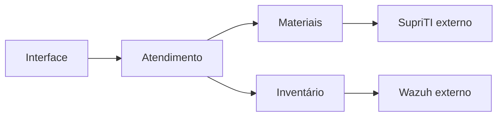

# Sistema de Chamados da Prefeitura

- **Autor:** Luis Felipe Vieira
- **Situação:** rascunho — problema, visão geral, objetivos e limites aprovados; plano técnico em construção.
- **Data:** 2026-11-10
- **Base:** [concepts_brief.md](./concepts_brief.md), aprovado como base do planejamento e atualizado com as decisões posteriores à revisão Goldfish.
- **Etapa atual:** plano técnico em construção, com decisões parciais aprovadas. O plano de implementação ainda não foi redigido.

## Ponto de retomada — 2026-11-12

Continuar com a skill `egm-draft`, usando este documento e `concepts_brief.md`. O autor pediu salvar e sincronizar o trabalho para continuar em outro computador. Não há autorização de implementação nem aprovação do plano técnico completo. Problema, objetivos, aprovação documental, interface e publicação, banco e implantação, anexos e retenção, backup e limitação por IP possuem aprovações parciais registradas nas respectivas seções.

A discussão atual é o configurador visual de formulários. Decisões mais recentes: perguntas condicionais em linguagem simples orientam a triagem; o técnico define a categoria efetiva; somente dois tipos de formulário, uso externo e uso interno; um formulário interno pode atender vários grupos; a associação define quem pode usá-lo para abrir um chamado, sem restringir por si só a consulta posterior.

**Próxima questão — ainda não respondida:** como cada formulário define a classificação inicial do chamado? Apresentar as opções ao autor, sem escolher por ele:

- Categoria definida no formulário: o chamado nasce nessa categoria, e o técnico pode alterá-la.
- Categoria conforme as respostas: os caminhos das perguntas sugerem a categoria, e o técnico confirma ou altera.
- Permitir ambas as configurações: cada formulário usa categoria fixa ou classificação conforme as respostas.

Retomar por essa questão antes de avançar. O bloco de formulários ainda não passou pela aprovação de seção. As decisões posteriores prevalecem sobre formulações antigas explicitamente substituídas neste rascunho; a consolidação editorial e as especificações técnicas pendentes ainda precisam ser concluídas.

## Visão geral

### Alteração de escopo aprovada durante o plano técnico

O autor decidiu priorizar a adoção pelos funcionários: permitir abertura por formulário sem login e manter a conversa, o acompanhamento e os pedidos de reabertura no WhatsApp/Chatwoot. A equipe técnica registra e atualiza o atendimento no sistema. Não implementar portal autenticado para o solicitante nem chat próprio nesta etapa.

Essa revisão altera parte da seção inicial anteriormente aprovada. Onde o texto anterior prevê notificações internas ou ações diretas do solicitante no portal, prevalece este novo fluxo pelo canal existente. As notificações dos técnicos e os controles internos continuam no escopo. Prazo e histórico de reabertura permanecem como referência; o registro e a avaliação pelo técnico de pedidos recebidos externamente ainda serão detalhados. Não há decisão de integrar automaticamente Chatwoot ou WhatsApp.

O autor confirmou os campos da abertura simplificada: nome, setor, telefone/WhatsApp, assunto, descrição e patrimônio opcional, além de anexo opcional de imagem, como foto do equipamento ou captura do erro. O contato permite à equipe continuar a conversa no canal existente, sem exigir conta do solicitante. Quantidade, formatos e tamanho máximo das imagens permanecem por definir. A relação dos campos essenciais com o configurador por categoria e as medidas para receber abertura não autenticada ainda precisam ser definidas. O formulário não deve permitir consulta anônima ao histórico nem apresentar dados informados como identidade comprovada. O configurador por categoria permanece previsto, sujeito à definição de uma abertura curta e de dados complementados pela equipe.

O sistema de Chamados organiza o atendimento interno de TI da Prefeitura. O solicitante informa seu problema por um formulário adequado à categoria. A equipe técnica faz a triagem, define a prioridade, assume o atendimento e registra intervenções, solução e materiais utilizados. O administrador configura formulários e permissões por grupos.

O atendimento mantém referências aos equipamentos e ao seu histórico técnico. O SupriTI permanece responsável pelo estoque oficial, pelas reservas e pelas movimentações de materiais. O Wazuh fornece inventários para comparação de hardware. Chamados deve relacionar essas informações sem confundir a conclusão do serviço com a confirmação de uma movimentação externa ou a evidência de uma mudança no equipamento.

O técnico fecha o chamado após conferir o resumo final. O fechamento não depende de confirmação do solicitante nem da disponibilidade do SupriTI. Pendências de integração permanecem visíveis em uma seção independente e continuam sendo acompanhadas por técnicos ativos. O solicitante pode pedir reabertura dentro de sete dias corridos; o pedido depende de aceite técnico e continua válido para avaliação depois do prazo se tiver sido apresentado a tempo.

## O problema

O planejamento busca reunir informações que precisam ser consultadas em conjunto durante uma manutenção: problema relatado, equipamento afetado, intervenções anteriores, responsáveis pelo atendimento e destino dos materiais. Quando o registro do atendimento e o controle de estoque têm ciclos diferentes, fechar o chamado não garante que a reserva, a baixa ou a liberação já tenha sido confirmada. Apresentar esses resultados como um único estado pode ocultar divergências ou provocar repetição de uma movimentação.

A equipe também precisa distinguir chamados novos dos já assumidos, ordenar o trabalho por prioridade e antiguidade e compartilhar atendimentos sem perder autoria. A participação de vários técnicos exige impedir que uma edição desatualizada sobrescreva alterações de materiais ou que alguém confirme um resumo diferente daquele que conferiu.

Formulários fixos não atendem à decisão de configurar dados diferentes por categoria. Ao mesmo tempo, mudar um formulário não pode alterar o significado das respostas de chamados anteriores. A configuração precisa preservar o registro histórico sem exigir rascunhos ou confirmações adicionais do solicitante.

Falhas externas e desativação de técnicos não podem tornar pendências invisíveis. Uma baixa recusada por falta de saldo exige regularização humana, mesmo que o atendimento já tenha terminado. A seção independente de pendências e a substituição do último técnico ativo devem manter esse trabalho identificável e atribuído.

Esses problemas e resultados pretendidos vêm do planejamento funcional. Ainda não foram medidos tempos de atendimento, volume de pico ou custos operacionais, nem foi comprovado que a cópia de SupriTI analisada corresponde à instalação em produção.

## Objetivos

Os critérios abaixo orientam o desenho e sua validação futura; não representam testes já executados.

1. **Permitir abertura adequada à categoria.** O administrador configura visualmente campos, ordem, tipos, obrigatoriedade e condições de exibição. Chamados existentes preservam a versão usada na abertura. Um erro de envio mantém os dados na página atual para correção, sem criar rascunho persistente.
2. **Organizar a fila sem ocultar chamados novos.** Manter a triagem no topo, independente dos filtros pessoais. Ao assumir, retirar o chamado da triagem e aplicar prioridade média caso o técnico não escolha outra. Ordenar os atendimentos por crítica, alta, média e baixa, com os mais antigos primeiro em cada nível. A prioridade é interna à equipe técnica.
3. **Preservar o trabalho compartilhado e sua autoria.** Permitir vários participantes, histórico de intervenções e permissões configuradas por grupos. Manter acompanhamento ativo na desativação do último técnico e notificar o substituto quando escolhido por outro administrador.
4. **Fechar com conferência do conteúdo efetivo.** Exigir nova conferência quando materiais, solução, diagnóstico ou equipamento mudarem durante a revisão. O fechamento é imediato e não depende do aceite do solicitante. Preservar o histórico nas reaberturas e não repetir consumos anteriores.
5. **Oferecer reabertura com decisão rastreável.** Permitir pedidos dentro dos sete dias corridos do fechamento mais recente, sujeitos a aceite ou recusa de qualquer técnico. Reabertura direta equivale a aceite quando há pedido pendente. Preservar decisões anteriores e aplicar a primeira ação válida nas disputas simultâneas. Reabertura técnica posterior a uma recusa é permitida dentro da janela vigente.
6. **Integrar materiais sem duplicar o controle oficial.** Reservar durante o atendimento e consumir somente os materiais atestados no fechamento, respeitando quantidade e condição. Tratar cancelamentos conforme o destino real das peças. A integração não deve duplicar efeitos ao repetir uma operação ou recuperar uma resposta perdida.
7. **Continuar o atendimento durante falhas externas.** Persistir intenções, separar indisponibilidade de recusa de negócio, preservar sucessos parciais e limitar a carga de recuperação. Mostrar pendências em seção independente, inclusive para chamados fechados ou cancelados, sem declará-las concluídas antes da confirmação externa.
8. **Relacionar histórico técnico e alterações de hardware.** Permitir consulta por equipamento e comparação diária com dados do Wazuh, com retenção limitada. Ausência de coleta não comprova ausência de alteração. A escolha da referência para dias sem coleta ainda depende de decisão.
9. **Comunicar pelo próprio sistema.** Usar notificações internas com indicação de leitura e retenção de 30 dias. Remover avisos de ações pendentes quando deixarem de ser aplicáveis, preservando o histórico do chamado.

## Limites e itens fora do escopo atual

- **Estoque paralelo:** Chamados guarda vínculos, intenções e resultados; o saldo oficial continua no SupriTI. O fluxo próprio da integração não substitui o ciclo das solicitações comuns desse sistema.
- **Aceite de conclusão pelo solicitante:** não haverá botão de confirmação, aceite de compliance ou fechamento automático após sete dias. O prazo serve à reabertura, não à confirmação de um serviço já fechado.
- **Rascunhos:** não haverá salvamento manual ou automático para retomada posterior. Preservar dados após um erro na página aberta não implica recuperação após fechar ou recarregar a página.
- **Comunicação externa:** e-mail, SMS, WhatsApp e implementação de um canal alternativo ficam fora desta etapa. Não acrescentar etapas de contestação à recusa de reabertura.
- **Login único:** as autenticações humanas dos sistemas permanecem separadas; integração com AD é futura.
- **Destino de componentes retirados dos equipamentos:** avaliação de reaproveitamento e eventual entrada no SupriTI são realizadas pelo técnico fora do fluxo de estoque de Chamados. Isso não exclui o registro técnico da intervenção nem a devolução de materiais separados do estoque para um atendimento cancelado.
- **Cópia integral do Wazuh:** não replicar todo o histórico bruto de inventários ou logs no novo sistema.
- **Privilégios fixos por nível técnico:** N1, N2 e N3 não substituem a configuração dinâmica de grupos e permissões.

O projeto inclui histórico de ativos e consulta à base de conhecimento, mas fluxos patrimoniais e publicação de artigos ainda não estão detalhados. Este documento não os declara prontos nem os exclui silenciosamente do projeto.

## Questões abertas para as próximas seções

- Definir arquitetura, tecnologias, armazenamento, hospedagem e mecanismos de credencial e fila com decisão explícita do autor.
- Especificar os contratos e a compatibilidade com a instalação real do SupriTI, inclusive recuperação após restauração ou retirada da integração com reservas ativas.
- Completar a matriz de permissões, os estados do atendimento e da integração, o fuso e o instante limite da janela de reabertura.
- Confirmar se o aceite técnico de pedidos de reabertura também se aplica a chamados cancelados por técnicos; as decisões atuais o definem para os fechados por resolução.
- Conciliar campos essenciais do chamado com o configurador por categoria; confirmar tipos de campo e regras de troca de categoria ou edição após abertura.
- Detalhar a seção de pendências, suas informações operacionais e os sinais de falta de progresso, sem depender da retenção das notificações.
- Fechar associação de equipamento e agente Wazuh, referência em dias sem coleta, componentes comparados e retenção mínima.
- Definir limites de anexos, retenção de dados, segurança, backup, implantação, reversão e metas mensuráveis. Não tratar a média mencionada de cinco chamados por dia como pico ou número de operações de integração.

## Plano técnico — em construção

### Organização em serviços separados

O autor escolheu serviços separados para permitir que mais pessoas desenvolvam o projeto de forma cooperativa. Os serviços devem ter responsabilidades e interfaces explícitas para que colaboradores possam trabalhar em partes diferentes sem depender continuamente de alterações internas de outros serviços.

A escolha permite implantações independentes, mas acrescenta comunicação entre serviços, compatibilidade de contratos, autenticação entre aplicações e investigação de falhas distribuídas. Separar serviços por si só não garante autonomia: limites mal definidos podem exigir mudanças coordenadas e dificultar o trabalho da equipe. A divisão precisa preservar as regras de consistência e recuperação já aprovadas.

O autor definiu um único repositório para o código dos serviços de Chamados. Cada serviço deve manter limites explícitos dentro desse repositório, permitindo colaboração e revisão conjunta de mudanças nos contratos. Compartilhar o repositório não implica compartilhar banco de dados, executar todos os serviços no mesmo processo ou exigir implantação conjunta.

As fronteiras dos serviços, seus responsáveis e a propriedade dos dados ainda não foram decididas. Não presumir um serviço para cada entidade ou tela, nem um banco compartilhado ou separado sem decisão do autor. O SupriTI continua sendo um sistema externo responsável pelo estoque oficial; a escolha não autoriza duplicar esse estoque em um novo serviço nem mover seu código para este repositório.

### Divisão inicial de responsabilidades

O autor escolheu três serviços para permitir frentes de desenvolvimento cooperativo e facilitar o isolamento de problemas em materiais e inventário:

| Serviço | Responsabilidade inicial | Limite |
| --- | --- | --- |
| Atendimento | Chamados, formulários por categoria e fluxo de atendimento, incluindo fechamento e reabertura. | Não controla o saldo oficial do SupriTI nem realiza comparação de inventários Wazuh. |
| Materiais | Integração com SupriTI: consulta, reservas, ajustes, liberações, consumos, devoluções e acompanhamento de resultados. | SupriTI mantém a propriedade do estoque oficial. A distribuição da persistência de intenções entre Atendimento e Materiais ainda precisa ser decidida. |
| Inventário | Equipamentos e integração com Wazuh para comparação de hardware e registro de alterações. | Não interpreta uma alteração detectada como autorização ou consumo de material; relacionamentos com intervenções exigem evidência. |

A interface ficará no mesmo repositório. O autor definiu que contas, login, grupos, permissões, sessões, notificações internas dos técnicos e base de conhecimento ficam dentro de Atendimento, sem criar serviços separados para essas funções.

### Base de conhecimento em Atendimento

Atendimento mantém os artigos da base de conhecimento e seus vínculos com as soluções dos chamados. Não criar um quarto serviço para esse recurso. A localização não define automaticamente autoria, revisão, publicação, visibilidade, versionamento ou criação de artigos a partir de soluções: essas regras continuam pendentes de detalhamento, respeitando as permissões por grupos e a proteção de informações dos chamados.

### Notificações centralizadas em Atendimento

Atendimento mantém as notificações internas dos técnicos e reúne no mesmo painel os avisos pertinentes dos três serviços. Materiais e Inventário encaminham os avisos pela API de Atendimento, sem consultar ou alterar diretamente suas tabelas de notificações. Aplicar as regras já aprovadas de destinatários, leitura, retenção de 30 dias e remoção de avisos que deixaram de ser aplicáveis. Não restabelecer notificações do solicitante retiradas pela simplificação do escopo.

A notificação não é a fonte oficial do resultado de uma operação nem substitui a seção independente de pendências. Uma falha no encaminhamento do aviso não deve apagar o resultado registrado no serviço responsável. Contrato, identificação para evitar avisos duplicados e recuperação de falhas de entrega ainda precisam ser definidos.

A separação facilita localizar e conter falhas, mas não garante isolamento sozinha. Falhas de Materiais não devem bloquear o fechamento técnico, conforme regra já aprovada. O desenho precisa definir como registrar a intenção com segurança quando esse serviço estiver indisponível, além de tempos de espera e recuperação sem duplicidade.

O autor confirmou que a indisponibilidade de Inventário não deve impedir a continuidade do atendimento nem o fechamento do chamado usando o vínculo de equipamento já registrado. Preservar esse vínculo e informar que a consulta ao histórico do equipamento e ao Wazuh está temporariamente indisponível; não apresentar ausência de resposta como ausência de histórico ou de alterações.

Durante essa falha, permitir também a abertura de chamado sem selecionar equipamento. O vínculo poderá ser realizado depois que Inventário voltar; não criar equipamento ou associação fictícia para contornar a indisponibilidade. A regra de contingência deve permitir enviar o formulário mesmo se ele normalmente exigir o seletor de equipamento.

Se o atendimento terminar antes da recuperação de Inventário, o técnico pode fechar o chamado ainda sem vínculo, registrando a indisponibilidade como justificativa e mantendo a associação pendente para regularização posterior. O fechamento técnico não elimina essa pendência. Registrar a associação posterior com autoria e data, preservando a justificativa e o histórico do fechamento, sem exigir reabertura apenas para completar o vínculo. Esta decisão não escolhe um mecanismo de cópia ou armazenamento dos dados do equipamento.

O autor confirmou que essa associação deve ser acompanhada na mesma seção independente de pendências já definida, identificada como “Vínculo de equipamento pendente”. Manter o aviso enquanto a associação não for regularizada, inclusive com o chamado fechado. Distinguir esse tipo das pendências de estoque; concluir o vínculo não resolve eventuais operações de materiais ainda pendentes no mesmo chamado. A recuperação de Inventário, por si só, não comprova a associação.

O autor escolheu banco compartilhado entre Atendimento, Materiais e Inventário. A propriedade das tabelas, as permissões de acesso entre serviços, os contratos e os mecanismos de comunicação continuam pendentes de decisão. O plano técnico completo ainda depende das decisões seguintes e de aprovação própria.

### Registro de materiais durante indisponibilidade

O autor confirmou que, se o serviço de Materiais estiver indisponível e o catálogo não puder ser consultado, o técnico pode registrar no chamado os materiais utilizados para sincronização posterior. A falha não impede esse registro nem o fechamento técnico. Preservar os dados informados e apresentar a pendência, sem declarar reserva ou consumo confirmado no SupriTI.

O autor confirmou que o registro provisório deve conter nome ou descrição do material, quantidade e condição (novo ou recondicionado). Após a recuperação do serviço, o técnico deve selecionar o produto correto no catálogo antes da execução da baixa. O retorno do serviço, por si só, não autoriza consumir um material ainda sem identificação oficial. Não fazer correspondência automática por nome nem criar produto oficial a partir do registro provisório. Preservar os dados informados e registrar a associação posterior com autoria e data, mantendo as validações de saldo, condição e proteção contra duplicidade já acordadas.

O autor confirmou que os materiais provisórios ainda sem produto oficial associado devem aparecer na seção independente de pendências, com o aviso “Identificação de material pendente”, inclusive se o chamado já estiver fechado. Remover esse aviso somente após a identificação; a associação do produto não equivale à confirmação da baixa, cujas pendências e resultados continuam sendo acompanhados separadamente.

O autor escolheu fila persistente para o encaminhamento e processamento posterior dessas operações, distinguindo pendência de identificação de operação pronta para baixa. Enquanto houver apenas descrição, quantidade e condição, preservar o registro aguardando ação humana, sem executar tentativas de consumo nem procurar adivinhar o produto pelo nome. A fila não substitui a identificação pelo técnico.

Depois de o técnico selecionar o produto oficial, a operação pode ser preparada para processamento automático, respeitando a intenção vigente do chamado e as validações de saldo, condição, autorização e proteção contra duplicidade. Identificar um material de chamado ainda em atendimento não antecipa o consumo: a baixa continua condicionada à revisão e ao fechamento, ou ao tratamento de cancelamento já aprovado. A seleção do produto não é confirmação de movimentação externa.

A tecnologia da fila, a propriedade do registro provisório e o mecanismo para persistir os dados e publicar a operação sem perda ainda precisam ser escolhidos. Respeitar a escrita exclusiva por serviço. A escolha não define que todos os processos do sistema serão assíncronos nem exige tentativas repetidas enquanto a identificação estiver pendente.

### Fila persistente no PostgreSQL

O autor escolheu usar somente PostgreSQL para persistência das filas, sem RabbitMQ ou outro intermediário de mensagens nesta etapa. As tarefas serão registros duráveis processados por executores dos serviços; não tratar a simples gravação de uma tabela como implementação completa de entrega e recuperação.

Cada serviço deve acessar apenas suas próprias tabelas, inclusive as de tarefas e de encaminhamento. Não usar uma tabela compartilhada que permita a um serviço consultar ou alterar a fila interna de outro. A comunicação entre serviços continua passando pelas interfaces responsáveis. O mecanismo de encaminhamento, confirmação de recebimento e recuperação diante de falha entre gravação e envio ainda precisa ser definido.

O desenho deve especificar reserva concorrente de tarefas, recuperação após interrupção do executor, intervalos e limites de tentativas, tratamento de recusas de negócio e resultados desconhecidos, identificação estável das operações e acompanhamento operacional. Uma tarefa sem produto identificado continua aguardando ação humana, sem tentativas de baixa. Biblioteca ou implementação da fila, transações e estratégia de processamento ainda não foram escolhidas.

#### Encaminhamento de Atendimento para Materiais

Na mesma transação do PostgreSQL que confirma o fechamento e registra a intenção de consumo, Atendimento grava uma tarefa de envio em sua própria fila para cada operação pronta. Se a transação falhar, o fechamento e as tarefas dessa tentativa são revertidos juntos. Uma intenção cujo produto ainda precisa ser identificado fica registrada como pendência humana e só gera tarefa quando estiver apta a processamento.

Após a confirmação da transação, um executor de Atendimento envia a tarefa pela API de Materiais. Uma nova tentativa de envio usa o mesmo identificador da operação. Materiais deve reconhecer um identificador já recebido, devolver a confirmação correspondente e evitar a criação de trabalho duplicado. A confirmação de recebimento encerra o envio e indica que Materiais registrou a operação de forma durável. O resultado da movimentação no SupriTI é acompanhado separadamente.

#### Ordem das operações por item

Atendimento encaminha as operações de cada item em sequência. Ao fechar um chamado, registra a intenção de consumo na mesma transação do fechamento. A tarefa de consumo fica bloqueada enquanto a reserva anterior do mesmo item tiver um resultado desconhecido. O fechamento técnico permanece registrado, e a seção de pendências mostra o item que aguarda conciliação. Outros itens podem seguir suas próprias sequências.

Atendimento só invalida localmente uma reserva superada quando pode garantir que nenhum executor iniciou seu envio. A invalidação e a autorização de envio precisam ser mutuamente exclusivas no PostgreSQL. Se o envio já puder ter ocorrido, preservar o identificador da reserva e obter seu desfecho por meio de Materiais. A confirmação de recebimento pela API permite acompanhar a reserva, mas o consumo só é encaminhado depois que seu desfecho estiver registrado. Esse resultado informa se o consumo deve usar uma reserva confirmada ou seguir o fluxo previsto para um item sem reserva.

Se uma resposta se perder e Materiais ainda não puder confirmar o resultado da reserva no SupriTI, manter o consumo pendente. Essa espera evita executar o consumo com uma premissa incorreta sobre a reserva, mas pode atrasar a movimentação mesmo após o fechamento. O contrato para consultar resultados e os intervalos de recuperação continuam em aberto.

#### Posse de tarefas com prazo

Cada executor assume uma tarefa elegível em uma transação curta no PostgreSQL. A transação registra o identificador exclusivo da tentativa, o prazo de posse e o início da tentativa antes de liberar o executor para chamar a API. Uma tarefa só é elegível quando sua vez na sequência do item chegar e quando estiver disponível para execução ou retomada. A chamada externa ocorre depois de confirmar a transação.

O executor pode renovar a posse enquanto a tentativa atual estiver vigente. Se o prazo vencer, outro executor pode assumir a tarefa com um novo identificador de tentativa. Renovação e registro do resultado exigem que o identificador corresponda à posse atual e que o prazo ainda esteja vigente. Uma resposta tardia de uma tentativa vencida fica sujeita à recuperação pelo executor atual.

O identificador da operação permanece igual nas retomadas. Uma chamada iniciada antes do vencimento pode chegar à API durante uma nova tentativa. A API receptora deve reconhecer o identificador da operação e preservar um único registro de recebimento. Se a chamada tiver resultado desconhecido no SupriTI, aplicar as regras de conciliação antes de liberar a operação seguinte do item.

#### Prazos iniciais de posse e recuperação

A posse dura inicialmente 120 segundos. Enquanto a tarefa estiver em execução, o executor tenta renovar a posse a cada 30 segundos. Uma renovação aceita estende a posse por 120 segundos a partir da renovação.

Após a primeira falha transitória, aguardar 30 segundos antes da nova tentativa. A cada falha transitória consecutiva, dobrar o intervalo até o teto de 15 minutos. Distribuir no tempo as tentativas de itens diferentes para reduzir picos quando várias tarefas falharem juntas. Esses valores são iniciais e devem ser avaliados com medições na VM e nas integrações.

Uma recusa de negócio fica visível para regularização. Quando o resultado de uma movimentação no SupriTI for desconhecido, a próxima ação é consultar o desfecho antes de repetir a movimentação.

#### Tempos limite das chamadas da fila de materiais

| Chamada | Prazo para conectar | Prazo total |
| --- | --- | --- |
| Atendimento → Materiais | 3 segundos | 10 segundos |
| Materiais → SupriTI | 5 segundos | 20 segundos |

O prazo total inclui o tempo de conexão. Materiais confirma o registro durável da operação na sua fila dentro da chamada de Atendimento. A chamada ao SupriTI ocorre separadamente, durante o processamento dessa operação. Se o prazo vencer depois de uma movimentação poder ter chegado ao SupriTI, registrar resultado desconhecido e consultar o desfecho antes de qualquer reenvio. Os prazos são valores iniciais a validar com medições.

#### Suspensão após falhas transitórias repetidas

Após dez falhas transitórias consecutivas da mesma tarefa, suspender as tentativas automáticas e manter a pendência visível para revisão, com a última falha registrada. Contar apenas chamadas da tarefa que falharam. Os intervalos entre tentativas e a pausa da dependência ficam fora da contagem. A recuperação da dependência pode liberar outras tarefas. Para retomar a tarefa suspensa, a equipe revisa a pendência e autoriza uma nova tentativa com o mesmo identificador da operação. Se o resultado de uma movimentação anterior ainda for desconhecido, retomar pela consulta do desfecho.

A suspensão pode manter o item pendente mesmo depois de a dependência voltar. As operações posteriores do mesmo item continuam sujeitas à ordem definida acima.

#### Pausa e retomada por dependência

Contar falhas transitórias consecutivas por dependência. Após três falhas, pausar novos envios para a dependência afetada por três minutos. Tarefas novas e tarefas reagendadas aguardam a retomada. Tarefas de outras dependências seguem seu processamento. Recusas de negócio ficam fora da contagem de falhas transitórias.

Depois da pausa, liberar uma chamada por vez a partir de tarefas elegíveis para testar a API no fluxo real. Se a tarefa tiver uma movimentação de resultado desconhecido, consultar o desfecho antes de repetir o envio. Após três respostas que confirmem a recuperação, permitir até duas chamadas simultâneas. Manter esse limite por três minutos sem nova falha transitória antes de voltar ao limite normal. Qualquer falha transitória durante a retomada reinicia a pausa de três minutos.

Em operação normal, permitir até quatro chamadas simultâneas por dependência, somadas entre os executores responsáveis. Cada item continua seguindo sua própria sequência. Todos os executores responsáveis pela mesma dependência precisam respeitar a pausa e os limites de chamadas simultâneas de cada fase. Os valores são iniciais e devem ser avaliados na VM e nas integrações.

A decisão evita operar um intermediário de mensagens separado, mas concentra também a persistência das tarefas no banco compartilhado. Não oferece disponibilidade independente do PostgreSQL nem proteção contra perda do armazenamento da VM sem recuperação apropriada.

### Acesso ao formulário pela internet

O autor confirmou que o formulário de abertura sem login deve ser acessível também fora da rede da Prefeitura, inclusive por celular conectado à internet. Essa decisão permite enviar solicitações externamente, mas não autoriza consulta anônima a chamados, anexos recebidos, contatos, cadastros de equipamentos ou histórico.

A exposição externa do formulário não define exposição pública dos três serviços, do PostgreSQL ou de suas filas. O autor também confirmou acesso ao painel dos técnicos pela internet, com login obrigatório e aplicação das permissões do usuário autenticado. Separar as funções públicas de abertura das consultas e ações restritas da equipe. O mecanismo de autenticação e sessão ainda precisa ser escolhido; acesso externo não autoriza consulta anônima ao painel.

Domínio, publicação HTTPS, entrada de rede, proteção contra envios abusivos e limites de upload ainda precisam ser definidos. Nenhuma configuração de servidor ou rede foi realizada nesta etapa de desenho.

### Contas da equipe técnica

O autor confirmou que as contas dos técnicos serão criadas pelo administrador, com login e senha próprios do sistema. Não prever autocadastro público de técnicos. A integração com AD permanece para uma etapa futura. O formulário público de abertura não exige nem cria uma conta técnica.

Manter as permissões dinâmicas por grupos e os controles de desativação e substituição já aprovados. A criação da conta não concede acesso irrestrito por si só. O administrador fornece uma senha temporária, que deve ser trocada obrigatoriamente no primeiro acesso antes da utilização das funções do painel. Se um técnico esquecer a senha, o administrador a redefine com outra senha temporária e o sistema exige nova troca no próximo acesso. Essa recuperação não depende de envio automático por e-mail ou de autocadastro. Autenticação adicional, duração e revogação de sessões e localização dessas funções entre os três serviços ainda precisam ser definidos.

### Comunicação por APIs

O autor confirmou a preferência por APIs para comunicação entre Atendimento, Materiais e Inventário. Consultas e solicitações de alteração passam pela API do serviço responsável, sem acesso direto às suas tabelas. A fila persistente no PostgreSQL continua sendo interna a cada serviço; o encaminhamento de trabalho entre serviços ocorre pelas APIs, com confirmação e recuperação ainda a especificar.

O autor definiu HTTP com mensagens JSON para as APIs entre os três serviços. Essa escolha não estabelece, por si só, um estilo REST completo nem torna todas as operações síncronas do ponto de vista do usuário. Preservar as contingências e o processamento posterior já aprovados. Autenticação entre serviços, proteção do transporte, versionamento, contratos, tempos de espera e tratamento de erros ainda precisam ser definidos. A escolha não presume que os contratos externos do SupriTI e do Wazuh já atendam ao padrão definido para os serviços internos.

### Banco compartilhado

Os três serviços de Chamados utilizarão um banco compartilhado. A escolha não inclui o banco do SupriTI, que permanece externo e responsável pelo estoque oficial, nem autoriza acesso direto ao banco do Wazuh.

O autor definiu PostgreSQL como banco compartilhado, alinhado à experiência da equipe. Essa escolha mantém a escrita exclusiva e as consultas entre serviços pelas interfaces responsáveis. Versão do PostgreSQL, organização das tabelas e schemas, credenciais por serviço, migrações, limites de conexão e configuração de persistência e recuperação ainda precisam ser definidos. O PostgreSQL será hospedado na mesma VM Debian dos serviços, dentro do orçamento total de recursos já informado.

O banco compartilhado facilita consultas e coordenação dos dados, mas constitui uma dependência comum: sua indisponibilidade pode afetar os três serviços. Alterações incompatíveis nas estruturas compartilhadas também podem exigir atualização coordenada. O objetivo aprovado de isolar falhas entre serviços continua válido para falhas específicas de cada serviço; não representa independência frente a falhas do banco.

O autor definiu escrita exclusiva por serviço: Atendimento, Materiais e Inventário alteram apenas as tabelas sob sua responsabilidade. Uma alteração em dados pertencentes a outro serviço deve passar pela interface desse serviço, preservando suas validações e regras. O autor também definiu que consultas a dados de outro serviço passam pela interface responsável, sem leitura direta de suas tabelas. O compartilhamento do banco não autoriza contornar essas fronteiras com consultas ou alterações diretas. A propriedade concreta das tabelas, as credenciais e a coordenação de migrações ainda precisam ser definidas.

Consequentemente, compartilhar o banco não torna os dados de Inventário acessíveis a Atendimento quando o serviço Inventário estiver indisponível. As contingências já aprovadas permanecem: preservar o vínculo registrado no chamado, permitir abertura e fechamento sem novo vínculo durante a falha e acompanhar a associação pendente para regularização.

O autor definiu que Atendimento deve guardar somente o identificador do equipamento vinculado, sem copiar patrimônio, descrição ou outro resumo do cadastro. Consultar os detalhes pela interface de Inventário. Durante sua indisponibilidade, preservar o identificador e informar que os detalhes não puderam ser consultados; não apagar o vínculo nem criar uma associação pendente apenas porque os detalhes de um vínculo existente estão inacessíveis. A pendência de vínculo aplica-se aos chamados que ainda precisam da associação. O formato do identificador ainda precisa ser definido.

Equipamentos que deixarem de ser usados devem ser desativados, preservando o cadastro e seu identificador para consulta pelos chamados antigos, sem exclusão que rompa esses vínculos. A desativação não apaga o histórico técnico nem implica uma movimentação de estoque ou um fluxo patrimonial de baixa já especificado. Equipamentos desativados não podem ser selecionados em novos chamados; a seleção volta a ser permitida se forem reativados. Preservar os vínculos antigos durante a desativação e a reativação, sem criar outro cadastro apenas para permitir o retorno ao uso.

O autor definiu que qualquer técnico pode desativar e reativar equipamentos, sem exigir uma concessão específica adicional para essas ações. Registrar a ação, a autoria e a data no histórico. Essa autorização não concede acesso direto às tabelas de Inventário nem altera as regras de consulta e preservação dos vínculos.

As setas representam relações funcionais, sem definir protocolo, sincronismo ou um ponto único obrigatório de acesso à interface.

### Linguagem dos serviços

O autor escolheu Rust para os três serviços de backend: Atendimento, Materiais e Inventário. As motivações são economizar recursos da VM e aprender a linguagem durante o projeto. A equipe de três pessoas possui experiência principalmente em JavaScript, Python e Java; o planejamento deve considerar o aprendizado e a revisão de código em Rust. A escolha não comprova economia de memória ou desempenho na carga real, que ainda precisam ser medidos.

Framework web, bibliotecas de acesso ao banco, cliente de fila e linguagem ou framework da interface ainda não foram escolhidos. Esta decisão não altera as responsabilidades dos serviços, o banco compartilhado, os limites de acesso aos dados ou os requisitos de recuperação.

### Ambiente de implantação

O autor definiu hospedagem em servidor próprio da Prefeitura, em uma VM Debian, com um container para cada serviço: Atendimento, Materiais e Inventário. Manter os serviços como processos separados, com configuração e execução próprias. A ferramenta de execução dos containers, a publicação da interface, a implantação do banco compartilhado e da fila persistente ainda precisam ser definidas.

Os containers permitem separar a execução dos serviços, mas todos dependem da mesma VM: falhas da VM, do armazenamento ou esgotamento de recursos podem afetar o conjunto. A configuração precisará prever limites de recursos, persistência, recuperação e monitoramento. Não presumir alta disponibilidade nem redundância de servidor a partir desta escolha.

O autor informou a capacidade inicial da VM: **4 GB de RAM, 4 vCPUs e 100 GB de armazenamento** e confirmou que o banco compartilhado e a fila persistente também serão hospedados nessa mesma VM. Tratar esses recursos como orçamento total, incluindo Debian, serviços, banco e fila, não como capacidade disponível para cada componente. A suficiência para a carga real ainda precisa ser validada. O volume de anexos, a retenção de logs e os requisitos de backup influenciam esse dimensionamento; não reservar silenciosamente o mesmo disco como única cópia de recuperação. A persistência da fila não garante disponibilidade durante falha da VM nem recuperação após perda do seu armazenamento. Metas de recuperação e distribuição dos recursos permanecem abertas.

### Validação e duração de sessões baseada no SupriTI

O autor pediu reproduzir o comportamento de sessão do SupriTI. A leitura estática de `apps/api/src/auth/auth.service.ts`, `session.guard.ts` e `auth.controller.ts` na cópia de SupriTI encontrou os padrões de 30 minutos de inatividade e limite absoluto de 8 horas desde o login, configuráveis por ambiente. Adotar esses padrões em Chamados; a configuração efetiva de produção do SupriTI não foi consultada.

A sessão é mantida no servidor, com hash do token persistido, e o navegador recebe o token em cookie HttpOnly, SameSite=Lax e Secure em produção. A cada requisição protegida, verificar existência, revogação, expiração por inatividade, limite absoluto e conta ativa. Requisições autenticadas renovam a janela de inatividade, sem ultrapassar o limite absoluto; no código examinado, a atualização persistida ocorre quando a última atividade registrada tem mais de um minuto. Atividade significa requisição autenticada observada pelo servidor, não movimento de mouse ou digitação. O cookie durar até o limite absoluto não impede a expiração anterior por inatividade.

Preservar a decisão de revogação imediata ao redefinir senha ou desativar conta. Atendimento é responsável por contas, grupos, permissões, login e sessões. Materiais e Inventário recorrem à API de Atendimento para validar acessos técnicos, sem ler suas tabelas nem compartilhar sessões com SupriTI. O contrato de validação e as credenciais entre serviços ainda precisam ser definidos. Esta inspeção não valida o comportamento em produção nem implementa autenticação.

### Revogação de sessões

O autor confirmou que redefinir a senha ou desativar uma conta deve encerrar imediatamente todas as sessões abertas do técnico. Requisições posteriores com essas sessões devem ser recusadas, inclusive se a página continuar aberta. A sessão antiga não volta a valer após a troca da senha temporária ou eventual reativação da conta; exigir novo login. Atendimento mantém a validação de identidade e sessão oferecida aos demais serviços por API. Não aceitar permissões declaradas pelo cliente como comprovação de autorização.

Revogar sessões não apaga autoria ou histórico nem cancela automaticamente operações de materiais já autorizadas. Preservar as regras de continuidade e de suspensão administrativa de operações específicas anteriormente aprovadas. A desativação também mantém a exigência de substituição do último participante ativo nos chamados vinculados.

## Framework HTTP: Axum

O autor escolheu Axum como framework HTTP dos serviços Atendimento, Materiais e Inventário. Usar o mesmo framework nos três serviços para manter uma base comum de desenvolvimento. Preservar os contratos HTTP/JSON e as responsabilidades já definidas; o acesso ao PostgreSQL foi definido posteriormente com SQLx e SQL direto. O mecanismo da fila, as sessões e a tecnologia da interface ainda precisam ser detalhados.

O desenho seguirá os mecanismos de rotas, extratores e integração com Tokio/Tower do Axum. Versões, bibliotecas complementares e padrões de erros e middleware ainda serão definidos. Não há medição que comprove um consumo específico de recursos da aplicação a partir dessa escolha.

## Acesso ao PostgreSQL: SQLx com SQL direto

O autor escolheu SQLx com consultas SQL escritas diretamente, sem ORM, para Atendimento, Materiais e Inventário. Preservar a propriedade das tabelas por serviço e o acesso aos dados de outros serviços somente pelas APIs responsáveis. SQL direto não autoriza consultas cruzando essas fronteiras.

A decisão permite explicitar consultas e atualizações condicionais, transações e operações concorrentes da fila PostgreSQL. Não representa garantia de desempenho ou consumo de memória. Usar parâmetros para os valores das consultas; versões, pools, migrações, estratégia de verificação das consultas e mecanismos de concorrência, tentativas e recuperação da fila ainda precisam ser definidos.

## Escopo futuro para discussão: alerta de inatividade

Registrar em Inventário a proposta de monitorar equipamentos sem atividade, usando a última atualização ou atividade disponível nos registros do Wazuh. Ao ultrapassar um prazo configurável pelo administrador, gerar alerta de possível sumiço do equipamento; 35 dias é a referência inicial proposta, ainda sujeita à discussão. A funcionalidade complementa a comparação de hardware e fica reservada para discussão futura, sem implementação nesta etapa.

Ainda definir a fonte e o significado de atividade no Wazuh, periodicidade, equipamentos elegíveis, tratamento de equipamentos desativados, registros ausentes e indisponibilidade da coleta, além de destinatários e ciclo dos alertas. Ausência de atualização não comprova desaparecimento. Este registro não pressupõe que a integração atual já ofereça o dado necessário nem exige replicar logs brutos.

## Aprovação opcional de uma ação no chamado — escopo funcional aprovado

O autor aprovou esta seção em 2026-11-12 e autorizou a continuidade do plano técnico. A aprovação abrange as regras funcionais registradas abaixo; não representa aprovação do plano técnico completo nem autorização de implementação.

Decisão do autor em 2026-11-12: incluir no escopo uma etapa opcional em que o técnico registra uma ação proposta, as informações disponíveis, os prós, os contras e os riscos conhecidos, e solicita análise de outro técnico designado. A pessoa designada aprova ou reprova, com registro da solicitação e da decisão no histórico. O uso por superiores não estabelece automaticamente novas permissões por cargo.

Bloquear apenas a ação submetida enquanto aguarda decisão ou após reprovação. Permitir outros trabalhos no chamado. A aprovação autoriza a continuidade da ação avaliada, sem executá-la automaticamente nem determinar diretamente o fechamento. A etapa é opcional no fluxo geral; solicitar a aprovação torna o impedimento aplicável à ação correspondente.

O registro deve permitir identificar quem solicitou, quem decidiu e qual conteúdo foi avaliado. Datas, preservação do conteúdo e tratamento de alterações posteriores ainda precisam ser detalhados. A finalidade é documentar riscos comunicados e autorização recebida; não prometer isenção administrativa. Aceite autenticado, geração de documento e eventual assinatura digital são mecanismos ainda não escolhidos.

O autor escolheu representar a ação como uma etapa escrita e documental, sem vínculo obrigatório com uma operação funcional do sistema. Exemplos: implantação de um sistema em um setor ou de um servidor Samba. O técnico apresenta a implementação e os riscos conhecidos; a pessoa designada registra se autoriza sua execução com conhecimento dos riscos descritos. A etapa permanece documentalmente impedida enquanto aguarda decisão ou após reprovação; o restante do chamado pode continuar. Não derivar dessa escolha bloqueios automáticos de estoque, cadastros ou execução externa.

O autor escolheu aprovação ou reprovação pela conta autenticada da pessoa designada, registrando identidade, decisão, data e hora vinculadas ao conteúdo avaliado. Aplicar a validação de sessão e conta ativa já definida, sem nova confirmação de senha e sem certificado digital. Apresentar o registro como aceite autenticado no sistema, sem declarar assinatura com certificado digital. Essa escolha resolve o mecanismo de aceite anteriormente aberto nesta seção.

O autor escolheu preservar cada versão da proposta. Alterações geram nova versão e exigem nova aprovação, sem transferir a autorização anterior ao texto alterado. Preservar conteúdo, autoria, datas e decisões das versões anteriores; cada decisão referencia a versão efetivamente avaliada. A versão alterada mantém a ação documentalmente impedida até nova aprovação.

O autor definiu exigir análise da versão atual: se houver alteração durante a leitura, recusar a tentativa de aprovação ou reprovação da versão substituída, apresentar o texto atual e exigir nova conferência. Validar a versão no servidor no processamento da decisão, impedindo que uma alteração concorrente seja ignorada. A tentativa desatualizada não registra aprovação nem reprovação de nenhuma versão; decisões anteriores já válidas permanecem preservadas.

O autor definiu comentário opcional nas decisões e acrescentou aprovação com ressalva e reprovação com sugestão. Oferecer quatro resultados: aprovação, aprovação com ressalva, reprovação e reprovação com sugestão. Registrar o resultado e o comentário, quando informado, na versão avaliada. A sugestão não modifica automaticamente o texto nem libera a ação reprovada. Incorporar a sugestão à proposta gera nova versão sujeita a nova aprovação. Ainda definir o efeito da aprovação com ressalva sobre a autorização e como representar ressalva ou sugestão sem texto; não exigir comentário por inferência.

O autor definiu que aprovação com ressalva autoriza a continuidade da ação na versão avaliada. A ressalva é uma observação documental, sem exigir comprovação de condições nem novo aceite. Alterações posteriores da proposta continuam exigindo nova aprovação. Manter comentário opcional; ainda definir a apresentação de uma ressalva ou sugestão sem texto. Esta decisão resolve o efeito da aprovação com ressalva anteriormente aberto nesta seção.

O autor esclareceu que aprovação e reprovação simples têm comentário opcional, enquanto aprovação com ressalva e reprovação com sugestão exigem comentário descrevendo o que deve mudar. Essa definição substitui a generalização anterior de comentário opcional em todas as decisões. Não aceitar resultados com ressalva ou sugestão sem texto preenchido; validar a obrigatoriedade no servidor. Preservar a liberação de continuidade pela aprovação com ressalva, sem novo aceite nem etapa adicional de comprovação das mudanças.

O autor definiu que qualquer outro técnico ativo pode ser designado como avaliador, sem permissão específica adicional de aprovação e sem exigência de cargo superior. Impedir autodesignação do solicitante. Somente a pessoa designada pode decidir essa solicitação, com sessão válida e conta ativa; os demais técnicos não podem substituí-la informalmente. Não exigir participação prévia no chamado para ser escolhido como avaliador.

O autor definiu que qualquer técnico com acesso ao chamado pode criar uma solicitação de aprovação, sem participação obrigatória no atendimento. Verificar o acesso já autorizado ao chamado e registrar a autoria da solicitação independentemente da lista de participantes. Criar essa solicitação não concede acesso a outros chamados.

O autor definiu que o técnico que criou a solicitação de aprovação ou um administrador pode trocar o avaliador antes da decisão. Não confundir esse solicitante com a pessoa que abriu o chamado público. Exigir que o substituto seja outro técnico ativo, sem autodesignação do autor. Registrar autoria, data e hora da troca e os avaliadores anterior e novo; o anterior perde a possibilidade de decidir após a substituição. Preservar versões e decisões históricas. Esta troca não permite substituir uma decisão já registrada.

O autor definiu que o autor da solicitação de aprovação ou um administrador pode cancelá-la enquanto estiver pendente. Manter a solicitação e suas versões no histórico, com autoria, data e hora do cancelamento, e impedir decisões posteriores. Cancelar não equivale a aprovar nem documenta autorização para executar a ação proposta. Ainda definir o efeito sobre a continuidade documental da etapa.

O autor definiu que o cancelamento da solicitação pendente retira a exigência de aprovação e permite a continuidade documental da etapa. Registrar quem retirou a exigência, a data e a hora, preservando proposta, versões e histórico. Exibir exigência retirada, sem aprovação do avaliador; não marcar a proposta como aprovada. O autor da solicitação ou um administrador pode efetuar essa retirada somente enquanto ela estiver pendente. Esta decisão resolve o efeito do cancelamento anteriormente aberto.

O autor definiu que não se pode fechar o chamado com solicitação de aprovação pendente. Resolver cada pendência por uma das quatro decisões ou pela retirada de exigência por pessoa autorizada. Verificar essa condição no processamento do fechamento, incluindo solicitações criadas durante a revisão final. Reprovação resolve a solicitação e não impede, por si só, fechar o chamado; continua sem autorizar a ação reprovada. Essa condição de fechamento detalha a relação anteriormente aberta entre o fluxo documental e a conclusão do atendimento.

Cancelar o chamado cancela automaticamente suas solicitações de aprovação ainda pendentes. Preservar propostas, versões e decisões anteriores, registrar o cancelamento automático com autoria e data do cancelamento do chamado e impedir decisões posteriores. Não confundir esse resultado com retirada individual de exigência para continuar: o cancelamento do chamado não autoriza a ação proposta. Não desfazer nem declarar desfeitas implementações externas apenas por esse registro. Preservar as regras já aprovadas para materiais e pendências de integração no cancelamento; o encerramento do fluxo documental não substitui liberação, consumo, devolução ou confirmação de efeitos externos.

O autor definiu avisar o avaliador por notificação interna quando a análise for solicitada e avisar o autor da solicitação quando houver decisão, em qualquer dos quatro resultados. Reutilizar as regras vigentes de destinatários, leitura, retenção e remoção de avisos de ações que deixarem de ser aplicáveis. Não tratar entrega ou leitura da notificação como leitura ou aprovação da proposta. Preservar o histórico independentemente das notificações e não acrescentar canais externos. Ainda detalhar avisos de troca de avaliador, nova versão e cancelamento.

O autor confirmou atualizar a pendência e notificar o avaliador responsável quando houver troca de avaliador ou nova versão da proposta. Remover avisos anteriores que perderam validade, preservando o histórico. Na troca, atribuir a análise ao novo avaliador; na nova versão, direcionar a análise ao texto atual. Avisos antigos não permitem decidir sem validar versão e designação atuais. Cancelamentos removem os avisos de ação pendente que deixaram de ser aplicáveis conforme regra geral existente; eventual aviso informativo específico de cancelamento permanece por definir.

O autor definiu que qualquer técnico com acesso ao chamado pode editar a proposta e criar nova versão. Exibir quem alterou e a data e hora da alteração, preservando o texto e a autoria de cada versão e suas decisões. Manter a autoria original da solicitação e as permissões já definidas para cancelar ou trocar o avaliador; a edição não transfere essas permissões. A nova versão exige nova aprovação e atualiza a pendência e o aviso ao avaliador. Ainda decidir como tratar a edição pelo próprio avaliador, sem presumir que ele possa aprovar o próprio texto.

O autor confirmou a exceção à edição geral: o avaliador designado não edita diretamente a proposta que está avaliando. Ele indica mudanças por aprovação com ressalva, com comentário obrigatório, autorizando a continuidade sem substituir o texto avaliado. Caso não autorize, pode usar reprovação com sugestão. Os demais técnicos com acesso continuam podendo gerar novas versões identificadas e sujeitas a nova aprovação. Validar no servidor a restrição ao avaliador atual; sua condição de administrador, se houver, não cria exceção implícita. Esta definição resolve a edição pelo próprio avaliador anteriormente aberta.

O autor escolheu apresentar solicitações e decisões somente no histórico do chamado, como uma linha do tempo, sem criar seção própria de aprovações. Identificar o momento da solicitação e da decisão, os envolvidos e a versão avaliada. Novas versões, trocas de avaliador, retirada de exigência e cancelamento decorrente do chamado também geram eventos com autoria, data e hora. Disponibilizar o texto de cada versão e o comentário da decisão no evento correspondente. Mostrar a situação atual junto à solicitação, distinguindo pendência, os quatro resultados, retirada de exigência e cancelamento pelo chamado, sem reescrever os fatos anteriores. Preservar as notificações internas já aprovadas.

O autor escolheu priorizar a decisão: impedir alterações da proposta enquanto o avaliador estiver analisando, exigindo liberação para editar. Preservar a edição pelos demais técnicos fora desse período e a validação da versão atual ao decidir. A entrega da notificação não inicia automaticamente a análise. Ainda definir como o avaliador inicia e libera o bloqueio e como recuperá-lo em caso de abandono, perda de sessão ou indisponibilidade. Não inferir dessa prioridade uma ordem para decisão concorrente com cancelamento ou troca de avaliador.

O autor definiu iniciar a análise e bloquear a edição quando o avaliador designado abrir a solicitação pendente, sem botão separado de início. Validar sessão e designação atual; abrir somente o chamado, receber notificação ou consultar como outro técnico não inicia o bloqueio. Registrar o início na linha do tempo com identidade, data e hora. Abrir a solicitação não constitui aprovação ou concordância com os riscos. Restringir o bloqueio à edição da proposta, permitindo os demais trabalhos no chamado.

O autor definiu liberar a edição ao sair da visualização da solicitação sem decidir. Encerrar o período de análise e registrá-lo na linha do tempo, mantendo a solicitação pendente e a exigência de aprovação: sair não equivale a cancelar ou aprovar. Uma abertura posterior pelo avaliador inicia nova análise da versão atual. Prever recuperação por prazo em caso de saída não comunicada pelo navegador ou perda de conexão; eventos de saída da página não bastam como único mecanismo. O prazo ainda depende de escolha do autor. Registrar uma decisão encerra o bloqueio de análise e aplica seu resultado, respeitando o versionamento.

O autor escolheu 1 minuto sem comunicação com a visualização do avaliador para expirar o bloqueio de análise após perda de conexão ou saída não comunicada. Não limitar a duração total da leitura a esse minuto nem alterar os prazos de autenticação. A expiração libera edição e mantém a solicitação pendente. Uma visualização com bloqueio expirado deve retomar a análise e conferir a versão atual antes de decidir. Ainda detalhar a renovação e as visualizações simultâneas.

O autor permitiu ambas as visualizações quando o avaliador abrir a mesma solicitação em múltiplas abas ou dispositivos. Manter o bloqueio enquanto alguma visualização estiver ativa e se comunicando; a saída ou expiração de uma não libera a edição se outra continuar ativa. Aplicar o prazo de 1 minuto sem comunicação a cada visualização. Liberar a edição quando nenhuma permanecer ativa. Aceitar somente a primeira decisão válida para a versão pendente e apresentar seu resultado nas demais visualizações, sem decisões duplicadas. Validar sessão, designação, versão e estado pendente no servidor. O mecanismo de renovação ainda será detalhado.

O autor confirmou permitir ao autor da solicitação ou administrador cancelar ou trocar o avaliador durante a análise, desde que a solicitação permaneça pendente. Encerrar as análises ativas e registrar a intervenção no histórico. O cancelamento retira a exigência; a troca mantém a pendência, notifica o novo avaliador e exige que ele abra a solicitação para iniciar nova análise. Invalidar as visualizações anteriores tanto para decidir quanto para renovar o bloqueio; uma designação posterior da mesma pessoa não revalida a visualização antiga. Não permitir que essas intervenções alterem uma decisão já registrada. Ainda definir a ordem entre ações simultâneas.

O autor definiu prevalecer a primeira ação válida registrada quando decisão e cancelamento ou troca de avaliador disputarem a mesma solicitação. Validar e registrar a transição de forma indivisível no serviço responsável, sem usar horário de clique do navegador. A operação seguinte confere o estado atual: uma decisão válida impede cancelar ou trocar; um cancelamento impede decidir; uma troca invalida a tentativa do avaliador anterior. Recusar a ação incompatível e apresentar o estado atualizado. Preservar o bloqueio de edição durante análise e a verificação de ausência de aprovações pendentes no processamento do fechamento.

O autor confirmou enviar notificação interna ao avaliador quando a solicitação for cancelada, removendo o aviso de análise pendente e preservando o evento na linha do tempo. Distinguir retirada individual de exigência de cancelamento automático pelo cancelamento do chamado, sem sugerir autorização de continuidade neste último. Aplicar as regras gerais de destinatários e retenção já aprovadas.

O autor escolheu renovar o bloqueio por interação na visualização do avaliador: clicar, digitar ou rolar. A página aberta, por si só, não renova o prazo. Expirar a participação da visualização após 1 minuto sem interação comunicada e aceita pelo servidor, inclusive se o avaliador estiver lendo sem interagir. Em múltiplas visualizações, manter o bloqueio enquanto alguma estiver ativa segundo essa regra. Não alterar os prazos próprios de autenticação nem restaurar sessões inválidas. Após expiração, exigir retomada da análise e conferência da versão atual antes de decidir. Sinais atrasados não revalidam análises invalidadas por troca, cancelamento ou decisão. Esta decisão resolve a renovação funcional e especifica o sentido de comunicação mencionado nos parágrafos anteriores; os detalhes técnicos serão definidos no plano de implementação.

As decisões funcionais desta seção foram aprovadas pelo autor. A consolidação técnica deve preservar essas regras. Uma ação realizada fora do sistema não pode ser impedida apenas por esse registro.

## Interface no navegador consumindo APIs

O autor aprovou em 2026-11-12 as definições de interface e publicação registradas nesta seção e nas subseções seguintes: React com TypeScript, arquivos servidos pelo proxy do projeto, encaminhamento das APIs por caminho, HTTPS no Traefik existente em outra VM, HTTP entre as VMs na VLAN de servidores e entrada do proxy restrita por firewall à VM do Traefik. A aprovação não resolve as escolhas técnicas explicitamente pendentes nem autoriza implementação.

O autor escolheu executar a interface no navegador, consumindo APIs para consultar dados e solicitar alterações. Manter seu código no mesmo repositório dos três serviços, conforme decisão anterior. Essa escolha não define framework, ferramenta de construção, publicação dos arquivos da interface ou roteamento das requisições entre serviços.

O navegador apresenta o formulário público, o painel técnico, o configurador de formulários e a linha do tempo, incluindo o fluxo documental de aprovação. Autenticação, permissões, validação de dados, controle de versões e transições concorrentes são aplicados pelos serviços responsáveis; esconder ou desabilitar um botão não substitui essa validação. Preservar as sessões em cookie protegido já definidas e não expor credenciais de integração ao navegador.

Prever estados de carregamento, indisponibilidade, falha de envio e dados desatualizados. Preservar a tentativa atual de preenchimento nos erros conforme as regras existentes, sem criar rascunho persistente. Uma resposta perdida não comprova falha da operação: contratos e recuperação deverão permitir conferir o resultado sem repetir efeitos. O framework e a linguagem da interface permanecem por escolher.

### Linguagem da interface: TypeScript

O autor escolheu TypeScript para a interface executada no navegador. Esta decisão resolve a linguagem anteriormente aberta, sem escolher framework ou ferramenta de construção. Usar tipos para representar dados e contratos consumidos pela interface; a tipagem não valida respostas HTTP em tempo de execução nem substitui validações do servidor. O alinhamento dos tipos aos contratos Rust, a validação das respostas e o tratamento de incompatibilidades ainda serão detalhados.

### Biblioteca da interface: React

O autor escolheu React para a interface em TypeScript porque já possui experiência com essa biblioteca. Manter a abordagem de execução no navegador consumindo APIs. Esta decisão resolve a escolha anteriormente aberta para a interface, sem definir ferramenta de construção, roteamento, biblioteca de componentes, formulários ou gerenciamento de dados remotos. A experiência informada reduz a necessidade de aprender outra biblioteca de interface enquanto a equipe aprende Rust no backend, mas não comprova prazo ou desempenho.

### Entrada das APIs por proxy

O autor escolheu um proxy que encaminha as requisições do navegador por caminho no mesmo endereço da interface: `/api/atendimento`, `/api/materiais` e `/api/inventario`, direcionados aos respectivos serviços. O navegador não precisa acessar portas ou endereços internos desses serviços. Essa entrada compartilhada não altera a propriedade dos dados nem permite consultas diretas às tabelas alheias.

O proxy encaminha o tráfego; os serviços continuam responsáveis por autenticação, autorização e validação das operações. Materiais e Inventário validam acessos técnicos pela API de Atendimento conforme decisão anterior. Preservar o cookie protegido de sessão; detalhar seu escopo, encaminhamento e proteção das operações autenticadas. Não tratar a passagem pelo proxy como autorização.

O proxy é uma dependência comum de acesso: sua falha pode impedir o uso da interface e das APIs pelo navegador mesmo com serviços internos funcionando. Ainda definir software do proxy, publicação dos arquivos React, HTTPS, configuração de caminhos, limites de requisição, tempos de espera e exposição de rede. Não presumir que as APIs internas e endpoints administrativos devam ficar publicamente acessíveis.

### Publicação da interface no próprio proxy

O autor escolheu servir os arquivos estáticos resultantes da construção da interface React no próprio proxy que encaminha as APIs. Não criar um container separado para servir a interface. Essa decisão não desloca regras de negócio para o proxy nem exige execução de um servidor Node.js em produção apenas para entregar esses arquivos.

Detalhar a publicação dos arquivos, o tratamento das rotas de navegação, a atualização de referências a recursos e a recuperação de uma versão anterior. Rotas de API devem continuar encaminhadas ao serviço responsável, sem receber a página React como resposta de erro. O software do proxy, sua forma de execução e a ferramenta de construção da interface permanecem abertos.

### HTTPS na infraestrutura existente: Traefik

O autor informou que a Prefeitura já utiliza Traefik e escolheu encerrar o HTTPS nessa infraestrutura existente. O Traefik recebe as conexões públicas e encaminha o tráfego ao proxy do projeto, que serve os arquivos React e distribui os caminhos das APIs aos serviços. Preservar os dois papéis definidos; não presumir que a escolha elimina o proxy do projeto ou exige um novo Traefik na VM.

Ainda confirmar domínio, localização e configuração efetiva do Traefik, responsabilidade pelos certificados, restrições de rede e proteção do trecho entre Traefik e proxy do projeto. O HTTPS externo não define se esse trecho interno será HTTP ou HTTPS. Configurar o reconhecimento do protocolo externo e aceitar cabeçalhos de encaminhamento apenas de proxies confiáveis, preservando cookies Secure e as validações de origem das operações autenticadas. Não aceitar cabeçalhos fornecidos livremente por clientes como comprovação de conexão segura ou identidade.

Essa decisão usa a infraestrutura informada pelo autor; sua configuração não foi inspecionada. Acessos internos não devem permitir contornar os controles definidos para a entrada pública. O software e a execução do proxy do projeto permanecem abertos.

### Transporte interno seguindo o SupriTI

Após verificar os arquivos locais `compose.traefik.yaml` e `compose.yaml` de SupriTI, o autor escolheu HTTPS externo encerrado no Traefik e HTTP na rede interna restrita até o proxy do projeto. Esta decisão substitui sua preferência inicial por HTTPS também nesse trecho. A inspeção foi estática e não comprovou a configuração de produção. Não exigir um segundo certificado para esse trecho HTTP.

O trecho interno não oferece criptografia nem autenticação TLS do destino. Quem conseguir observar ou manipular esse tráfego poderá acessar ou alterar dados e credenciais encaminhadas, incluindo tokens de sessão. Restringir o acesso de rede ao proxy, impedir exposição direta que contorne a entrada prevista e confiar em cabeçalhos de encaminhamento apenas dos proxies autorizados. Detalhar o isolamento considerando a localização real do Traefik e da VM; compartilhar uma rede Docker com aplicações alheias não prova isolamento suficiente. Esta escolha não define automaticamente o transporte de todas as integrações externas ou entre serviços.

### Localização do Traefik: outra VM

O autor informou que o Traefik existente está em outra VM. Portanto, o HTTP entre Traefik e proxy do projeto atravessa a rede entre VMs, não apenas uma rede local de containers. A escolha por HTTP interno permanece registrada, mas o isolamento desse caminho ainda não foi confirmado. Identificar rede ou VLAN, equipamentos intermediários, acesso de outras máquinas e regras de entrada da VM do projeto antes de concluir a configuração de publicação. Restringir a origem ao Traefik reduz a exposição direta, mas não criptografa o tráfego nem impede observação ou manipulação por quem controlar seu caminho. Não presumir que uma rede privada ofereça confidencialidade.

### Rede entre as VMs: VLAN exclusiva de servidores

O autor informou que as VMs do Traefik e do projeto se comunicam por uma VLAN exclusiva de servidores. Essa segmentação reduz a exposição aos computadores de usuários; não acrescenta criptografia ao HTTP e não comprova isolamento entre todos os servidores da VLAN. Permanecem os riscos de observação ou manipulação por um servidor comprometido com acesso ao caminho, pela infraestrutura de rede ou pelo ambiente de virtualização.

Manter a escolha por HTTPS externo e HTTP entre as VMs. Antes de finalizar a implantação, confirmar as regras que restringem a porta do proxy do projeto à origem do Traefik e impedem exposição direta das APIs e do banco a outras redes. A existência da VLAN não comprova que essas regras já estejam aplicadas. Não tratar o endereço de origem como substituto da autenticação dos serviços.

### Restrição de entrada ao proxy do projeto

O autor aprovou restringir por firewall a porta do proxy do projeto, permitindo conexões somente da VM do Traefik. Negar outras origens nessa porta, inclusive os demais servidores da VLAN. A regra é um requisito de implantação; não foi aplicada ou verificada nesta análise. Identificar o endereço de origem efetivamente observado e conferir o efeito das publicações de portas dos containers antes de considerar a restrição implementada.

Essa regra não define restrições de outras portas, como administração da VM, nem substitui autenticação ou criptografia. Preservar o encaminhamento pelo Traefik e a confiança apenas em proxies autorizados.

## Organização do PostgreSQL: um schema por serviço

O autor aprovou em 2026-11-12 as definições de banco e implantação desta seção e suas subseções: um schema e credenciais próprias por serviço, migrações na inicialização, atualização manual sem pipeline, construção das imagens na própria VM e execução com Docker Compose. A aprovação preserva as pendências técnicas explicitamente registradas e não autoriza implementação.

O autor escolheu um schema para cada serviço no banco PostgreSQL compartilhado: `atendimento`, `materiais` e `inventario`. Utilizar credenciais próprias e permissões restritas ao schema de responsabilidade de cada serviço, preservando a proibição de leitura e escrita diretas em tabelas alheias. Consultas e alterações entre serviços continuam passando pelas APIs responsáveis; compartilhar o banco ou conhecer o nome de uma tabela não concede acesso.

Detalhar permissões de conexão, uso e criação nos schemas, acesso a tabelas e sequências e permissões aplicadas a objetos futuros. As credenciais usadas em execução não devem receber acesso amplo por conveniência de instalação. O isolamento por schema não oferece disponibilidade independente: os serviços continuam dependentes da mesma instância e dos recursos da VM.

A separação entre credenciais de execução e de migração, a organização dos arquivos de migração e a coordenação de sua aplicação ainda precisam ser definidas. Esta escolha resolve a organização dos dados anteriormente aberta, sem definir tabelas ou contratos novos.

### Migrações na inicialização de cada serviço

O autor substituiu a etapa separada de migração por execução automática na inicialização de cada serviço, para simplificar a operação. Antes de atender requisições, o serviço aplica suas migrações pendentes somente em seu próprio schema. A inicialização precisa acessar uma credencial com permissão de alterar essas estruturas; o modelo de credenciais será detalhado sem presumir acesso a schemas alheios.

Se uma migração falhar, interromper a inicialização e informar o erro, sem atender com estrutura incompatível nem presumir reversão automática das alterações já aplicadas. Impedir execução simultânea do mesmo conjunto de migrações. Preservar compatibilidade com versões ainda em uso; voltar a imagem da aplicação não desfaz o banco.

Permanecem por definir a ferramenta e os arquivos de migração, o mecanismo de coordenação, as credenciais e a recuperação. Esta decisão não exige implantação simultânea dos três serviços.

### Atualização manual dos containers

O autor retirou o pipeline automatizado do desenho. Atualizar os containers manualmente, com as migrações executadas na inicialização dos serviços. Não exigir plataforma de automação, executor ou configuração de pipeline para implantar o projeto. Preservar a possibilidade de atualizar cada serviço separadamente.

Detalhar um procedimento curto para obter a versão, construir ou receber as imagens, atualizar os containers e verificar a inicialização. A forma de entrega das imagens e a ferramenta de execução dos containers permanecem abertas. Verificar falhas de migração e recuperação, sem presumir reversão automática do banco.

### Construção das imagens na própria VM

O autor escolheu obter o código e construir as imagens dos containers na própria VM Debian, durante a atualização manual. Essa decisão resolve a forma de obtenção das imagens anteriormente aberta; não exigir registro externo de imagens ou pipeline automatizado para esse fluxo. Preservar migrações na inicialização e atualização por serviço.

A construção compartilha os 4 GB de RAM, 4 vCPUs e 100 GB de armazenamento com os serviços, PostgreSQL e sistema operacional. Compilação Rust e construção da interface precisam ser verificadas nesse orçamento; não há medição que comprove sua suficiência. Detalhar limites de paralelismo, espaço de construção e cache, identificação da versão e procedimento em caso de falha, sem remover a versão em uso antes de uma construção bem-sucedida. A ferramenta de execução e construção dos containers permanece por escolher.

### Execução dos containers com Docker Compose

O autor escolheu Docker Compose para construir e executar os containers na VM Debian, seguindo o modelo operacional do SupriTI. Manter atualização manual a partir do código na própria VM e migrações na inicialização de cada serviço, sem pipeline automatizado. Preservar um container para cada backend e a entrega dos arquivos React pelo proxy do projeto.

Os arquivos Compose deverão descrever serviços, redes, volumes persistentes e configurações de execução. Não expor PostgreSQL ou portas dos backends por inferência da escolha da ferramenta. O acesso ao proxy continua restrito à VM do Traefik conforme regra de firewall aprovada. Detalhar limites de recursos e construção, verificações de saúde, reinício, armazenamento de anexos, segredos e identificação das versões no plano de implementação. Docker Compose não garante alta disponibilidade ou recuperação após perda do armazenamento.

## Armazenamento de anexos na VM

O autor aprovou em 2026-11-12 as definições de anexos e retenção desta seção e suas subseções: volume persistente local; limites separados de abertura e envios técnicos; formatos e visualização escolhidos; ausência de limite acumulado por chamado; retenção padrão de 90 dias com limpeza diária; preservação indeterminada controlada por técnicos com acesso; configuração do prazo restrita a administradores e aplicada a todos os encerrados; reinício da contagem após reabertura e novo encerramento. Permanecem abertas as especificações técnicas explicitamente indicadas. Esta aprovação autoriza continuar o desenho, sem implementação.

O autor escolheu armazenar os anexos em volume persistente na própria VM, integrado à implantação com Docker Compose. O volume deve sobreviver à substituição dos containers. O acesso aos arquivos continua sujeito às permissões do sistema; não publicar o volume como diretório estático público por inferência dessa escolha.

O autor informou que poderá ampliar o armazenamento da VM futuramente. Manter 100 GB como capacidade inicial total até haver ampliação confirmada, compartilhada por sistema operacional, PostgreSQL, anexos, logs, imagens e cache de construção. Não tratar a possibilidade de expansão como espaço já disponível ou substituto de limites de upload e acompanhamento do uso do disco.

Volume persistente não é backup e não protege contra perda da VM ou de seu armazenamento. Ainda definir destino externo de backup, consistência entre arquivos e registros do banco, recuperação, retenção e limites de anexos. A ampliação futura deverá preservar os arquivos existentes e ser verificada no ambiente de implantação.

### Limites de imagens na abertura pública

O autor escolheu limites separados para a abertura pública e para anexos posteriores. Na abertura pública, permitir até 3 imagens, com tamanho máximo de 5 MB por imagem, totalizando no máximo 15 MB de arquivos nessa abertura. O anexo continua opcional. Esses valores não são um limite total do chamado e não incluem texto, histórico ou arquivos posteriores.

Validar quantidade e tamanho no servidor, além das orientações na interface. O limite da requisição no proxy precisa comportar os arquivos permitidos e os demais campos e metadados do envio; não igualar automaticamente o limite HTTP ao total de arquivos. Formatos aceitos, validação do conteúdo, tratamento de imagens e controles de envios abusivos permanecem por definir. Os limites para envios posteriores e eventual limite acumulado de anexos por chamado ainda não foram escolhidos.

### Tipos de anexos posteriores e vídeo na abertura

O autor definiu inicialmente imagens, PDF, CSV e arquivos Excel como tipos permitidos para anexos posteriores dos técnicos. Ainda especificar os formatos concretos de imagem e Excel, a validação do conteúdo e os limites de quantidade, tamanho e armazenamento acumulado; não presumir aceitação de arquivos com macros apenas pela referência a Excel.

O autor ampliou a abertura pública para permitir vídeo opcional além das imagens. Preservar o limite de até 3 imagens de 5 MB cada; o total de 15 MB anteriormente registrado refere-se apenas às imagens e deixa de representar o total de arquivos da abertura quando houver vídeo. Quantidade, tamanho, duração, formatos de vídeo e possibilidade de combinação com imagens ainda precisam ser definidos. Compatibilizar os limites de requisição e armazenamento após essas decisões. Não presumir conversão automática, reprodução embutida ou permissão de vídeo nos anexos posteriores a partir dessa ampliação.

### Limite de vídeo na abertura pública

O autor escolheu até 1 vídeo de 30 MB na abertura pública, além das até 3 imagens de 5 MB cada. Todos os anexos continuam opcionais. A abertura pode conter simultaneamente esses arquivos, com no máximo 45 MB de conteúdo de anexos; esse total não representa limite acumulado do chamado. Esta decisão resolve a quantidade, o tamanho e a combinação de vídeo com imagens anteriormente abertos.

Validar quantidade e tamanho no servidor e compatibilizar o limite HTTP de entrada tanto no Traefik quanto no proxy do projeto com os arquivos, campos e metadados do envio. Formatos de vídeo, eventual limite de duração e tratamento do conteúdo continuam por definir. Não presumir compressão ou conversão automática.

### Limites dos anexos posteriores dos técnicos

O autor definiu até 5 arquivos de 10 MB cada por envio posterior dos técnicos, totalizando até 50 MB de arquivos por envio. Aplicar aos tipos já escolhidos: imagens, PDF, CSV e Excel. Esse limite é separado da abertura pública e não representa limite acumulado de anexos por chamado. Não incluir vídeos posteriores por inferência.

Validar quantidade e tamanho no servidor e dimensionar a requisição HTTP para comportar arquivos e metadados nos componentes de entrada. Permanecem por definir os formatos concretos aceitos, o tratamento de conteúdo e eventual limite acumulado por chamado.

### Sem limite acumulado de anexos por chamado

O autor escolheu não estabelecer limite acumulado de anexos por chamado. Manter os limites por envio: na abertura pública, até 3 imagens de 5 MB cada e 1 vídeo de 30 MB; nos envios posteriores dos técnicos, até 5 arquivos de 10 MB cada dos tipos autorizados. Esta decisão resolve a pendência sobre limite acumulado, sem alterar os tipos permitidos.

A ausência de limite por chamado não representa armazenamento ilimitado. Acompanhar o uso total do disco da VM, compartilhado com banco, logs, imagens e construções, e definir o comportamento quando não houver espaço para concluir um envio. Não registrar um anexo como disponível antes de sua persistência confirmada nem apagar anexos históricos automaticamente para liberar espaço por inferência dessa escolha. Controles de abuso da abertura pública e retenção permanecem por detalhar.

### Formatos de imagem permitidos

O autor escolheu JPEG, PNG e WebP para imagens, tanto na abertura pública quanto nos anexos posteriores dos técnicos. Preservar os respectivos limites de quantidade e tamanho. Não incluir outros formatos por inferência; detalhar a validação do conteúdo real do arquivo, sem confiar apenas na extensão ou no tipo declarado no envio. Esta escolha não determina conversão ou compressão automática.

### Formatos de Excel permitidos

O autor escolheu XLSX e XLS como formatos de planilha Excel permitidos nos anexos posteriores dos técnicos, incluindo o formato antigo XLS. Manter os limites de até 5 arquivos de 10 MB cada por envio. Não incluir XLSM por inferência. Aceitar XLS não comprova ausência de macros ou conteúdo ativo; a política de tratamento desse conteúdo ainda precisa ser definida. A aplicação não deve executar macros ou fórmulas dos arquivos como consequência do recebimento. Validar o formato real, sem confiar somente na extensão ou no tipo declarado.

### Formatos de vídeo permitidos

O autor escolheu MP4 e MOV para o vídeo opcional da abertura pública, mantendo até 1 arquivo de 30 MB além das imagens permitidas. Não incluir WebM nem vídeo nos envios posteriores dos técnicos por inferência. Validar o conteúdo real do arquivo, sem depender apenas da extensão ou do tipo declarado. MP4 e MOV identificam formatos de contêiner; não garantem reprodução no navegador para qualquer codec. Reprodução embutida, codecs aceitos e eventual conversão continuam por definir.

### Vídeo limitado por tamanho, sem duração máxima

O autor escolheu limitar o vídeo da abertura somente pelo tamanho: até 1 arquivo MP4 ou MOV de 30 MB, sem duração máxima. Essa decisão resolve a pendência de duração, sem ampliar formatos ou quantidade e sem exigir conversão automática. Preservar a validação do conteúdo e os limites dos demais anexos.

### Visualização e download dos anexos

O autor escolheu visualizar imagens e tentar reproduzir vídeos no navegador, mantendo download disponível para esses arquivos. Se o navegador não reproduzir o vídeo, informar a indisponibilidade da reprodução e permitir download; não rejeitar automaticamente um MP4 ou MOV válido somente por incompatibilidade do navegador. Não exigir conversão de codecs por inferência dessa escolha.

PDF, CSV, XLSX e XLS ficam disponíveis para download, sem visualizador embutido. Autorizar tanto visualização quanto download no servidor; não expor endereços públicos permanentes dos arquivos. A abertura pública permite enviar anexos, mas não concede consulta anônima aos anexos ou ao histórico do chamado. Detalhar cabeçalhos de resposta e entrega dos arquivos no plano técnico, preservando validação do conteúdo real e nomes de armazenamento seguros.

### Retenção de anexos e preservação histórica

O autor escolheu excluir anexos após um prazo configurável contado do encerramento do chamado, com opção de permanência por tempo indeterminado para arquivos considerados importantes pelo técnico como evidência histórica. Fechamento ou cancelamento não implica exclusão imediata. A marca de preservação deve permitir distinguir os arquivos mantidos por essa finalidade dos sujeitos à exclusão por prazo.

Preservar no histórico o registro da remoção, sem apresentar o arquivo excluído como disponível. Registrar autoria e data das alterações da marca de preservação. Permanência indeterminada impede a exclusão automática por prazo; não representa garantia contra perda do armazenamento. Ainda definir quem pode marcar e desmarcar, prazo inicial e configuração, efeito de reabertura na contagem, concorrência entre preservação e exclusão e tratamento das cópias de backup. Não presumir remoção imediata de arquivos já existentes nos backups.

### Permissão para preservar anexos

O autor definiu que qualquer técnico com acesso ao chamado pode marcar ou desmarcar a preservação por tempo indeterminado de um anexo. Não exigir participação no chamado ou permissão administrativa adicional. Verificar o acesso no servidor e registrar quem alterou a marca, a data e a hora, preservando o histórico anterior. A marca impede exclusão automática por prazo enquanto estiver ativa. Desmarcar não restaura arquivo já excluído; ainda definir quando excluir um arquivo desmarcado cujo prazo de retenção já venceu.

### Prazo padrão de retenção: 90 dias

O autor definiu 90 dias após o encerramento como prazo padrão para excluir anexos não marcados para preservação por tempo indeterminado. O prazo permanece configurável. Manter o registro dos arquivos removidos no histórico. Ainda definir quem configura o prazo, sua aplicação a chamados já encerrados e a contagem em caso de reabertura.

### Retenção após reabertura

O autor definiu reiniciar a contagem no próximo encerramento se o chamado for reaberto antes da exclusão. Enquanto o chamado estiver aberto, não excluir seus anexos automaticamente por prazo. No novo encerramento, contar novamente o prazo configurado, com padrão de 90 dias, para os anexos existentes não preservados. A reabertura não recupera arquivos já removidos e não altera as marcas de preservação indeterminada.

Verificar o estado atual do chamado e a marca de preservação no processamento da exclusão, para não aplicar uma contagem antiga após reabertura. O controle técnico dessa concorrência será detalhado no plano de implementação.

### Retirada da preservação após vencimento do prazo

O autor definiu que, ao desmarcar a preservação de um arquivo cujo prazo já venceu, ele fica elegível para exclusão na próxima execução da limpeza. Antes de confirmar a desmarcação, avisar explicitamente o técnico sobre esse efeito. Não iniciar novo prazo de retenção a partir da desmarcação.

Aplicar somente quando o chamado estiver encerrado e a contagem vigente estiver vencida. Se estiver aberto, prevalece a suspensão da exclusão por prazo até o próximo encerramento. Registrar a alteração da marca e, quando realizada, a remoção como eventos distintos no histórico. A limpeza deve conferir novamente as condições atuais antes de excluir, inclusive eventual nova marca de preservação ou reabertura.

### Configuração do prazo de retenção por administradores

O autor definiu que somente administradores podem alterar o prazo configurável de retenção de anexos, cujo padrão é 90 dias. Validar essa autorização no servidor. Essa restrição não altera a permissão já aprovada para qualquer técnico com acesso ao chamado marcar ou desmarcar a preservação de arquivos. Ainda definir o efeito de uma mudança do prazo sobre chamados já encerrados.

### Mudança de retenção aplicada a todos os chamados

O autor definiu aplicar o novo prazo de retenção a todos os chamados encerrados, inclusive os encerrados antes da alteração. Recalcular o vencimento a partir da data do último encerramento usando a configuração vigente; não preservar automaticamente o prazo que estava configurado na época do encerramento. Uma redução pode tornar anexos não preservados elegíveis para a próxima limpeza. Aumentar o prazo não recupera arquivos já excluídos.

Manter a exclusão suspensa nos chamados abertos e preservar os arquivos marcados por tempo indeterminado. Antes de salvar uma redução do prazo, informar ao administrador que ela também afeta chamados já encerrados e pode antecipar exclusões. Registrar autoria, data e valores anterior e novo da configuração no histórico administrativo. A limpeza deve utilizar as condições vigentes no processamento da exclusão.

### Limpeza diária dos anexos vencidos

O autor definiu executar a limpeza automática uma vez por dia. Considerar elegíveis somente anexos de chamados encerrados, com prazo vigente vencido e sem preservação indeterminada. Conferir novamente essas condições antes da remoção, respeitando reabertura, alterações de prazo e marcações concorrentes. Não declarar removido um arquivo cuja exclusão não foi confirmada; preservar no histórico o resultado da remoção.

Detalhar no plano técnico horário e fuso da execução, recuperação após indisponibilidade, exclusão coordenada entre arquivos e banco e tratamento de falhas sem duplicar eventos de remoção. A frequência diária não constitui garantia de exclusão no instante exato do vencimento nem implica limpeza das cópias de backup.

## Backup em serviço de armazenamento externo

O autor aprovou em 2026-11-12 as definições de backup desta seção, com precedência das delimitações posteriores: geração local diária às 02h em `America/Sao_Paulo`, cópia semanal aos domingos, retenção de 7 diários e 4 semanais, download somente por administradores e pausa temporária das alterações durante a geração. O sistema não controla o envio manual à nuvem. Permanecem abertas as especificações técnicas indicadas. A aprovação autoriza continuar o plano técnico, sem implementação.

O autor escolheu um serviço de armazenamento externo à VM como destino dos backups. A cópia deve permitir recuperar o PostgreSQL e os anexos de forma consistente, incluindo propostas, versões, decisões e marcas de preservação. Não tratar volumes locais ou cópias mantidas somente no disco da VM como atendimento a essa decisão.

Ainda identificar o serviço e definir acesso, credenciais, proteção do transporte e dos arquivos, periodicidade, retenção, tempo e perda de dados aceitáveis na recuperação e verificação de restauração. A exclusão de anexos na aplicação não implica remoção imediata dos backups; definir essa relação na política de retenção. A escolha não autoriza criar conta, contratar serviço ou transferir dados nesta etapa de desenho.

### Backup manual na conta de nuvem existente

O autor informou que a Prefeitura já possui uma conta de nuvem utilizada para guardar arquivos de backup e definiu que o envio pode ser manual nesta etapa. Usar essa conta como destino externo, sem exigir integração automática ou contratação de novo serviço. Essa definição resolve o modo inicial de envio, não a periodicidade ou retenção.

O procedimento deverá gerar uma cópia recuperável e consistente de banco e anexos e orientar o responsável a enviá-la à conta existente, conferindo a conclusão da transferência. Uma cópia gerada apenas na VM não conta como backup externo concluído. Não presumir sincronização automática nem proteção contra exclusão na conta de nuvem. Ainda definir frequência, responsável operacional, retenção, proteção dos arquivos e verificação de restauração; identificar o serviço ao detalhar suas instruções de envio, sem solicitar credenciais no documento.

### Geração e retenção de backups seguindo o SupriTI

O autor confirmou adotar o comportamento encontrado na leitura estática de `infrastructure/backup/run-backup.sh` e `entrypoint.sh` da cópia de SupriTI: gerar um backup completo automaticamente a cada dia e, aos domingos, copiar o backup concluído daquele dia para a categoria semanal. Manter os últimos 7 backups diários e os últimos 4 semanais, removendo os excedentes de cada categoria. Não juntar os diários nem apagar todos eles na virada da semana. O envio para a conta de nuvem existente permanece manual.

Cada backup completo deverá incluir banco e anexos de forma recuperável; a consistência durante alterações e limpeza de anexos ainda precisa de mecanismo definido. Uma falha na geração não deve contar como backup concluído nem justificar remoção de uma cópia válida para cumprir a contagem. Distinguir conclusão local de confirmação do envio externo. As contagens escolhidas descrevem a retenção local; a política das cópias enviadas à nuvem ainda será definida.

O código examinado do SupriTI verifica o domingo em UTC. Isso não estabelece automaticamente horário ou fuso para este projeto, que ainda precisam ser escolhidos. A inspeção não verificou a configuração de produção nem comprovou restauração. Detalhar também falhas, espaço temporário e verificação das cópias antes de concluir o plano técnico.

### Horário dos backups

O autor definiu gerar o backup diário às 02h no fuso `America/Sao_Paulo`. Usar esse mesmo fuso para identificar o domingo e criar a cópia semanal do backup concluído nesse dia, sem herdar a verificação em UTC encontrada no código examinado do SupriTI. Essa decisão resolve horário e fuso; não estabelece uma opção de alteração pelo painel administrativo.

### Escopo do sistema: gerar backups e disponibilizar download

O autor esclareceu que o sistema deve apenas gerar os backups localmente e disponibilizá-los para download. O envio à nuvem é uma atividade manual externa da equipe: não exigir integração, agenda de envio, confirmação de transferência ou gestão da retenção da nuvem dentro do sistema. A conta existente permanece como destino operacional informado, sem dependência funcional para a geração e o download.

Preservar geração diária às 02h em `America/Sao_Paulo`, cópia semanal de domingo e retenção local de 7 diários e 4 semanais. Exibir a conclusão como backup gerado localmente, sem afirmar que há uma cópia externa. O arquivo baixado deverá permitir recuperar banco e anexos; definir acesso ao download e mecanismo de consistência no plano técnico. Esta delimitação substitui expectativas anteriores de controle do envio externo pelo sistema.

### Download de backups restrito a administradores

O autor definiu que somente administradores podem baixar os backups. Validar sessão, conta ativa e autorização administrativa no servidor a cada solicitação de download. Não servir os arquivos por diretório público ou endereço que permita contornar essa verificação. Essa permissão não se estende aos técnicos apenas por terem acesso a chamados ou anexos. Registrar o download no histórico administrativo, sem expor o conteúdo do backup ou credenciais nos registros.

### Consistência do backup com pausa temporária de alterações

O autor escolheu pausar temporariamente as alterações durante a geração do backup, mantendo consultas disponíveis. A pausa deve abranger os três serviços e tarefas automáticas que escrevem no banco ou nos anexos, incluindo migrações, limpeza, processamento de filas e registros de análise e decisão. Não iniciar a cópia antes de concluir ou interromper de forma segura as gravações já em andamento. Não prometer que requisições de consulta que também atualizam sessão ou histórico sejam inteiramente livres de escrita: detalhar como manter sua segurança durante a pausa.

Informar o período de pausa à interface e impedir gravações no servidor, preservando o preenchimento atual quando aplicável. Após terminar ou falhar o backup, liberar alterações com recuperação segura em caso de reinício. A duração depende do volume de banco e anexos; não foi medida. Não declarar consistência apenas por desabilitar botões ou pausar novos uploads.

A pausa local não interrompe operações já enviadas a SupriTI ou atualizações do Wazuh. Preservar intenções e resultados recuperáveis e conferir efeitos externos ao retomar, sem duplicar movimentações. Detalhar coordenação da pausa, operações em andamento, expiração de análises e retorno dos trabalhadores antes de concluir o plano técnico. Esta decisão resolve a estratégia funcional de consistência, sem aprovar um mecanismo técnico específico.

## Proteção da abertura pública: limite por IP

O autor aprovou em 2026-11-12 as regras vigentes de limitação por IP: sem CAPTCHA, até 10 chamados criados e até 30 tentativas inválidas por IP, em contadores separados e janelas móveis de 10 minutos. As escolhas de CAPTCHA abaixo foram substituídas. A aprovação autoriza continuar o plano técnico, preservando pendências técnicas explicitamente registradas, sem implementação.

**Decisão vigente:** o autor retirou o CAPTCHA do escopo atual e manteve somente o limite por IP. As avaliações e escolhas de CAPTCHA abaixo são registros substituídos, sem obrigação de integração, configuração de chaves ou tratamento de indisponibilidade de provedor nesta etapa. Preservar a validação de origem por proxies confiáveis, o cuidado com IP compartilhado e a proteção dos uploads. Valores e janela do limite ainda precisam ser escolhidos.

O autor escolheu combinar limite de frequência por IP e CAPTCHA na abertura pública sem login. Validar ambos no servidor antes de aceitar a criação do chamado. A verificação de CAPTCHA no navegador não basta. Detalhar também em que momento limitar o recebimento de anexos para que o controle não ocorra somente após consumo de disco e processamento.

Usar o IP do cliente obtido da cadeia de proxies confiáveis já definida, sem aceitar cabeçalhos arbitrários como identidade de origem. Vários funcionários podem compartilhar o mesmo IP público de saída; os limites precisam considerar esse cenário para não impedir a abertura legítima da equipe. Não tratar CAPTCHA ou IP como comprovação da identidade informada no formulário.

Permanecem abertos o mecanismo ou provedor de CAPTCHA, frequência e janela por IP, persistência e recuperação dos contadores, comportamento quando o CAPTCHA estiver indisponível e tratamento acessível dos erros. Não presumir proteção absoluta contra abuso ou exigir conta do solicitante por inferência.

### CAPTCHA por serviço externo — decisão substituída

O autor escolheu serviço externo para o CAPTCHA da abertura pública. A interface obtém o resultado do desafio e o backend o valida com o provedor antes de aceitar a criação, mantendo a credencial secreta fora do navegador. A escolha não define provedor, plano ou autorização para contratação.

Ainda escolher o provedor e detalhar os dados envolvidos na verificação, configuração de domínio, acessibilidade, tempos de espera, prevenção de reutilização e comportamento em indisponibilidade. Essa dependência não elimina o limite por IP nem comprova a identidade informada pelo solicitante.

### Provedores de CAPTCHA avaliados — registro histórico fora do escopo atual

O autor informou não utilizar um provedor atualmente. Opções consultadas em fontes oficiais em 2026-11-12:

| Opção | Mecanismo e condições | Limites e falhas a considerar |
| --- | --- | --- |
| Cloudflare Turnstile | Verificação no navegador com token validado pelo backend. Possui plano gratuito e funciona sem transferir DNS ou tráfego do site para a Cloudflare. | Depende dos serviços e scripts da Cloudflare; bloqueios no navegador ou indisponibilidade podem impedir a validação. Não substitui limites por IP. |
| Google reCAPTCHA | Verificação integrada ao Google Cloud, com faixa gratuita publicada de até 10.000 avaliações mensais e cobrança conforme plano e uso. | Exige acompanhar configuração, cotas e cobrança; indisponibilidade ou bloqueio dos recursos Google afeta a verificação. |
| hCaptcha | Desafios no navegador e validação no backend, com mecanismos de acessibilidade documentados. | A experiência depende dos desafios e das opções do plano; verificar acessibilidade no formulário real e condições comerciais antes de escolher. |

Fontes: [Turnstile: planos](https://developers.cloudflare.com/turnstile/plans/), [integração](https://developers.cloudflare.com/turnstile/get-started/), [reCAPTCHA: cobrança](https://docs.cloud.google.com/recaptcha/docs/billing-information), [hCaptcha: planos](https://www.hcaptcha.com/plans) e [acessibilidade](https://www.hcaptcha.com/accessibility). Os três dependem de serviço externo. Nenhuma opção foi escolhida ou contratada; definir o comportamento em falha após a escolha.

### Cloudflare Turnstile — escolha substituída pela retirada do CAPTCHA

O autor escolheu Cloudflare Turnstile para a proteção da abertura pública, resolvendo a avaliação anterior de provedores. Integrar o desafio na interface React e validar seu token no backend de Atendimento antes de aceitar a criação do chamado. Manter o segredo somente no servidor e preservar a limitação de frequência por IP. Não exigir migração do DNS ou substituição do Traefik por inferência dessa escolha.

Detalhar configuração de domínio, validação do contexto e validade do token, prevenção de reutilização, testes de acessibilidade e falhas de comunicação. A escolha do provedor não define o comportamento da abertura quando a verificação estiver indisponível nem os valores dos limites por IP. Não houve criação de conta ou configuração de chaves nesta etapa.

### Limite de abertura: 10 chamados por IP a cada 10 minutos

O autor escolheu permitir até 10 chamados por IP a cada 10 minutos na abertura pública, sem CAPTCHA nesta etapa. Funcionários que compartilham o mesmo IP de saída compartilham esse limite. Identificar o cliente pela cadeia de proxies confiáveis e verificar o limite no servidor, sem depender da interface.

Quando o limite for atingido, recusar novas aberturas temporariamente, informar a restrição e preservar o preenchimento na página conforme as regras de erro já definidas. Não criar chamado para uma tentativa recusada. O mecanismo de janela e contagem, o tratamento de tentativas inválidas, a coordenação concorrente e a limitação do recebimento de uploads ainda serão detalhados; o limite de chamados criados não substitui proteção contra requisições inválidas repetidas ou uploads abusivos.

### Contagem por janela móvel

O autor escolheu janela móvel para o limite de abertura pública. A cada criação, considerar os chamados criados pelo mesmo IP nos 10 minutos anteriores, permitindo no máximo 10 nesse intervalo. Não zerar a contagem em blocos fixos de relógio. Coordenar verificação e criação para que requisições simultâneas não ultrapassem o limite. Quando houver recusa, informar quando a próxima vaga poderá estar disponível, sem revelar dados de chamados de outras pessoas que compartilham o IP.

Essa decisão resolve o tipo de janela. O controle separado de tentativas inválidas e recebimento de uploads permanece por definir, pois limitar criações concluídas não restringe sozinho requisições que falham antes da criação.

### Erros de validação não consomem a cota de chamados

O autor definiu contar somente chamados efetivamente criados no limite de 10 por IP em janela móvel de 10 minutos. Envios recusados por campos ou arquivos inválidos não consomem essa cota. Preservar o preenchimento da tentativa atual para correção conforme as regras existentes. Não registrar tentativa inválida como chamado nem reservar permanentemente uma vaga sem criação concluída.

Definir controle separado de frequência das tentativas e recebimento de uploads, aplicado antes de receber integralmente os arquivos quando possível. Esse controle poderá recusar temporariamente tentativas abusivas sem alterar a contagem dos chamados criados. Seu valor ainda precisa ser escolhido pelo autor.

### Limite separado de tentativas inválidas

O autor definiu até 30 tentativas inválidas por IP em janela móvel de 10 minutos, em contador separado dos chamados criados. Contar nesse limite envios recusados por validação dos campos ou arquivos. Chamados criados não consomem a cota de inválidos, e tentativas inválidas não consomem a cota de até 10 chamados criados no mesmo intervalo. A escolha não corresponde a limitar todas as tentativas a 30.

Ao atingir o limite de inválidos, restringir temporariamente novos envios do IP até que a janela permita nova tentativa, informando a espera e preservando o preenchimento atual na página. Não classificar indisponibilidade do sistema ou bloqueio pelo próprio limite como novo erro de validação. Detalhar no plano técnico o tratamento de envios interrompidos, controle durante recebimento dos arquivos e coordenação das requisições em andamento. O contador de inválidos, isoladamente, não limita bytes recebidos antes da validação.

## Configurador visual: triagem guiada e públicos do formulário

O autor esclareceu que o configurador visual existente deve atender à triagem guiada, sem criar um configurador separado. O administrador define perguntas em linguagem simples, opções e perguntas seguintes condicionadas às respostas. O solicitante pode indicar a natureza do problema por essas escolhas, sem precisar identificar uma categoria técnica. As respostas podem orientar uma categoria sugerida; o técnico define, confirma ou corrige a categoria efetiva na triagem.

Exemplo fornecido pelo autor: perguntar se o problema envolve internet ou computador; na opção internet, perguntar se afeta somente o computador da pessoa ou o setor inteiro. Essas respostas orientam a classificação, mas não comprovam diagnóstico de equipamento ou rede. Preservar as respostas e a versão do formulário usadas na abertura mesmo após reclassificação pelo técnico.

O autor substituiu a proposta de três destinos por dois tipos no mesmo configurador: **uso externo**, destinado ao solicitante, e **uso interno**, destinado aos grupos da equipe. Não oferecer modo híbrido ou formulário de uso mútuo nesta etapa. Formulários internos e seus dados não são expostos na abertura pública. A separação de tipo não cria dois configuradores independentes.

Ainda definir associação dos formulários internos aos grupos, relação dos caminhos externos com categorias sugeridas e tratamento dos campos técnicos quando a categoria mudar. Preservar as respostas e versões dos formulários externos e internos separadamente, os campos básicos já escolhidos para a abertura e as permissões aplicadas no servidor.

### Formulário interno compartilhado entre grupos

O autor definiu que um formulário de uso interno pode atender vários grupos. Associar os grupos autorizados à mesma configuração, sem exigir uma cópia do formulário para cada grupo. Preservar a versão usada em cada preenchimento; alterações na configuração não reescrevem respostas anteriores.

A associação define quem pode usar o formulário interno para abrir um chamado: técnicos integrantes dos grupos associados. Validar essa autorização no servidor durante a abertura. Não interpretar a associação como regra de atribuição do atendimento ou como restrição adicional de consulta às respostas. Após a criação, aplicar as permissões vigentes de acesso ao chamado; o vínculo do formulário não concede acesso a chamados antes inacessíveis. Essa definição resolve o significado da associação aos grupos, anteriormente aberto.

## Referências

- [Brief funcional e decisões atualizadas](./concepts_brief.md).
- [Relatório da revisão Goldfish](./goldfish_review_report.md): descreve a revisão do brief anterior às respostas do autor; não é revisão deste desenho.
- [Registro de decisões](./mudancas_necessarias_supriti.md).
- [Planejamento inicial](./planejamento_suporte_ti.md).
- [Análise estática documentada do SupriTI](./analise_integracao_supriti.md).

*Redigido com EGM. Esta etapa produz documentação de desenho, sem implementação.*
