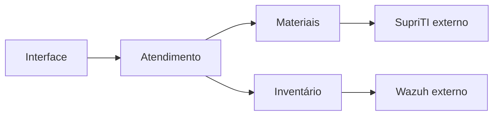

# Sistema de Chamados da Prefeitura

- **Autor:** Luis Felipe Vieira
- **Situação:** rascunho — problema, visão geral, objetivos e limites aprovados; plano técnico em construção.
- **Data:** 2026-11-10
- **Base:** [concepts_brief.md](./concepts_brief.md), aprovado como base do planejamento e atualizado com as decisões posteriores à revisão Goldfish.
- **Etapa atual:** problema, visão geral, objetivos e limites. Arquitetura e plano de implementação ainda não foram definidos neste documento.

## Visão geral

### Alteração de escopo aprovada durante o plano técnico

O autor decidiu priorizar a adoção pelos funcionários: permitir abertura por formulário sem login e manter a conversa, o acompanhamento e os pedidos de reabertura no WhatsApp/Chatwoot. A equipe técnica registra e atualiza o atendimento no sistema. Não implementar portal autenticado para o solicitante nem chat próprio nesta etapa.

Essa revisão altera parte da seção inicial anteriormente aprovada. Onde o texto anterior prevê notificações internas ou ações diretas do solicitante no portal, prevalece este novo fluxo pelo canal existente. As notificações dos técnicos e os controles internos continuam no escopo. Prazo e histórico de reabertura permanecem como referência; o registro e a avaliação pelo técnico de pedidos recebidos externamente ainda serão detalhados. Não há decisão de integrar automaticamente Chatwoot ou WhatsApp.

O autor confirmou os campos da abertura simplificada: nome, setor, telefone/WhatsApp, assunto, descrição e patrimônio opcional, além de anexo opcional de imagem, como foto do equipamento ou captura do erro. O contato permite à equipe continuar a conversa no canal existente, sem exigir conta do solicitante. Quantidade, formatos e tamanho máximo das imagens permanecem por definir. A relação dos campos essenciais com o configurador por categoria e as medidas para receber abertura não autenticada ainda precisam ser definidas. O formulário não deve permitir consulta anônima ao histórico nem apresentar dados informados como identidade comprovada. O configurador por categoria permanece previsto, sujeito à definição de uma abertura curta e de dados complementados pela equipe.

O sistema de Chamados organiza o atendimento interno de TI da Prefeitura. O solicitante informa seu problema por um formulário adequado à categoria. A equipe técnica faz a triagem, define a prioridade, assume o atendimento e registra intervenções, solução e materiais utilizados. O administrador configura formulários e permissões por grupos.

O atendimento mantém referências aos equipamentos e ao seu histórico técnico. O SupriTI permanece responsável pelo estoque oficial, pelas reservas e pelas movimentações de materiais. O Wazuh fornece inventários para comparação de hardware. Chamados deve relacionar essas informações sem confundir a conclusão do serviço com a confirmação de uma movimentação externa ou a evidência de uma mudança no equipamento.

O técnico fecha o chamado após conferir o resumo final. O fechamento não depende de confirmação do solicitante nem da disponibilidade do SupriTI. Pendências de integração permanecem visíveis em uma seção independente e continuam sendo acompanhadas por técnicos ativos. O solicitante pode pedir reabertura dentro de sete dias corridos; o pedido depende de aceite técnico e continua válido para avaliação depois do prazo se tiver sido apresentado a tempo.

## O problema

O planejamento busca reunir informações que precisam ser consultadas em conjunto durante uma manutenção: problema relatado, equipamento afetado, intervenções anteriores, responsáveis pelo atendimento e destino dos materiais. Quando o registro do atendimento e o controle de estoque têm ciclos diferentes, fechar o chamado não garante que a reserva, a baixa ou a liberação já tenha sido confirmada. Apresentar esses resultados como um único estado pode ocultar divergências ou provocar repetição de uma movimentação.

A equipe também precisa distinguir chamados novos dos já assumidos, ordenar o trabalho por prioridade e antiguidade e compartilhar atendimentos sem perder autoria. A participação de vários técnicos exige impedir que uma edição desatualizada sobrescreva alterações de materiais ou que alguém confirme um resumo diferente daquele que conferiu.

Formulários fixos não atendem à decisão de configurar dados diferentes por categoria. Ao mesmo tempo, mudar um formulário não pode alterar o significado das respostas de chamados anteriores. A configuração precisa preservar o registro histórico sem exigir rascunhos ou confirmações adicionais do solicitante.

Falhas externas e desativação de técnicos não podem tornar pendências invisíveis. Uma baixa recusada por falta de saldo exige regularização humana, mesmo que o atendimento já tenha terminado. A seção independente de pendências e a substituição do último técnico ativo devem manter esse trabalho identificável e atribuído.

Esses problemas e resultados pretendidos vêm do planejamento funcional. Ainda não foram medidos tempos de atendimento, volume de pico ou custos operacionais, nem foi comprovado que a cópia de SupriTI analisada corresponde à instalação em produção.

## Objetivos

Os critérios abaixo orientam o desenho e sua validação futura; não representam testes já executados.

1. **Permitir abertura adequada à categoria.** O administrador configura visualmente campos, ordem, tipos, obrigatoriedade e condições de exibição. Chamados existentes preservam a versão usada na abertura. Um erro de envio mantém os dados na página atual para correção, sem criar rascunho persistente.
2. **Organizar a fila sem ocultar chamados novos.** Manter a triagem no topo, independente dos filtros pessoais. Ao assumir, retirar o chamado da triagem e aplicar prioridade média caso o técnico não escolha outra. Ordenar os atendimentos por crítica, alta, média e baixa, com os mais antigos primeiro em cada nível. A prioridade é interna à equipe técnica.
3. **Preservar o trabalho compartilhado e sua autoria.** Permitir vários participantes, histórico de intervenções e permissões configuradas por grupos. Manter acompanhamento ativo na desativação do último técnico e notificar o substituto quando escolhido por outro administrador.
4. **Fechar com conferência do conteúdo efetivo.** Exigir nova conferência quando materiais, solução, diagnóstico ou equipamento mudarem durante a revisão. O fechamento é imediato e não depende do aceite do solicitante. Preservar o histórico nas reaberturas e não repetir consumos anteriores.
5. **Oferecer reabertura com decisão rastreável.** Permitir pedidos dentro dos sete dias corridos do fechamento mais recente, sujeitos a aceite ou recusa de qualquer técnico. Reabertura direta equivale a aceite quando há pedido pendente. Preservar decisões anteriores e aplicar a primeira ação válida nas disputas simultâneas. Reabertura técnica posterior a uma recusa é permitida dentro da janela vigente.
6. **Integrar materiais sem duplicar o controle oficial.** Reservar durante o atendimento e consumir somente os materiais atestados no fechamento, respeitando quantidade e condição. Tratar cancelamentos conforme o destino real das peças. A integração não deve duplicar efeitos ao repetir uma operação ou recuperar uma resposta perdida.
7. **Continuar o atendimento durante falhas externas.** Persistir intenções, separar indisponibilidade de recusa de negócio, preservar sucessos parciais e limitar a carga de recuperação. Mostrar pendências em seção independente, inclusive para chamados fechados ou cancelados, sem declará-las concluídas antes da confirmação externa.
8. **Relacionar histórico técnico e alterações de hardware.** Permitir consulta por equipamento e comparação diária com dados do Wazuh, com retenção limitada. Ausência de coleta não comprova ausência de alteração. A escolha da referência para dias sem coleta ainda depende de decisão.
9. **Comunicar pelo próprio sistema.** Usar notificações internas com indicação de leitura e retenção de 30 dias. Remover avisos de ações pendentes quando deixarem de ser aplicáveis, preservando o histórico do chamado.

## Limites e itens fora do escopo atual

- **Estoque paralelo:** Chamados guarda vínculos, intenções e resultados; o saldo oficial continua no SupriTI. O fluxo próprio da integração não substitui o ciclo das solicitações comuns desse sistema.
- **Aceite de conclusão pelo solicitante:** não haverá botão de confirmação, aceite de compliance ou fechamento automático após sete dias. O prazo serve à reabertura, não à confirmação de um serviço já fechado.
- **Rascunhos:** não haverá salvamento manual ou automático para retomada posterior. Preservar dados após um erro na página aberta não implica recuperação após fechar ou recarregar a página.
- **Comunicação externa:** e-mail, SMS, WhatsApp e implementação de um canal alternativo ficam fora desta etapa. Não acrescentar etapas de contestação à recusa de reabertura.
- **Login único:** as autenticações humanas dos sistemas permanecem separadas; integração com AD é futura.
- **Destino de componentes retirados dos equipamentos:** avaliação de reaproveitamento e eventual entrada no SupriTI são realizadas pelo técnico fora do fluxo de estoque de Chamados. Isso não exclui o registro técnico da intervenção nem a devolução de materiais separados do estoque para um atendimento cancelado.
- **Cópia integral do Wazuh:** não replicar todo o histórico bruto de inventários ou logs no novo sistema.
- **Privilégios fixos por nível técnico:** N1, N2 e N3 não substituem a configuração dinâmica de grupos e permissões.

O projeto inclui histórico de ativos e consulta à base de conhecimento, mas fluxos patrimoniais e publicação de artigos ainda não estão detalhados. Este documento não os declara prontos nem os exclui silenciosamente do projeto.

## Questões abertas para as próximas seções

- Definir arquitetura, tecnologias, armazenamento, hospedagem e mecanismos de credencial e fila com decisão explícita do autor.
- Especificar os contratos e a compatibilidade com a instalação real do SupriTI, inclusive recuperação após restauração ou retirada da integração com reservas ativas.
- Completar a matriz de permissões, os estados do atendimento e da integração, o fuso e o instante limite da janela de reabertura.
- Confirmar se o aceite técnico de pedidos de reabertura também se aplica a chamados cancelados por técnicos; as decisões atuais o definem para os fechados por resolução.
- Conciliar campos essenciais do chamado com o configurador por categoria; confirmar tipos de campo e regras de troca de categoria ou edição após abertura.
- Detalhar a seção de pendências, suas informações operacionais e os sinais de falta de progresso, sem depender da retenção das notificações.
- Fechar associação de equipamento e agente Wazuh, referência em dias sem coleta, componentes comparados e retenção mínima.
- Definir limites de anexos, retenção de dados, segurança, backup, implantação, reversão e metas mensuráveis. Não tratar a média mencionada de cinco chamados por dia como pico ou número de operações de integração.

## Plano técnico — em construção

### Organização em serviços separados

O autor escolheu serviços separados para permitir que mais pessoas desenvolvam o projeto de forma cooperativa. Os serviços devem ter responsabilidades e interfaces explícitas para que colaboradores possam trabalhar em partes diferentes sem depender continuamente de alterações internas de outros serviços.

A escolha permite implantações independentes, mas acrescenta comunicação entre serviços, compatibilidade de contratos, autenticação entre aplicações e investigação de falhas distribuídas. Separar serviços por si só não garante autonomia: limites mal definidos podem exigir mudanças coordenadas e dificultar o trabalho da equipe. A divisão precisa preservar as regras de consistência e recuperação já aprovadas.

O autor definiu um único repositório para o código dos serviços de Chamados. Cada serviço deve manter limites explícitos dentro desse repositório, permitindo colaboração e revisão conjunta de mudanças nos contratos. Compartilhar o repositório não implica compartilhar banco de dados, executar todos os serviços no mesmo processo ou exigir implantação conjunta.

As fronteiras dos serviços, seus responsáveis e a propriedade dos dados ainda não foram decididas. Não presumir um serviço para cada entidade ou tela, nem um banco compartilhado ou separado sem decisão do autor. O SupriTI continua sendo um sistema externo responsável pelo estoque oficial; a escolha não autoriza duplicar esse estoque em um novo serviço nem mover seu código para este repositório.

### Divisão inicial de responsabilidades

O autor escolheu três serviços para permitir frentes de desenvolvimento cooperativo e facilitar o isolamento de problemas em materiais e inventário:

| Serviço | Responsabilidade inicial | Limite |
| --- | --- | --- |
| Atendimento | Chamados, formulários por categoria e fluxo de atendimento, incluindo fechamento e reabertura. | Não controla o saldo oficial do SupriTI nem realiza comparação de inventários Wazuh. |
| Materiais | Integração com SupriTI: consulta, reservas, ajustes, liberações, consumos, devoluções e acompanhamento de resultados. | SupriTI mantém a propriedade do estoque oficial. A distribuição da persistência de intenções entre Atendimento e Materiais ainda precisa ser decidida. |
| Inventário | Equipamentos e integração com Wazuh para comparação de hardware e registro de alterações. | Não interpreta uma alteração detectada como autorização ou consumo de material; relacionamentos com intervenções exigem evidência. |

A interface ficará no mesmo repositório. O autor definiu que contas, login, grupos, permissões, sessões, notificações internas dos técnicos e base de conhecimento ficam dentro de Atendimento, sem criar serviços separados para essas funções.

### Base de conhecimento em Atendimento

Atendimento mantém os artigos da base de conhecimento e seus vínculos com as soluções dos chamados. Não criar um quarto serviço para esse recurso. A localização não define automaticamente autoria, revisão, publicação, visibilidade, versionamento ou criação de artigos a partir de soluções: essas regras continuam pendentes de detalhamento, respeitando as permissões por grupos e a proteção de informações dos chamados.

### Notificações centralizadas em Atendimento

Atendimento mantém as notificações internas dos técnicos e reúne no mesmo painel os avisos pertinentes dos três serviços. Materiais e Inventário encaminham os avisos pela API de Atendimento, sem consultar ou alterar diretamente suas tabelas de notificações. Aplicar as regras já aprovadas de destinatários, leitura, retenção de 30 dias e remoção de avisos que deixaram de ser aplicáveis. Não restabelecer notificações do solicitante retiradas pela simplificação do escopo.

A notificação não é a fonte oficial do resultado de uma operação nem substitui a seção independente de pendências. Uma falha no encaminhamento do aviso não deve apagar o resultado registrado no serviço responsável. Contrato, identificação para evitar avisos duplicados e recuperação de falhas de entrega ainda precisam ser definidos.

A separação facilita localizar e conter falhas, mas não garante isolamento sozinha. Falhas de Materiais não devem bloquear o fechamento técnico, conforme regra já aprovada. O desenho precisa definir como registrar a intenção com segurança quando esse serviço estiver indisponível, além de tempos de espera e recuperação sem duplicidade.

O autor confirmou que a indisponibilidade de Inventário não deve impedir a continuidade do atendimento nem o fechamento do chamado usando o vínculo de equipamento já registrado. Preservar esse vínculo e informar que a consulta ao histórico do equipamento e ao Wazuh está temporariamente indisponível; não apresentar ausência de resposta como ausência de histórico ou de alterações.

Durante essa falha, permitir também a abertura de chamado sem selecionar equipamento. O vínculo poderá ser realizado depois que Inventário voltar; não criar equipamento ou associação fictícia para contornar a indisponibilidade. A regra de contingência deve permitir enviar o formulário mesmo se ele normalmente exigir o seletor de equipamento.

Se o atendimento terminar antes da recuperação de Inventário, o técnico pode fechar o chamado ainda sem vínculo, registrando a indisponibilidade como justificativa e mantendo a associação pendente para regularização posterior. O fechamento técnico não elimina essa pendência. Registrar a associação posterior com autoria e data, preservando a justificativa e o histórico do fechamento, sem exigir reabertura apenas para completar o vínculo. Esta decisão não escolhe um mecanismo de cópia ou armazenamento dos dados do equipamento.

O autor confirmou que essa associação deve ser acompanhada na mesma seção independente de pendências já definida, identificada como “Vínculo de equipamento pendente”. Manter o aviso enquanto a associação não for regularizada, inclusive com o chamado fechado. Distinguir esse tipo das pendências de estoque; concluir o vínculo não resolve eventuais operações de materiais ainda pendentes no mesmo chamado. A recuperação de Inventário, por si só, não comprova a associação.

O autor escolheu banco compartilhado entre Atendimento, Materiais e Inventário. A propriedade das tabelas, as permissões de acesso entre serviços, os contratos e os mecanismos de comunicação continuam pendentes de decisão. O plano técnico completo ainda depende das decisões seguintes e de aprovação própria.

### Registro de materiais durante indisponibilidade

O autor confirmou que, se o serviço de Materiais estiver indisponível e o catálogo não puder ser consultado, o técnico pode registrar no chamado os materiais utilizados para sincronização posterior. A falha não impede esse registro nem o fechamento técnico. Preservar os dados informados e apresentar a pendência, sem declarar reserva ou consumo confirmado no SupriTI.

O autor confirmou que o registro provisório deve conter nome ou descrição do material, quantidade e condição (novo ou recondicionado). Após a recuperação do serviço, o técnico deve selecionar o produto correto no catálogo antes da execução da baixa. O retorno do serviço, por si só, não autoriza consumir um material ainda sem identificação oficial. Não fazer correspondência automática por nome nem criar produto oficial a partir do registro provisório. Preservar os dados informados e registrar a associação posterior com autoria e data, mantendo as validações de saldo, condição e proteção contra duplicidade já acordadas.

O autor confirmou que os materiais provisórios ainda sem produto oficial associado devem aparecer na seção independente de pendências, com o aviso “Identificação de material pendente”, inclusive se o chamado já estiver fechado. Remover esse aviso somente após a identificação; a associação do produto não equivale à confirmação da baixa, cujas pendências e resultados continuam sendo acompanhados separadamente.

O autor escolheu fila persistente para o encaminhamento e processamento posterior dessas operações, distinguindo pendência de identificação de operação pronta para baixa. Enquanto houver apenas descrição, quantidade e condição, preservar o registro aguardando ação humana, sem executar tentativas de consumo nem procurar adivinhar o produto pelo nome. A fila não substitui a identificação pelo técnico.

Depois de o técnico selecionar o produto oficial, a operação pode ser preparada para processamento automático, respeitando a intenção vigente do chamado e as validações de saldo, condição, autorização e proteção contra duplicidade. Identificar um material de chamado ainda em atendimento não antecipa o consumo: a baixa continua condicionada à revisão e ao fechamento, ou ao tratamento de cancelamento já aprovado. A seleção do produto não é confirmação de movimentação externa.

A tecnologia da fila, a propriedade do registro provisório e o mecanismo para persistir os dados e publicar a operação sem perda ainda precisam ser escolhidos. Respeitar a escrita exclusiva por serviço. A escolha não define que todos os processos do sistema serão assíncronos nem exige tentativas repetidas enquanto a identificação estiver pendente.

### Fila persistente no PostgreSQL

O autor escolheu usar somente PostgreSQL para persistência das filas, sem RabbitMQ ou outro intermediário de mensagens nesta etapa. As tarefas serão registros duráveis processados por executores dos serviços; não tratar a simples gravação de uma tabela como implementação completa de entrega e recuperação.

Cada serviço deve acessar apenas suas próprias tabelas, inclusive as de tarefas e de encaminhamento. Não usar uma tabela compartilhada que permita a um serviço consultar ou alterar a fila interna de outro. A comunicação entre serviços continua passando pelas interfaces responsáveis. O mecanismo de encaminhamento, confirmação de recebimento e recuperação diante de falha entre gravação e envio ainda precisa ser definido.

O desenho deve especificar reserva concorrente de tarefas, recuperação após interrupção do executor, intervalos e limites de tentativas, tratamento de recusas de negócio e resultados desconhecidos, identificação estável das operações e acompanhamento operacional. Uma tarefa sem produto identificado continua aguardando ação humana, sem tentativas de baixa. Biblioteca ou implementação da fila, transações e estratégia de processamento ainda não foram escolhidas.

#### Encaminhamento de Atendimento para Materiais

Na mesma transação do PostgreSQL que confirma o fechamento e registra a intenção de consumo, Atendimento grava uma tarefa de envio em sua própria fila para cada operação pronta. Se a transação falhar, o fechamento e as tarefas dessa tentativa são revertidos juntos. Uma intenção cujo produto ainda precisa ser identificado fica registrada como pendência humana e só gera tarefa quando estiver apta a processamento.

Após a confirmação da transação, um executor de Atendimento envia a tarefa pela API de Materiais. Uma nova tentativa de envio usa o mesmo identificador da operação. Materiais deve reconhecer um identificador já recebido, devolver a confirmação correspondente e evitar a criação de trabalho duplicado. A confirmação de recebimento encerra o envio e indica que Materiais registrou a operação de forma durável. O resultado da movimentação no SupriTI é acompanhado separadamente.

#### Ordem das operações por item

Atendimento encaminha as operações de cada item em sequência. Ao fechar um chamado, registra a intenção de consumo na mesma transação do fechamento. A tarefa de consumo fica bloqueada enquanto a reserva anterior do mesmo item tiver um resultado desconhecido. O fechamento técnico permanece registrado, e a seção de pendências mostra o item que aguarda conciliação. Outros itens podem seguir suas próprias sequências.

Atendimento só invalida localmente uma reserva superada quando pode garantir que nenhum executor iniciou seu envio. A invalidação e a autorização de envio precisam ser mutuamente exclusivas no PostgreSQL. Se o envio já puder ter ocorrido, preservar o identificador da reserva e obter seu desfecho por meio de Materiais. A confirmação de recebimento pela API permite acompanhar a reserva, mas o consumo só é encaminhado depois que seu desfecho estiver registrado. Esse resultado informa se o consumo deve usar uma reserva confirmada ou seguir o fluxo previsto para um item sem reserva.

Se uma resposta se perder e Materiais ainda não puder confirmar o resultado da reserva no SupriTI, manter o consumo pendente. Essa espera evita executar o consumo com uma premissa incorreta sobre a reserva, mas pode atrasar a movimentação mesmo após o fechamento. O contrato para consultar resultados e os intervalos de recuperação continuam em aberto.

#### Posse de tarefas com prazo

Cada executor assume uma tarefa elegível em uma transação curta no PostgreSQL. A transação registra o identificador exclusivo da tentativa, o prazo de posse e o início da tentativa antes de liberar o executor para chamar a API. Uma tarefa só é elegível quando sua vez na sequência do item chegar e quando estiver disponível para execução ou retomada. A chamada externa ocorre depois de confirmar a transação.

O executor pode renovar a posse enquanto a tentativa atual estiver vigente. Se o prazo vencer, outro executor pode assumir a tarefa com um novo identificador de tentativa. Renovação e registro do resultado exigem que o identificador corresponda à posse atual e que o prazo ainda esteja vigente. Uma resposta tardia de uma tentativa vencida fica sujeita à recuperação pelo executor atual.

O identificador da operação permanece igual nas retomadas. Uma chamada iniciada antes do vencimento pode chegar à API durante uma nova tentativa. A API receptora deve reconhecer o identificador da operação e preservar um único registro de recebimento. Se a chamada tiver resultado desconhecido no SupriTI, aplicar as regras de conciliação antes de liberar a operação seguinte do item.

#### Prazos iniciais de posse e recuperação

A posse dura inicialmente 120 segundos. Enquanto a tarefa estiver em execução, o executor tenta renovar a posse a cada 30 segundos. Uma renovação aceita estende a posse por 120 segundos a partir da renovação.

Após a primeira falha transitória, aguardar 30 segundos antes da nova tentativa. A cada falha transitória consecutiva, dobrar o intervalo até o teto de 15 minutos. Distribuir no tempo as tentativas de itens diferentes para reduzir picos quando várias tarefas falharem juntas. Esses valores são iniciais e devem ser avaliados com medições na VM e nas integrações.

Uma recusa de negócio fica visível para regularização. Quando o resultado de uma movimentação no SupriTI for desconhecido, a próxima ação é consultar o desfecho antes de repetir a movimentação.

#### Tempos limite das chamadas da fila de materiais

| Chamada | Prazo para conectar | Prazo total |
| --- | --- | --- |
| Atendimento → Materiais | 3 segundos | 10 segundos |
| Materiais → SupriTI | 5 segundos | 20 segundos |

O prazo total inclui o tempo de conexão. Materiais confirma o registro durável da operação na sua fila dentro da chamada de Atendimento. A chamada ao SupriTI ocorre separadamente, durante o processamento dessa operação. Se o prazo vencer depois de uma movimentação poder ter chegado ao SupriTI, registrar resultado desconhecido e consultar o desfecho antes de qualquer reenvio. Os prazos são valores iniciais a validar com medições.

#### Suspensão após falhas transitórias repetidas

Após dez falhas transitórias consecutivas da mesma tarefa, suspender as tentativas automáticas e manter a pendência visível para revisão, com a última falha registrada. Contar apenas chamadas da tarefa que falharam. Os intervalos entre tentativas e a pausa da dependência ficam fora da contagem. A recuperação da dependência pode liberar outras tarefas. Para retomar a tarefa suspensa, a equipe revisa a pendência e autoriza uma nova tentativa com o mesmo identificador da operação. Se o resultado de uma movimentação anterior ainda for desconhecido, retomar pela consulta do desfecho.

A suspensão pode manter o item pendente mesmo depois de a dependência voltar. As operações posteriores do mesmo item continuam sujeitas à ordem definida acima.

#### Pausa e retomada por dependência

Contar falhas transitórias consecutivas por dependência. Após três falhas, pausar novos envios para a dependência afetada por três minutos. Tarefas novas e tarefas reagendadas aguardam a retomada. Tarefas de outras dependências seguem seu processamento. Recusas de negócio ficam fora da contagem de falhas transitórias.

Depois da pausa, liberar uma chamada por vez a partir de tarefas elegíveis para testar a API no fluxo real. Se a tarefa tiver uma movimentação de resultado desconhecido, consultar o desfecho antes de repetir o envio. Após três respostas que confirmem a recuperação, permitir até duas chamadas simultâneas. Manter esse limite por três minutos sem nova falha transitória antes de voltar ao limite normal. Qualquer falha transitória durante a retomada reinicia a pausa de três minutos.

Em operação normal, permitir até quatro chamadas simultâneas por dependência, somadas entre os executores responsáveis. Cada item continua seguindo sua própria sequência. Todos os executores responsáveis pela mesma dependência precisam respeitar a pausa e os limites de chamadas simultâneas de cada fase. Os valores são iniciais e devem ser avaliados na VM e nas integrações.

A decisão evita operar um intermediário de mensagens separado, mas concentra também a persistência das tarefas no banco compartilhado. Não oferece disponibilidade independente do PostgreSQL nem proteção contra perda do armazenamento da VM sem recuperação apropriada.

### Acesso ao formulário pela internet

O autor confirmou que o formulário de abertura sem login deve ser acessível também fora da rede da Prefeitura, inclusive por celular conectado à internet. Essa decisão permite enviar solicitações externamente, mas não autoriza consulta anônima a chamados, anexos recebidos, contatos, cadastros de equipamentos ou histórico.

A exposição externa do formulário não define exposição pública dos três serviços, do PostgreSQL ou de suas filas. O autor também confirmou acesso ao painel dos técnicos pela internet, com login obrigatório e aplicação das permissões do usuário autenticado. Separar as funções públicas de abertura das consultas e ações restritas da equipe. O mecanismo de autenticação e sessão ainda precisa ser escolhido; acesso externo não autoriza consulta anônima ao painel.

Domínio, publicação HTTPS, entrada de rede, proteção contra envios abusivos e limites de upload ainda precisam ser definidos. Nenhuma configuração de servidor ou rede foi realizada nesta etapa de desenho.

### Contas da equipe técnica

O autor confirmou que as contas dos técnicos serão criadas pelo administrador, com login e senha próprios do sistema. Não prever autocadastro público de técnicos. A integração com AD permanece para uma etapa futura. O formulário público de abertura não exige nem cria uma conta técnica.

Manter as permissões dinâmicas por grupos e os controles de desativação e substituição já aprovados. A criação da conta não concede acesso irrestrito por si só. O administrador fornece uma senha temporária, que deve ser trocada obrigatoriamente no primeiro acesso antes da utilização das funções do painel. Se um técnico esquecer a senha, o administrador a redefine com outra senha temporária e o sistema exige nova troca no próximo acesso. Essa recuperação não depende de envio automático por e-mail ou de autocadastro. Autenticação adicional, duração e revogação de sessões e localização dessas funções entre os três serviços ainda precisam ser definidos.

### Comunicação por APIs

O autor confirmou a preferência por APIs para comunicação entre Atendimento, Materiais e Inventário. Consultas e solicitações de alteração passam pela API do serviço responsável, sem acesso direto às suas tabelas. A fila persistente no PostgreSQL continua sendo interna a cada serviço; o encaminhamento de trabalho entre serviços ocorre pelas APIs, com confirmação e recuperação ainda a especificar.

O autor definiu HTTP com mensagens JSON para as APIs entre os três serviços. Essa escolha não estabelece, por si só, um estilo REST completo nem torna todas as operações síncronas do ponto de vista do usuário. Preservar as contingências e o processamento posterior já aprovados. Autenticação entre serviços, proteção do transporte, versionamento, contratos, tempos de espera e tratamento de erros ainda precisam ser definidos. A escolha não presume que os contratos externos do SupriTI e do Wazuh já atendam ao padrão definido para os serviços internos.

### Banco compartilhado

Os três serviços de Chamados utilizarão um banco compartilhado. A escolha não inclui o banco do SupriTI, que permanece externo e responsável pelo estoque oficial, nem autoriza acesso direto ao banco do Wazuh.

O autor definiu PostgreSQL como banco compartilhado, alinhado à experiência da equipe. Essa escolha mantém a escrita exclusiva e as consultas entre serviços pelas interfaces responsáveis. Versão do PostgreSQL, organização das tabelas e schemas, credenciais por serviço, migrações, limites de conexão e configuração de persistência e recuperação ainda precisam ser definidos. O PostgreSQL será hospedado na mesma VM Debian dos serviços, dentro do orçamento total de recursos já informado.

O banco compartilhado facilita consultas e coordenação dos dados, mas constitui uma dependência comum: sua indisponibilidade pode afetar os três serviços. Alterações incompatíveis nas estruturas compartilhadas também podem exigir atualização coordenada. O objetivo aprovado de isolar falhas entre serviços continua válido para falhas específicas de cada serviço; não representa independência frente a falhas do banco.

O autor definiu escrita exclusiva por serviço: Atendimento, Materiais e Inventário alteram apenas as tabelas sob sua responsabilidade. Uma alteração em dados pertencentes a outro serviço deve passar pela interface desse serviço, preservando suas validações e regras. O autor também definiu que consultas a dados de outro serviço passam pela interface responsável, sem leitura direta de suas tabelas. O compartilhamento do banco não autoriza contornar essas fronteiras com consultas ou alterações diretas. A propriedade concreta das tabelas, as credenciais e a coordenação de migrações ainda precisam ser definidas.

Consequentemente, compartilhar o banco não torna os dados de Inventário acessíveis a Atendimento quando o serviço Inventário estiver indisponível. As contingências já aprovadas permanecem: preservar o vínculo registrado no chamado, permitir abertura e fechamento sem novo vínculo durante a falha e acompanhar a associação pendente para regularização.

O autor definiu que Atendimento deve guardar somente o identificador do equipamento vinculado, sem copiar patrimônio, descrição ou outro resumo do cadastro. Consultar os detalhes pela interface de Inventário. Durante sua indisponibilidade, preservar o identificador e informar que os detalhes não puderam ser consultados; não apagar o vínculo nem criar uma associação pendente apenas porque os detalhes de um vínculo existente estão inacessíveis. A pendência de vínculo aplica-se aos chamados que ainda precisam da associação. O formato do identificador ainda precisa ser definido.

Equipamentos que deixarem de ser usados devem ser desativados, preservando o cadastro e seu identificador para consulta pelos chamados antigos, sem exclusão que rompa esses vínculos. A desativação não apaga o histórico técnico nem implica uma movimentação de estoque ou um fluxo patrimonial de baixa já especificado. Equipamentos desativados não podem ser selecionados em novos chamados; a seleção volta a ser permitida se forem reativados. Preservar os vínculos antigos durante a desativação e a reativação, sem criar outro cadastro apenas para permitir o retorno ao uso.

O autor definiu que qualquer técnico pode desativar e reativar equipamentos, sem exigir uma concessão específica adicional para essas ações. Registrar a ação, a autoria e a data no histórico. Essa autorização não concede acesso direto às tabelas de Inventário nem altera as regras de consulta e preservação dos vínculos.

As setas representam relações funcionais, sem definir protocolo, sincronismo ou um ponto único obrigatório de acesso à interface.

### Linguagem dos serviços

O autor escolheu Rust para os três serviços de backend: Atendimento, Materiais e Inventário. As motivações são economizar recursos da VM e aprender a linguagem durante o projeto. A equipe de três pessoas possui experiência principalmente em JavaScript, Python e Java; o planejamento deve considerar o aprendizado e a revisão de código em Rust. A escolha não comprova economia de memória ou desempenho na carga real, que ainda precisam ser medidos.

Framework web, bibliotecas de acesso ao banco, cliente de fila e linguagem ou framework da interface ainda não foram escolhidos. Esta decisão não altera as responsabilidades dos serviços, o banco compartilhado, os limites de acesso aos dados ou os requisitos de recuperação.

### Ambiente de implantação

O autor definiu hospedagem em servidor próprio da Prefeitura, em uma VM Debian, com um container para cada serviço: Atendimento, Materiais e Inventário. Manter os serviços como processos separados, com configuração e execução próprias. A ferramenta de execução dos containers, a publicação da interface, a implantação do banco compartilhado e da fila persistente ainda precisam ser definidas.

Os containers permitem separar a execução dos serviços, mas todos dependem da mesma VM: falhas da VM, do armazenamento ou esgotamento de recursos podem afetar o conjunto. A configuração precisará prever limites de recursos, persistência, recuperação e monitoramento. Não presumir alta disponibilidade nem redundância de servidor a partir desta escolha.

O autor informou a capacidade inicial da VM: **4 GB de RAM, 4 vCPUs e 100 GB de armazenamento** e confirmou que o banco compartilhado e a fila persistente também serão hospedados nessa mesma VM. Tratar esses recursos como orçamento total, incluindo Debian, serviços, banco e fila, não como capacidade disponível para cada componente. A suficiência para a carga real ainda precisa ser validada. O volume de anexos, a retenção de logs e os requisitos de backup influenciam esse dimensionamento; não reservar silenciosamente o mesmo disco como única cópia de recuperação. A persistência da fila não garante disponibilidade durante falha da VM nem recuperação após perda do seu armazenamento. Metas de recuperação e distribuição dos recursos permanecem abertas.

### Validação e duração de sessões baseada no SupriTI

O autor pediu reproduzir o comportamento de sessão do SupriTI. A leitura estática de `apps/api/src/auth/auth.service.ts`, `session.guard.ts` e `auth.controller.ts` na cópia de SupriTI encontrou os padrões de 30 minutos de inatividade e limite absoluto de 8 horas desde o login, configuráveis por ambiente. Adotar esses padrões em Chamados; a configuração efetiva de produção do SupriTI não foi consultada.

A sessão é mantida no servidor, com hash do token persistido, e o navegador recebe o token em cookie HttpOnly, SameSite=Lax e Secure em produção. A cada requisição protegida, verificar existência, revogação, expiração por inatividade, limite absoluto e conta ativa. Requisições autenticadas renovam a janela de inatividade, sem ultrapassar o limite absoluto; no código examinado, a atualização persistida ocorre quando a última atividade registrada tem mais de um minuto. Atividade significa requisição autenticada observada pelo servidor, não movimento de mouse ou digitação. O cookie durar até o limite absoluto não impede a expiração anterior por inatividade.

Preservar a decisão de revogação imediata ao redefinir senha ou desativar conta. Atendimento é responsável por contas, grupos, permissões, login e sessões. Materiais e Inventário recorrem à API de Atendimento para validar acessos técnicos, sem ler suas tabelas nem compartilhar sessões com SupriTI. O contrato de validação e as credenciais entre serviços ainda precisam ser definidos. Esta inspeção não valida o comportamento em produção nem implementa autenticação.

### Revogação de sessões

O autor confirmou que redefinir a senha ou desativar uma conta deve encerrar imediatamente todas as sessões abertas do técnico. Requisições posteriores com essas sessões devem ser recusadas, inclusive se a página continuar aberta. A sessão antiga não volta a valer após a troca da senha temporária ou eventual reativação da conta; exigir novo login. Atendimento mantém a validação de identidade e sessão oferecida aos demais serviços por API. Não aceitar permissões declaradas pelo cliente como comprovação de autorização.

Revogar sessões não apaga autoria ou histórico nem cancela automaticamente operações de materiais já autorizadas. Preservar as regras de continuidade e de suspensão administrativa de operações específicas anteriormente aprovadas. A desativação também mantém a exigência de substituição do último participante ativo nos chamados vinculados.

## Framework HTTP: Axum

O autor escolheu Axum como framework HTTP dos serviços Atendimento, Materiais e Inventário. Usar o mesmo framework nos três serviços para manter uma base comum de desenvolvimento. Preservar os contratos HTTP/JSON e as responsabilidades já definidas; o acesso ao PostgreSQL foi definido posteriormente com SQLx e SQL direto. O mecanismo da fila, as sessões e a tecnologia da interface ainda precisam ser detalhados.

O desenho seguirá os mecanismos de rotas, extratores e integração com Tokio/Tower do Axum. Versões, bibliotecas complementares e padrões de erros e middleware ainda serão definidos. Não há medição que comprove um consumo específico de recursos da aplicação a partir dessa escolha.

## Acesso ao PostgreSQL: SQLx com SQL direto

O autor escolheu SQLx com consultas SQL escritas diretamente, sem ORM, para Atendimento, Materiais e Inventário. Preservar a propriedade das tabelas por serviço e o acesso aos dados de outros serviços somente pelas APIs responsáveis. SQL direto não autoriza consultas cruzando essas fronteiras.

A decisão permite explicitar consultas e atualizações condicionais, transações e operações concorrentes da fila PostgreSQL. Não representa garantia de desempenho ou consumo de memória. Usar parâmetros para os valores das consultas; versões, pools, migrações, estratégia de verificação das consultas e mecanismos de concorrência, tentativas e recuperação da fila ainda precisam ser definidos.

## Escopo futuro para discussão: alerta de inatividade

Registrar em Inventário a proposta de monitorar equipamentos sem atividade, usando a última atualização ou atividade disponível nos registros do Wazuh. Ao ultrapassar um prazo configurável pelo administrador, gerar alerta de possível sumiço do equipamento; 35 dias é a referência inicial proposta, ainda sujeita à discussão. A funcionalidade complementa a comparação de hardware e fica reservada para discussão futura, sem implementação nesta etapa.

Ainda definir a fonte e o significado de atividade no Wazuh, periodicidade, equipamentos elegíveis, tratamento de equipamentos desativados, registros ausentes e indisponibilidade da coleta, além de destinatários e ciclo dos alertas. Ausência de atualização não comprova desaparecimento. Este registro não pressupõe que a integração atual já ofereça o dado necessário nem exige replicar logs brutos.

## Referências

- [Brief funcional e decisões atualizadas](./concepts_brief.md).
- [Relatório da revisão Goldfish](./goldfish_review_report.md): descreve a revisão do brief anterior às respostas do autor; não é revisão deste desenho.
- [Registro de decisões](./mudancas_necessarias_supriti.md).
- [Planejamento inicial](./planejamento_suporte_ti.md).
- [Análise estática documentada do SupriTI](./analise_integracao_supriti.md).

*Redigido com EGM. Esta etapa produz documentação de desenho, sem implementação.*
