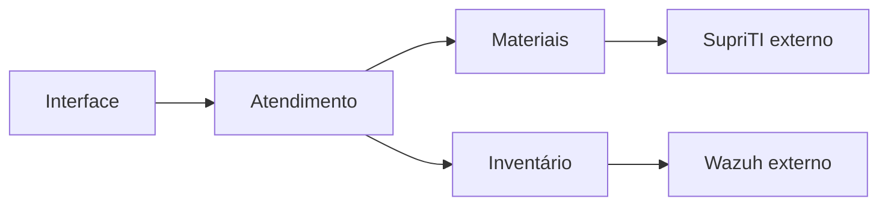

# Sistema de Chamados da Prefeitura

- **Autor:** Luis Felipe Vieira
- **Situação:** rascunho — problema, visão geral, objetivos e limites aprovados; plano técnico em construção.
- **Data:** 2026-11-10
- **Base:** [concepts_brief.md](./concepts_brief.md), aprovado como base do planejamento e atualizado com as decisões posteriores à revisão Goldfish.
- **Etapa atual:** problema, visão geral, objetivos e limites. Arquitetura e plano de implementação ainda não foram definidos neste documento.

## Visão geral

O sistema de Chamados organiza o atendimento interno de TI da Prefeitura. O solicitante informa seu problema por um formulário adequado à categoria. A equipe técnica faz a triagem, define a prioridade, assume o atendimento e registra intervenções, solução e materiais utilizados. O administrador configura formulários e permissões por grupos.

O atendimento mantém referências aos equipamentos e ao seu histórico técnico. O SupriTI permanece responsável pelo estoque oficial, pelas reservas e pelas movimentações de materiais. O Wazuh fornece inventários para comparação de hardware. Chamados deve relacionar essas informações sem confundir a conclusão do serviço com a confirmação de uma movimentação externa ou a evidência de uma mudança no equipamento.

O técnico fecha o chamado após conferir o resumo final. O fechamento não depende de confirmação do solicitante nem da disponibilidade do SupriTI. Pendências de integração permanecem visíveis em uma seção independente e continuam sendo acompanhadas por técnicos ativos. O solicitante pode pedir reabertura dentro de sete dias corridos; o pedido depende de aceite técnico e continua válido para avaliação depois do prazo se tiver sido apresentado a tempo.

## O problema

O planejamento busca reunir informações que precisam ser consultadas em conjunto durante uma manutenção: problema relatado, equipamento afetado, intervenções anteriores, responsáveis pelo atendimento e destino dos materiais. Quando o registro do atendimento e o controle de estoque têm ciclos diferentes, fechar o chamado não garante que a reserva, a baixa ou a liberação já tenha sido confirmada. Apresentar esses resultados como um único estado pode ocultar divergências ou provocar repetição de uma movimentação.

A equipe também precisa distinguir chamados novos dos já assumidos, ordenar o trabalho por prioridade e antiguidade e compartilhar atendimentos sem perder autoria. A participação de vários técnicos exige impedir que uma edição desatualizada sobrescreva alterações de materiais ou que alguém confirme um resumo diferente daquele que conferiu.

Formulários fixos não atendem à decisão de configurar dados diferentes por categoria. Ao mesmo tempo, mudar um formulário não pode alterar o significado das respostas de chamados anteriores. A configuração precisa preservar o registro histórico sem exigir rascunhos ou confirmações adicionais do solicitante.

Falhas externas e desativação de técnicos não podem tornar pendências invisíveis. Uma baixa recusada por falta de saldo exige regularização humana, mesmo que o atendimento já tenha terminado. A seção independente de pendências e a substituição do último técnico ativo devem manter esse trabalho identificável e atribuído.

Esses problemas e resultados pretendidos vêm do planejamento funcional. Ainda não foram medidos tempos de atendimento, volume de pico ou custos operacionais, nem foi comprovado que a cópia de SupriTI analisada corresponde à instalação em produção.

## Objetivos

Os critérios abaixo orientam o desenho e sua validação futura; não representam testes já executados.

1. **Permitir abertura adequada à categoria.** O administrador configura visualmente campos, ordem, tipos, obrigatoriedade e condições de exibição. Chamados existentes preservam a versão usada na abertura. Um erro de envio mantém os dados na página atual para correção, sem criar rascunho persistente.
2. **Organizar a fila sem ocultar chamados novos.** Manter a triagem no topo, independente dos filtros pessoais. Ao assumir, retirar o chamado da triagem e aplicar prioridade média caso o técnico não escolha outra. Ordenar os atendimentos por crítica, alta, média e baixa, com os mais antigos primeiro em cada nível. A prioridade é interna à equipe técnica.
3. **Preservar o trabalho compartilhado e sua autoria.** Permitir vários participantes, histórico de intervenções e permissões configuradas por grupos. Manter acompanhamento ativo na desativação do último técnico e notificar o substituto quando escolhido por outro administrador.
4. **Fechar com conferência do conteúdo efetivo.** Exigir nova conferência quando materiais, solução, diagnóstico ou equipamento mudarem durante a revisão. O fechamento é imediato e não depende do aceite do solicitante. Preservar o histórico nas reaberturas e não repetir consumos anteriores.
5. **Oferecer reabertura com decisão rastreável.** Permitir pedidos dentro dos sete dias corridos do fechamento mais recente, sujeitos a aceite ou recusa de qualquer técnico. Reabertura direta equivale a aceite quando há pedido pendente. Preservar decisões anteriores e aplicar a primeira ação válida nas disputas simultâneas. Reabertura técnica posterior a uma recusa é permitida dentro da janela vigente.
6. **Integrar materiais sem duplicar o controle oficial.** Reservar durante o atendimento e consumir somente os materiais atestados no fechamento, respeitando quantidade e condição. Tratar cancelamentos conforme o destino real das peças. A integração não deve duplicar efeitos ao repetir uma operação ou recuperar uma resposta perdida.
7. **Continuar o atendimento durante falhas externas.** Persistir intenções, separar indisponibilidade de recusa de negócio, preservar sucessos parciais e limitar a carga de recuperação. Mostrar pendências em seção independente, inclusive para chamados fechados ou cancelados, sem declará-las concluídas antes da confirmação externa.
8. **Relacionar histórico técnico e alterações de hardware.** Permitir consulta por equipamento e comparação diária com dados do Wazuh, com retenção limitada. Ausência de coleta não comprova ausência de alteração. A escolha da referência para dias sem coleta ainda depende de decisão.
9. **Comunicar pelo próprio sistema.** Usar notificações internas com indicação de leitura e retenção de 30 dias. Remover avisos de ações pendentes quando deixarem de ser aplicáveis, preservando o histórico do chamado.

## Limites e itens fora do escopo atual

- **Estoque paralelo:** Chamados guarda vínculos, intenções e resultados; o saldo oficial continua no SupriTI. O fluxo próprio da integração não substitui o ciclo das solicitações comuns desse sistema.
- **Aceite de conclusão pelo solicitante:** não haverá botão de confirmação, aceite de compliance ou fechamento automático após sete dias. O prazo serve à reabertura, não à confirmação de um serviço já fechado.
- **Rascunhos:** não haverá salvamento manual ou automático para retomada posterior. Preservar dados após um erro na página aberta não implica recuperação após fechar ou recarregar a página.
- **Comunicação externa:** e-mail, SMS, WhatsApp e implementação de um canal alternativo ficam fora desta etapa. Não acrescentar etapas de contestação à recusa de reabertura.
- **Login único:** as autenticações humanas dos sistemas permanecem separadas; integração com AD é futura.
- **Destino de componentes retirados dos equipamentos:** avaliação de reaproveitamento e eventual entrada no SupriTI são realizadas pelo técnico fora do fluxo de estoque de Chamados. Isso não exclui o registro técnico da intervenção nem a devolução de materiais separados do estoque para um atendimento cancelado.
- **Cópia integral do Wazuh:** não replicar todo o histórico bruto de inventários ou logs no novo sistema.
- **Privilégios fixos por nível técnico:** N1, N2 e N3 não substituem a configuração dinâmica de grupos e permissões.

O projeto inclui histórico de ativos e consulta à base de conhecimento, mas fluxos patrimoniais e publicação de artigos ainda não estão detalhados. Este documento não os declara prontos nem os exclui silenciosamente do projeto.

## Questões abertas para as próximas seções

- Definir arquitetura, tecnologias, armazenamento, hospedagem e mecanismos de credencial e fila com decisão explícita do autor.
- Especificar os contratos e a compatibilidade com a instalação real do SupriTI, inclusive recuperação após restauração ou retirada da integração com reservas ativas.
- Completar a matriz de permissões, os estados do atendimento e da integração, o fuso e o instante limite da janela de reabertura.
- Confirmar se o aceite técnico de pedidos de reabertura também se aplica a chamados cancelados por técnicos; as decisões atuais o definem para os fechados por resolução.
- Conciliar campos essenciais do chamado com o configurador por categoria; confirmar tipos de campo e regras de troca de categoria ou edição após abertura.
- Detalhar a seção de pendências, suas informações operacionais e os sinais de falta de progresso, sem depender da retenção das notificações.
- Fechar associação de equipamento e agente Wazuh, referência em dias sem coleta, componentes comparados e retenção mínima.
- Definir limites de anexos, retenção de dados, segurança, backup, implantação, reversão e metas mensuráveis. Não tratar a média mencionada de cinco chamados por dia como pico ou número de operações de integração.

## Plano técnico — em construção

### Organização em serviços separados

O autor escolheu serviços separados para permitir que mais pessoas desenvolvam o projeto de forma cooperativa. Os serviços devem ter responsabilidades e interfaces explícitas para que colaboradores possam trabalhar em partes diferentes sem depender continuamente de alterações internas de outros serviços.

A escolha permite implantações independentes, mas acrescenta comunicação entre serviços, compatibilidade de contratos, autenticação entre aplicações e investigação de falhas distribuídas. Separar serviços por si só não garante autonomia: limites mal definidos podem exigir mudanças coordenadas e dificultar o trabalho da equipe. A divisão precisa preservar as regras de consistência e recuperação já aprovadas.

O autor definiu um único repositório para o código dos serviços de Chamados. Cada serviço deve manter limites explícitos dentro desse repositório, permitindo colaboração e revisão conjunta de mudanças nos contratos. Compartilhar o repositório não implica compartilhar banco de dados, executar todos os serviços no mesmo processo ou exigir implantação conjunta.

As fronteiras dos serviços, seus responsáveis e a propriedade dos dados ainda não foram decididas. Não presumir um serviço para cada entidade ou tela, nem um banco compartilhado ou separado sem decisão do autor. O SupriTI continua sendo um sistema externo responsável pelo estoque oficial; a escolha não autoriza duplicar esse estoque em um novo serviço nem mover seu código para este repositório.

### Divisão inicial de responsabilidades

O autor escolheu três serviços para permitir frentes de desenvolvimento cooperativo e facilitar o isolamento de problemas em materiais e inventário:

| Serviço | Responsabilidade inicial | Limite |
| --- | --- | --- |
| Atendimento | Chamados, formulários por categoria e fluxo de atendimento, incluindo fechamento e reabertura. | Não controla o saldo oficial do SupriTI nem realiza comparação de inventários Wazuh. |
| Materiais | Integração com SupriTI: consulta, reservas, ajustes, liberações, consumos, devoluções e acompanhamento de resultados. | SupriTI mantém a propriedade do estoque oficial. A distribuição da persistência de intenções entre Atendimento e Materiais ainda precisa ser decidida. |
| Inventário | Equipamentos e integração com Wazuh para comparação de hardware e registro de alterações. | Não interpreta uma alteração detectada como autorização ou consumo de material; relacionamentos com intervenções exigem evidência. |

A interface ficará no mesmo repositório. A localização de autenticação, permissões, notificações e base de conhecimento ainda precisa ser definida; a escolha destes três serviços não cria automaticamente outros serviços para essas funções.

A separação facilita localizar e conter falhas, mas não garante isolamento sozinha. Falhas de Materiais não devem bloquear o fechamento técnico, conforme regra já aprovada. O desenho precisa definir como registrar a intenção com segurança quando esse serviço estiver indisponível, além de tempos de espera e recuperação sem duplicidade.

O autor confirmou que a indisponibilidade de Inventário não deve impedir a continuidade do atendimento nem o fechamento do chamado usando o vínculo de equipamento já registrado. Preservar esse vínculo e informar que a consulta ao histórico do equipamento e ao Wazuh está temporariamente indisponível; não apresentar ausência de resposta como ausência de histórico ou de alterações.

Durante essa falha, permitir também a abertura de chamado sem selecionar equipamento. O vínculo poderá ser realizado depois que Inventário voltar; não criar equipamento ou associação fictícia para contornar a indisponibilidade. A regra de contingência deve permitir enviar o formulário mesmo se ele normalmente exigir o seletor de equipamento.

Se o atendimento terminar antes da recuperação de Inventário, o técnico pode fechar o chamado ainda sem vínculo, registrando a indisponibilidade como justificativa e mantendo a associação pendente para regularização posterior. O fechamento técnico não elimina essa pendência. Registrar a associação posterior com autoria e data, preservando a justificativa e o histórico do fechamento, sem exigir reabertura apenas para completar o vínculo. Esta decisão não escolhe um mecanismo de cópia ou armazenamento dos dados do equipamento.

O autor confirmou que essa associação deve ser acompanhada na mesma seção independente de pendências já definida, identificada como “Vínculo de equipamento pendente”. Manter o aviso enquanto a associação não for regularizada, inclusive com o chamado fechado. Distinguir esse tipo das pendências de estoque; concluir o vínculo não resolve eventuais operações de materiais ainda pendentes no mesmo chamado. A recuperação de Inventário, por si só, não comprova a associação.

O autor escolheu banco compartilhado entre Atendimento, Materiais e Inventário. A propriedade das tabelas, as permissões de acesso entre serviços, os contratos e os mecanismos de comunicação continuam pendentes de decisão. O plano técnico completo ainda depende das decisões seguintes e de aprovação própria.

### Registro de materiais durante indisponibilidade

O autor confirmou que, se o serviço de Materiais estiver indisponível e o catálogo não puder ser consultado, o técnico pode registrar no chamado os materiais utilizados para sincronização posterior. A falha não impede esse registro nem o fechamento técnico. Preservar os dados informados e apresentar a pendência, sem declarar reserva ou consumo confirmado no SupriTI.

O autor confirmou que o registro provisório deve conter nome ou descrição do material, quantidade e condição (novo ou recondicionado). Após a recuperação do serviço, o técnico deve selecionar o produto correto no catálogo antes da execução da baixa. O retorno do serviço, por si só, não autoriza consumir um material ainda sem identificação oficial. Não fazer correspondência automática por nome nem criar produto oficial a partir do registro provisório. Preservar os dados informados e registrar a associação posterior com autoria e data, mantendo as validações de saldo, condição e proteção contra duplicidade já acordadas.

O autor confirmou que os materiais provisórios ainda sem produto oficial associado devem aparecer na seção independente de pendências, com o aviso “Identificação de material pendente”, inclusive se o chamado já estiver fechado. Remover esse aviso somente após a identificação; a associação do produto não equivale à confirmação da baixa, cujas pendências e resultados continuam sendo acompanhados separadamente.

O autor escolheu fila persistente para o encaminhamento e processamento posterior dessas operações, distinguindo pendência de identificação de operação pronta para baixa. Enquanto houver apenas descrição, quantidade e condição, preservar o registro aguardando ação humana, sem executar tentativas de consumo nem procurar adivinhar o produto pelo nome. A fila não substitui a identificação pelo técnico.

Depois de o técnico selecionar o produto oficial, a operação pode ser preparada para processamento automático, respeitando a intenção vigente do chamado e as validações de saldo, condição, autorização e proteção contra duplicidade. Identificar um material de chamado ainda em atendimento não antecipa o consumo: a baixa continua condicionada à revisão e ao fechamento, ou ao tratamento de cancelamento já aprovado. A seleção do produto não é confirmação de movimentação externa.

A tecnologia da fila, a propriedade do registro provisório e o mecanismo para persistir os dados e publicar a operação sem perda ainda precisam ser escolhidos. Respeitar a escrita exclusiva por serviço. A escolha não define que todos os processos do sistema serão assíncronos nem exige tentativas repetidas enquanto a identificação estiver pendente.

### Banco compartilhado

Os três serviços de Chamados utilizarão um banco compartilhado. A escolha não inclui o banco do SupriTI, que permanece externo e responsável pelo estoque oficial, nem autoriza acesso direto ao banco do Wazuh.

O banco compartilhado facilita consultas e coordenação dos dados, mas constitui uma dependência comum: sua indisponibilidade pode afetar os três serviços. Alterações incompatíveis nas estruturas compartilhadas também podem exigir atualização coordenada. O objetivo aprovado de isolar falhas entre serviços continua válido para falhas específicas de cada serviço; não representa independência frente a falhas do banco.

O autor definiu escrita exclusiva por serviço: Atendimento, Materiais e Inventário alteram apenas as tabelas sob sua responsabilidade. Uma alteração em dados pertencentes a outro serviço deve passar pela interface desse serviço, preservando suas validações e regras. O autor também definiu que consultas a dados de outro serviço passam pela interface responsável, sem leitura direta de suas tabelas. O compartilhamento do banco não autoriza contornar essas fronteiras com consultas ou alterações diretas. A propriedade concreta das tabelas, as credenciais e a coordenação de migrações ainda precisam ser definidas.

Consequentemente, compartilhar o banco não torna os dados de Inventário acessíveis a Atendimento quando o serviço Inventário estiver indisponível. As contingências já aprovadas permanecem: preservar o vínculo registrado no chamado, permitir abertura e fechamento sem novo vínculo durante a falha e acompanhar a associação pendente para regularização.

O autor definiu que Atendimento deve guardar somente o identificador do equipamento vinculado, sem copiar patrimônio, descrição ou outro resumo do cadastro. Consultar os detalhes pela interface de Inventário. Durante sua indisponibilidade, preservar o identificador e informar que os detalhes não puderam ser consultados; não apagar o vínculo nem criar uma associação pendente apenas porque os detalhes de um vínculo existente estão inacessíveis. A pendência de vínculo aplica-se aos chamados que ainda precisam da associação. O formato do identificador ainda precisa ser definido.

Equipamentos que deixarem de ser usados devem ser desativados, preservando o cadastro e seu identificador para consulta pelos chamados antigos, sem exclusão que rompa esses vínculos. A desativação não apaga o histórico técnico nem implica uma movimentação de estoque ou um fluxo patrimonial de baixa já especificado. Equipamentos desativados não podem ser selecionados em novos chamados; a seleção volta a ser permitida se forem reativados. Preservar os vínculos antigos durante a desativação e a reativação, sem criar outro cadastro apenas para permitir o retorno ao uso.

O autor definiu que qualquer técnico pode desativar e reativar equipamentos, sem exigir uma concessão específica adicional para essas ações. Registrar a ação, a autoria e a data no histórico. Essa autorização não concede acesso direto às tabelas de Inventário nem altera as regras de consulta e preservação dos vínculos.

As setas representam relações funcionais, sem definir protocolo, sincronismo ou um ponto único obrigatório de acesso à interface.

### Linguagem dos serviços

O autor escolheu Rust para os três serviços de backend: Atendimento, Materiais e Inventário. As motivações são economizar recursos da VM e aprender a linguagem durante o projeto. A equipe de três pessoas possui experiência principalmente em JavaScript, Python e Java; o planejamento deve considerar o aprendizado e a revisão de código em Rust. A escolha não comprova economia de memória ou desempenho na carga real, que ainda precisam ser medidos.

Framework web, bibliotecas de acesso ao banco, cliente de fila e linguagem ou framework da interface ainda não foram escolhidos. Esta decisão não altera as responsabilidades dos serviços, o banco compartilhado, os limites de acesso aos dados ou os requisitos de recuperação.

### Ambiente de implantação

O autor definiu hospedagem em servidor próprio da Prefeitura, em uma VM Debian, com um container para cada serviço: Atendimento, Materiais e Inventário. Manter os serviços como processos separados, com configuração e execução próprias. A ferramenta de execução dos containers, a publicação da interface, a implantação do banco compartilhado e da fila persistente ainda precisam ser definidas.

Os containers permitem separar a execução dos serviços, mas todos dependem da mesma VM: falhas da VM, do armazenamento ou esgotamento de recursos podem afetar o conjunto. A configuração precisará prever limites de recursos, persistência, recuperação e monitoramento. Não presumir alta disponibilidade nem redundância de servidor a partir desta escolha.

O autor informou a capacidade inicial da VM: **4 GB de RAM, 4 vCPUs e 100 GB de armazenamento** e confirmou que o banco compartilhado e a fila persistente também serão hospedados nessa mesma VM. Tratar esses recursos como orçamento total, incluindo Debian, serviços, banco e fila, não como capacidade disponível para cada componente. A suficiência para a carga real ainda precisa ser validada. O volume de anexos, a retenção de logs e os requisitos de backup influenciam esse dimensionamento; não reservar silenciosamente o mesmo disco como única cópia de recuperação. A persistência da fila não garante disponibilidade durante falha da VM nem recuperação após perda do seu armazenamento. Metas de recuperação e distribuição dos recursos permanecem abertas.

## Referências

- [Brief funcional e decisões atualizadas](./concepts_brief.md).
- [Relatório da revisão Goldfish](./goldfish_review_report.md): descreve a revisão do brief anterior às respostas do autor; não é revisão deste desenho.
- [Registro de decisões](./mudancas_necessarias_supriti.md).
- [Planejamento inicial](./planejamento_suporte_ti.md).
- [Análise estática documentada do SupriTI](./analise_integracao_supriti.md).

*Redigido com EGM. Esta etapa produz documentação de desenho, sem implementação.*
